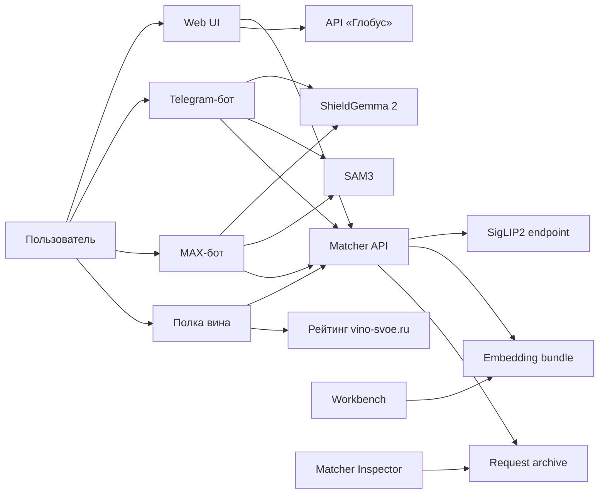

# Архитектура

Система разделяет пользовательские интерфейсы, matcher, model services и лабораторию.

## Компоненты

### Web UI

Nuxt принимает одну фотографию и вызывает свой route `POST /v1/eval/predict`.
Server route работает в `mock` или `upstream` mode. Браузер не видит upstream URL.
Web UI также содержит food recommendations и выключенный по умолчанию shelf mode.

### Telegram-бот

Бот принимает одиночные фотографии и albums. ShieldGemma 2 выполняет moderation.
SAM3 проверяет бутылку и этикетку. Затем бот запрашивает четыре кандидата через
`POST /v1/match?k=4`. Score и margin управляют ответом `Не уверен`.

### MAX-бот

MAX-бот повторяет функциональность Telegram-бота. Ядро обработки (очередь, moderation,
quality, matcher client, артефакты, файловые хранилища, HTTP API) — общий пакет
`chto_za_vino_core` в `im-core/`. Оба бота используют его. Административный интерфейс,
жизненный цикл данных и дозаполнение артефактов — проверяемые копии модулей Telegram-бота.
Транспорт, хранилище и настройки MAX-бота написаны для MAX Bot API. На время хакатона
production получает события через long polling (`updates.mode` в `config.yaml`).
Подробности: `max-bot/README.md`, `im-core/README.md`.

### Полка вина

`shelf-lens/` содержит Android-приложение «Полка вина». Пользователь ведёт камерой вдоль
полки. Детектор YOLOX-s на телефоне находит бутылки в кадре. Трекер на C++ (`shelf-lens/cpp/`)
даёт каждой физической бутылке один номер. Номер зависит от места бутылки на полке, а не от
её вида. Для каждой бутылки приложение отправляет в `POST /v1/match` одну лучшую вырезку.
Рейтинг вина приложение берёт из открытых данных vino-svoe.ru. Рамки и рейтинг приложение
рисует поверх изображения камеры. Из карты полки приложение строит планограмму.
Подробности: `shelf-lens/README.md`, `shelf-lens/docs/design.md`.

### Matcher

FastAPI service загружает один pipeline из `matcher/config.yaml`.
Текущий pipeline преобразует фотографию в SigLIP2 vector. Затем он выполняет cosine
search по `full` vectors из embedding bundle.

`POST /v1/eval/predict` возвращает Top-1 slug. `POST /v1/match` возвращает ranked
candidates и карточки вин. Bundle версии 2 содержит vectors и metadata. Bundle не
содержит model weights.

### Model services

`bootstrap/` предоставляет совместимые локальные endpoints для SigLIP2, SAM3,
ShieldGemma 2 и QR scanner. Сервисы читают локальные model snapshots. Они не требуют
доступа к Hugging Face во время работы.

Каждый SAM3 client читает базовый URL из `SAM3_ENDPOINT`.

### Workbench

Workbench хранит SQLite catalogue, test sets, image derivatives, experiment pipelines
и run artifacts. Он строит embedding indexes и экспортирует production bundle для
matcher. Production matcher не импортирует workbench и не читает `lab.sqlite3`.

### Картинки вин

Картинка вина — статический файл `https://chtozavino.ru/img/wines/<1600|400>/<slug>.webp`
(план `docs/plans/06_wine-images.md`). Файл — уменьшенная копия `main_patched`, а без неё —
`main`. `workbench/scripts/build_wine_images.py` строит релиз с `manifest.json`, Caddy
отдаёт его. `check_wine_images.py` сверяет файлы с базой каталога по SHA-256 при каждом
деплое картинок и каталога matcher. Matcher отдаёт этот адрес в `image_url`, а для вина без
картинки — `null`. Web UI строит адрес из slug и при ошибке загрузки показывает силуэт бутылки.

## Данные и безопасность

- Web UI держит загруженную фотографию в памяти.
- Telegram-бот записывает фотографию только после автоматической модерации.
- В Telegram-боте не прошедшие модерацию картинки хранятся отдельно и не передаются в matcher.
- Matcher MAY сохранять request archive, если настроен `output_dir`.
- API tokens читаются из environment variables.
- Administration UI и Matcher Inspector предназначены только для trusted LAN.

