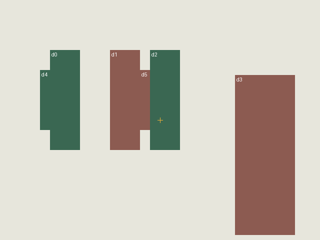
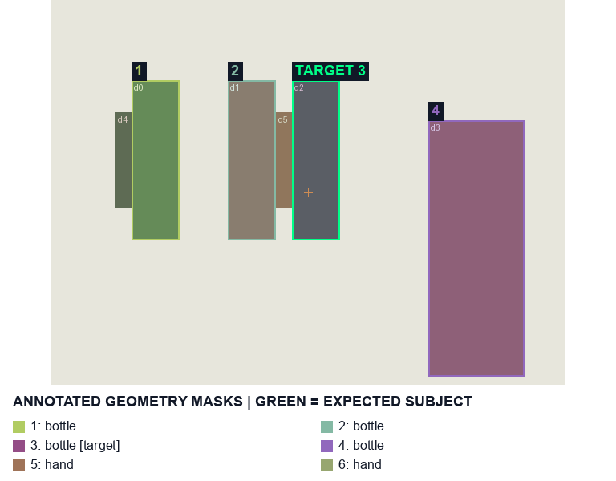

# fb-owner-and-uncertain-background A confirmed grip plus another uncertain hand cannot promote an unheld bottle

[All cases](../README.md) · [Group](../groups/review.md) · [Exact case metadata](../evidence/fb-owner-and-uncertain-background.json)

**scene-v1:** Contract N/A; fallback: target match  
**semantic-v2:** Recorded checks pass

## Expected result

- Group: `review`; provenance: `geometry_fixture`.
- Expected subject: `3`; acceptable IDs: `[3]`.
- Expected status: `selected`; expected selection mode: `fallback`.
- Interaction: `{}`.
- Annotation source: declared geometry fixture.
- Complete label GT: `False`.

Diagnostic geometry fixture, not a photograph or model output. The gold crosshair marks the photo center; no aim is supplied unless declared.

This is a diagnostic geometry fixture, not a photo. Annotated expected geometry and detector input masks are identified separately below. The new selector contract is not scored as legacy scene-v1 accuracy; target differences are shown only as observations.

## Original input and masks

| Mask ID | Category | Parent | Expected subject or label | Original binary PNG |
|---|---|---|---|---|
| `1` | bottle | `None` |  | [view raw mask](../assets/masks/fb-owner-and-uncertain-background-i1.png) |
| `2` | bottle | `None` |  | [view raw mask](../assets/masks/fb-owner-and-uncertain-background-i2.png) |
| `3` | bottle | `None` | yes | [view raw mask](../assets/masks/fb-owner-and-uncertain-background-i3.png) |
| `4` | bottle | `None` |  | [view raw mask](../assets/masks/fb-owner-and-uncertain-background-i4.png) |
| `5` | hand | `None` |  | [view raw mask](../assets/masks/fb-owner-and-uncertain-background-i5.png) |
| `6` | hand | `None` |  | [view raw mask](../assets/masks/fb-owner-and-uncertain-background-i6.png) |

## Declared detector input masks

These masks are the exact PNG bytes supplied as fixture detections. They may differ from the annotated expected geometry above. Source detector indices are not ground-truth instance IDs.

| Detector index | Class | Score | Input box | Original mask PNG |
|---|---|---:|---|---|
| `d0` | wine bottle | 0.9 | `[100, 100, 160, 300]` | [view input mask](../fixture-masks/fb-owner-and-uncertain-background-d0.png) |
| `d1` | wine bottle | 0.9 | `[220, 100, 280, 300]` | [view input mask](../fixture-masks/fb-owner-and-uncertain-background-d1.png) |
| `d2` | wine bottle | 0.9 | `[300, 100, 360, 300]` | [view input mask](../fixture-masks/fb-owner-and-uncertain-background-d2.png) |
| `d3` | wine bottle | 0.9 | `[470, 150, 590, 470]` | [view input mask](../fixture-masks/fb-owner-and-uncertain-background-d3.png) |
| `d4` | hand | 0.9 | `[80, 140, 100, 260]` | [view input mask](../fixture-masks/fb-owner-and-uncertain-background-d4.png) |
| `d5` | hand | 0.9 | `[280, 140, 300, 260]` | [view input mask](../fixture-masks/fb-owner-and-uncertain-background-d5.png) |

## Saved selector outputs

`live` replays saved detector responses; `controlled` uses declared GT-derived detections and faults. No new inference was run for this gallery. Expected-label retention below 98% is flagged separately from target matching. A full-frame crop can retain distractors.

### fallback

| Selector | Result | Assigned subject | Mode | Expected-label retention | Reason |
|---|---|---|---|---|---|
| `scene-v1` | LEGACY: TARGET MATCH (new contract not scored) | `3` | `legacy` | not scored | `existing_scene_v1_rank` |
| `semantic-v2` | Recorded checks pass | `3` | `fallback` | not scored | `fallback_center_contains` |

#### scene-v1 fallback crop

[View original selector keep mask](../assets/crops/fb-owner-and-uncertain-background-fallback-scene-v1-keep.png)

#### semantic-v2 fallback crop

[View original selector keep mask](../assets/crops/fb-owner-and-uncertain-background-fallback-semantic-v2-keep.png)
