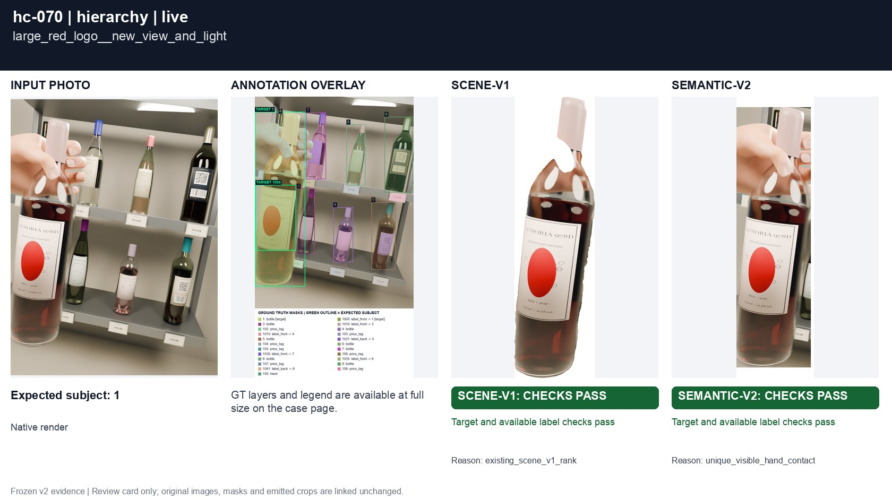
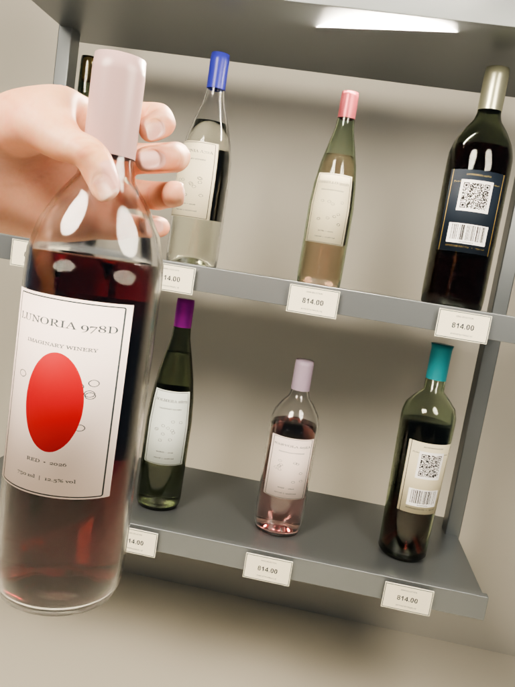
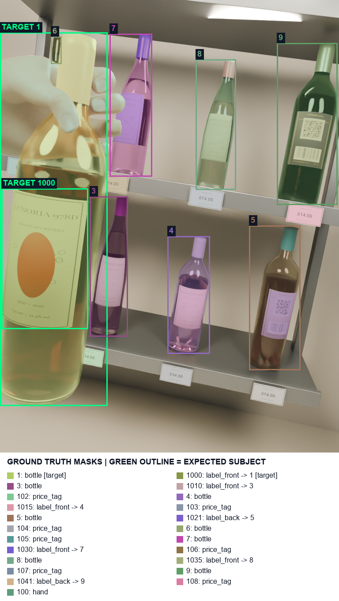
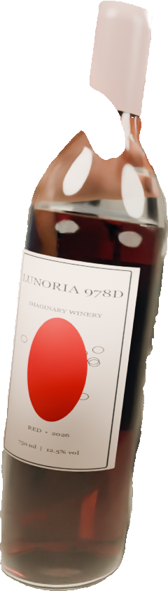
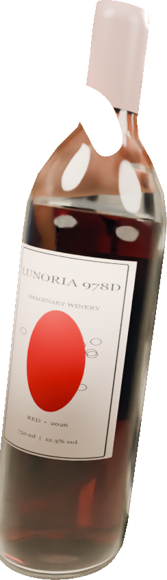
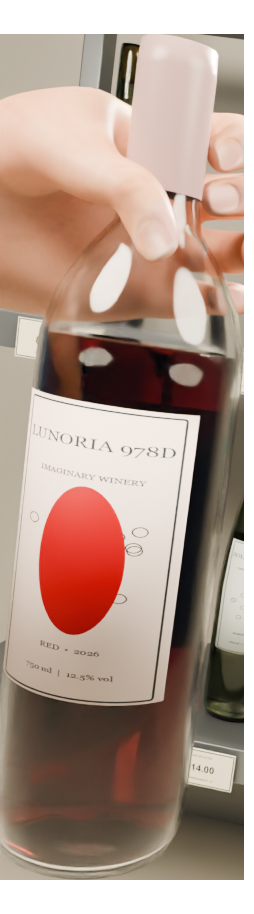

# hc-070 large_red_logo__new_view_and_light

[All cases](../README.md) · [Group](../groups/hierarchy.md) · [Exact case metadata](../evidence/hc-070.json)

**scene-v1:** Recorded checks pass  
**semantic-v2:** Recorded checks pass

## Expected result

- Group: `hierarchy`; provenance: `new_native_render`.
- Expected subject: `1`; acceptable IDs: `[1]`.
- Expected status: `selected`; expected selection mode: `not constrained`.
- Interaction: `{}`.
- Annotation source: native opaque visible geometry.
- Complete label GT: `True`.

## Original input and masks

| Mask ID | Category | Parent | Expected subject or label | Original binary PNG |
|---|---|---|---|---|
| `1` | bottle | `None` | yes | [view raw mask](../assets/masks/hc-070-i1.png) |
| `1000` | label_front | `1` | yes | [view raw mask](../assets/masks/hc-070-i1000.png) |
| `3` | bottle | `None` |  | [view raw mask](../assets/masks/hc-070-i3.png) |
| `1010` | label_front | `3` |  | [view raw mask](../assets/masks/hc-070-i1010.png) |
| `102` | price_tag | `None` |  | [view raw mask](../assets/masks/hc-070-i102.png) |
| `4` | bottle | `None` |  | [view raw mask](../assets/masks/hc-070-i4.png) |
| `1015` | label_front | `4` |  | [view raw mask](../assets/masks/hc-070-i1015.png) |
| `103` | price_tag | `None` |  | [view raw mask](../assets/masks/hc-070-i103.png) |
| `5` | bottle | `None` |  | [view raw mask](../assets/masks/hc-070-i5.png) |
| `1021` | label_back | `5` |  | [view raw mask](../assets/masks/hc-070-i1021.png) |
| `104` | price_tag | `None` |  | [view raw mask](../assets/masks/hc-070-i104.png) |
| `6` | bottle | `None` |  | [view raw mask](../assets/masks/hc-070-i6.png) |
| `105` | price_tag | `None` |  | [view raw mask](../assets/masks/hc-070-i105.png) |
| `7` | bottle | `None` |  | [view raw mask](../assets/masks/hc-070-i7.png) |
| `1030` | label_front | `7` |  | [view raw mask](../assets/masks/hc-070-i1030.png) |
| `106` | price_tag | `None` |  | [view raw mask](../assets/masks/hc-070-i106.png) |
| `8` | bottle | `None` |  | [view raw mask](../assets/masks/hc-070-i8.png) |
| `1035` | label_front | `8` |  | [view raw mask](../assets/masks/hc-070-i1035.png) |
| `107` | price_tag | `None` |  | [view raw mask](../assets/masks/hc-070-i107.png) |
| `9` | bottle | `None` |  | [view raw mask](../assets/masks/hc-070-i9.png) |
| `1041` | label_back | `9` |  | [view raw mask](../assets/masks/hc-070-i1041.png) |
| `108` | price_tag | `None` |  | [view raw mask](../assets/masks/hc-070-i108.png) |
| `100` | hand | `None` |  | [view raw mask](../assets/masks/hc-070-i100.png) |

## Saved selector outputs

`live` replays saved detector responses; `controlled` uses declared GT-derived detections and faults. No new inference was run for this gallery. Expected-label retention below 98% is flagged separately from target matching. A full-frame crop can retain distractors.

### live

| Selector | Result | Assigned subject | Mode | Expected-label retention | Reason |
|---|---|---|---|---|---|
| `scene-v1` | Recorded checks pass | `1` | `legacy` | 99.42% | `existing_scene_v1_rank` |
| `semantic-v2` | Recorded checks pass | `1` | `confident` | 100.00% | `unique_visible_hand_contact` |

#### scene-v1 live crop

[View original selector keep mask](../assets/crops/hc-070-live-scene-v1-keep.png)

#### semantic-v2 live crop

[View original selector keep mask](../assets/crops/hc-070-live-semantic-v2-keep.png)

Label crop views: [view 1](../assets/crops/hc-070-live-semantic-v2-label-0.png), [view 2](../assets/crops/hc-070-live-semantic-v2-label-1.png), [view 3](../assets/crops/hc-070-live-semantic-v2-label-2.png).
### controlled

| Selector | Result | Assigned subject | Mode | Expected-label retention | Reason |
|---|---|---|---|---|---|
| `scene-v1` | Recorded checks pass | `1` | `legacy` | 100.00% | `existing_scene_v1_rank` |
| `semantic-v2` | Recorded checks pass | `1` | `confident` | 100.00% | `unique_visible_hand_contact` |

#### scene-v1 controlled crop

[View original selector keep mask](../assets/crops/hc-070-controlled-scene-v1-keep.png)

#### semantic-v2 controlled crop

[View original selector keep mask](../assets/crops/hc-070-controlled-semantic-v2-keep.png)

Label crop views: [view 1](../assets/crops/hc-070-controlled-semantic-v2-label-0.png), [view 2](../assets/crops/hc-070-controlled-semantic-v2-label-1.png), [view 3](../assets/crops/hc-070-controlled-semantic-v2-label-2.png).
