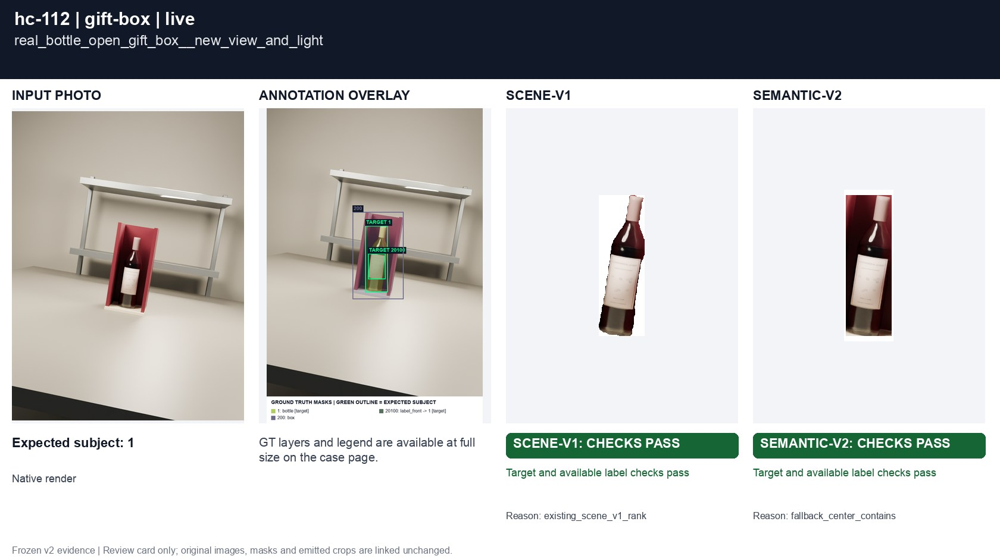
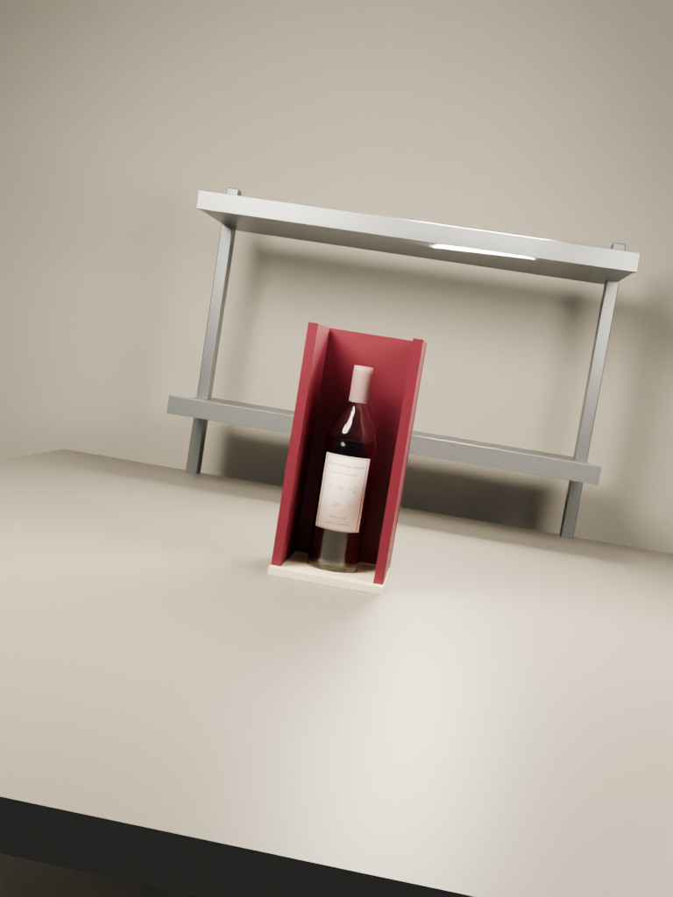
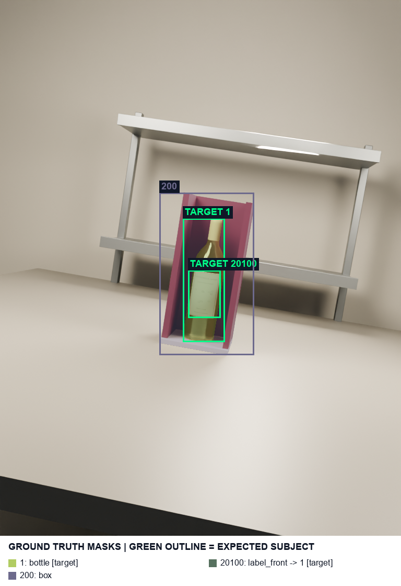
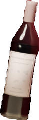
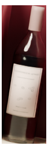
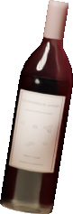
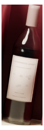

# hc-112 real_bottle_open_gift_box__new_view_and_light

[All cases](../README.md) · [Group](../groups/gift-box.md) · [Exact case metadata](../evidence/hc-112.json)

**scene-v1:** Recorded checks pass  
**semantic-v2:** Recorded checks pass

## Expected result

- Group: `gift-box`; provenance: `new_native_render`.
- Expected subject: `1`; acceptable IDs: `[1]`.
- Expected status: `selected`; expected selection mode: `not constrained`.
- Interaction: `{}`.
- Annotation source: native opaque visible geometry.
- Complete label GT: `True`.

Staged intended subject declared in the scene recipe before rendering and before selector predictions.

## Original input and masks

| Mask ID | Category | Parent | Expected subject or label | Original binary PNG |
|---|---|---|---|---|
| `1` | bottle | `None` | yes | [view raw mask](../assets/masks/hc-112-i1.png) |
| `20100` | label_front | `1` | yes | [view raw mask](../assets/masks/hc-112-i20100.png) |
| `200` | box | `None` |  | [view raw mask](../assets/masks/hc-112-i200.png) |

## Saved selector outputs

`live` replays saved detector responses; `controlled` uses declared GT-derived detections and faults. No new inference was run for this gallery. Expected-label retention below 98% is flagged separately from target matching. A full-frame crop can retain distractors.

### live

| Selector | Result | Assigned subject | Mode | Expected-label retention | Reason |
|---|---|---|---|---|---|
| `scene-v1` | Recorded checks pass | `1` | `legacy` | 100.00% | `existing_scene_v1_rank` |
| `semantic-v2` | Recorded checks pass | `1` | `fallback` | 100.00% | `fallback_center_contains` |

#### scene-v1 live crop

[View original selector keep mask](../assets/crops/hc-112-live-scene-v1-keep.png)

#### semantic-v2 live crop

[View original selector keep mask](../assets/crops/hc-112-live-semantic-v2-keep.png)

Label crop views: [view 1](../assets/crops/hc-112-live-semantic-v2-label-0.png).
### controlled

| Selector | Result | Assigned subject | Mode | Expected-label retention | Reason |
|---|---|---|---|---|---|
| `scene-v1` | Recorded checks pass | `1` | `legacy` | 100.00% | `existing_scene_v1_rank` |
| `semantic-v2` | Recorded checks pass | `1` | `fallback` | 100.00% | `fallback_center_contains` |

#### scene-v1 controlled crop

[View original selector keep mask](../assets/crops/hc-112-controlled-scene-v1-keep.png)

#### semantic-v2 controlled crop

[View original selector keep mask](../assets/crops/hc-112-controlled-semantic-v2-keep.png)

Label crop views: [view 1](../assets/crops/hc-112-controlled-semantic-v2-label-0.png).
