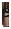

# real-166918 long_dinner_table_with_repeated_bottles

[All cases](../README.md) · [Group](../groups/ambiguity.md) · [Exact case metadata](../evidence/real-166918.json)

**scene-v1:** **FAIL** live: WRONG TARGET  
**semantic-v2:** **FAIL** live: WRONG TARGET

## Expected result

- Group: `ambiguity`; provenance: `coco_real_photo`.
- Expected subject: `1865335`; acceptable IDs: `[1482938, 1485829, 1865335, 1872990, 1873065]`.
- Expected status: `selected`; expected selection mode: `fallback`.
- Interaction: `{}`.
- Annotation source: COCO bottle polygons; Codex visual target review before evaluation, not independently adjudicated; background instance coverage can be incomplete.
- Complete label GT: `False`.

No unique intended bottle. The annotated crop target follows the revised photo-center / pixel-distance / left / upper policy; this is a product fallback, not evidence of user intent.

COCO image `166918` · [original source](http://images.cocodataset.org/val2017/000000166918.jpg) · [Flickr source](http://farm5.staticflickr.com/4117/4745624149_369a63786e_z.jpg) · [license: Attribution License](http://creativecommons.org/licenses/by/2.0/).

Real targets are developer judgments, not independently adjudicated user intent. COCO competitor coverage may be incomplete; no hand or complete-label ground truth is invented.

## Original input and masks

| Mask ID | Category | Parent | Expected subject or label | Original binary PNG |
|---|---|---|---|---|
| `1482938` | bottle | `None` |  | [view raw mask](../assets/masks/real-166918-i1482938.png) |
| `1485829` | bottle | `None` |  | [view raw mask](../assets/masks/real-166918-i1485829.png) |
| `1865335` | bottle | `None` | yes | [view raw mask](../assets/masks/real-166918-i1865335.png) |
| `1872990` | bottle | `None` |  | [view raw mask](../assets/masks/real-166918-i1872990.png) |
| `1873065` | bottle | `None` |  | [view raw mask](../assets/masks/real-166918-i1873065.png) |

## Saved selector outputs

`live` replays saved detector responses; `controlled` uses declared GT-derived detections and faults. No new inference was run for this gallery. Expected-label retention below 98% is flagged separately from target matching. A full-frame crop can retain distractors.

### live

| Selector | Result | Assigned subject | Mode | Expected-label retention | Reason |
|---|---|---|---|---|---|
| `scene-v1` | **FAIL: WRONG TARGET** | `1482938` | `legacy` | not scored | `existing_scene_v1_rank` |
| `semantic-v2` | **FAIL: WRONG TARGET** | `None` | `fallback` | not scored | `fallback_nearest_center` |

#### scene-v1 live crop

[View original selector keep mask](../assets/crops/real-166918-live-scene-v1-keep.png)

#### semantic-v2 live crop

[View original selector keep mask](../assets/crops/real-166918-live-semantic-v2-keep.png)
