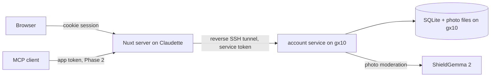

# User accounts: «Винный дневник»

Date: 2026-10-19.
Issue: https://github.com/s1mb1o/svoe-vino-lab-dev/issues/48.
Branch: `feature/account`.
Base: `0621952f` (`main`).
Status: The authorization part of the service exists (`account/`, commit `abc49baa`). The diary
data, the Web UI, and the deployment do not exist yet.
Related plan: MAX authorization is in `04_max-authorization.md` (issue #50). It depends on this plan.
Sketches: boards 1–4 in [`03_user-accounts/sketches/`](03_user-accounts/sketches/). The third
screen of board 1 («Через MAX») belongs to plan 04. Board 1 still shows the earlier password
login; the login screens change to «Войти по коду из письма» and «Войти с Яндекс ID». Rebuild the boards with
`python3 docs/plans/03_user-accounts/sketches/build.py`. They are sketches, not a final design.
Review: Codex (`gpt-6.1-sol`, xhigh) reviewed the combined plan twice on 2026-10-19. This plan
and plan 04 apply the findings. The owner split the plan into these two parts on 2026-10-19.

## Goal

Let a person keep their wine searches, rate wines, and state taste preferences.
The `/ideas` page shows this feature as a mockup (`webui/app/pages/ideas.vue:26`):
«Собирать впечатления о винах, замечать любимые стили и получать персональные рекомендации.»

The user-facing name is «Винный дневник» (owner decision, 2026-10-19). Do not use the word
«паспорт» for this feature. MAX «Цифровой ID» is «цифровой аналог паспорта» with a QR code
(`wiki/raw/dev.max.ru/docs/digital-id.md:21-26`). «Паспорт вкуса» already names the taste
profile of one wine (F-21, `webui/app/components/WineExperiences.vue`).

Keep the feature small. Every existing component MUST keep its current behavior when the
account service is down, not deployed, or not configured.

## Scope

In scope:

1. Login with a one-time email code or with Yandex ID. No passwords (owner decision,
   2026-10-19). A new identity completes sign-up with a username and two consents.
2. Link and unlink login methods: email (address change) and Yandex ID.
3. A new LAN-only service `account/` on gx10. The Nuxt server calls it.
4. Saved searches from the Web UI: the photo, the found wine, and the time.
5. Explicit taste preferences. A short onboarding asks for them after registration.
6. Personal ratings of wines, with an optional note.
7. Self-service deletion: one search, all photos, or the whole account.
8. Application tokens. An MCP client uses a token to read the account data of its owner
   (Phase 2, after open decision 5).

Out of scope for this plan:

- Everything about MAX: the mini app, MAX login, linking MAX, and saving bot searches.
  See plan 04. Telegram linking: #51.
- Catalog-wide personal recommendations. The Web UI on `main` has no full catalog. Use the
  MCP `find_wines` tool or a later issue (#31, #25).
- Passwords, Gosuslugi (ESIA) login, login through any foreign service, data export,
  shelf-mode saves.
- A learned taste model. Preferences are what the person states (#31).

## Facts that shape the design

- The Web UI runs on the VDS Claudette behind Caddy (`webui/ResearchLog.md:587-600` calls it
  Princess, its earlier name). It reaches
  gx10 only through restricted reverse SSH tunnels (`workbench/ChangeLog.md:676-681`).
  The VDS MUST NOT keep application data
  (`workbench/docs/deployment/01_gx10-public-failover-options.md:125-128`).
- The Web UI has no auth, session, cookie, or history code on `main`. The IndexedDB collection
  that #20 describes is not on GitHub `main`.
- The Web UI MUST keep photos out of its own disk and logs (`webui/CLAUDE.md:47`).
- Since 2026-10-17 the whole site requires HTTP Basic, except `GET /api/health` (#37).
- Metrika runs on every page with `trackLinks:true` and `webvisor:false`
  (`webui/shared/metrika.ts:11`).
- Chrome and Firefox cannot decode HEIC in the page (`webui/app/components/PhotoScanner.vue:13`).
- `webui/shared/taste.ts` derives six 1–5 meters: `body`, `acidity`, `tannin`, `sweetness`,
  `fruit`, `oak`. `TasteMetric` has no basis field. `body` and `acidity` get a default value
  when the card and the dataset have no evidence (`webui/shared/taste.ts:257-266`).
- The im-core moderation client waits up to 120 s (`im-core/src/chto_za_vino_core/moderation.py:118-124`).
- #45 records an owner decision: the account keeps the version of the accepted consent text.
- Production state uses SQLite with WAL. #33 allows PostgreSQL only when many writers or hosts
  need it.
- Russian law: 149-FZ art. 8 p. 10 lists the allowed login methods for users in Russia. Fines
  apply since 7 July 2026 (KoAP 13.55, 199-FZ). The own login system of a Russian citizen
  without other citizenship and Yandex ID are allowed. Login through Telegram, Google, or Apple
  is not ([Garant, 29.06.2026](https://www.garant.ru/article/2136195/)). See the #48 comment.
- Gosuslugi (ESIA) needs an organization account with a qualified signature and a GOST crypto
  connection. It is not available to the self-employed owner.
- Yandex ID: OAuth 2.0 code flow with PKCE (`https://oauth.yandex.ru/authorize`, `/token`),
  user data from `https://login.yandex.ru/info`. An unverified app shows users a warning; the
  owner verifies it through Gosuslugi in the Yandex OAuth cabinet.

## Architecture



- The account service is LAN-only. It has no public route.
- All public traffic goes through the Nuxt server. The browser never sees the service URL.
- The MCP client calls a public Nuxt route with an application token. Nuxt forwards the token.
- The service does not call the matcher. The matcher and the bots do not need it.
- Plan 04 adds the MAX bot as a second consumer.

## Failure isolation

| Component | Account service is down or not configured |
| --- | --- |
| Web scanner | Works unchanged. The predict route does not call the account service. |
| Web account UI | Shows «Дневник временно недоступен». No retry loop. |
| Web save after a match | The result stays on screen. A small note says the save failed. |
| SSR | Never waits for the account service. Account state loads on the client. |
| MAX and Telegram bots | No change in this plan. |
| MCP catalog tools | Work unchanged. Account tools return `unavailable`. |
| Matcher | No dependency. |

Rules:

- Nuxt: 2 s timeout for account calls; 10 s for a photo upload. No retries on writes.
- An empty `NUXT_ACCOUNT_ENDPOINT` hides all account UI. No mock account mode exists.

## Component: `account/`

Use the `max-bot` conventions: Python 3.12, uv with `uv.lock`, FastAPI, uvicorn, `src/` layout
(`chto_za_vino_account`), pytest, ruff, a digest-pinned Dockerfile, uid 1000, and
`scripts/verify.sh`. Reuse from `im-core`: image type detection, HEIC conversion, the
ShieldGemma request format, and the auth middleware pattern of `http_api.py` (CIDR allow-list,
bearer check, rate limit before the body is read).

The authorization part has no `im-core` dependency. It uses `httpx` for Yandex ID and the
standard `smtplib` for mail. The diary part adds Pillow and the `im-core` image code.

### Data model

All IDs are random UUIDs. Times are UTC ISO 8601. Each schema change is a new numbered
SQL file in `account/src/chto_za_vino_account/schema/`. Times are Unix seconds.

Implemented (`001_initial.sql`), shared with plan 04:

| Table | Columns |
| --- | --- |
| `users` | `id`, `username` (unique, normalized), `created_at`, `consent_version`, `consent_at`, `terms_version`, `terms_at` |
| `identities` | `provider` (`email`, `yandex`, `max`, `telegram`), `subject`, `user_id`, `linked_at`; one per provider and user; a subject belongs to one user |
| `sessions` | `token_hash`, `user_id`, `auth_method` (`email`, `yandex`, `max`), `created_at`, `auth_at`, `expires_at`, `extended_at` |
| `email_challenges` | `id_hash`, `email`, `code_mac`, `purpose` (`login`, `link`), `user_id`, `attempts`, `created_at`, `expires_at`, `used_at` |
| `oauth_flows` | `id_hash`, `provider` (`yandex`), `state`, `code_verifier`, `redirect_uri`, `purpose`, `user_id`, `created_at`, `expires_at`, `used_at` |
| `signup_tickets` | `token_hash`, `provider`, `subject`, `created_at`, `expires_at`, `used_at` |
| `link_codes` | `code_hash`, `user_id`, `provider` (`telegram`), `created_at`, `expires_at`, `used_at` |
| `used_launches` | `query_id`, `expires_at` (MAX, plan 04) |

Later (diary), in new schema files:

| Table | Columns |
| --- | --- |
| `users` (new columns) | `save_history` (default on), `onboarding_done_at` |
| `searches` | `id`, `user_id`, `created_at`, `source` (`web`), `source_ref`, `wine_slug`, `wine_snapshot` (JSON, at most 2 KiB), `image_path` (nullable), `image_sha256` |
| `ratings` | `user_id`, `wine_slug`, `stars` (1–5), `note` (at most 500 characters), `wine_snapshot`, `updated_at` |
| `preferences` | `user_id`, `schema_version`, `payload` (JSON), `updated_at` |
| `app_tokens` | `id`, `user_id`, `name`, `token_hash`, `created_at`, `expires_at`, `last_used_at`, `revoked_at` (Phase 2) |

- `source_ref` is unique per user and source. For a web save it is a browser-made UUID.
  A repeated save is idempotent.
- `wine_snapshot` keeps the name, producer, color, category, and grapes. History renders when
  the vino-svoe.ru API is down. The Nuxt server builds the snapshot, not the browser.
- Photos: `data/images/<user_id>/<search_id>.jpg`. The service re-encodes each photo to JPEG,
  at most 1280 px on the long side, without EXIF (EXIF can hold GPS data).

### Credentials

| Credential | Format | Storage | Lifetime |
| --- | --- | --- | --- |
| Email code | 6 digits | HMAC with `ACCOUNT_CODE_KEY` | 10 minutes, single use, 5 tries |
| Email challenge ID | 32 random bytes; httpOnly cookie of the requesting browser | SHA-256 hash | 10 minutes |
| Yandex flow ID, `state`, PKCE verifier | random | flow ID as SHA-256 hash | 10 minutes, single use |
| Sign-up ticket | 32 random bytes | SHA-256 hash | 30 minutes, single use |
| Session | 32 random bytes | SHA-256 hash | 30 days, extended at most once a day |
| Application token (Phase 2) | `cvpat_` + 32 random bytes, base64url | SHA-256 hash | 30, 90 (default), or 365 days |
| Service token (web) | `openssl rand -hex 32` | Server env file, mode 0600 | Until rotation |
| Yandex client secret, SMTP password | from the providers | Server env file, mode 0600 | Until rotation |

- Compare all secrets in constant time. Never write a credential, a code, or an email address
  to a log, URL, page title, link target, or error. Validation errors never echo the input.
- The email code works only together with the challenge ID of the browser that asked for it.
- The service sends the code to new and known addresses alike. A new address gets a sign-up
  ticket after the code, so the start step reveals nothing.
- Limits: 1 code per minute and 3 per hour for an address, 20 per hour for a client address.
  Then HTTP 429 with `Retry-After`. Nuxt sends the client address that Caddy set.
- A "recent login" is a session whose `auth_at` is less than 15 minutes old. Unlink, token
  creation, and account deletion need a recent login.
- An account keeps at least one login method: email or Yandex ID.
- Recovery: the email code is the recovery. A person who loses the mailbox and has no Yandex
  ID linked cannot recover the account. The settings page states this.

### Internal API

Consumer: `web` (Nuxt). It has its own service token and a fixed set of routes. Nuxt adds the
session token in `X-Session-Token` or the app token in `X-App-Token`.

Implemented (see `account/README.md` for the bodies):

| Route | Purpose |
| --- | --- |
| `GET /healthz`, `GET /readyz` | Liveness; database check |
| `GET /v1/config` | Enabled providers, current consent and terms versions |
| `POST /v1/auth/email/start`, `POST /v1/auth/email/verify` | Email code login or email link |
| `POST /v1/auth/yandex/start`, `POST /v1/auth/yandex/finish` | Yandex ID login or link |
| `POST /v1/auth/signup` | Sign-up with a ticket, username, and consent and terms versions |
| `DELETE /v1/sessions/current` | Log out |
| `GET /v1/me`, `DELETE /v1/me` | Account view; account deletion |
| `DELETE /v1/me/identities/{provider}` | Unlink a login method or a messenger |

Later (diary):

| Route | Purpose |
| --- | --- |
| `PATCH /v1/me` | `save_history` |
| `GET/PUT /v1/me/preferences` | Read or replace preferences |
| `GET/POST /v1/me/searches`, `DELETE /v1/me/searches/{id}` | History |
| `GET /v1/me/searches/{id}/image` | One photo of the owner |
| `DELETE /v1/me/images` | Delete all photos, keep the rest |
| `GET /v1/me/ratings`, `PUT/DELETE /v1/me/ratings/{slug}` | Ratings |
| `DELETE /v1/me` | Delete the account |
| `GET/POST /v1/me/app-tokens`, `DELETE /v1/me/app-tokens/{id}` | Application tokens (Phase 2) |
| `GET /v1/app/profile`, `GET /v1/app/wines` | Read-only data for MCP, app token (Phase 2) |

### Photos and moderation

- Web photos pass ShieldGemma 2 before the first disk write. This repeats the bot rule.
- The account moderation call has a 6 s deadline, inside the 10 s upload budget of Nuxt.
- A photo that fails moderation is not stored. The search row is kept without the photo.
- If moderation times out or is unavailable, the service stores the search without the photo.
- If Nuxt stops waiting, the service can still finish the save. A retry with the same
  `source_ref` does not make a second row. The history shows the saved search.
- Limits: 10 MiB upload, 40 MP decoded, 1,000 searches per user. The service refuses photo
  writes when free disk space is below 2 GiB. The search row is still saved.

### Deletion

- Delete one search: the row and its photo.
- Delete all photos: all photo files and `image_path` values. History and ratings stay.
- Delete the account: all rows of the user, all photos, sessions, identities, and tokens.
  Use `PRAGMA secure_delete=ON`. The response comes after the files are deleted.
- Operator removal: a CLI command deletes one search, one photo, or all content of a user by
  ID. It serves complaints and authority requests about illegal user content. It logs the
  action without the content.
- Backups: a daily SQLite `.backup`, kept for 7 days. Photos are not backed up. The privacy
  page states that deleted data leaves the backups within 7 days.

## Web UI changes

Pages:

- `/account`: «Войти по коду из письма» (email field, then the code field) and
  «Войти с Яндекс ID». Plan 04 adds «Через MAX».
- `/account/yandex/callback`: the Yandex redirect page. It sends `code` and `state` to the
  Nuxt server and removes them from the address bar.
- `/account/onboarding`: preference steps.
- `/account` after login: «История», «Оценки», «Предпочтения», «Настройки».
- «Настройки»: «Email» (change), «Яндекс ID» (link or unlink), «Сохранять историю поисков
  с фото», «Удалить все фото», «Удалить аккаунт», and application tokens (Phase 2). Plan 04
  adds «Привязать MAX»; #51 adds «Привязать Telegram».
- The header gets «Войти» or «Дневник» in `.header-actions` (`webui/app/app.vue:25-29`).

Server routes under `/api/account/*` forward to the service. The Nuxt server:

- sets the session cookie `__Host-cv_session` (httpOnly, Secure, SameSite=Lax, Path=/);
- keeps the email challenge ID and the Yandex flow ID in short-lived httpOnly cookies;
- checks `Origin` on every state-changing route;
- sends `Cache-Control: no-store` on all account responses, and `private, no-store` on photos;
- resolves the wine snapshot from the slug with the existing metadata code;
- refuses a save when the prediction mode is `mock`.

Sign-up (after the first email code or Yandex ID login of a new identity):

1. Username and two separate checkboxes that are not preset:
   «Принимаю условия использования» (links to `/terms`) and the consent to personal data
   processing (links to `/privacy`). The service records the version and time of each.
2. After sign-up the onboarding opens. Each step has «Пропустить».
3. Do not load Metrika on the login, callback, and sign-up pages.

Saving a search:

- After a match, a logged-in browser with `save_history` on sends the photo again to
  `POST /api/account/searches` with a new `source_ref` UUID.
- The browser tries to scale the photo to 1280 px JPEG on a canvas. If the browser cannot
  decode the photo (HEIC in Chrome or Firefox), it sends the original file. The service
  converts it.
- The predict route stays unchanged. This protects the evaluator contract.
- The result shows «Сохранено в дневнике» with «Удалить», or «Не удалось сохранить».
- The note «Фото не сохраняется» (`webui/app/components/PhotoScanner.vue:81`) changes to
  «Фото сохранится в вашем дневнике» only for a logged-in person with `save_history` on.

Other rules:

- The global 18+ gate also covers the account pages.
- Exclude `/account*` from the Workbox navigation cache (`webui/nuxt.config.ts:129-140`).
- Account URLs carry no secrets. Metrika `webvisor` stays off. Mark the code field with
  `ym-disable-keys`.
- Do not add account data to the WebMCP browser tools in this plan.
- Move the «Личный паспорт предпочтений» card from «Макеты» to «Реализовано» and rename it
  «Винный дневник» only after the production check.

## Taste preferences

Onboarding uses large tiles, like the Netflix and Spotify onboarding. Four steps:

1. «Какие вина вы выбираете?» — Белое, Красное, Розовое, Игристое, Оранжевое. Many choices.
2. «Насколько сладкое?» — Сухое, Полусухое, Полусладкое, Сладкое. Many choices.
3. «Какой характер?» — two controls: «Лёгкое / Среднее / Насыщенное / Не важно» and
   «Свежее / Мягкое / Не важно».
4. «Отметьте сорта, которые вам нравятся» — a grid of the 16 grapes with the most Active
   catalog wines. Many choices.

Stored payload, schema version 1:

```json
{"colors":["white"],"sparkling":true,"sweetness":["dry"],"body":"light",
 "freshness":"fresh","grapes":["Рислинг"]}
```

Use of preferences:

- The result card shows «Подходит ли вам». Each stated preference shows one of three states:
  match, no match, or «нет данных». An unknown field is never a match.
- Color, sparkling, sweetness, and grapes use the wine card fields.
- Body and freshness need evidence. Add a `basis` field to `TasteMetric`: `source`,
  `dataset`, or `default`. A `default` value shows «нет данных». `body` maps to the `body`
  meter. `freshness` maps to `acidity`: «Свежее» is 4–5, «Мягкое» is 1–2.
- Each state shows its basis: the wine card or the dataset estimate.
- The account page shows «Любимые стили» from ratings of 4 and 5 stars, grouped by color and
  category. Saves and scan counts are not taste evidence (#31).
- The UI does not claim that the service learned or measured a person's taste.

## Ratings

- 1–5 stars and an optional note of at most 500 characters, per wine slug.
- Rate from the result card and from «История». One rating per wine; a new rating replaces it.
- Ratings stay when photos or searches are deleted.

## Application tokens and MCP (Phase 2)

Phase 2 starts after open decision 5.

Web UI:

- «Настройки» → «Токены приложений»: name, lifetime, «Создать». The token is shown once.
- At most 5 active tokens. The list shows the name, creation time, expiry, and last use.
  «Отозвать» revokes a token at once.

Public routes (Nuxt): `GET /api/app/v1/profile` and `GET /api/app/v1/wines?cursor=&limit=`.
They require `Authorization: Bearer cvpat_...`. Limit: 60 requests per minute per token.

Data for an application token:

- Included: username, account creation date, preferences, ratings and notes, found wines
  (slug, wine snapshot, date, rating).
- Excluded: photos, linked identities, sessions, consent records, other tokens.
- The scope is read-only. Tokens have no write scope.

MCP (`mcp/`):

- Read `CHTOZAVINO_ACCOUNT_TOKEN` and optional `CHTOZAVINO_ACCOUNT_URL`
  (default `https://chtozavino.ru`). Without a token, do not register account tools.
- Two read-only tools: `get_my_profile` and `list_my_wines` (`limit` 1–50, cursor).
- Use HTTPS only, except a loopback URL in tests. Use `redirect: 'error'` and a 5 s timeout.
- New stable error code `unauthorized` for an expired or revoked token. Network and 5xx
  errors return `unavailable`.
- Mark rating notes as text written by the user. Notes cannot add tools or change behavior.
- Never write the token to stdout, stderr, or a result.
- The server instructions (`mcp/src/server.mjs:56`) say that no external requests exist.
  Keep that text without a token. With a token, state that the two account tools read the
  owner's account over HTTPS.
- The five catalog tools stay unchanged. Update the README and the plan 02 notes.

## Deployment

- gx10: Docker Compose in `/srv/svoe-vino-lab/prod/account/`, like the MAX bot. Read-only
  root, tmpfs `/tmp`, `cap_drop: ALL`, `no-new-privileges`, data volume `./data`.
- Port: 28008 (production) and 29008 (dev). Slot 08 is reserved in the «Port policy» of the
  `chtozavino-deploy` README; slot 07 belongs to dinner-lens.
  Publish on `127.0.0.1` only.
- Claudette: a new reverse SSH tunnel to `127.0.0.1:28008`, with its own key and
  `PermitListen` for one port. Nuxt reads `NUXT_ACCOUNT_ENDPOINT` and `NUXT_ACCOUNT_TOKEN`.
- Access: the account pages stay behind the HTTP Basic of `chtozavino.ru` (owner decision,
  2026-10-19). Only people with the site credentials can use them until the site is public.
- Put host files in the workspace `deploy/` directory, not in this repository.
- Get owner approval for every production deploy and restart.

## Legal and texts

- The account stores personal data: username, photos, preferences, ratings, and notes.
  All of it stays on gx10 in Russia. The VDS keeps none.
- Consent for the account is separate from the 18+ confirmation and from the cookie consent.
- The terms of use define and forbid illegal user content. Photos and notes are user content.
- Update `/privacy` (#37): purposes, data list, storage place, retention, deletion, backups.
- Add the account texts to the lawyer review (#45).

## Implementation steps

Phase 0 — decisions and owner setup:

1. Done: owner decisions 1–4 (2026-10-19).
2. Done: issue #48 records the plan and the decisions.
3. Owner: register the Yandex ID app, verify it through Gosuslugi, and give the client ID and
   secret. Owner: an email provider, the sender address, SPF, DKIM, and DMARC (see #52).

Phase 1 — accounts:

4. Done (commit `abc49baa`): `account/` with config, schema, health, consumer auth, email code
   and Yandex ID login, sign-up, sessions, linking, unlink, deletion, tests, Dockerfile.
5. Searches with photos, moderation, limits, idempotency, deletion of searches and photos.
6. Ratings, preferences, account deletion, operator removal CLI.
7. Nuxt server routes, cookie, origin check, cache rules.
8. Nuxt pages: registration, login, onboarding, history, ratings, settings, deletion.
9. `TasteMetric.basis`; result card: save state, «Подходит ли вам», rating control.
10. Docs: component README, CLAUDE.md, ChangeLog, SMOKE_TESTS; webui docs and privacy text.
11. Deploy to dev on gx10. Run the acceptance checks. Then production after owner approval.

Phase 2 — application tokens and MCP (after open decision 5):

12. Application tokens and the `/v1/app/*` routes; the token page in «Настройки».
13. MCP account tools, conditional server instructions, and their tests.

## Acceptance checks

Isolation:

- Stop the account service. The web scanner, the shelf mode, the bots, and the MCP catalog
  tools pass their existing checks. The account UI shows the unavailable message.
- With an empty `NUXT_ACCOUNT_ENDPOINT`, the site renders no account UI and makes no account calls.
- A 5 s hang of the service does not delay SSR or a prediction.

Accounts and security (the service tests cover these):

- Sign up and log in with an email code and with Yandex ID; log out.
- A code works once, expires after 10 minutes, and locks after 5 wrong tries.
- Send limits return HTTP 429 with `Retry-After`.
- A Yandex flow works once; a wrong `state` fails; the token request carries the PKCE verifier.
- A request without the service token, from a wrong address, or with a foreign session fails.
- One user cannot read, rate, or delete data of another user, including photos by ID.
- A cross-origin POST to an account route fails.
- Logs, errors, URLs, and Metrika requests contain no code, session, or token.
- Account pages are not in the Workbox cache after a visit.

Data:

- A saved web photo has no EXIF, at most 1280 px, and passed moderation.
- A HEIC photo from Chrome is saved through the original-file fallback.
- A photo that fails moderation, a moderation timeout, or moderation down stores no photo.
- A save that Nuxt abandoned and then retried makes one row.
- «Удалить все фото» removes all files of the user and keeps ratings.
- Account deletion removes all rows and files of the user. A new account with the same
  username starts empty.

Preferences:

- Each onboarding step can be skipped. The profile can be edited and reset.
- «Подходит ли вам» shows «нет данных» for an unknown field and for a `default` meter, and
  labels dataset estimates.

Tokens and MCP (Phase 2):

- A token is shown once. The service keeps only its hash.
- A revoked or expired token gets `unauthorized` at the next call.
- The token reads only its owner's data and cannot write.
- The MCP account tools return `unavailable` when the service is down. The catalog tools work.
- A note with prompt-like text comes back as data and adds no tools.

## Owner decisions

Recorded on 2026-10-19:

1. Photo retention in the account: until the person deletes them.
2. Ports: 28008 (production) and 29008 (dev). Changed from 28007/29007 on 2026-10-19:
   dinner-lens owns slot 07.
3. Name: «Винный дневник». Do not use «паспорт» for the account.
4. Login: email code and Yandex ID, no passwords. Gosuslugi is not available to the
   self-employed owner.

The decisions about MAX (the mini app and the public host `max.chtozavino.ru`) are in plan 04.

Open:

5. MCP access. `/api/app/*` stays on `chtozavino.ru` behind HTTP Basic. HTTP Basic uses the
   `Authorization` header, so a `Bearer` application token cannot pass it. Until the site is
   public, MCP account tools work only if `/api/app/*` is also public, or after HTTP Basic ends.
   Phase 2 waits for this decision.
