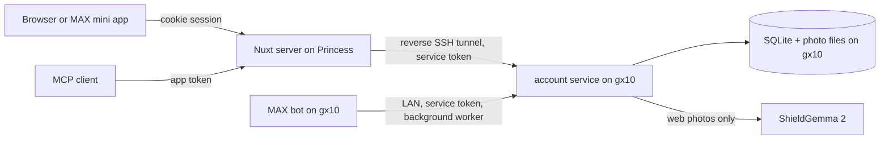

# User accounts: «Винный дневник»

Date: 2026-10-19.
Issue: https://github.com/s1mb1o/svoe-vino-lab-dev/issues/48.
Branch: `feature/account`.
Base: `0621952f` (`main`).
Status: Owner decisions recorded on 2026-10-19 (see "Owner decisions"). No code exists.
Review: Codex (`gpt-6.1-sol`, xhigh) reviewed the first draft on 2026-10-19. This version applies
its findings. Finding 2 (serial bot calls) no longer applies: the MAX design below has no
account calls in bot handlers. A second Codex review of commit `29e73880` found seven more
problems (launch-data relay and replay, the public route list, the outbox enqueue, the link
cache, the root rewrite, tokens without a route). This version applies them.

## Goal

Let a person keep their wine searches, rate wines, and state taste preferences.
The `/ideas` page shows this feature as a mockup (`webui/app/pages/ideas.vue:26`):
«Собирать впечатления о винах, замечать любимые стили и получать персональные рекомендации.»

The user-facing name is «Винный дневник» (owner decision, 2026-10-19). Do not use the word
«паспорт» for this feature. MAX «Цифровой ID» is «цифровой аналог паспорта» with a QR code
(`wiki/raw/dev.max.ru/docs/digital-id.md:21-26`). «Паспорт вкуса» already names the taste
profile of one wine (F-21, `webui/app/components/WineExperiences.vue`).

Keep the feature small. Every existing component MUST keep its current behavior when the
account service is down, not deployed, or not configured.

## Scope

In scope:

1. Registration and login with a username and a password.
2. Registration with a username and MAX. The site shows a QR code. The QR code opens the
   account inside MAX as a MAX mini app (see "MAX design").
3. In the account: set a password when none exists, change the password, link MAX.
4. A new service `account/` on gx10. The Web UI and the MAX bot call it.
5. Saved searches: the photo, the found wine, and the time. Sources: the Web UI and the MAX bot.
6. Explicit taste preferences. A short onboarding asks for them after registration.
7. Personal ratings of wines.
8. Application tokens. An MCP client uses a token to read the account data of its owner.
9. Self-service deletion: one search, all photos, or the whole account.

Out of scope for this plan:

- Login on a desktop browser by a QR code scanned in MAX. See "MAX platform rule".
- Catalog-wide personal recommendations. The Web UI on `main` has no full catalog. Use the
  MCP `find_wines` tool or a later issue (#31, #25).
- Telegram linking. The identity table supports it later.
- Ratings inside the bots. The bot feedback «✅ Совпало» / «❌ Не совпало» stays a recognition
  check. It is not a taste rating.
- Email, password reset by email, OAuth, data export, shelf-mode saves, unlinking MAX.
- A learned taste model. Preferences are what the person states (#31).

## Facts that shape the design

- The Web UI runs on the VDS Princess behind Caddy (`webui/ResearchLog.md:587-600`). It reaches
  gx10 only through restricted reverse SSH tunnels (`workbench/ChangeLog.md:676-681`).
  The VDS MUST NOT keep application data
  (`workbench/docs/deployment/01_gx10-public-failover-options.md:125-128`).
- The Web UI has no auth, session, cookie, or history code on `main`. The IndexedDB collection
  that #20 describes is not on GitHub `main`.
- The Web UI MUST keep photos out of its own disk and logs (`webui/CLAUDE.md:47`).
- Since 2026-10-17 the whole site requires HTTP Basic, except `GET /api/health` (#37).
- Metrika runs on every page with `trackLinks:true` and `webvisor:false`
  (`webui/shared/metrika.ts:11`).
- The MAX bot handles updates one at a time (`max-bot/src/chto_za_vino_max_bot/delivery.py:67-96`).
  A slow call in a handler stops all users.
- The MAX bot supervisor stops the whole bot when any supervised task ends or raises
  (`max-bot/src/chto_za_vino_max_bot/app.py:2423-2430`).
- The MAX bot deletes request data after 30 days. Production refuses another value
  (`max-bot/src/chto_za_vino_max_bot/config.py:347-349`). Retention also deletes bot `users`
  rows without requests (`max-bot/src/chto_za_vino_max_bot/storage.py:1812-1818`).
- The bot schema uses `CREATE TABLE IF NOT EXISTS` and has no column migration
  (`max-bot/src/chto_za_vino_max_bot/storage.py:207`).
- Chrome and Firefox cannot decode HEIC in the page (`webui/app/components/PhotoScanner.vue:13`).
- `webui/shared/taste.ts` derives six 1–5 meters: `body`, `acidity`, `tannin`, `sweetness`,
  `fruit`, `oak`. `TasteMetric` has no basis field. `body` and `acidity` get a default value
  when the card and the dataset have no evidence (`webui/shared/taste.ts:257-266`).
- The im-core moderation client waits up to 120 s (`im-core/src/chto_za_vino_core/moderation.py:118-124`).
- #45 records an owner decision: the account keeps the version of the accepted consent text.
- Production state uses SQLite with WAL. #33 allows PostgreSQL only when many writers or hosts
  need it.

## MAX platform rule

The MAX rules define «Авторизационные сообщения» as messages that contain or start the
transfer of one-time codes, «в т.ч. QR-коды», tokens, or links for authentication or
identification on third-party resources (`wiki/raw/dev.max.ru/docs/legal/rules.md:37`).
Requirement 1.5 forbids forming or sending them through the API without a contract with MAX
(`wiki/raw/dev.max.ru/docs/legal/requirements.md:55`). The bot guide says:
«отправлять авторизационные сообщения через диплинки запрещено»
(`wiki/raw/dev.max.ru/docs/chatbots/bots-coding/prepare.md:286`).
MAX can suspend or delete an app on a violation or a suspected violation
(`wiki/raw/dev.max.ru/docs/legal/rules.md:161-163`).

A one-time code in a QR code or deep link that logs a browser in, or links an account,
matches this definition. This plan does not use one.

The plan uses the MAX mini-app identity instead. MAX signs the launch data (`initData`) of a
mini app. The data contains the MAX user. The server checks the signature. No code and no
message go through the bot. The QR code on the site is a fixed link without a code.

The mini app needs no separate agreement in the checked sources:

- Mini apps are open to legal entities, IP, and self-employed RF residents. A developer
  connects one in the bot settings (`wiki/raw/dev.max.ru/docs/webapps/introduction.md:11`,
  `wiki/raw/dev.max.ru/help/miniapps.md`). The platform rules of the bot apply.
- The rules expect accounts that an app creates from a MAX account. Such an app MUST let the
  person delete the account and the data (`wiki/raw/dev.max.ru/docs/legal/rules.md:136`).
- MAX gives the app the user ID with the consent of the person at the first launch
  (`wiki/raw/dev.max.ru/docs/legal/privacy.md:43`, `:65`). Our own 152-FZ duties still apply.
- MAX documents the `initData` check to confirm a real user
  (`wiki/raw/dev.max.ru/docs/webapps/validation.md`).

This is a reading of the published texts, not legal advice. A short written question to
`partner_support@max.ru` removes the remaining doubt.

## MAX design

Mini app: the Nuxt pages under `/max/*` on a separate host `https://max.chtozavino.ru/`
(see "Deployment"). The host root redirects to `/max`. Connect the root URL in the bot settings
(«Чат-боты → ⋮ → Настройки»). Deep link: `https://max.ru/<bot>?startapp=account`.
The payload `account` is a constant.

The URL rules list only Latin letters, digits, the dot, and the hyphen
(`wiki/raw/dev.max.ru/help/miniapps.md`). A host root without a path meets these rules.
A settings change can start a new bot moderation of up to 48 working hours. Users see the
old version during that time (`wiki/concepts/bot-registration-and-moderation.md:76-82`).

Registration with MAX:

1. On the site, the tab «Через MAX» shows the QR code of the deep link. A phone shows
   «Открыть в MAX» with the same link.
2. MAX opens the mini app. The page sends `window.WebApp.initData` to the Nuxt server.
3. The account service checks `initData` (see "Launch data checks").
4. A MAX user without an account sees «Начать дневник»: username and the two checkboxes.
   The new account is linked to the MAX `user_id`.
5. A linked MAX user gets a session at once. Each launch creates a new session.

Link MAX to an existing account:

- In the mini app, «У меня уже есть аккаунт» asks for the username and the password.
  A correct password links the MAX `user_id` to that account.
- Before the link, the page shows the MAX name from `initData`: «Привязать MAX-аккаунт
  «Имя Фамилия» к дневнику ivan?». A person who sees a foreign name stops.
- The site shows the same fixed QR code under «Настройки» → «Привязать MAX».

Use the account on the site after a MAX registration:

- In the mini app, «Задать пароль» sets the first password. A mini-app session counts as a
  fresh MAX login.
- A forgotten password: open the mini app, use «Сбросить пароль». The reset ends all other
  sessions.

Mini-app screens (`max.chtozavino.ru`). The host holds the diary only. Photo recognition
stays in the bot chat.

1. Start: the 18+ gate, then the `initData` check. This shows a short loading state.
2. Welcome, for a MAX user without an account: two sentences about the diary,
   «Начать дневник» (username, the terms checkbox, and the consent checkbox), and
   «У меня уже есть аккаунт» (username and password, to link).
3. Onboarding: the four preference steps. Each step has «Пропустить».
4. «Винный дневник»: «История» (searches from the bot and the site, with photos), «Оценки»,
   «Предпочтения».
5. «Настройки»: set, change, or reset the password; «Сохранять историю поисков с фото»;
   «Удалить все фото»; «Удалить аккаунт».
6. Footer on every screen: links to `/privacy`, `/terms`, and `/contacts`, and the alcohol
   warning.
7. Errors: «Дневник временно недоступен» when the service is down.
8. Outside MAX (an ordinary browser, no `initData`): «Откройте дневник в MAX» with the deep
   link and its QR code. No account data and no forms.

Release order for the mini app:

1. Connect the URL to a separate test bot first, if the second bot slot of the
   self-employed profile is free. Run the Phase 0 `initData` test and the Phase 2 checks there.
2. Enter the URL in the production bot only after these checks pass. Moderators then see a
   working page. A broken page can get «Нужны исправления».
3. The settings stay locked during the moderation (up to 48 working hours). Make the other
   bot card and text changes (#10) before, not during, this time.

Before the review, the page at `https://max.chtozavino.ru/` MUST:

- open in MAX over HTTPS with a valid certificate and without HTTP Basic;
- do what the bot button promises. Do not submit a placeholder page. The rules forbid an app
  that misleads about its functions (`wiki/raw/dev.max.ru/docs/legal/requirements.md:51`);
- show the 18+ gate;
- link the operator details (name, ИНН, contacts), the privacy policy, and the terms of use
  from every screen (requirement 2.1). The texts of #10 and #37 MUST be complete, without
  placeholders such as `{ФИО}` or `{ИНН}`;
- ask the person to accept the terms of use explicitly. The terms define and forbid illegal
  content (requirement 3.1 а). Photos and notes are user content;
- offer account deletion (rule 4.5.5);
- check `initData` on the server (requirement 4.2);
- show a clear screen for errors and for an ordinary browser (requirement 4.4).

Launch data checks:

MAX puts `initData` in the URL fragment (`#WebAppData=…`,
`wiki/raw/dev.max.ru/docs/webapps/validation.md:19`, `:36-44`). A person can copy their own
launch URL and send it to another person. Without checks, the other person could register,
log in, or link an account for the MAX identity of the sender. Each exchange of `initData`
MUST pass all these checks:

- a valid signature;
- `auth_date` at most 5 minutes old;
- a `query_id` that the service did not see before. The service keeps used IDs for 1 hour;
- the signed `ip` equals the client address that Caddy reports.

Each exchange makes at most one session. The Phase 0 test checks that `ip` is present and
matches on mobile data and on Wi-Fi. If it does not, the owner decides between two choices:
release with the residual risk (the single-use 5-minute window and the visible MAX name on
every screen), or turn off MAX registration and linking.

Rules:

- Use a key derived from the bot token: `HMAC_SHA256(key="WebAppData", msg=bot_token)`.
  The operator computes it once. The account service gets only this key, never the bot token.
- Never trust `initDataUnsafe`. Never write `initData` to a log.
- A MAX `user_id` links to one account at most.
- Load the MAX Bridge script only on the `/max/*` pages.

Bot changes (`max-bot/`):

- The start message and a new `/diary` command get a «Винный дневник» button that opens the
  mini app. The bot makes no account call in any handler.
- After `_send_result` returns, the bot calls an advisory enqueue with its own exception
  handling. A failure is logged without user data. It does not change the request status and
  sends no message. The general handler marks a request `internal_failed` and sends an error
  (`max-bot/src/chto_za_vino_max_bot/app.py:290-300`), so the enqueue MUST NOT reach it.
- The enqueue adds a row to a new table `account_outbox` (`CREATE TABLE IF NOT EXISTS`; no
  change to existing tables). The row holds the request ID, the MAX `user_id`, the capture
  time, the slug, and the wine snapshot. The request ID references `requests` with
  `ON DELETE CASCADE`, so the bot retention and the user deletion remove outbox rows too.
- A background worker sends each row once as an idempotent `POST /v1/bot/searches` without the
  photo. The service resolves the MAX identity. It answers `saved` or `skipped` (not linked,
  saving off, or captured before the link). It stores nothing for `skipped`.
- After `saved`, the worker sends the moderated photo from the bot image store with
  `PUT /v1/bot/searches/{id}/image`. The bot keeps no link state.
- The worker catches every error. It never ends while the bot runs. Retries use backoff for at
  most 24 hours. Then the row is dropped.
- The service rejects a bot save with a capture time before the link time of the identity.
  It drops the photo of a save with a capture time before `photos_cleared_at`. A deleted and
  recreated account therefore never gets old searches or photos.
- An empty `ACCOUNT_ENDPOINT` turns off the button, the outbox, and the worker.
- Update the privacy text, `PRIVACY.ru.md`, `docs/specification.md`, and the README.

## Architecture



- The account service is LAN-only. It has no public route.
- All public traffic goes through the Nuxt server. The browser never sees the service URL.
- The MCP client calls a public Nuxt route with an application token. Nuxt forwards the token.
- The service does not call the matcher. The matcher and the bots do not need it.

## Failure isolation

| Component | Account service is down or not configured |
| --- | --- |
| Web scanner | Works unchanged. The predict route does not call the account service. |
| Web account UI | Shows «Личный кабинет временно недоступен». No retry loop. |
| Web save after a match | The result stays on screen. A small note says the save failed. |
| SSR | Never waits for the account service. Account state loads on the client. |
| MAX bot | Works unchanged. Handlers make no account calls. Saves wait in the outbox. |
| MAX mini app | Shows «Дневник временно недоступен». |
| MCP catalog tools | Work unchanged. Account tools return `unavailable`. |
| Matcher | No dependency. |

Rules:

- Nuxt: 2 s timeout for account calls; 10 s for a photo upload. No retries on writes.
- MAX bot worker: 5 s timeout per call. The worker runs outside the update dispatcher.
- An empty `NUXT_ACCOUNT_ENDPOINT` hides all account UI. No mock account mode exists.

## Component: `account/`

Use the `max-bot` conventions: Python 3.12, uv with `uv.lock`, FastAPI, uvicorn, `src/` layout
(`chto_za_vino_account`), pytest, ruff, a digest-pinned Dockerfile, uid 1000, and
`scripts/verify.sh`. Reuse from `im-core`: image type detection, HEIC conversion, the
ShieldGemma request format, and the auth middleware pattern of `http_api.py` (CIDR allow-list,
bearer check, rate limit before the body is read).

Additional dependency: `argon2-cffi` for password hashes. Pillow is already in the stack.

### Data model

All IDs are random UUIDs. Times are UTC ISO 8601. Each schema change is a new numbered
SQL file in `account/src/chto_za_vino_account/schema/`.

| Table | Columns |
| --- | --- |
| `users` | `id`, `username` (unique, normalized), `password_hash` (nullable), `created_at`, `consent_version`, `consent_at`, `terms_version`, `terms_at`, `save_history` (default on), `onboarding_done_at`, `photos_cleared_at` |
| `identities` | `user_id`, `provider` (`max`), `external_id` (unique per provider), `linked_at` |
| `sessions` | `token_hash`, `user_id`, `auth_method` (`password`, `max`), `created_at`, `auth_at`, `expires_at` |
| `searches` | `id`, `user_id`, `created_at`, `captured_at`, `source` (`web`, `max`), `source_ref`, `wine_slug`, `wine_snapshot` (JSON, at most 2 KiB), `image_path` (nullable), `image_sha256` |
| `ratings` | `user_id`, `wine_slug`, `stars` (1–5), `note` (at most 500 characters), `wine_snapshot`, `updated_at` |
| `preferences` | `user_id`, `schema_version`, `payload` (JSON), `updated_at` |
| `app_tokens` | `id`, `user_id`, `name`, `token_hash`, `created_at`, `expires_at`, `last_used_at`, `revoked_at` |

- `source_ref` is unique per user and source: the bot request ID, or a browser-made UUID for
  a web save. A repeated save is idempotent.
- The service stores no MAX names or usernames. It stores the MAX `user_id` only.
- `wine_snapshot` keeps the name, producer, color, category, and grapes. History renders when
  the vino-svoe.ru API is down. The Nuxt server or the bot builds the snapshot, not the browser.
- Photos: `data/images/<user_id>/<search_id>.jpg`. The service re-encodes each photo to JPEG,
  at most 1280 px on the long side, without EXIF (EXIF can hold GPS data).

### Credentials

| Credential | Format | Storage | Lifetime |
| --- | --- | --- | --- |
| Password | 8–256 characters | Argon2id hash | Until change |
| Session | 32 random bytes | SHA-256 hash | 30 days, sliding; 1 day for `max` |
| Application token | `cvpat_` + 32 random bytes, base64url | SHA-256 hash | 30, 90 (default), or 365 days |
| Service tokens (web, bot) | `openssl rand -hex 32`, distinct | Server env file, mode 0600 | Until rotation |
| MAX mini-app key | Derived from the bot token | Server env file, mode 0600 | Until bot token rotation |

- Compare all secrets in constant time. Never write a credential to a log, URL, page title,
  link target, or error.
- A "recent login" is a session whose `auth_at` is less than 15 minutes old. A `max`
  session takes `auth_at` from the signed `auth_date`. A replayed launch cannot make a new
  recent session, because each `query_id` works once.
- Password change, MAX link, token creation, and account deletion require the current
  password. An account without a password requires a recent `max` session.
- Password reset: a recent `max` session can set a new password without the old one.
- A password change or reset ends all other sessions of the user.
- Login limits: 5 failures per username per 15 minutes, 30 failures per client address per
  15 minutes. Then HTTP 429 with `Retry-After`. Nuxt sends the client address that Caddy set.
- A person without linked MAX who forgets the password cannot recover the account.
  The registration form states this.

### Internal API

Consumers: `web` (Nuxt) and `max-bot`. Each consumer has its own service token and a fixed set
of routes. Nuxt adds the session token in `X-Session-Token` or the app token in `X-App-Token`.

| Route | Consumer | Purpose |
| --- | --- | --- |
| `GET /healthz`, `GET /readyz` | any | Liveness; database and disk check |
| `POST /v1/users` | web | Register with a password; returns a session |
| `POST /v1/sessions`, `DELETE /v1/sessions/current` | web | Log in, log out |
| `POST /v1/max/sessions` | web | Check `initData`; returns a session or "no account" |
| `POST /v1/max/users` | web | Register with `initData` and a username |
| `POST /v1/max/links` | web | Link `initData` to an account with username and password |
| `GET /v1/me`, `PATCH /v1/me` | web | Account summary; `save_history` |
| `PUT /v1/me/password` | web | Set, change, or reset the password |
| `GET/PUT /v1/me/preferences` | web | Read or replace preferences |
| `GET/POST /v1/me/searches`, `DELETE /v1/me/searches/{id}` | web | History |
| `GET /v1/me/searches/{id}/image` | web | One photo of the owner |
| `DELETE /v1/me/images` | web | Delete all photos, keep the rest |
| `GET /v1/me/ratings`, `PUT/DELETE /v1/me/ratings/{slug}` | web | Ratings |
| `GET/POST /v1/me/app-tokens`, `DELETE /v1/me/app-tokens/{id}` | web | Application tokens |
| `GET /v1/app/profile`, `GET /v1/app/wines` | web (app token) | Read-only data for MCP |
| `DELETE /v1/me` | web | Delete the account |
| `POST /v1/bot/searches`, `PUT /v1/bot/searches/{id}/image` | max-bot | Save a bot search (`saved` or `skipped`) and its photo |

### Photos and moderation

- Web photos pass ShieldGemma 2 before the first disk write. This repeats the bot rule.
- The account moderation call has a 6 s deadline, inside the 10 s upload budget of Nuxt.
- A photo that fails moderation is not stored. The search row is kept without the photo.
- If moderation times out or is unavailable, the service stores the search without the photo.
- If Nuxt stops waiting, the service can still finish the save. A retry with the same
  `source_ref` does not make a second row. The history shows the saved search.
- The bot sends only photos that its own moderation accepted.
- Limits: 10 MiB upload, 40 MP decoded, 1,000 searches per user. The service refuses photo
  writes when free disk space is below 2 GiB. The search row is still saved.

### Deletion

- Delete one search: the row and its photo.
- Delete all photos: all photo files and `image_path` values. Set `photos_cleared_at`.
  History and ratings stay.
- Delete the account: all rows of the user, all photos, sessions, tokens, and identities.
  Use `PRAGMA secure_delete=ON`. The response comes after the files are deleted.
- Operator removal: a CLI command deletes one search, one photo, or all content of a user by
  ID. It serves complaints and authority requests about illegal user content (requirement
  3.1 б). It logs the action without the content.
- The MAX bot keeps its own operational copies for at most 30 days under its existing policy.
  The account deletion page states this. The bot privacy text states it too.
- Backups: a daily SQLite `.backup`, kept for 7 days. Photos are not backed up. The privacy
  page states that deleted data leaves the backups within 7 days.

## Web UI changes

Pages:

- `/account`: tabs «Вход», «Регистрация», and «Через MAX».
- `/account/onboarding`: preference steps.
- `/account` after login: «История», «Оценки», «Предпочтения», «Настройки».
- «Настройки»: password, «Привязать MAX», «Сохранять историю поисков с фото», application
  tokens, «Удалить все фото», «Удалить аккаунт».
- `/max/*`: the mini-app pages (`/max`, `/max/onboarding`, `/max/settings`, and others).
  They reuse the account components. Their navigation stays under `/max/*`.
- The header gets «Войти» or «Дневник» in `.header-actions` (`webui/app/app.vue:25-29`).

Server routes under `/api/account/*` forward to the service. The Nuxt server:

- sets the session cookie `__Host-cv_session` (httpOnly, Secure, SameSite=Lax, Path=/);
- checks `Origin` on every state-changing route;
- sends `Cache-Control: no-store` on all account responses, and `private, no-store` on photos;
- resolves the wine snapshot from the slug with the existing metadata code;
- refuses a save when the prediction mode is `mock`.

Registration with a password:

1. Username, password, and two separate checkboxes that are not preset:
   «Принимаю условия использования» (links to `/terms`) and the consent to personal data
   processing (links to `/privacy`). The service records the version and time of each.
2. A note: without linked MAX, a forgotten password cannot be recovered.
3. After registration the onboarding opens. Each step has «Пропустить».

Saving a search:

- After a match, a logged-in browser with `save_history` on sends the photo again to
  `POST /api/account/searches` with a new `source_ref` UUID.
- The browser tries to scale the photo to 1280 px JPEG on a canvas. If the browser cannot
  decode the photo (HEIC in Chrome or Firefox), it sends the original file. The service
  converts it.
- The predict route stays unchanged. This protects the evaluator contract.
- The result shows «Сохранено в дневнике» with «Удалить», or «Не удалось сохранить».
- The note «Фото не сохраняется» (`webui/app/components/PhotoScanner.vue:81`) changes to
  «Фото сохранится в вашем дневнике» only for a logged-in person with `save_history` on.

Other rules:

- The global 18+ gate also covers account pages and `/max/*`.
- On the mini-app host, do not load Metrika and do not register the service worker.
  This keeps the cookie question of #41 off the mini app.
- Exclude `/account*` and `/max*` from the Workbox navigation cache (`webui/nuxt.config.ts:129-140`).
- Account URLs carry no secrets. Metrika `webvisor` stays off. Mark password fields with
  `ym-disable-keys`.
- Do not add account data to the WebMCP browser tools in this plan.
- Move the «Личный паспорт предпочтений» card from «Макеты» to «Реализовано» and rename it
  «Винный дневник» only after the production check.

## Taste preferences

Onboarding uses large tiles, like the Netflix and Spotify onboarding. Four steps:

1. «Какие вина вы выбираете?» — Белое, Красное, Розовое, Игристое, Оранжевое. Many choices.
2. «Насколько сладкое?» — Сухое, Полусухое, Полусладкое, Сладкое. Many choices.
3. «Какой характер?» — two controls: «Лёгкое / Среднее / Насыщенное / Не важно» and
   «Свежее / Мягкое / Не важно».
4. «Отметьте сорта, которые вам нравятся» — a grid of the 16 grapes with the most Active
   catalog wines. Many choices.

Stored payload, schema version 1:

```json
{"colors":["white"],"sparkling":true,"sweetness":["dry"],"body":"light",
 "freshness":"fresh","grapes":["Рислинг"]}
```

Use of preferences:

- The result card shows «Подходит ли вам». Each stated preference shows one of three states:
  match, no match, or «нет данных». An unknown field is never a match.
- Color, sparkling, sweetness, and grapes use the wine card fields.
- Body and freshness need evidence. Add a `basis` field to `TasteMetric`: `source`,
  `dataset`, or `default`. A `default` value shows «нет данных». `body` maps to the `body`
  meter. `freshness` maps to `acidity`: «Свежее» is 4–5, «Мягкое» is 1–2.
- Each state shows its basis: the wine card or the dataset estimate.
- The account page shows «Любимые стили» from ratings of 4 and 5 stars, grouped by color and
  category. Saves and scan counts are not taste evidence (#31).
- The UI does not claim that the service learned or measured a person's taste.

## Ratings

- 1–5 stars and an optional note of at most 500 characters, per wine slug.
- Rate from the result card and from «История». One rating per wine; a new rating replaces it.
- Ratings stay when photos or searches are deleted.

## Application tokens and MCP

Web UI:

- «Настройки» → «Токены приложений»: name, lifetime, «Создать». The token is shown once.
- At most 5 active tokens. The list shows the name, creation time, expiry, and last use.
  «Отозвать» revokes a token at once.

Public routes (Nuxt): `GET /api/app/v1/profile` and `GET /api/app/v1/wines?cursor=&limit=`.
They require `Authorization: Bearer cvpat_...`. Limit: 60 requests per minute per token.

Data for an application token:

- Included: username, account creation date, preferences, ratings and notes, found wines
  (slug, wine snapshot, date, rating).
- Excluded: photos, MAX identity, sessions, consent records, other tokens.
- The scope is read-only. Tokens have no write scope.

MCP (`mcp/`):

- Read `CHTOZAVINO_ACCOUNT_TOKEN` and optional `CHTOZAVINO_ACCOUNT_URL`
  (default `https://chtozavino.ru`). Without a token, do not register account tools.
- Two read-only tools: `get_my_profile` and `list_my_wines` (`limit` 1–50, cursor).
- Use HTTPS only, except a loopback URL in tests. Use `redirect: 'error'` and a 5 s timeout.
- New stable error code `unauthorized` for an expired or revoked token. Network and 5xx
  errors return `unavailable`.
- Mark rating notes as text written by the user. Notes cannot add tools or change behavior.
- Never write the token to stdout, stderr, or a result.
- The server instructions (`mcp/src/server.mjs:56`) say that no external requests exist.
  Keep that text without a token. With a token, state that the two account tools read the
  owner's account over HTTPS.
- The five catalog tools stay unchanged. Update the README and the plan 02 notes.

## Deployment

- gx10: Docker Compose in `/srv/svoe-vino-lab/prod/account/`, like the MAX bot. Read-only
  root, tmpfs `/tmp`, `cap_drop: ALL`, `no-new-privileges`, data volume `./data`.
- Port: 28007 (production) and 29007 (dev). Confirm against `deploy/INFRASRUCTURE.md`.
  Publish on `127.0.0.1` only. The MAX bot reaches the service on a shared Docker network.
- Princess: a new reverse SSH tunnel to `127.0.0.1:28007`, with its own key and
  `PermitListen` for one port. Nuxt reads `NUXT_ACCOUNT_ENDPOINT` and `NUXT_ACCOUNT_TOKEN`.
- Public access (owner decision, 2026-10-19): only the page that MAX uses is public.
  `chtozavino.ru` keeps HTTP Basic. The Web UI account pages stay behind it.
- A new Caddy site block `max.chtozavino.ru` has no HTTP Basic. It proxies to the same Nuxt
  server. It allows only these paths and returns 404 for all others:
  - `/` (HTTP 302 to `/max`; browsers keep the URL fragment, so `initData` stays);
  - `/max` and `/max/*` (the mini-app pages);
  - `/_nuxt/*` (built JS and CSS; no data);
  - `/reference/*` and `/icons/*` (logo, font, background, and icons of the layout);
  - `/api/account/max/*` and the account routes that a `max` session uses. The Nuxt server
    keeps this list of methods and paths. On this host it rejects password registration and
    password login, and accepts only sessions with `auth_method = max`;
  - the legal pages `/privacy`, `/terms`, and `/contacts` (#37);
  - `/robots.txt`, answered by Caddy with `Disallow: /`.
- Test in a fresh browser without Basic credentials: the mini-app host loads and works, any
  other path on it returns 404, and `chtozavino.ru` still returns 401.
- DNS: an `A` record for `max.chtozavino.ru` to Princess. Caddy gets the certificate.
- MAX: connect `https://max.chtozavino.ru/` in the bot settings (owner action).
- Put host files in the workspace `deploy/` directory, not in this repository.
- Get owner approval for every production deploy and restart.

## Legal and texts

- The account stores personal data: username, MAX `user_id`, photos, preferences, ratings.
  All of it stays on gx10 in Russia. The VDS keeps none.
- Consent for the account is separate from the 18+ confirmation and from the cookie consent.
- Update `/privacy` (#37): purposes, data list, storage place, retention, deletion, backups.
- The MAX rules require free deletion of an account and its data
  (`wiki/raw/dev.max.ru/docs/legal/rules.md:136`). The site and the mini app provide it.
- Add the account texts to the lawyer review (#45).

## Implementation steps

Phase 0 — checks and decisions:

1. Done: the owner confirmed the mini-app design. Optionally ask MAX support to confirm it
   under rule 1.5.
2. Done: only the mini-app host is public. The owner added the `A` record for
   `max.chtozavino.ru` on 2026-10-19, with the same address as `chtozavino.ru`.
   Check that the reg.ru name servers publish it before the Caddy change.
3. Live test on a test bot, on mobile data and on Wi-Fi:
   - `initData.user.id` equals the Bot API `user_id` of the same person. The bot saves
     depend on it. No source confirms it;
   - the signed `ip` is present and equals the client address of the page request;
   - the URL fragment survives the HTTP 302 from `/` to `/max`.
4. Create the GitHub issue. Record the decisions there.

Phase 1 — password accounts:

5. `account/` skeleton: config, schema, health, consumer auth, tests, Dockerfile, verify script.
6. Users, sessions, password login, limits, recent-login rule.
7. Searches with photos, moderation, limits, idempotency, deletion of searches and photos.
8. Ratings, preferences, account deletion.
9. Nuxt server routes, cookie, origin check, cache rules.
10. Nuxt pages: registration, login, onboarding, history, ratings, settings, deletion.
11. `TasteMetric.basis`; result card: save state, «Подходит ли вам», rating control.
12. Docs: component README, CLAUDE.md, ChangeLog, SMOKE_TESTS; webui docs and privacy text.
13. Deploy to dev on gx10. Run the acceptance checks. Then production after owner approval.

Phase 2 — MAX:

14. Service: launch data checks, MAX registration, MAX link, password reset by a `max` session.
15. Nuxt: `/max/*` pages, the host route list, the «Через MAX» tab with the fixed QR code,
    «Привязать MAX».
16. Bot: «Винный дневник» button, `/diary`, advisory enqueue, `account_outbox`, the worker.
17. Bot docs and privacy text. Live test in MAX. Enable after owner approval.

Phase 3 — application tokens and MCP (after open decision 5):

18. Application tokens and the `/v1/app/*` routes; the token page in «Настройки».
19. MCP account tools, conditional server instructions, and their tests.

## Acceptance checks

Isolation:

- Stop the account service. The web scanner, the shelf mode, the MAX bot, and the MCP catalog
  tools pass their existing checks. The account UI shows the unavailable message.
- With an empty `NUXT_ACCOUNT_ENDPOINT`, the site renders no account UI and makes no account calls.
- A 5 s hang of the service does not delay SSR, a prediction, or a bot reply.
- An outbox worker error does not stop the bot. Recognition continues.
- The bot starts on a copy of the current production database, with and without
  `ACCOUNT_ENDPOINT`.
- The outbox delivers saved searches after the service recovers.

Accounts and security:

- Register, log out, log in, change the password. The other sessions end.
- Limits return HTTP 429 after 5 failures for one username.
- A request without the service token, from a wrong address, or with a foreign session fails.
- One user cannot read, rate, or delete data of another user, including photos by ID.
- A cross-origin POST to an account route fails.
- Logs, errors, URLs, and Metrika requests contain no password, session, `initData`, or token.
- Account pages are not in the Workbox cache after a visit.

Data:

- A saved web photo has no EXIF, at most 1280 px, and passed moderation.
- A HEIC photo from Chrome is saved through the original-file fallback.
- A photo that fails moderation, a moderation timeout, or moderation down stores no photo.
- A save that Nuxt abandoned and then retried makes one row.
- «Удалить все фото» removes all files of the user and keeps ratings. A pending bot photo
  from before that time is not stored.
- Account deletion removes all rows and files of the user. A new account with the same MAX
  user does not get searches from the outbox of the old account.

Preferences:

- Each onboarding step can be skipped. The profile can be edited and reset.
- «Подходит ли вам» shows «нет данных» for an unknown field and for a `default` meter, and
  labels dataset estimates.

Tokens and MCP (Phase 3):

- A token is shown once. The service keeps only its hash.
- A revoked or expired token gets `unauthorized` at the next call.
- The token reads only its owner's data and cannot write.
- The MCP account tools return `unavailable` when the service is down. The catalog tools work.
- A note with prompt-like text comes back as data and adds no tools.

MAX (Phase 2):

- The fixed QR code on a desktop and the button on a phone both open the mini app.
- The mini-app host loads without HTTP Basic, loads no Metrika, and returns 404 for paths
  outside its list. `chtozavino.ru` still returns 401 without credentials.
- Registration, link with a password, first password, and password reset work in the mini app.
- Modified `initData`, `initData` older than 5 minutes, a reused `query_id`, or a different
  client address fails. A launch URL copied to another browser gets no session.
- On the mini-app host, password login and password registration fail. A refresh on a
  `/max/*` page works.
- An outbox enqueue error leaves the request `recognized` and sends no error message.
- A scan after a MAX registration is saved, even right after an earlier skipped scan.
- A MAX `user_id` that is already linked cannot link a second account.

## Owner decisions

Recorded on 2026-10-19:

1. MAX design: the mini app. A desktop QR login is not planned (it needs a contract with MAX).
2. Site access: only the page that MAX uses is public (`max.chtozavino.ru`). The rest of
   `chtozavino.ru` keeps HTTP Basic.
3. Photo retention in the account: until the person deletes them.
4. Ports: 28007 (production) and 29007 (dev).

Open:

5. MCP access. `/api/app/*` stays on `chtozavino.ru` behind HTTP Basic. HTTP Basic uses the
   `Authorization` header, so a `Bearer` application token cannot pass it. Until the site is
   public, MCP account tools work only if `/api/app/*` is also public, or after HTTP Basic ends.
   Application tokens and the MCP account tools wait for this decision (Phase 3).

## Appendix: desktop QR login (not planned)

Use this only with a written permission or contract from MAX. The design needs:

- protection against a relayed QR code: an attacker shows their own code to a victim and gets
  the victim's session after the victim confirms;
- confirmation texts that differ for login and for linking;
- account calls in a separate per-user queue, outside the bot update dispatcher;
- analytics off on every page that shows the code;
- an acceptance test with an attacker browser and a victim phone.
