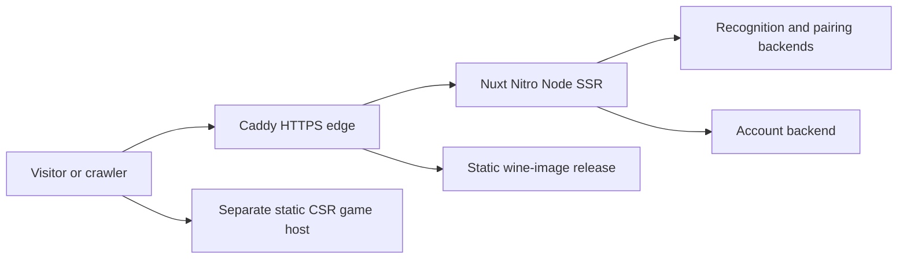

# Deployment and infrastructure audit

This was read-only. No SSH command, reload, restart, rollback, DNS/environment edit, deployment or commit was performed. Source baseline is `cd8b063e…`. Production facts are anonymous HTTP observations; local deployment documents/snapshots can be stale.

## Serving architecture and inspected locations

Live portal responses use Caddy and Nuxt, negotiate HTTP/2, advertise HTTP/3, and passed normal curl TLS validation without insecure overrides. HTTP/www redirects lead to the preferred HTTPS host. Sample public landing GETs are 200. This does not independently verify authoritative DNS/AAAA propagation, renewal, edge access from verified crawler IPs or a running commit.

A neighboring deployment repository at `../chtozavino-deploy` matches application documentation references. Only relevant non-secret excerpts/documentation were read. Secret directories, credential indexes, private keys and actual environment files were not opened/copied. Variable names below disclose no private values.



| Layer | Exact inspected location | Behavior / evidence limit |
|---|---|---|
| Nuxt runtime | `webui/package.json:10–15`; `webui/nuxt.config.ts:14–35,176` | Build/start Node SSR; no frontend Dockerfile found |
| Head/policies | `webui/nuxt.config.ts:33–99,161–175` | Defaults, per-route noindex/cache/redirects; partial overrides cause SEO-008 |
| Discovery | `webui/public/robots.txt`, `sitemap.xml`; `webui/app/data/sitemap.ts` | Static policy lists, not effective-edge-aware |
| Public edge record | `../chtozavino-deploy/claudette/README.md:5–7` | Records Claudette/domain migration; observed IP agrees; not authoritative DNS audit |
| www/compression | `../chtozavino-deploy/snapshots/claudette/etc/caddy/Caddyfile:9–21` | www 308 and `encode zstd gzip`, supported by live behavior |
| Presentation | same snapshot `:48–55` | Presentation/material matcher sets noindex and private/no-store; live matching headers prove present behavior, not exact running file |
| Portal proxy | same snapshot `:130–137` | Proxy to Node; request-body limit is not a response-size limit |
| Static wine images | same snapshot `:112–126`; `docs/plans/06_wine-images.md:203–219` | Separate file release/cache; entire wine-image manifest not audited |
| Separate game | same snapshot `:181–193`; `webui/app/pages/game.vue:2–3` | Own static release, immutable hashed assets/revalidated mutable files; E03 root sample is CSR |
| MAX routing | `webui/server/middleware/max-host.ts:1–5`; `webui/server/utils/account.ts` function `maxHostGuard`; external `claudette/max-chtozavino-ru.Caddyfile` | Host-specific mini-app restrictions; static files precede middleware. No complete live MAX-host audit |
| Node launch | `../chtozavino-deploy/snapshots/claudette/etc/systemd/system/svoe-vino-webui.service:10–12` | Built server via current release symlink, separate environment file; values not read |
| GitLab CI | `.gitlab-ci.yml:26–40` | npm ci, typecheck, Vitest, build and output artifact; no deployment job here |
| GitHub CI | `.github/workflows/matcher-tests.yml`, `mcp-tests.yml`, `runner-smoke.yml` | Inspected workflows cover backends/MCP/manual runner smoke, no general Web UI workflow; external release checks may exist |

No frontend Nginx/CDN configuration was found in the inspected paths. No evidence establishes a missing CDN or DNS defect. Older Basic Auth descriptions/imports do not prove an active indexing blocker: anonymous production GETs returned 200. They also do not prove private/API routes are public.

Supporting containers: `matcher/Dockerfile:20–50`, `dinner-lens/Dockerfile:2–25`, `account/Dockerfile:14–54` use pinned/locked dependencies, revision labels and readiness checks. `account/deploy/compose.example.yaml:26–47`, `max-bot/deploy/compose.example.yaml:36–57` and bot host-demo Compose files define examples/backends, not the active frontend edge. No container change is justified for a page metadata defect.

## Environment-dependent behavior

| Setting/source | Source/default | Observed production / limit |
|---|---|---|
| Prediction mode/endpoint | Mock default in `webui/nuxt.config.ts:20–22` | `/api/config` returned upstream/API available; no inference submitted |
| Shelf/pairing flags | `webui/server/api/config.get.ts:11–18` | Both available; rendered controls present. Actual recognition/pairing execution not tested |
| Upstream health | `webui/server/utils/upstream-health.ts:13–24`, default 2s timeout; SSR awaits config in `webui/app/components/ScannerPage.vue:3` | Availability changes copy; no slow-probe defect measured. Test outage on staging before changing caching |
| Account setting | `webui/app/app.vue:25–26` controls header link | Link present; account GET noindex/no-store. Do not public-cache personal pages |
| APK path/public URL | `webui/nuxt.config.ts:11,19,35`; `webui/shared/android.ts:13` | Baseline divergence resolved by verified 0.3.0 contract/file match (E10); retain release-time checks |
| Canonical origin | Production origin hard-coded globally/per page | Correct on production; preview behavior needs an intentional staging policy, not assumed production equivalence |
| MAX host settings | Guard/integration disabled when empty | Main-host observations cannot establish mini-app host behavior |
| PWA | `webui/nuxt.config.ts:102–159`, production worker/NetworkFirst | Cached navigation may contain earlier SSR config. Use fresh-cache release checks |

## SEO-001 — Android download does not match the advertised release contract

**Current status, superseding the historical finding below:** [0.3.0 verified at 19:26–19:28 UTC](android-030-verification.md). Full production download size/SHA-256, embedded version/code/package, certificate fingerprint, visible copy and JSON-LD agree. Remote main `58388d83` also adds a size guard at route line 19. The original mismatch is resolved; HEAD 404 remains P3/S. No new artifact reconciliation/replacement project is needed. The following 0.2.0 observations/actions are retained as historical audit evidence, not an instruction to undo the new release.

**VERIFIED defect, P1/M; binary version/signer REQUIRES VERIFICATION.** Page: `https://chtozavino.ru/android`. Download: `https://chtozavino.ru/downloads/chtozavino-0.2.0-release-test-signed.apk`.

E01 production SoftwareApplication names version 0.2.0 and `fileSize: 414941197 bytes`; visible copy says 396 MB. `webui/shared/android.ts:1–13` supplies version/size/hash/package contract. E02 HEAD returns 404, but E03 **GET returns 200** with APK MIME and attachment filename and **Content-Length 576503447**. Range 0–0 was ignored. A 1 MiB `--max-filesize` guard stopped curl with exit 56 before any body bytes. Thus the link is not a broken GET; the advertised artifact contract is demonstrably inconsistent.

The local runbook `../chtozavino-deploy/princess/webui.md:569–572` records an older file served under the 0.2.0 name pending new artifact upload. That supports a likely cause but is not proof of current binary version. No APK was downloaded/hashed/installed.

**Root:** `webui/server/routes/downloads/[filename].get.ts:5–20` verifies only allowed filename/existing target. Lines 23–30 label/stream whatever runtime file is configured; no size/hash/package/version check. `webui/app/pages/android.vue:30–35` uses independent static contract fields. GET-only routing is a likely cause of HEAD divergence; confirm framework dispatch when adding support.

**Fix:** publish the exact approved artifact in a separately authorized release, or accurately revert the displayed contract until it exists. Before activation compare size/SHA-256/application ID/version/versionCode/signer to a generated or checked release manifest. Verify once during packaging/activation, not by hashing a huge file on every GET. Fail a mismatched release or present a truthful unavailable CTA rather than renaming another binary. Share validated headers between GET/HEAD, with HEAD returning no body. Optional range support needs real 206/Content-Range/416 semantics.

**Side effects:** upgrade/signing compatibility, old installations/artifacts, fixed-name caches and rollback. Do not delete/replace an older package before that decision; invalidate stale cache if a fixed-name payload changes.

**Acceptance:** inspect/hash/count the staging artifact with existing Android tools; compare manifest/page/schema; verify full staging stream integrity and GET/HEAD parity; test install/upgrade where authorized. Include in SEO-013. Production status-only probe:

```sh
# Intentional size-limit exit after 200 headers is not an HTTP failure.
curl -sS --range 0-0 --max-filesize 1048576 --max-time 20 \
  -D /tmp/seo-apk.headers -o /tmp/seo-apk.body \
  https://chtozavino.ru/downloads/chtozavino-0.2.0-release-test-signed.apk
```

## Release drift and effective policy — SEO-012/013

Runbook `princess/webui.md:9` records `09403930…`; current source is `cd8b063e…`. Live XML/footer omit Shelf Lens; static timestamps and documentation alone cannot attest a current commit. `webui/server/api/health.get.ts:1` exposes service/status only. Use a build-generated inert revision marker/manifest, disclosing no private paths/configuration.

Existing source-string metadata/XML tests cannot see the Caddy header or APK bytes. `webui/scripts/check-contract.mjs:12,18` is mock/inference-only, with obsolete age markup at 40–41 and 302 at 79–82; do not point it at production. Proposed `webui/scripts/check-seo-http.mjs` should perform bounded public GET/header/meta/XML/artifact checks without inference/uploads/accounts. Validate a built staging release and public responses after a separately authorized release; record actual revision/results. See [detailed coverage](technical-audit.md#seo-012-and-seo-013--release-drift-and-missing-end-to-end-guard-coverage).

Before future edge changes compare the effective running configuration to snapshots and test route/header matrices. The original APK integrity defect was resolved by 0.3.0 (E10); HEAD dispatch remains a minor follow-up. The presentation/XML mismatch is still established by the audit snapshot. Generic CDN/DNS changes are unsupported.
