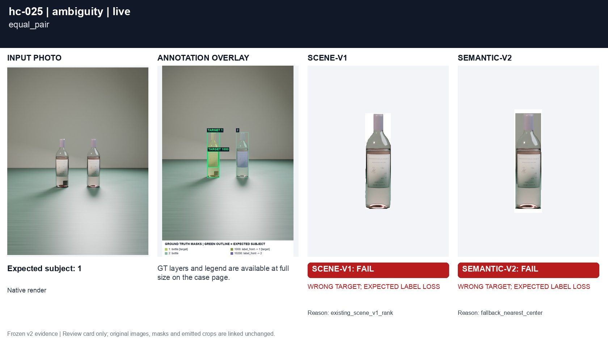
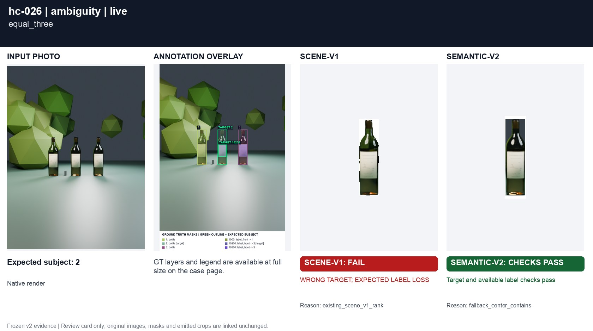
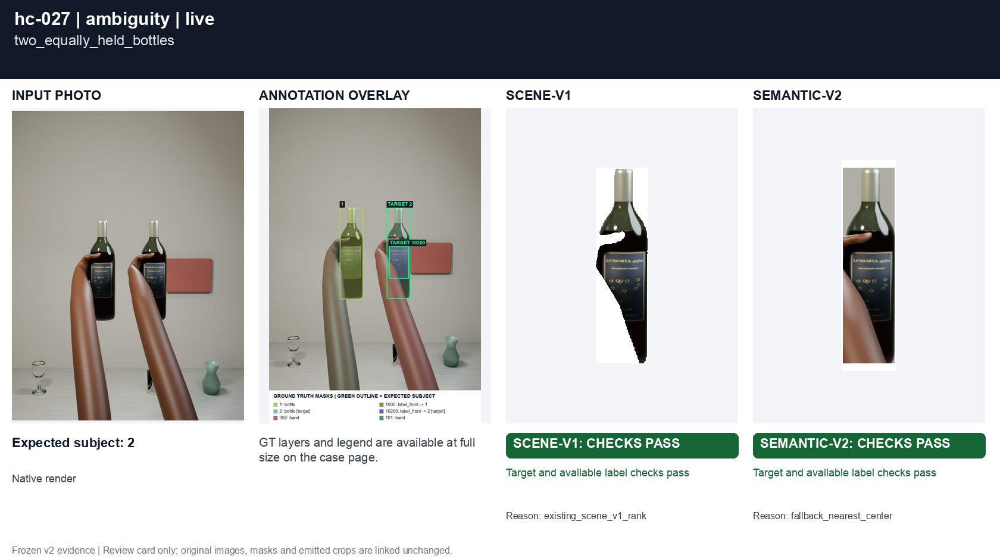
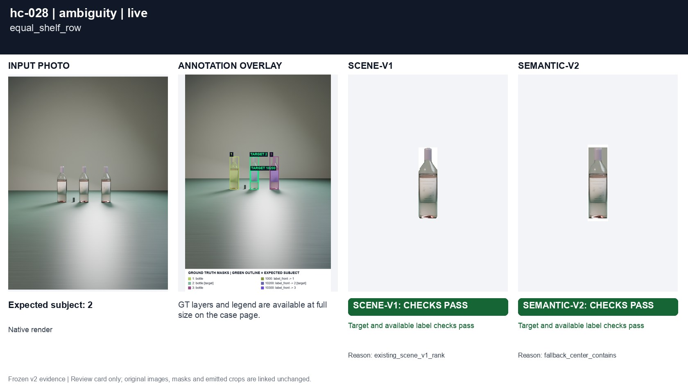
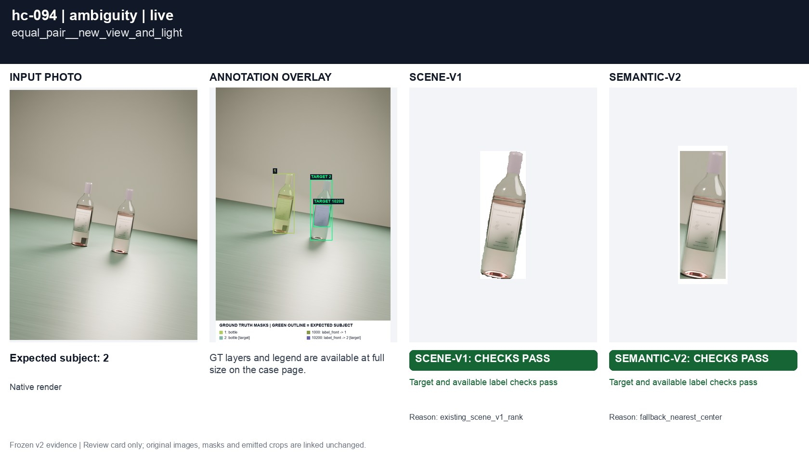
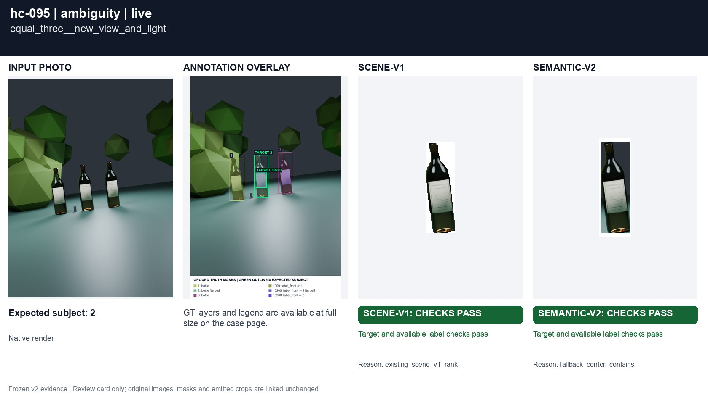
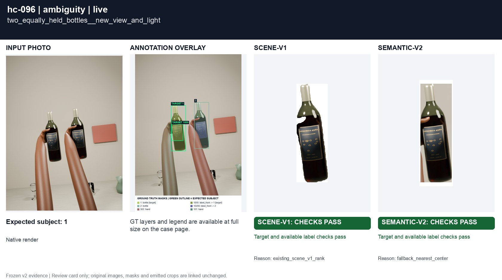
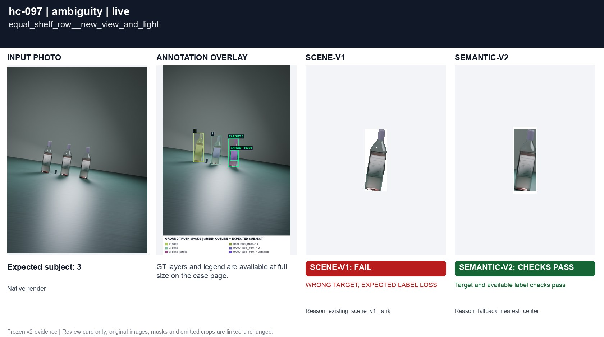
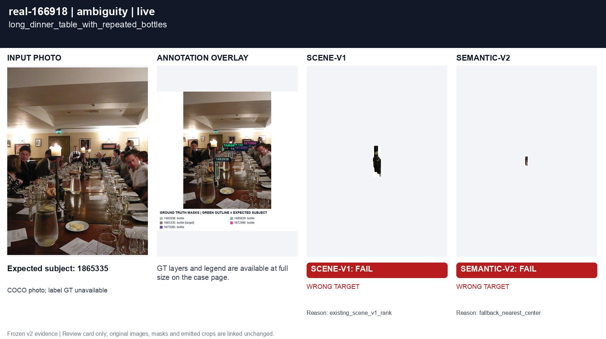

# No clear main bottle

[All groups](../README.md)

Two or three equal bottles, two equally held bottles, and a wide shelf row. Intent remains ambiguous, but the selector must return a crop using the photo-center / nearest / left / upper / stable-ID fallback.

9 cases. Failures below use frozen result fields; photos and fixtures retain separate interpretation.

| Case | scene-v1 | semantic-v2 |
|---|---|---|
| [hc-025 equal_pair](../cases/hc-025.md) | **FAIL** controlled: WRONG TARGET; EXPECTED LABEL LOSS, live: WRONG TARGET; EXPECTED LABEL LOSS | **FAIL** live: WRONG TARGET; EXPECTED LABEL LOSS |
| [hc-026 equal_three](../cases/hc-026.md) | **FAIL** live: WRONG TARGET; EXPECTED LABEL LOSS | Recorded checks pass |
| [hc-027 two_equally_held_bottles](../cases/hc-027.md) | Recorded checks pass | Recorded checks pass |
| [hc-028 equal_shelf_row](../cases/hc-028.md) | Recorded checks pass | Recorded checks pass |
| [hc-094 equal_pair__new_view_and_light](../cases/hc-094.md) | Recorded checks pass | Recorded checks pass |
| [hc-095 equal_three__new_view_and_light](../cases/hc-095.md) | Recorded checks pass | Recorded checks pass |
| [hc-096 two_equally_held_bottles__new_view_and_light](../cases/hc-096.md) | **FAIL** controlled: WRONG TARGET; EXPECTED LABEL LOSS | Recorded checks pass |
| [hc-097 equal_shelf_row__new_view_and_light](../cases/hc-097.md) | **FAIL** controlled: WRONG TARGET; EXPECTED LABEL LOSS, live: WRONG TARGET; EXPECTED LABEL LOSS | Recorded checks pass |
| [real-166918 long_dinner_table_with_repeated_bottles](../cases/real-166918.md) | **FAIL** live: WRONG TARGET | **FAIL** live: WRONG TARGET |

## Visual examples

### hc-025 equal_pair

**scene-v1:** **FAIL** controlled: WRONG TARGET; EXPECTED LABEL LOSS, live: WRONG TARGET; EXPECTED LABEL LOSS

[Open original photo, all masks and every selector crop](../cases/hc-025.md)

### hc-026 equal_three

**scene-v1:** **FAIL** live: WRONG TARGET; EXPECTED LABEL LOSS

[Open original photo, all masks and every selector crop](../cases/hc-026.md)

### hc-027 two_equally_held_bottles

**scene-v1:** Recorded checks pass

[Open original photo, all masks and every selector crop](../cases/hc-027.md)

### hc-028 equal_shelf_row

**scene-v1:** Recorded checks pass

[Open original photo, all masks and every selector crop](../cases/hc-028.md)

### hc-094 equal_pair__new_view_and_light

**scene-v1:** Recorded checks pass

[Open original photo, all masks and every selector crop](../cases/hc-094.md)

### hc-095 equal_three__new_view_and_light

**scene-v1:** Recorded checks pass

[Open original photo, all masks and every selector crop](../cases/hc-095.md)

### hc-096 two_equally_held_bottles__new_view_and_light

**scene-v1:** **FAIL** controlled: WRONG TARGET; EXPECTED LABEL LOSS

[Open original photo, all masks and every selector crop](../cases/hc-096.md)

### hc-097 equal_shelf_row__new_view_and_light

**scene-v1:** **FAIL** controlled: WRONG TARGET; EXPECTED LABEL LOSS, live: WRONG TARGET; EXPECTED LABEL LOSS

[Open original photo, all masks and every selector crop](../cases/hc-097.md)

### real-166918 long_dinner_table_with_repeated_bottles

**scene-v1:** **FAIL** live: WRONG TARGET

[Open original photo, all masks and every selector crop](../cases/real-166918.md)

