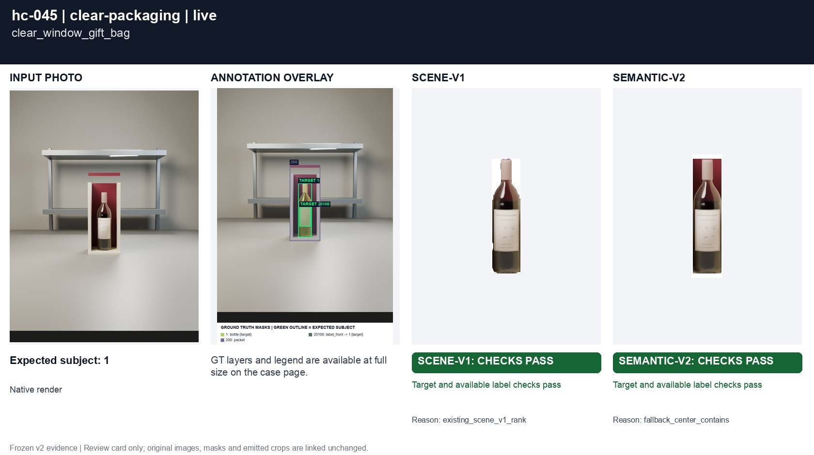
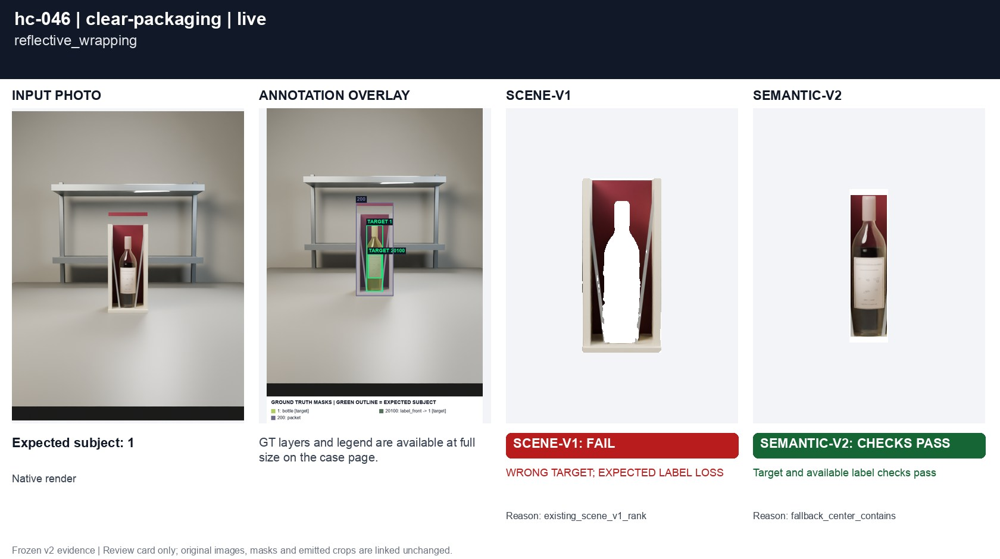
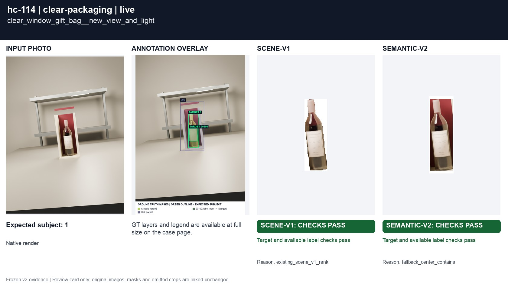
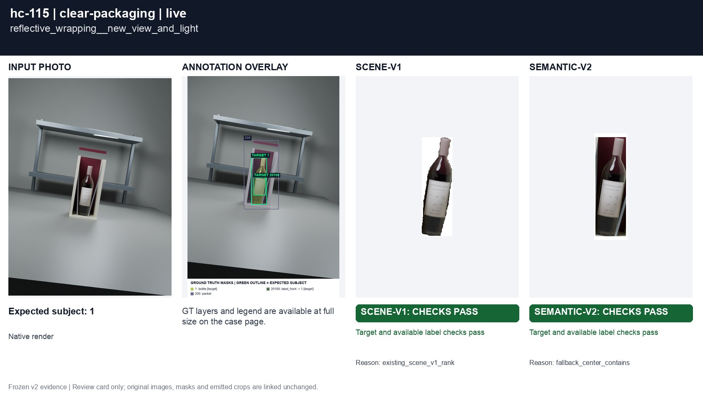

# Clear gift packaging

[All groups](../README.md)

A window gift bag and reflective wrapping strips. Opaque native passes annotate visible physical surfaces; transparent windows are open geometry.

4 cases. Failures below use frozen result fields; photos and fixtures retain separate interpretation.

| Case | scene-v1 | semantic-v2 |
|---|---|---|
| [hc-045 clear_window_gift_bag](../cases/hc-045.md) | Recorded checks pass | Recorded checks pass |
| [hc-046 reflective_wrapping](../cases/hc-046.md) | **FAIL** controlled: WRONG TARGET; EXPECTED LABEL LOSS, live: WRONG TARGET; EXPECTED LABEL LOSS | Recorded checks pass |
| [hc-114 clear_window_gift_bag__new_view_and_light](../cases/hc-114.md) | Recorded checks pass | Recorded checks pass |
| [hc-115 reflective_wrapping__new_view_and_light](../cases/hc-115.md) | Recorded checks pass | Recorded checks pass |

## Visual examples

### hc-045 clear_window_gift_bag

**scene-v1:** Recorded checks pass

[Open original photo, all masks and every selector crop](../cases/hc-045.md)

### hc-046 reflective_wrapping

**scene-v1:** **FAIL** controlled: WRONG TARGET; EXPECTED LABEL LOSS, live: WRONG TARGET; EXPECTED LABEL LOSS

[Open original photo, all masks and every selector crop](../cases/hc-046.md)

### hc-114 clear_window_gift_bag__new_view_and_light

**scene-v1:** Recorded checks pass

[Open original photo, all masks and every selector crop](../cases/hc-114.md)

### hc-115 reflective_wrapping__new_view_and_light

**scene-v1:** Recorded checks pass

[Open original photo, all masks and every selector crop](../cases/hc-115.md)

