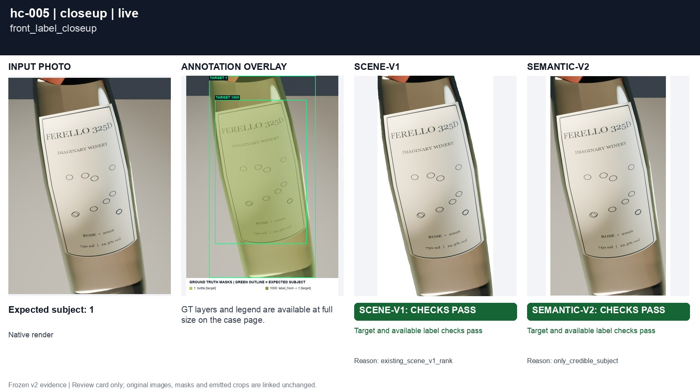
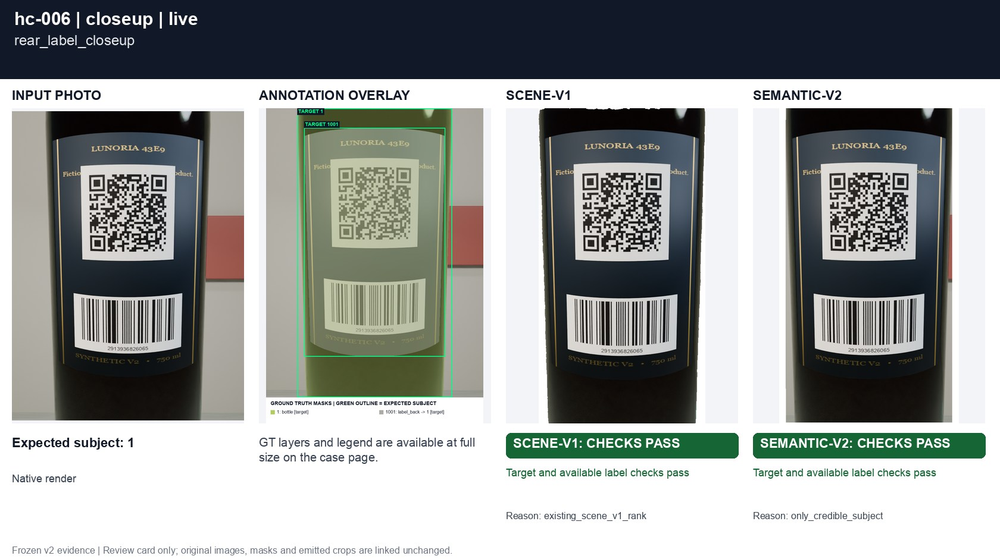
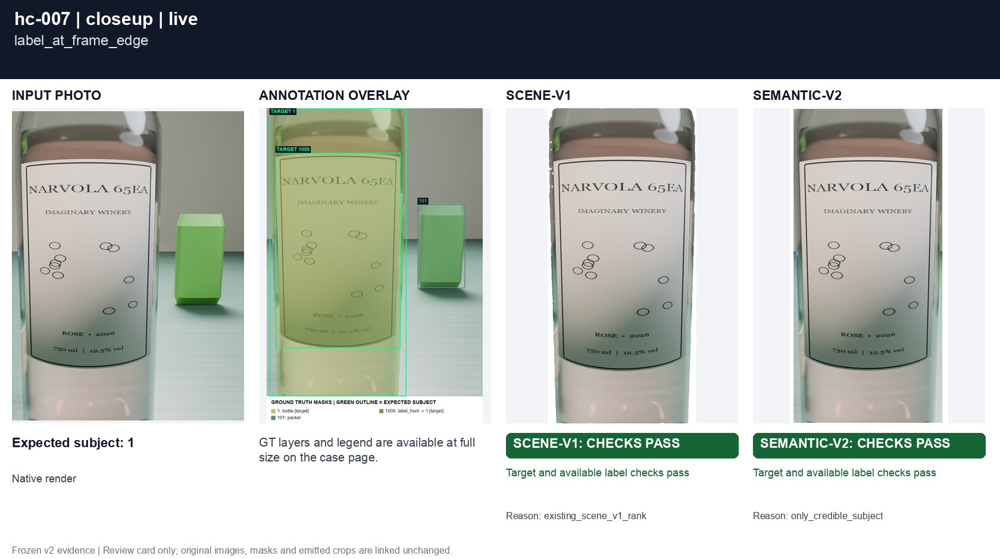
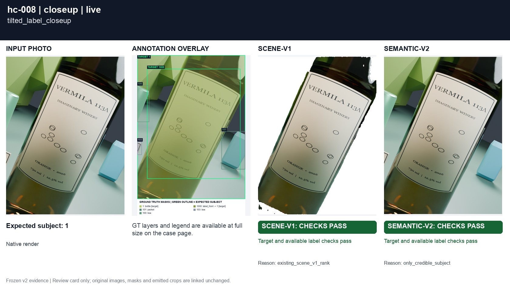
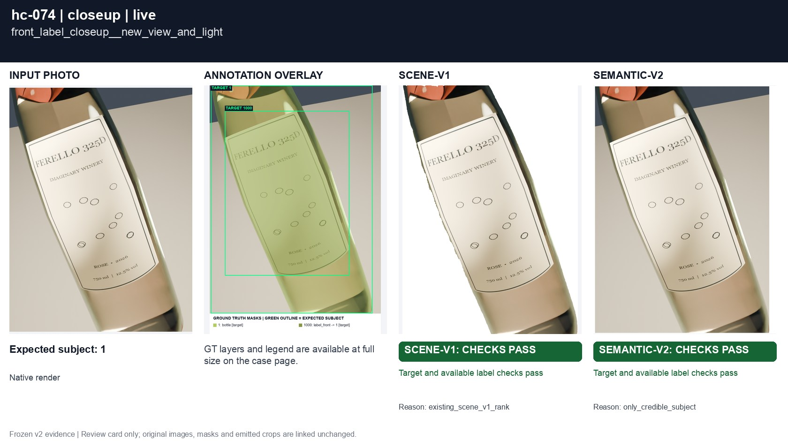
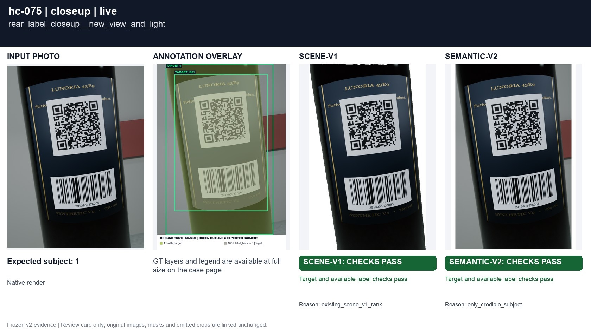
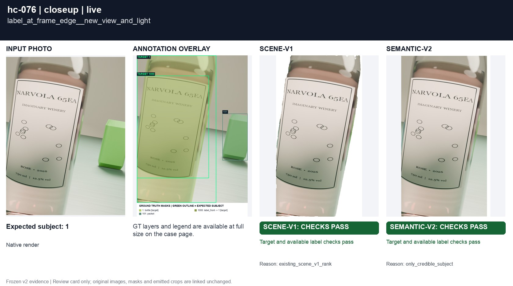
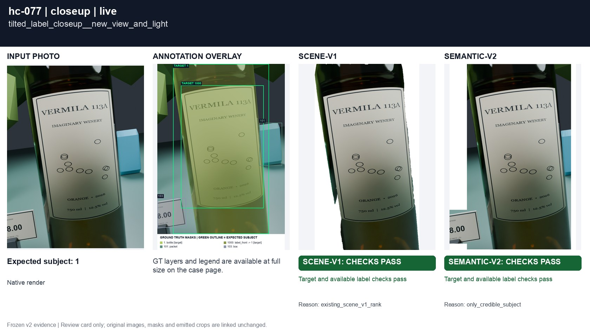

# Label-only photographs

[All groups](../README.md)

Front, back, edge-cropped and tilted label close-ups. No neck or cap is required. Without an enclosing bottle detection, preserve original-frame context.

8 cases. Failures below use frozen result fields; photos and fixtures retain separate interpretation.

| Case | scene-v1 | semantic-v2 |
|---|---|---|
| [hc-005 front_label_closeup](../cases/hc-005.md) | **FAIL** controlled: WRONG TARGET | Recorded checks pass |
| [hc-006 rear_label_closeup](../cases/hc-006.md) | **FAIL** controlled: WRONG TARGET | Recorded checks pass |
| [hc-007 label_at_frame_edge](../cases/hc-007.md) | **FAIL** controlled: WRONG TARGET; EXPECTED LABEL LOSS | Recorded checks pass |
| [hc-008 tilted_label_closeup](../cases/hc-008.md) | **FAIL** controlled: WRONG TARGET; EXPECTED LABEL LOSS | Recorded checks pass |
| [hc-074 front_label_closeup__new_view_and_light](../cases/hc-074.md) | **FAIL** controlled: WRONG TARGET | Recorded checks pass |
| [hc-075 rear_label_closeup__new_view_and_light](../cases/hc-075.md) | **FAIL** controlled: WRONG TARGET | Recorded checks pass |
| [hc-076 label_at_frame_edge__new_view_and_light](../cases/hc-076.md) | **FAIL** controlled: WRONG TARGET; EXPECTED LABEL LOSS | Recorded checks pass |
| [hc-077 tilted_label_closeup__new_view_and_light](../cases/hc-077.md) | **FAIL** controlled: WRONG TARGET; EXPECTED LABEL LOSS | Recorded checks pass |

## Visual examples

### hc-005 front_label_closeup

**scene-v1:** **FAIL** controlled: WRONG TARGET

[Open original photo, all masks and every selector crop](../cases/hc-005.md)

### hc-006 rear_label_closeup

**scene-v1:** **FAIL** controlled: WRONG TARGET

[Open original photo, all masks and every selector crop](../cases/hc-006.md)

### hc-007 label_at_frame_edge

**scene-v1:** **FAIL** controlled: WRONG TARGET; EXPECTED LABEL LOSS

[Open original photo, all masks and every selector crop](../cases/hc-007.md)

### hc-008 tilted_label_closeup

**scene-v1:** **FAIL** controlled: WRONG TARGET; EXPECTED LABEL LOSS

[Open original photo, all masks and every selector crop](../cases/hc-008.md)

### hc-074 front_label_closeup__new_view_and_light

**scene-v1:** **FAIL** controlled: WRONG TARGET

[Open original photo, all masks and every selector crop](../cases/hc-074.md)

### hc-075 rear_label_closeup__new_view_and_light

**scene-v1:** **FAIL** controlled: WRONG TARGET

[Open original photo, all masks and every selector crop](../cases/hc-075.md)

### hc-076 label_at_frame_edge__new_view_and_light

**scene-v1:** **FAIL** controlled: WRONG TARGET; EXPECTED LABEL LOSS

[Open original photo, all masks and every selector crop](../cases/hc-076.md)

### hc-077 tilted_label_closeup__new_view_and_light

**scene-v1:** **FAIL** controlled: WRONG TARGET; EXPECTED LABEL LOSS

[Open original photo, all masks and every selector crop](../cases/hc-077.md)

