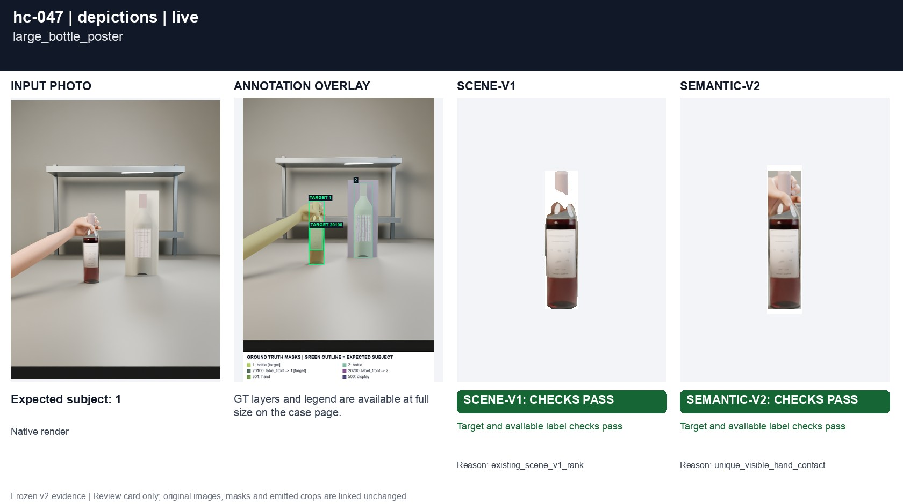
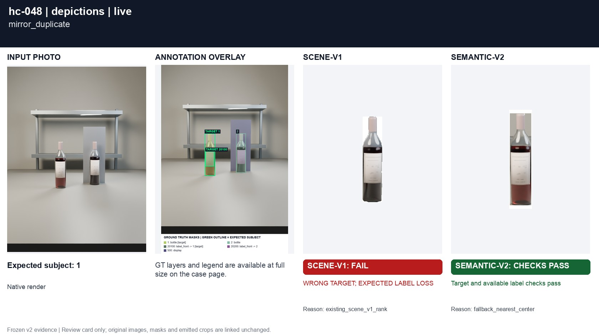
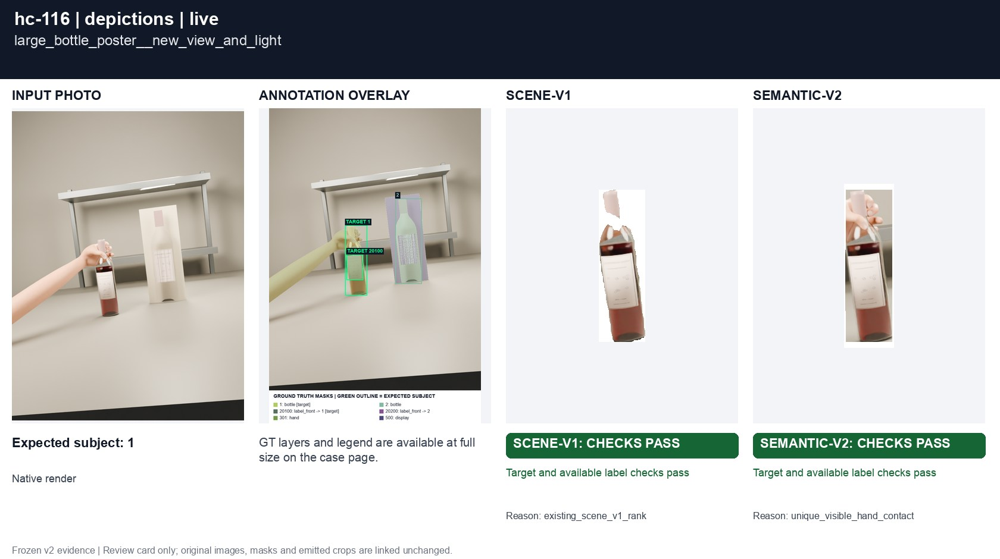
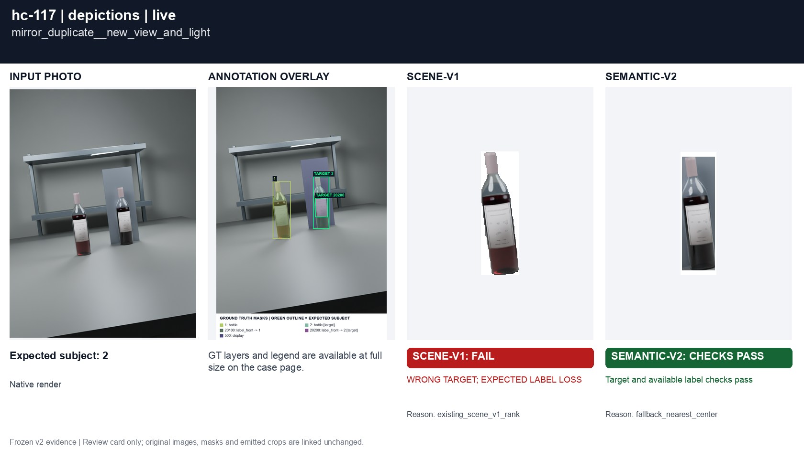

# Poster and mirror duplicate

[All groups](../README.md)

A large flat bottle poster beside a real bottle; a reflected duplicate. Physical ownership and representation masks are annotated separately. The mirror duplicate is staged virtual geometry (a reflection proxy), not a real reflected-light photo.

4 cases. Failures below use frozen result fields; photos and fixtures retain separate interpretation.

| Case | scene-v1 | semantic-v2 |
|---|---|---|
| [hc-047 large_bottle_poster](../cases/hc-047.md) | Recorded checks pass | Recorded checks pass |
| [hc-048 mirror_duplicate](../cases/hc-048.md) | **FAIL** live: WRONG TARGET; EXPECTED LABEL LOSS | Recorded checks pass |
| [hc-116 large_bottle_poster__new_view_and_light](../cases/hc-116.md) | Recorded checks pass | Recorded checks pass |
| [hc-117 mirror_duplicate__new_view_and_light](../cases/hc-117.md) | **FAIL** controlled: WRONG TARGET; EXPECTED LABEL LOSS, live: WRONG TARGET; EXPECTED LABEL LOSS | Recorded checks pass |

## Visual examples

### hc-047 large_bottle_poster

**scene-v1:** Recorded checks pass

[Open original photo, all masks and every selector crop](../cases/hc-047.md)

### hc-048 mirror_duplicate

**scene-v1:** **FAIL** live: WRONG TARGET; EXPECTED LABEL LOSS

[Open original photo, all masks and every selector crop](../cases/hc-048.md)

### hc-116 large_bottle_poster__new_view_and_light

**scene-v1:** Recorded checks pass

[Open original photo, all masks and every selector crop](../cases/hc-116.md)

### hc-117 mirror_duplicate__new_view_and_light

**scene-v1:** **FAIL** controlled: WRONG TARGET; EXPECTED LABEL LOSS, live: WRONG TARGET; EXPECTED LABEL LOSS

[Open original photo, all masks and every selector crop](../cases/hc-117.md)

