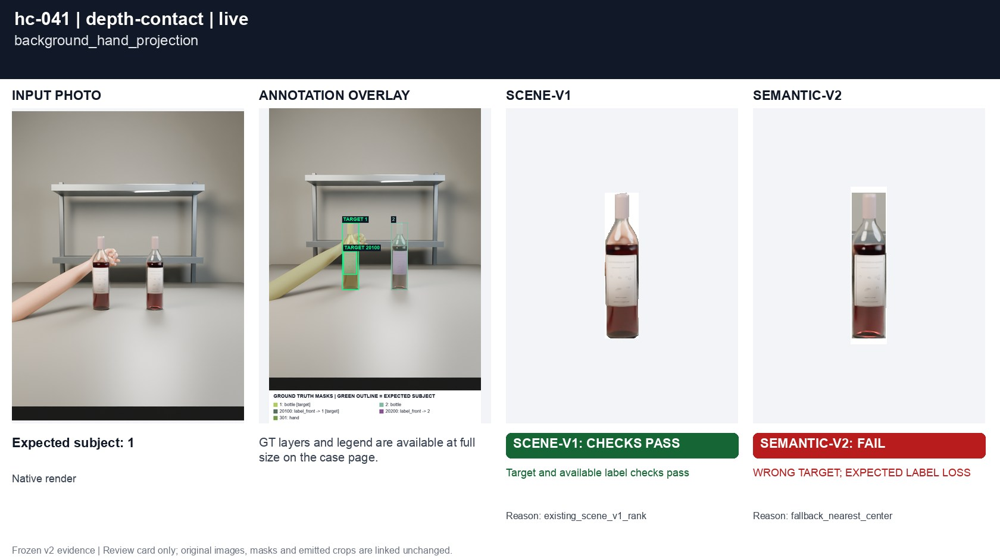
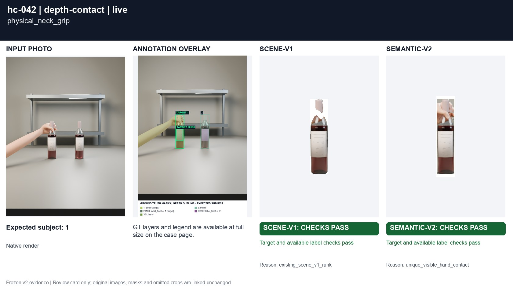
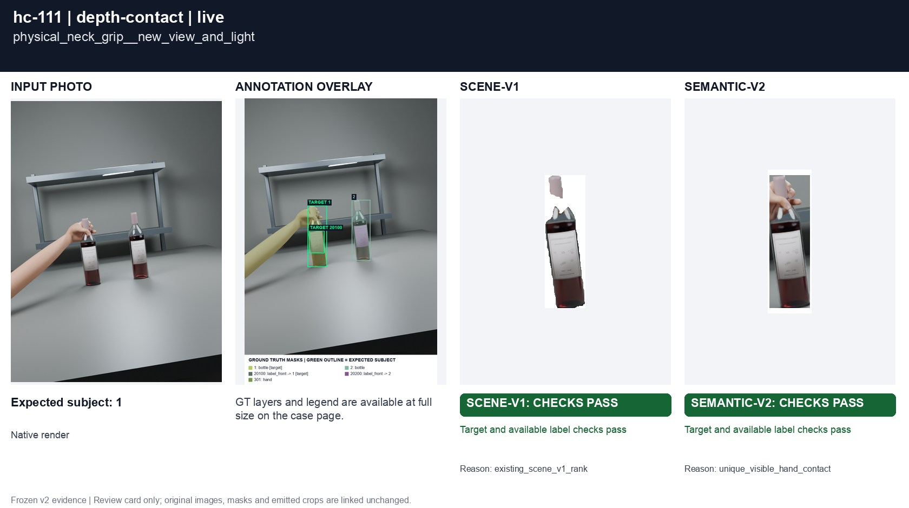

# Projected contact across depth

[All groups](../README.md)

A hand behind a bottle versus a physical grip. Native masks encode visible pixels, not ground-truth depth supplied to the selector.

4 cases. Failures below use frozen result fields; photos and fixtures retain separate interpretation.

| Case | scene-v1 | semantic-v2 |
|---|---|---|
| [hc-041 background_hand_projection](../cases/hc-041.md) | Recorded checks pass | **FAIL** live: WRONG TARGET; EXPECTED LABEL LOSS |
| [hc-042 physical_neck_grip](../cases/hc-042.md) | Recorded checks pass | Recorded checks pass |
| [hc-110 background_hand_projection__new_view_and_light](../cases/hc-110.md) | Recorded checks pass | Recorded checks pass |
| [hc-111 physical_neck_grip__new_view_and_light](../cases/hc-111.md) | Recorded checks pass | Recorded checks pass |

## Visual examples

### hc-041 background_hand_projection

**scene-v1:** Recorded checks pass

[Open original photo, all masks and every selector crop](../cases/hc-041.md)

### hc-042 physical_neck_grip

**scene-v1:** Recorded checks pass

[Open original photo, all masks and every selector crop](../cases/hc-042.md)

### hc-110 background_hand_projection__new_view_and_light

**scene-v1:** Recorded checks pass

[Open original photo, all masks and every selector crop](../cases/hc-110.md)

### hc-111 physical_neck_grip__new_view_and_light

**scene-v1:** Recorded checks pass

[Open original photo, all masks and every selector crop](../cases/hc-111.md)

