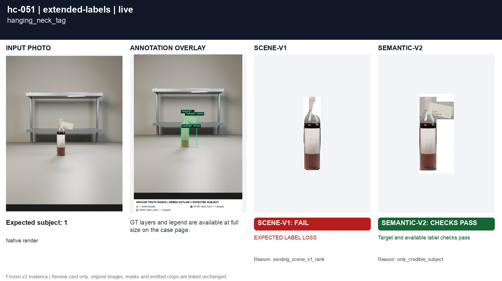
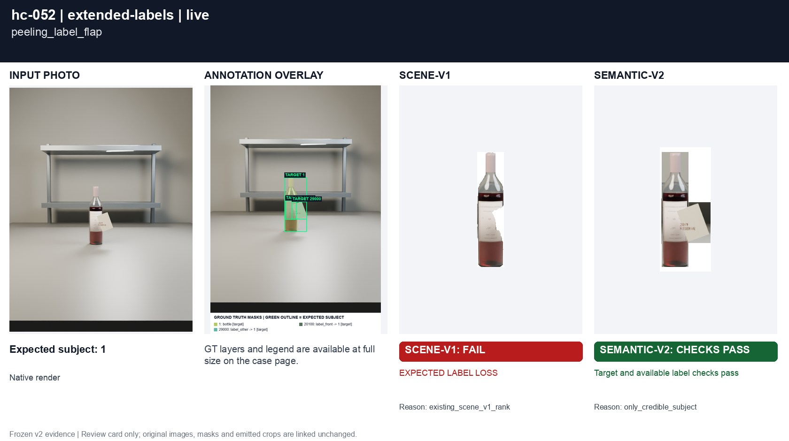
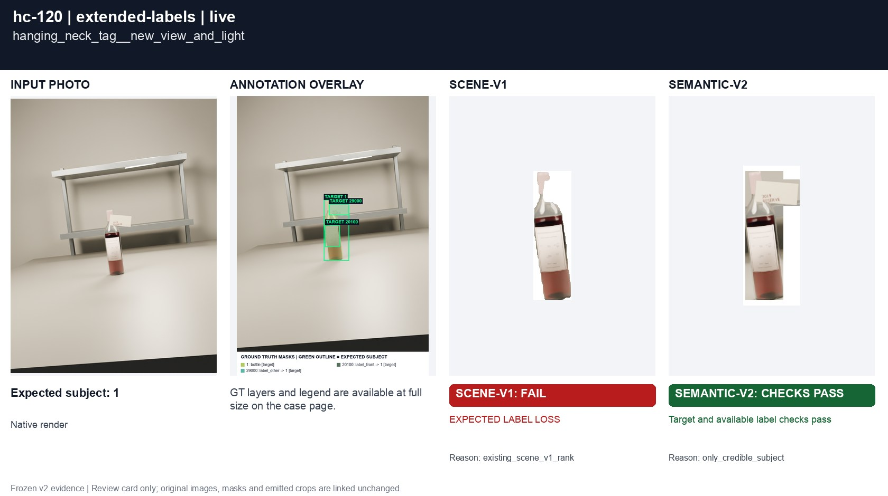
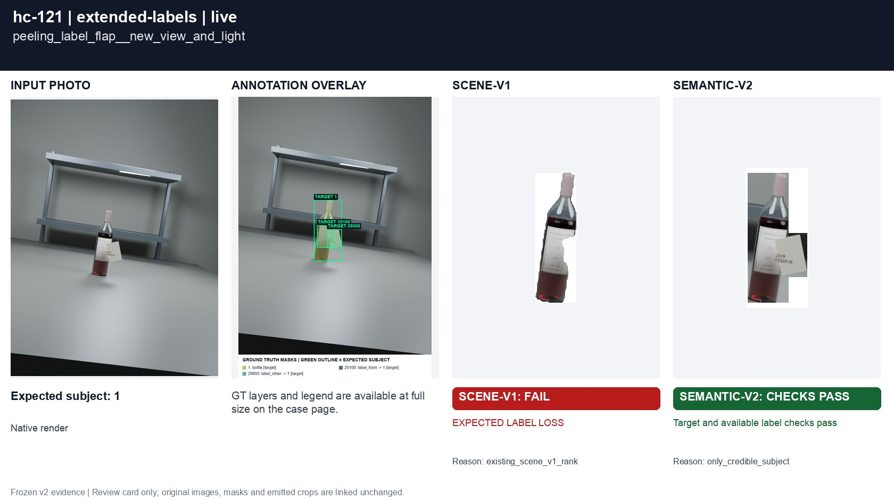

# Tags and paper outside the bottle body

[All groups](../README.md)

A hanging neck tag and a peeling paper flap. They belong to the bottle and must remain complete.

4 cases. Failures below use frozen result fields; photos and fixtures retain separate interpretation.

| Case | scene-v1 | semantic-v2 |
|---|---|---|
| [hc-051 hanging_neck_tag](../cases/hc-051.md) | **FAIL** live: EXPECTED LABEL LOSS | Recorded checks pass |
| [hc-052 peeling_label_flap](../cases/hc-052.md) | **FAIL** live: EXPECTED LABEL LOSS | Recorded checks pass |
| [hc-120 hanging_neck_tag__new_view_and_light](../cases/hc-120.md) | **FAIL** live: EXPECTED LABEL LOSS | Recorded checks pass |
| [hc-121 peeling_label_flap__new_view_and_light](../cases/hc-121.md) | **FAIL** live: EXPECTED LABEL LOSS | Recorded checks pass |

## Visual examples

### hc-051 hanging_neck_tag

**scene-v1:** **FAIL** live: EXPECTED LABEL LOSS

[Open original photo, all masks and every selector crop](../cases/hc-051.md)

### hc-052 peeling_label_flap

**scene-v1:** **FAIL** live: EXPECTED LABEL LOSS

[Open original photo, all masks and every selector crop](../cases/hc-052.md)

### hc-120 hanging_neck_tag__new_view_and_light

**scene-v1:** **FAIL** live: EXPECTED LABEL LOSS

[Open original photo, all masks and every selector crop](../cases/hc-120.md)

### hc-121 peeling_label_flap__new_view_and_light

**scene-v1:** **FAIL** live: EXPECTED LABEL LOSS

[Open original photo, all masks and every selector crop](../cases/hc-121.md)

