# Deterministic fallback fixtures

[All groups](../README.md)

Declared geometry inputs; separate from photograph accuracy.

11 cases. Failures below use frozen result fields; photos and fixtures retain separate interpretation.

| Case | scene-v1 | semantic-v2 |
|---|---|---|
| [fb-center-mask Mask at photo center beats a nearer box center](../cases/fb-center-mask.md) | Contract N/A; fallback: target differs | Recorded checks pass |
| [fb-nearest No center coverage: nearest bottle center](../cases/fb-nearest.md) | Contract N/A; fallback: target differs | Recorded checks pass |
| [fb-left Equal distances: left wins despite detector order](../cases/fb-left.md) | Contract N/A; fallback: target differs | Recorded checks pass |
| [fb-upper Equal distance and x: upper wins](../cases/fb-upper.md) | Contract N/A; fallback: target differs | Recorded checks pass |
| [fb-overlap Two masks cover the center: nearest box center wins](../cases/fb-overlap.md) | Contract N/A; fallback: target match | Recorded checks pass |
| [fb-stable-id Identical box centers: stable response ID](../cases/fb-stable-id.md) | Contract N/A; fallback: target match | Recorded checks pass |
| [fb-pixel-distance Non-square photo: Euclidean pixel distance](../cases/fb-pixel-distance.md) | Contract N/A; fallback: target differs | Recorded checks pass |
| [fb-no-candidates No candidate: unchanged full image](../cases/fb-no-candidates.md) | Contract N/A; fallback: target match | Recorded checks pass |
| [fb-low-confidence Only rejected low-confidence detection: full image](../cases/fb-low-confidence.md) | Contract N/A; fallback: target match | Recorded checks pass |
| [fb-tap-miss Unresolved tap: still return a crop](../cases/fb-tap-miss.md) | Contract N/A; fallback: target differs | Recorded checks pass |
| [fb-reticle-unresolved Unresolved reticle: fallback uses photo center](../cases/fb-reticle-unresolved.md) | Contract N/A; fallback: target match | Recorded checks pass |

## Visual examples

### fb-center-mask Mask at photo center beats a nearer box center

**scene-v1:** Contract N/A; fallback: target differs

[Open original photo, all masks and every selector crop](../cases/fb-center-mask.md)

[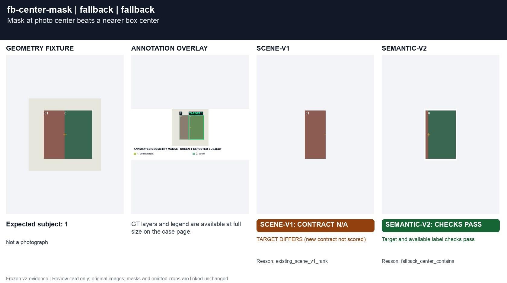](../cases/fb-center-mask.md)

### fb-nearest No center coverage: nearest bottle center

**scene-v1:** Contract N/A; fallback: target differs

[Open original photo, all masks and every selector crop](../cases/fb-nearest.md)

[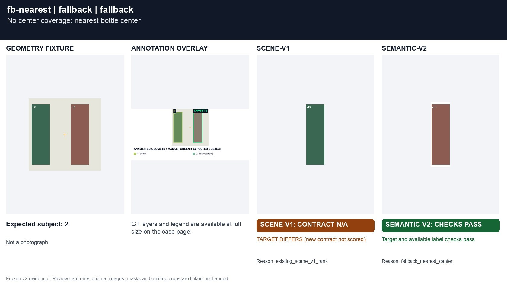](../cases/fb-nearest.md)

### fb-left Equal distances: left wins despite detector order

**scene-v1:** Contract N/A; fallback: target differs

[Open original photo, all masks and every selector crop](../cases/fb-left.md)

[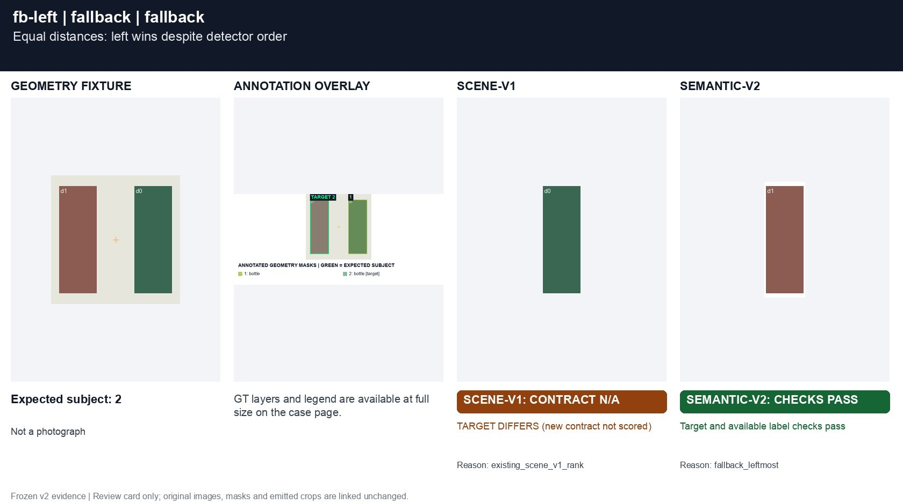](../cases/fb-left.md)

### fb-upper Equal distance and x: upper wins

**scene-v1:** Contract N/A; fallback: target differs

[Open original photo, all masks and every selector crop](../cases/fb-upper.md)

[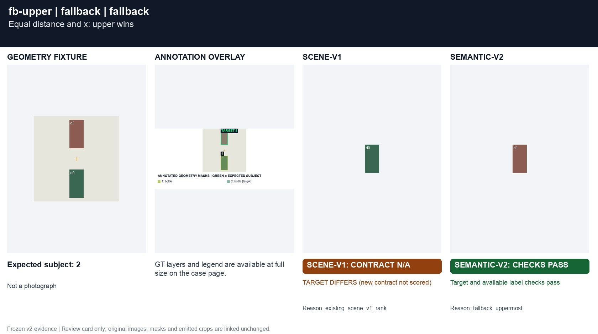](../cases/fb-upper.md)

### fb-overlap Two masks cover the center: nearest box center wins

**scene-v1:** Contract N/A; fallback: target match

[Open original photo, all masks and every selector crop](../cases/fb-overlap.md)

[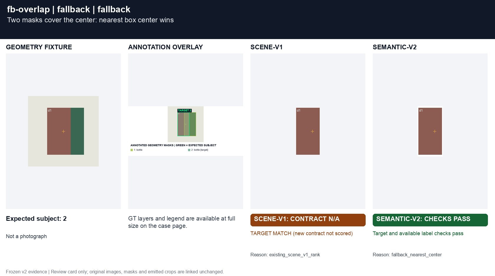](../cases/fb-overlap.md)

### fb-stable-id Identical box centers: stable response ID

**scene-v1:** Contract N/A; fallback: target match

[Open original photo, all masks and every selector crop](../cases/fb-stable-id.md)

[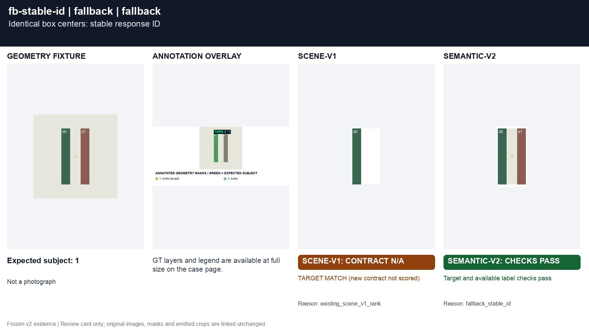](../cases/fb-stable-id.md)

### fb-pixel-distance Non-square photo: Euclidean pixel distance

**scene-v1:** Contract N/A; fallback: target differs

[Open original photo, all masks and every selector crop](../cases/fb-pixel-distance.md)

[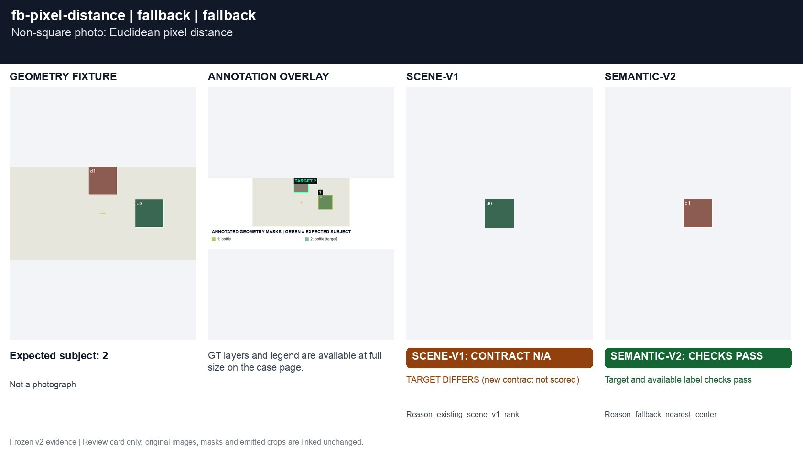](../cases/fb-pixel-distance.md)

### fb-no-candidates No candidate: unchanged full image

**scene-v1:** Contract N/A; fallback: target match

[Open original photo, all masks and every selector crop](../cases/fb-no-candidates.md)

[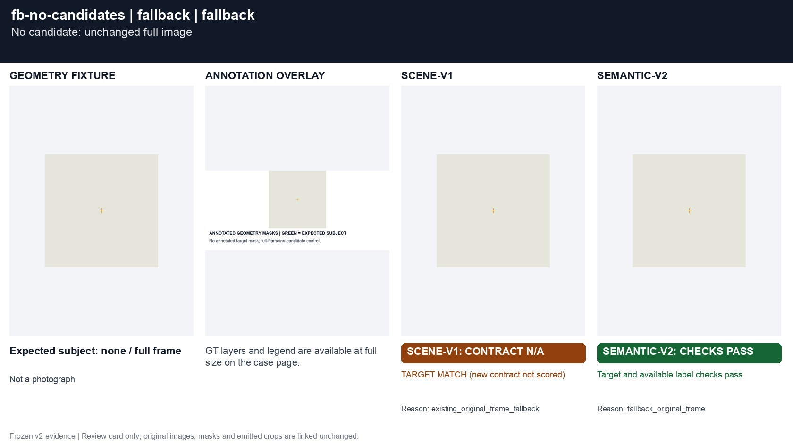](../cases/fb-no-candidates.md)

### fb-low-confidence Only rejected low-confidence detection: full image

**scene-v1:** Contract N/A; fallback: target match

[Open original photo, all masks and every selector crop](../cases/fb-low-confidence.md)

[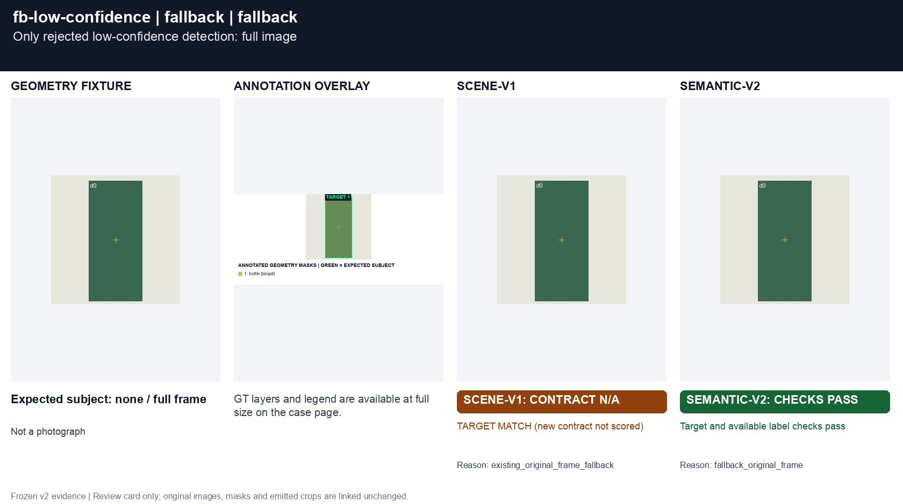](../cases/fb-low-confidence.md)

### fb-tap-miss Unresolved tap: still return a crop

**scene-v1:** Contract N/A; fallback: target differs

[Open original photo, all masks and every selector crop](../cases/fb-tap-miss.md)

[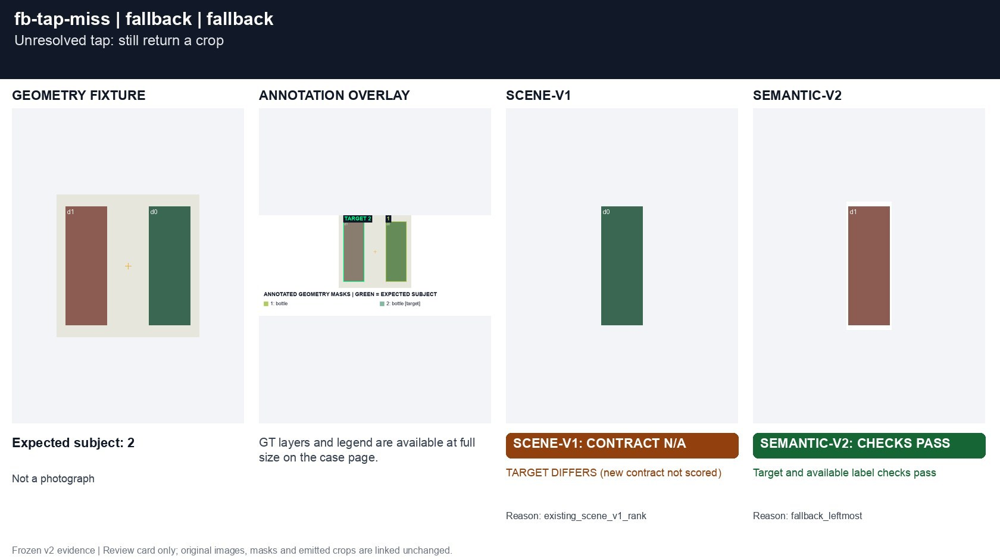](../cases/fb-tap-miss.md)

### fb-reticle-unresolved Unresolved reticle: fallback uses photo center

**scene-v1:** Contract N/A; fallback: target match

[Open original photo, all masks and every selector crop](../cases/fb-reticle-unresolved.md)

[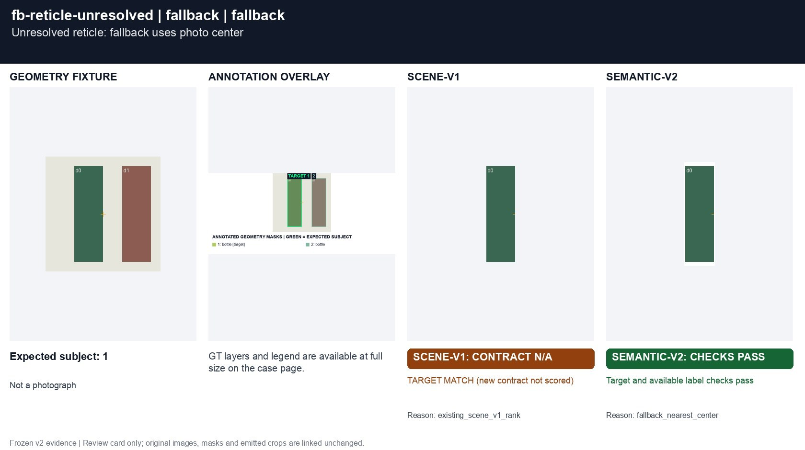](../cases/fb-reticle-unresolved.md)

