# Three bottles: foreground versus photo center

[All groups](../README.md)

Two background bottles close to center and one foreground bottle off-center. Includes overlap, edge framing, weak depth, a background magnum and an explicit background tap. Size is prominence evidence, not measured camera depth. A horizontally lying foreground bottle is a pose countercontrol.

14 cases. Failures below use frozen result fields; photos and fixtures retain separate interpretation.

| Case | scene-v1 | semantic-v2 |
|---|---|---|
| [hc-061 three_foreground_offcenter](../cases/hc-061.md) | Recorded checks pass | Recorded checks pass |
| [hc-062 three_foreground_overlap](../cases/hc-062.md) | Recorded checks pass | Recorded checks pass |
| [hc-063 three_foreground_at_edge](../cases/hc-063.md) | Recorded checks pass | Recorded checks pass |
| [hc-064 three_weak_depth](../cases/hc-064.md) | Recorded checks pass | Recorded checks pass |
| [hc-065 three_background_magnum](../cases/hc-065.md) | **FAIL** controlled: WRONG TARGET; EXPECTED LABEL LOSS, live: WRONG TARGET; EXPECTED LABEL LOSS | Recorded checks pass |
| [hc-066 three_tap_background](../cases/hc-066.md) | **FAIL** controlled: WRONG TARGET; EXPECTED LABEL LOSS, live: WRONG TARGET; EXPECTED LABEL LOSS | Recorded checks pass |
| [hc-069 three_foreground_lying](../cases/hc-069.md) | Recorded checks pass | Recorded checks pass |
| [hc-130 three_foreground_offcenter__new_view_and_light](../cases/hc-130.md) | Recorded checks pass | Recorded checks pass |
| [hc-131 three_foreground_overlap__new_view_and_light](../cases/hc-131.md) | Recorded checks pass | Recorded checks pass |
| [hc-132 three_foreground_at_edge__new_view_and_light](../cases/hc-132.md) | **FAIL** controlled: WRONG TARGET; EXPECTED LABEL LOSS, live: WRONG TARGET; EXPECTED LABEL LOSS | Recorded checks pass |
| [hc-133 three_weak_depth__new_view_and_light](../cases/hc-133.md) | Recorded checks pass | Recorded checks pass |
| [hc-134 three_background_magnum__new_view_and_light](../cases/hc-134.md) | **FAIL** controlled: WRONG TARGET; EXPECTED LABEL LOSS, live: WRONG TARGET; EXPECTED LABEL LOSS | Recorded checks pass |
| [hc-135 three_tap_background__new_view_and_light](../cases/hc-135.md) | **FAIL** controlled: WRONG TARGET; EXPECTED LABEL LOSS, live: WRONG TARGET; EXPECTED LABEL LOSS | Recorded checks pass |
| [hc-138 three_foreground_lying__new_view_and_light](../cases/hc-138.md) | Recorded checks pass | Recorded checks pass |

## Visual examples

### hc-061 three_foreground_offcenter

**scene-v1:** Recorded checks pass

[Open original photo, all masks and every selector crop](../cases/hc-061.md)

### hc-062 three_foreground_overlap

**scene-v1:** Recorded checks pass

[Open original photo, all masks and every selector crop](../cases/hc-062.md)

[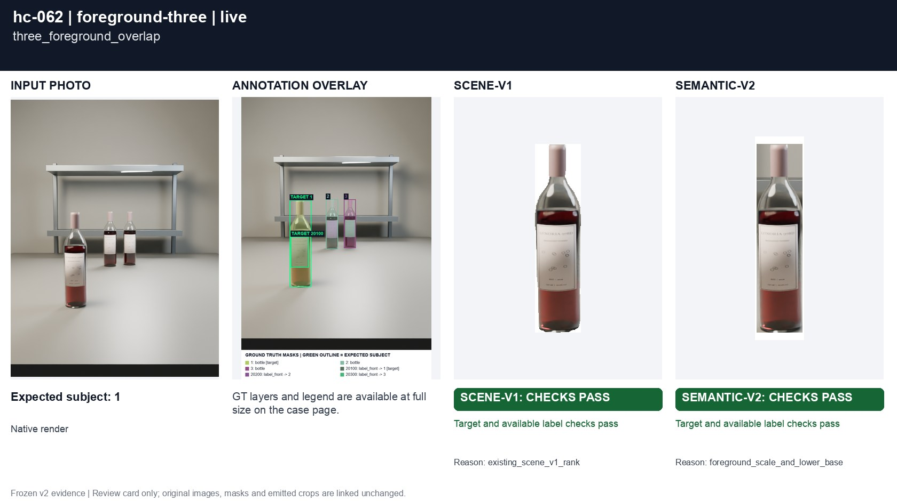](../cases/hc-062.md)

### hc-063 three_foreground_at_edge

**scene-v1:** Recorded checks pass

[Open original photo, all masks and every selector crop](../cases/hc-063.md)

[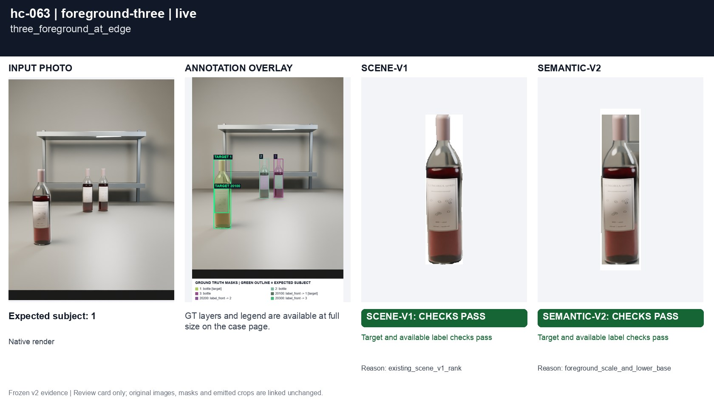](../cases/hc-063.md)

### hc-064 three_weak_depth

**scene-v1:** Recorded checks pass

[Open original photo, all masks and every selector crop](../cases/hc-064.md)

[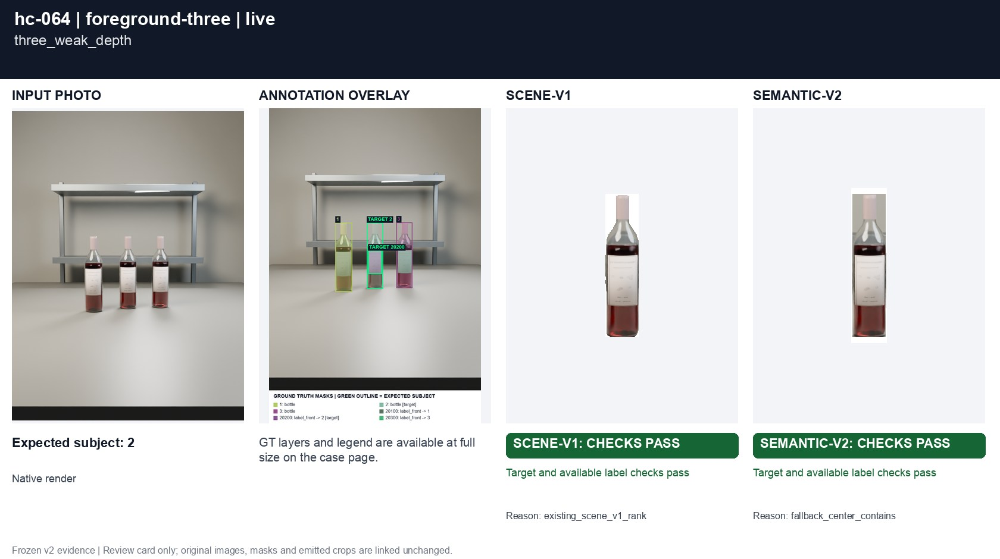](../cases/hc-064.md)

### hc-065 three_background_magnum

**scene-v1:** **FAIL** controlled: WRONG TARGET; EXPECTED LABEL LOSS, live: WRONG TARGET; EXPECTED LABEL LOSS

[Open original photo, all masks and every selector crop](../cases/hc-065.md)

[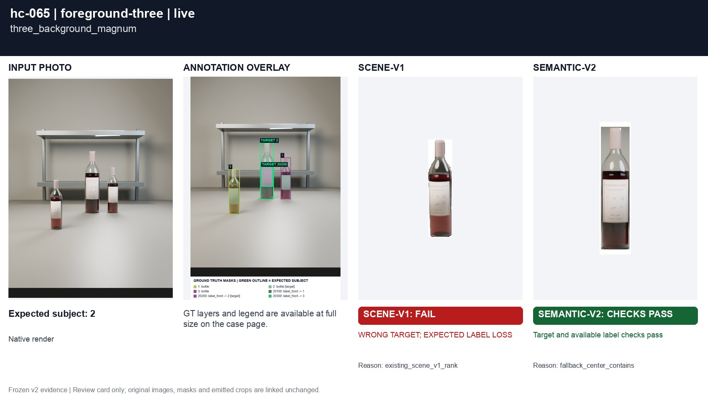](../cases/hc-065.md)

### hc-066 three_tap_background

**scene-v1:** **FAIL** controlled: WRONG TARGET; EXPECTED LABEL LOSS, live: WRONG TARGET; EXPECTED LABEL LOSS

[Open original photo, all masks and every selector crop](../cases/hc-066.md)

### hc-069 three_foreground_lying

**scene-v1:** Recorded checks pass

[Open original photo, all masks and every selector crop](../cases/hc-069.md)

### hc-130 three_foreground_offcenter__new_view_and_light

**scene-v1:** Recorded checks pass

[Open original photo, all masks and every selector crop](../cases/hc-130.md)

[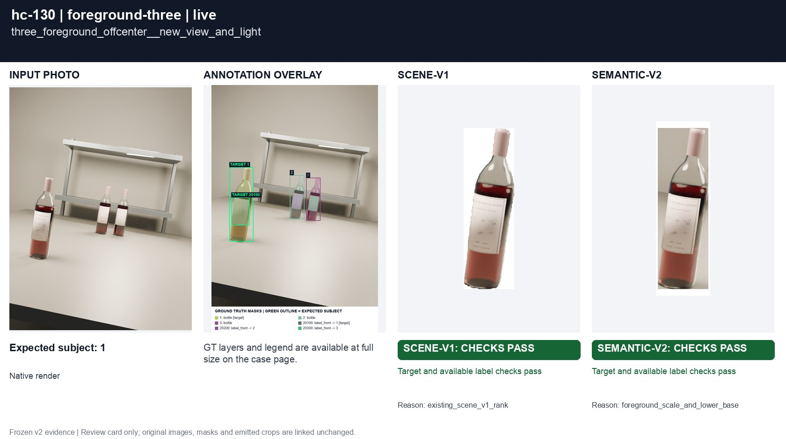](../cases/hc-130.md)

### hc-131 three_foreground_overlap__new_view_and_light

**scene-v1:** Recorded checks pass

[Open original photo, all masks and every selector crop](../cases/hc-131.md)

[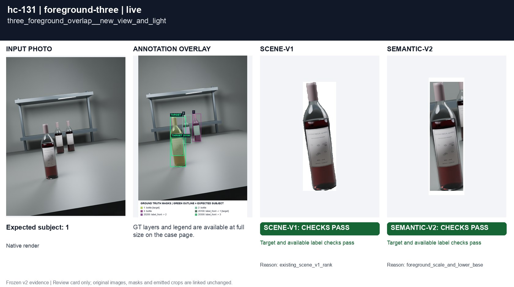](../cases/hc-131.md)

### hc-132 three_foreground_at_edge__new_view_and_light

**scene-v1:** **FAIL** controlled: WRONG TARGET; EXPECTED LABEL LOSS, live: WRONG TARGET; EXPECTED LABEL LOSS

[Open original photo, all masks and every selector crop](../cases/hc-132.md)

[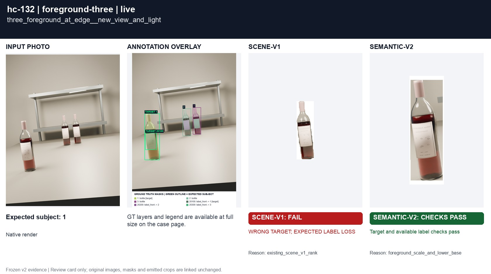](../cases/hc-132.md)

### hc-133 three_weak_depth__new_view_and_light

**scene-v1:** Recorded checks pass

[Open original photo, all masks and every selector crop](../cases/hc-133.md)

[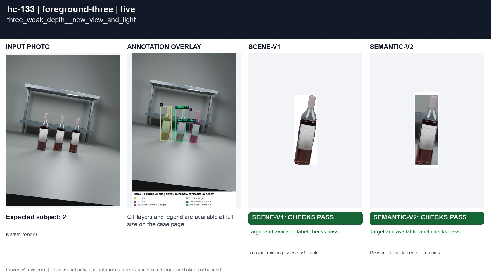](../cases/hc-133.md)

### hc-134 three_background_magnum__new_view_and_light

**scene-v1:** **FAIL** controlled: WRONG TARGET; EXPECTED LABEL LOSS, live: WRONG TARGET; EXPECTED LABEL LOSS

[Open original photo, all masks and every selector crop](../cases/hc-134.md)

[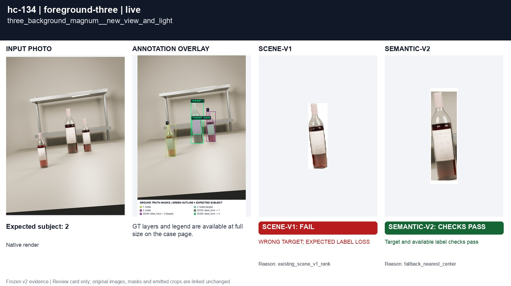](../cases/hc-134.md)

### hc-135 three_tap_background__new_view_and_light

**scene-v1:** **FAIL** controlled: WRONG TARGET; EXPECTED LABEL LOSS, live: WRONG TARGET; EXPECTED LABEL LOSS

[Open original photo, all masks and every selector crop](../cases/hc-135.md)

[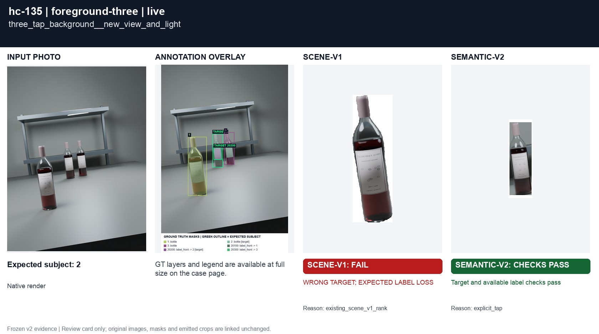](../cases/hc-135.md)

### hc-138 three_foreground_lying__new_view_and_light

**scene-v1:** Recorded checks pass

[Open original photo, all masks and every selector crop](../cases/hc-138.md)

[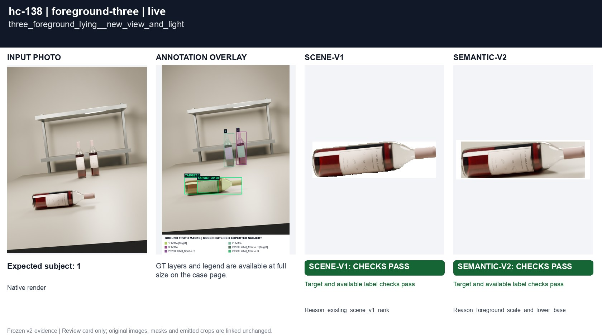](../cases/hc-138.md)

