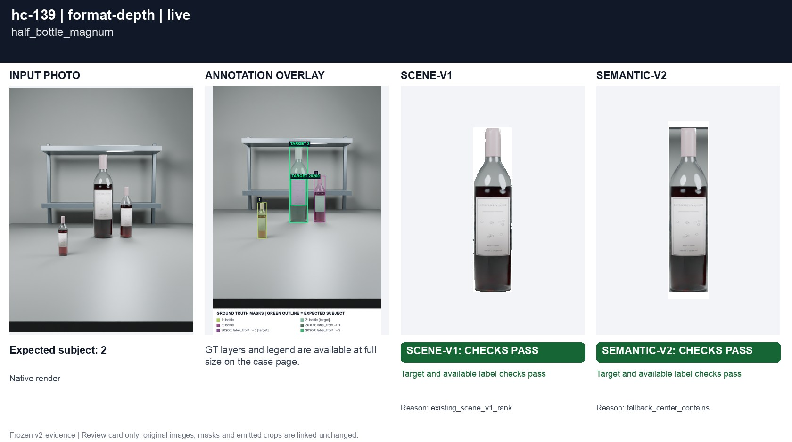
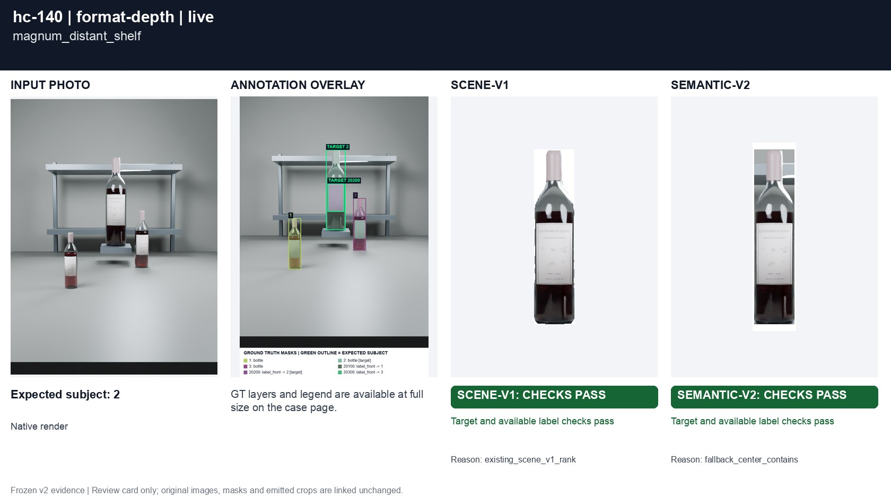
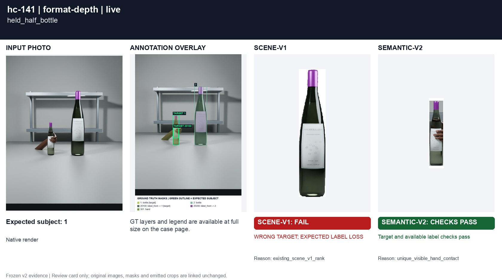

# Bottle format versus camera distance

[All groups](../README.md)

Half bottles, magnums and a held small bottle. Conflicting apparent size and depth use fallback unless a grip establishes intent.

3 cases. Failures below use frozen result fields; photos and fixtures retain separate interpretation.

| Case | scene-v1 | semantic-v2 |
|---|---|---|
| [hc-139 half_bottle_magnum](../cases/hc-139.md) | Recorded checks pass | Recorded checks pass |
| [hc-140 magnum_distant_shelf](../cases/hc-140.md) | Recorded checks pass | Recorded checks pass |
| [hc-141 held_half_bottle](../cases/hc-141.md) | **FAIL** controlled: WRONG TARGET; EXPECTED LABEL LOSS, live: WRONG TARGET; EXPECTED LABEL LOSS | Recorded checks pass |

## Visual examples

### hc-139 half_bottle_magnum

**scene-v1:** Recorded checks pass

[Open original photo, all masks and every selector crop](../cases/hc-139.md)

### hc-140 magnum_distant_shelf

**scene-v1:** Recorded checks pass

[Open original photo, all masks and every selector crop](../cases/hc-140.md)

### hc-141 held_half_bottle

**scene-v1:** **FAIL** controlled: WRONG TARGET; EXPECTED LABEL LOSS, live: WRONG TARGET; EXPECTED LABEL LOSS

[Open original photo, all masks and every selector crop](../cases/hc-141.md)

