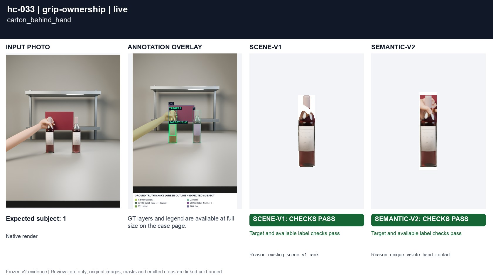
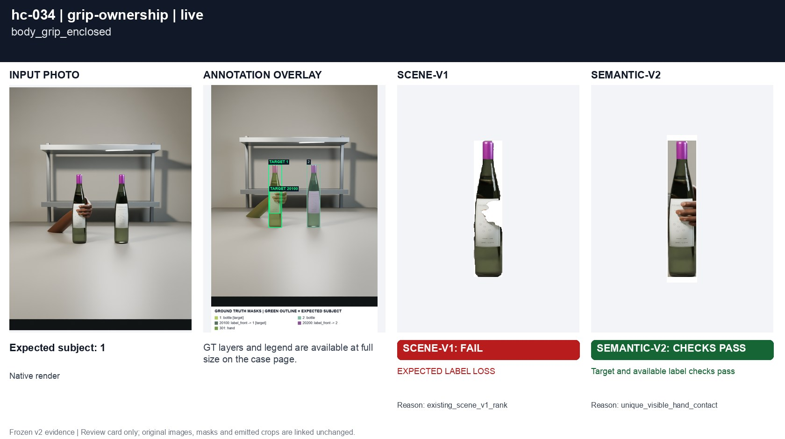
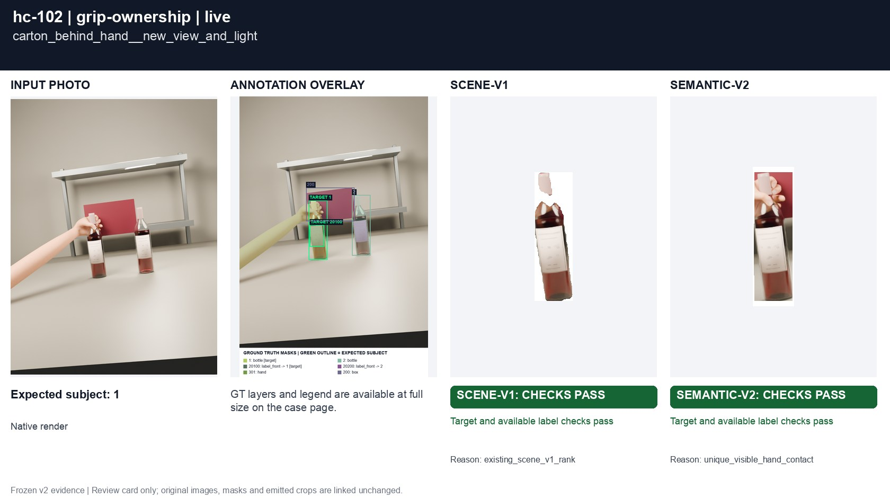
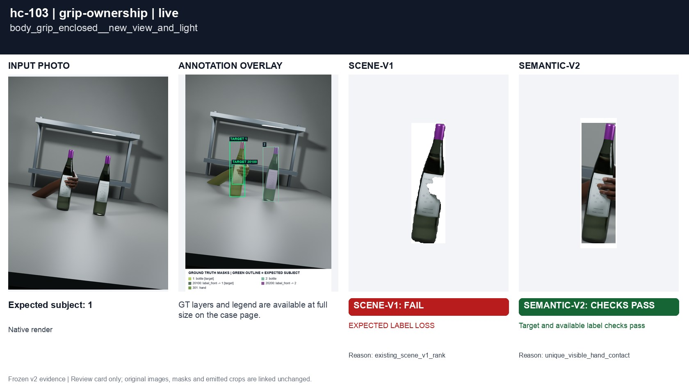

# Grip ownership and occluding packages

[All groups](../README.md)

A carton behind a hand and a legitimate body grip. Enclosure alone must not establish or reject a grip.

4 cases. Failures below use frozen result fields; photos and fixtures retain separate interpretation.

| Case | scene-v1 | semantic-v2 |
|---|---|---|
| [hc-033 carton_behind_hand](../cases/hc-033.md) | Recorded checks pass | Recorded checks pass |
| [hc-034 body_grip_enclosed](../cases/hc-034.md) | **FAIL** live: EXPECTED LABEL LOSS | Recorded checks pass |
| [hc-102 carton_behind_hand__new_view_and_light](../cases/hc-102.md) | Recorded checks pass | Recorded checks pass |
| [hc-103 body_grip_enclosed__new_view_and_light](../cases/hc-103.md) | **FAIL** live: EXPECTED LABEL LOSS | Recorded checks pass |

## Visual examples

### hc-033 carton_behind_hand

**scene-v1:** Recorded checks pass

[Open original photo, all masks and every selector crop](../cases/hc-033.md)

### hc-034 body_grip_enclosed

**scene-v1:** **FAIL** live: EXPECTED LABEL LOSS

[Open original photo, all masks and every selector crop](../cases/hc-034.md)

### hc-102 carton_behind_hand__new_view_and_light

**scene-v1:** Recorded checks pass

[Open original photo, all masks and every selector crop](../cases/hc-102.md)

### hc-103 body_grip_enclosed__new_view_and_light

**scene-v1:** **FAIL** live: EXPECTED LABEL LOSS

[Open original photo, all masks and every selector crop](../cases/hc-103.md)

