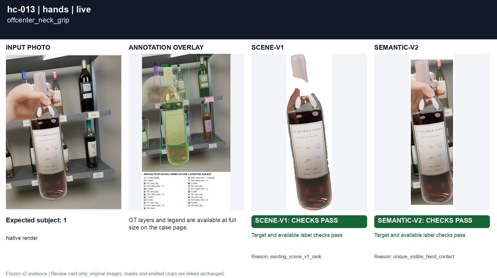
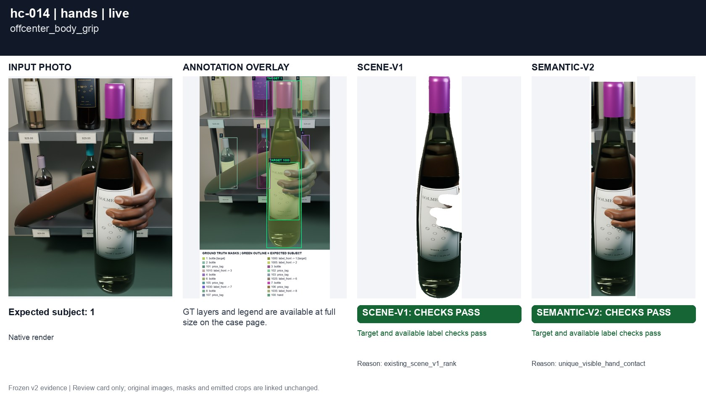
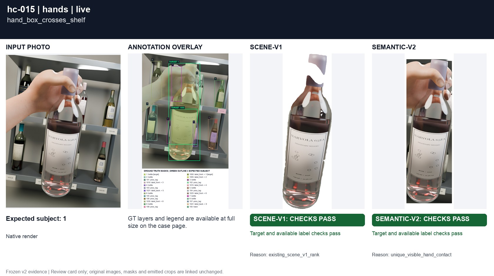
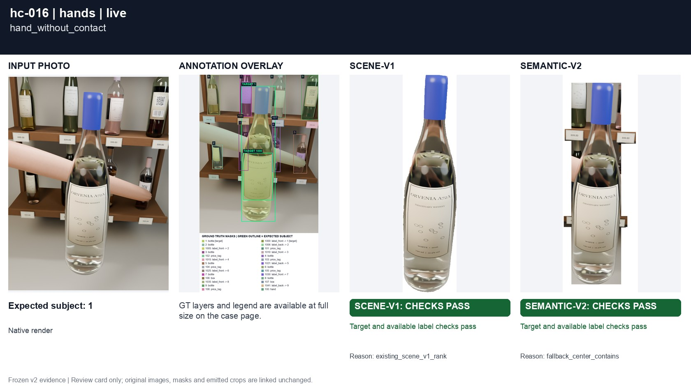
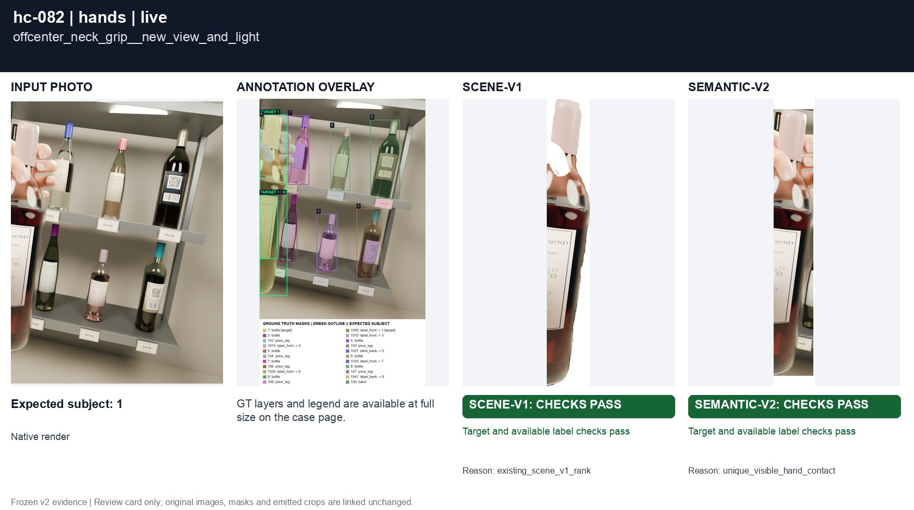
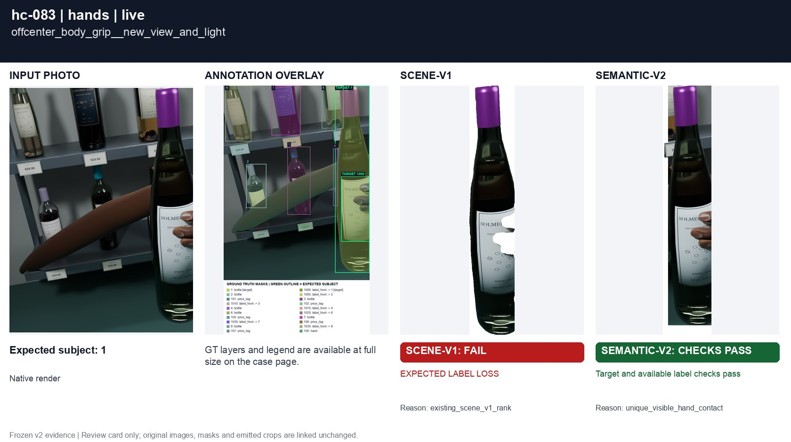
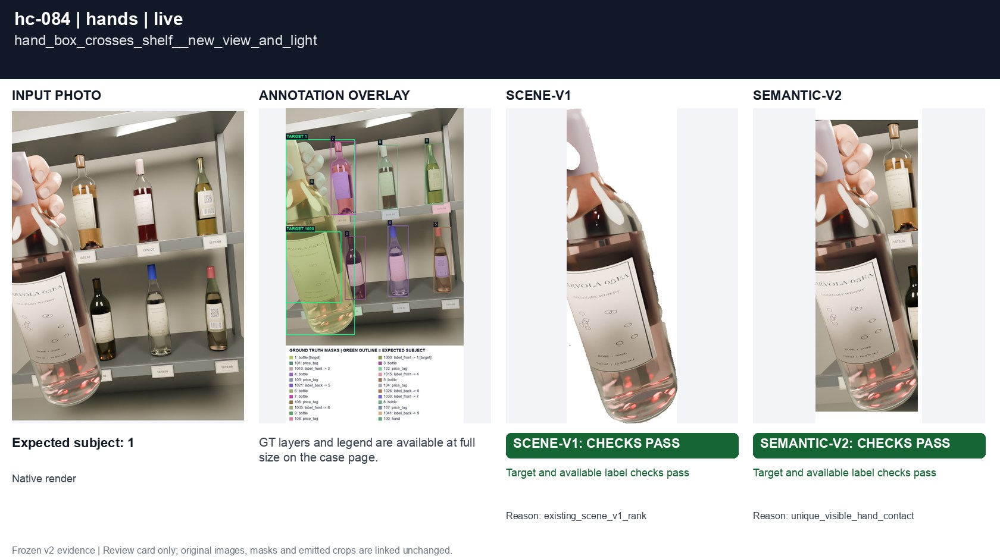
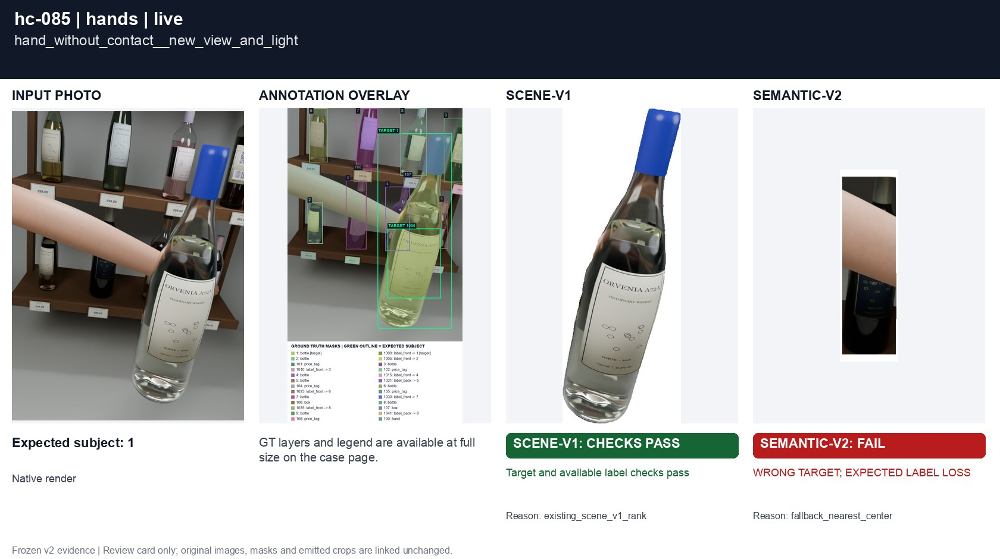

# Hand association

[All groups](../README.md)

Off-center neck/body grips, a large hand bounding box crossing background bottles, and a hand moved clear of a bottle. Mask adjacency supports contact; box overlap alone must not establish a grip.

10 cases. Failures below use frozen result fields; photos and fixtures retain separate interpretation.

| Case | scene-v1 | semantic-v2 |
|---|---|---|
| [hc-013 offcenter_neck_grip](../cases/hc-013.md) | Recorded checks pass | Recorded checks pass |
| [hc-014 offcenter_body_grip](../cases/hc-014.md) | Recorded checks pass | Recorded checks pass |
| [hc-015 hand_box_crosses_shelf](../cases/hc-015.md) | Recorded checks pass | Recorded checks pass |
| [hc-016 hand_without_contact](../cases/hc-016.md) | Recorded checks pass | Recorded checks pass |
| [hc-082 offcenter_neck_grip__new_view_and_light](../cases/hc-082.md) | Recorded checks pass | Recorded checks pass |
| [hc-083 offcenter_body_grip__new_view_and_light](../cases/hc-083.md) | **FAIL** live: EXPECTED LABEL LOSS | Recorded checks pass |
| [hc-084 hand_box_crosses_shelf__new_view_and_light](../cases/hc-084.md) | Recorded checks pass | Recorded checks pass |
| [hc-085 hand_without_contact__new_view_and_light](../cases/hc-085.md) | Recorded checks pass | **FAIL** controlled: WRONG TARGET; EXPECTED LABEL LOSS, live: WRONG TARGET; EXPECTED LABEL LOSS |
| [real-25394 napkin_around_a_held_bottle](../cases/real-25394.md) | Recorded checks pass | Recorded checks pass |
| [real-22705 foreground_glass_does_not_hold_background_bottle](../cases/real-22705.md) | Recorded checks pass | Recorded checks pass |

## Visual examples

### hc-013 offcenter_neck_grip

**scene-v1:** Recorded checks pass

[Open original photo, all masks and every selector crop](../cases/hc-013.md)

### hc-014 offcenter_body_grip

**scene-v1:** Recorded checks pass

[Open original photo, all masks and every selector crop](../cases/hc-014.md)

### hc-015 hand_box_crosses_shelf

**scene-v1:** Recorded checks pass

[Open original photo, all masks and every selector crop](../cases/hc-015.md)

### hc-016 hand_without_contact

**scene-v1:** Recorded checks pass

[Open original photo, all masks and every selector crop](../cases/hc-016.md)

### hc-082 offcenter_neck_grip__new_view_and_light

**scene-v1:** Recorded checks pass

[Open original photo, all masks and every selector crop](../cases/hc-082.md)

### hc-083 offcenter_body_grip__new_view_and_light

**scene-v1:** **FAIL** live: EXPECTED LABEL LOSS

[Open original photo, all masks and every selector crop](../cases/hc-083.md)

### hc-084 hand_box_crosses_shelf__new_view_and_light

**scene-v1:** Recorded checks pass

[Open original photo, all masks and every selector crop](../cases/hc-084.md)

### hc-085 hand_without_contact__new_view_and_light

**scene-v1:** Recorded checks pass

[Open original photo, all masks and every selector crop](../cases/hc-085.md)

### real-25394 napkin_around_a_held_bottle

**scene-v1:** Recorded checks pass

[Open original photo, all masks and every selector crop](../cases/real-25394.md)

### real-22705 foreground_glass_does_not_hold_background_bottle

**scene-v1:** Recorded checks pass

[Open original photo, all masks and every selector crop](../cases/real-22705.md)

