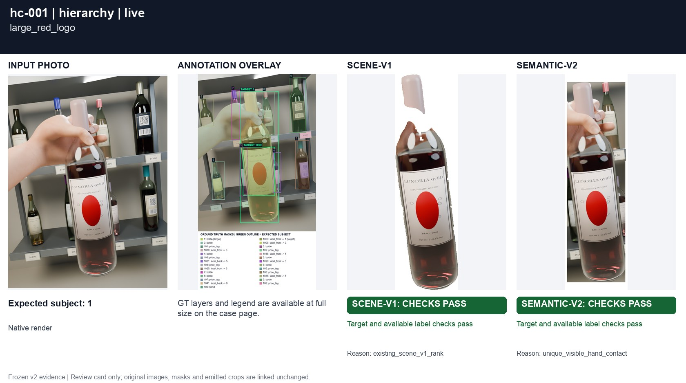
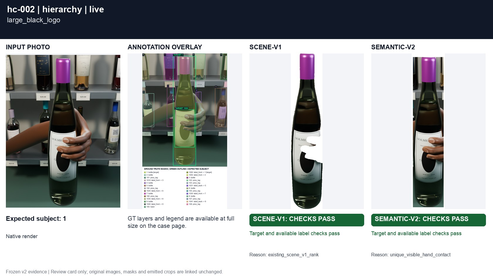
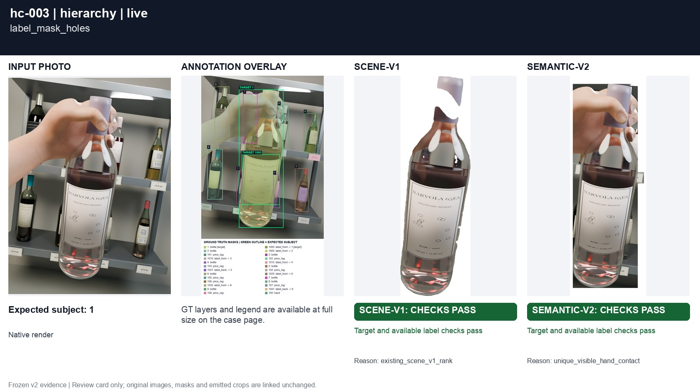
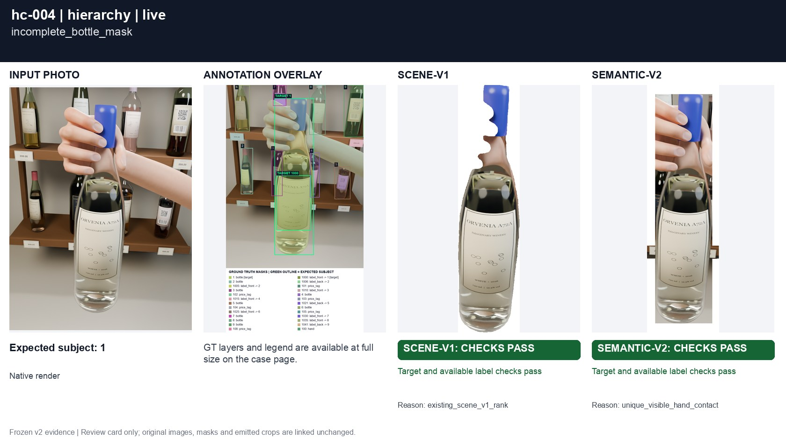
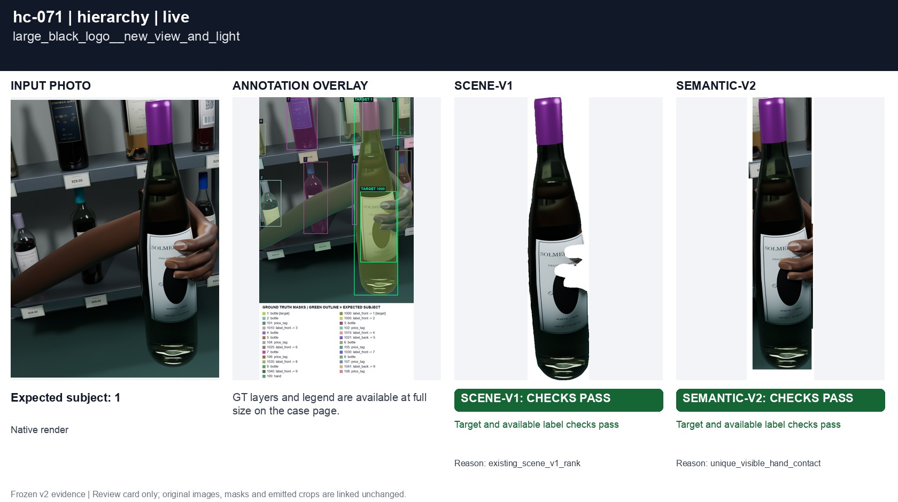
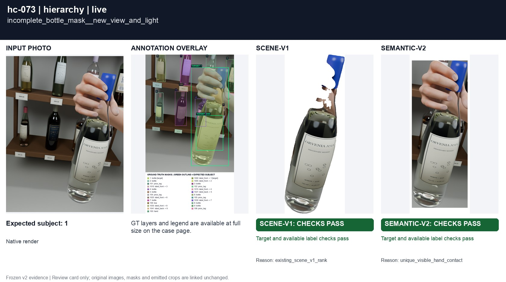

# Whole labels, not logos

[All groups](../README.md)

Large red and black emblems, a perforated predicted label mask, and an incomplete predicted bottle mask. The complete visible paper and its text must survive.

8 cases. Failures below use frozen result fields; photos and fixtures retain separate interpretation.

| Case | scene-v1 | semantic-v2 |
|---|---|---|
| [hc-001 large_red_logo](../cases/hc-001.md) | Recorded checks pass | Recorded checks pass |
| [hc-002 large_black_logo](../cases/hc-002.md) | Recorded checks pass | Recorded checks pass |
| [hc-003 label_mask_holes](../cases/hc-003.md) | Recorded checks pass | Recorded checks pass |
| [hc-004 incomplete_bottle_mask](../cases/hc-004.md) | Recorded checks pass | Recorded checks pass |
| [hc-070 large_red_logo__new_view_and_light](../cases/hc-070.md) | Recorded checks pass | Recorded checks pass |
| [hc-071 large_black_logo__new_view_and_light](../cases/hc-071.md) | Recorded checks pass | Recorded checks pass |
| [hc-072 label_mask_holes__new_view_and_light](../cases/hc-072.md) | Recorded checks pass | Recorded checks pass |
| [hc-073 incomplete_bottle_mask__new_view_and_light](../cases/hc-073.md) | **FAIL** controlled: EXPECTED LABEL LOSS | Recorded checks pass |

## Visual examples

### hc-001 large_red_logo

**scene-v1:** Recorded checks pass

[Open original photo, all masks and every selector crop](../cases/hc-001.md)

### hc-002 large_black_logo

**scene-v1:** Recorded checks pass

[Open original photo, all masks and every selector crop](../cases/hc-002.md)

### hc-003 label_mask_holes

**scene-v1:** Recorded checks pass

[Open original photo, all masks and every selector crop](../cases/hc-003.md)

### hc-004 incomplete_bottle_mask

**scene-v1:** Recorded checks pass

[Open original photo, all masks and every selector crop](../cases/hc-004.md)

### hc-070 large_red_logo__new_view_and_light

**scene-v1:** Recorded checks pass

[Open original photo, all masks and every selector crop](../cases/hc-070.md)

### hc-071 large_black_logo__new_view_and_light

**scene-v1:** Recorded checks pass

[Open original photo, all masks and every selector crop](../cases/hc-071.md)

### hc-072 label_mask_holes__new_view_and_light

**scene-v1:** Recorded checks pass

[Open original photo, all masks and every selector crop](../cases/hc-072.md)

### hc-073 incomplete_bottle_mask__new_view_and_light

**scene-v1:** **FAIL** controlled: EXPECTED LABEL LOSS

[Open original photo, all masks and every selector crop](../cases/hc-073.md)

