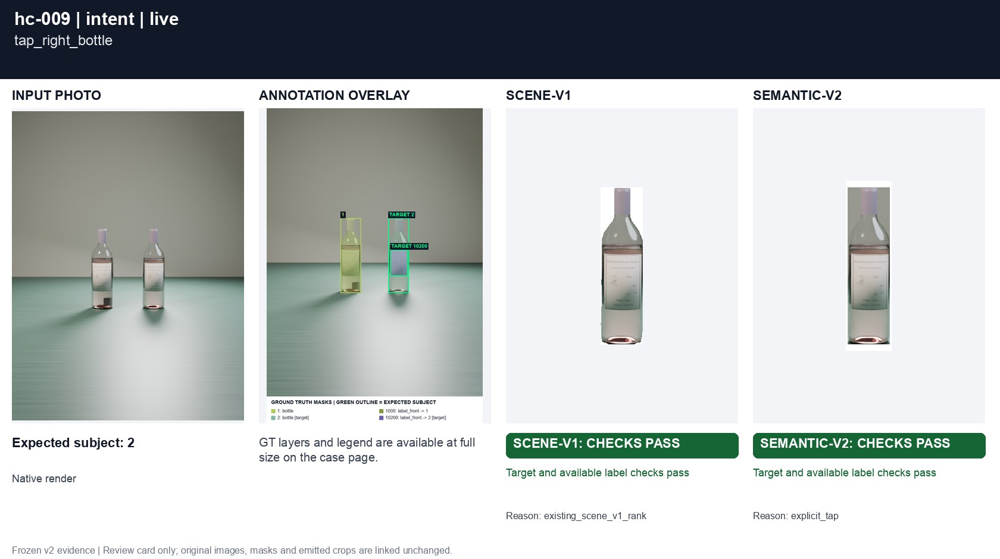
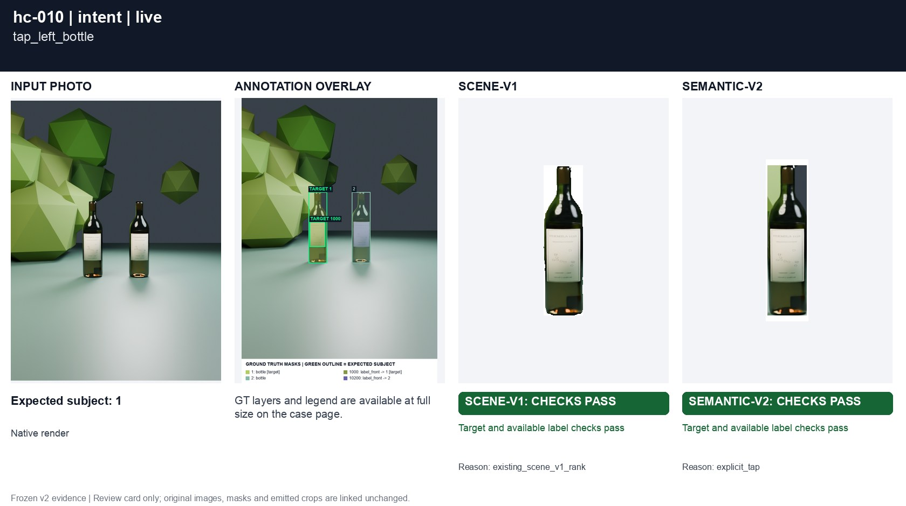
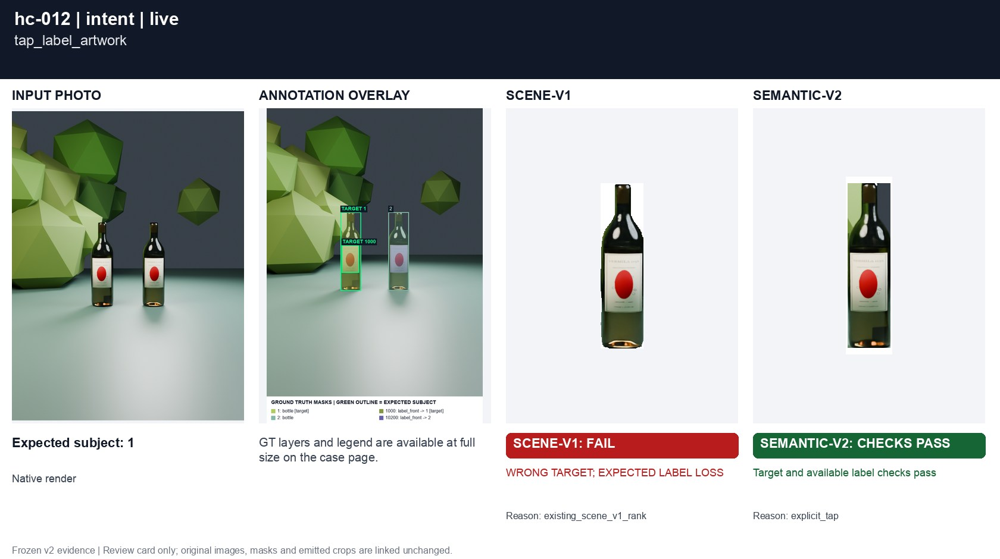
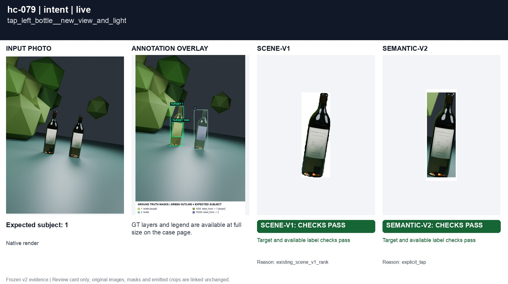
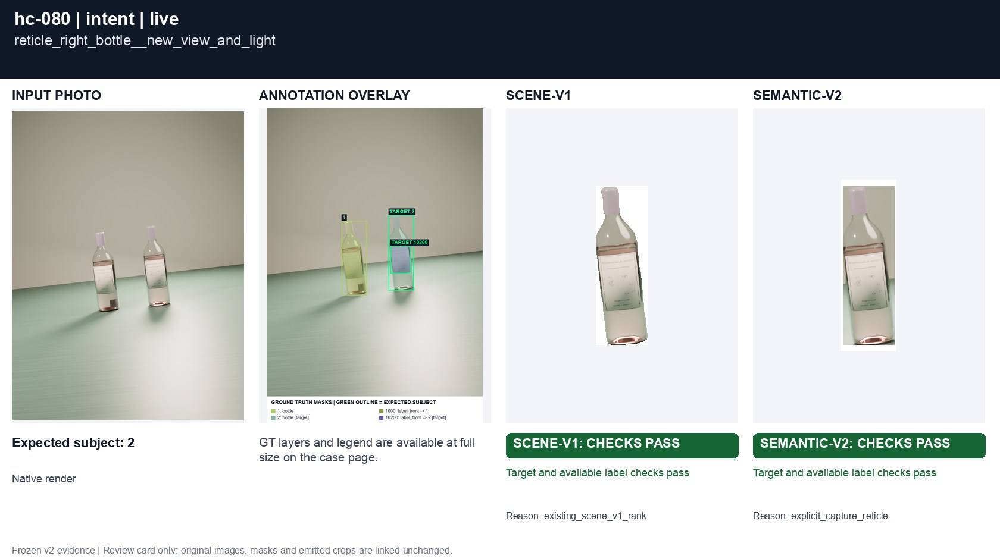
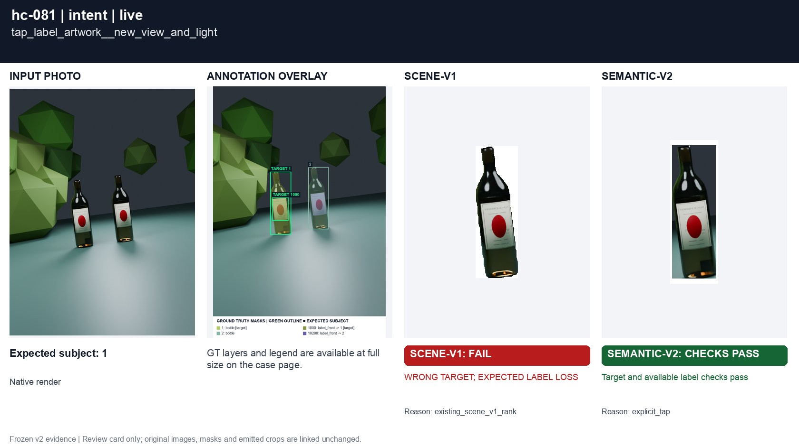

# Tap and capture reticle

[All groups](../README.md)

Balanced multi-bottle scenes with an explicit tap or reticle. A tap on label artwork resolves to the owning bottle. These are additional interaction capabilities, not like-for-like passive ranking cases.

8 cases. Failures below use frozen result fields; photos and fixtures retain separate interpretation.

| Case | scene-v1 | semantic-v2 |
|---|---|---|
| [hc-009 tap_right_bottle](../cases/hc-009.md) | Recorded checks pass | Recorded checks pass |
| [hc-010 tap_left_bottle](../cases/hc-010.md) | **FAIL** controlled: WRONG TARGET; EXPECTED LABEL LOSS | Recorded checks pass |
| [hc-011 reticle_right_bottle](../cases/hc-011.md) | Recorded checks pass | Recorded checks pass |
| [hc-012 tap_label_artwork](../cases/hc-012.md) | **FAIL** controlled: WRONG TARGET; EXPECTED LABEL LOSS, live: WRONG TARGET; EXPECTED LABEL LOSS | Recorded checks pass |
| [hc-078 tap_right_bottle__new_view_and_light](../cases/hc-078.md) | Recorded checks pass | Recorded checks pass |
| [hc-079 tap_left_bottle__new_view_and_light](../cases/hc-079.md) | Recorded checks pass | Recorded checks pass |
| [hc-080 reticle_right_bottle__new_view_and_light](../cases/hc-080.md) | Recorded checks pass | Recorded checks pass |
| [hc-081 tap_label_artwork__new_view_and_light](../cases/hc-081.md) | **FAIL** controlled: WRONG TARGET; EXPECTED LABEL LOSS, live: WRONG TARGET; EXPECTED LABEL LOSS | Recorded checks pass |

## Visual examples

### hc-009 tap_right_bottle

**scene-v1:** Recorded checks pass

[Open original photo, all masks and every selector crop](../cases/hc-009.md)

### hc-010 tap_left_bottle

**scene-v1:** **FAIL** controlled: WRONG TARGET; EXPECTED LABEL LOSS

[Open original photo, all masks and every selector crop](../cases/hc-010.md)

### hc-011 reticle_right_bottle

**scene-v1:** Recorded checks pass

[Open original photo, all masks and every selector crop](../cases/hc-011.md)

### hc-012 tap_label_artwork

**scene-v1:** **FAIL** controlled: WRONG TARGET; EXPECTED LABEL LOSS, live: WRONG TARGET; EXPECTED LABEL LOSS

[Open original photo, all masks and every selector crop](../cases/hc-012.md)

### hc-078 tap_right_bottle__new_view_and_light

**scene-v1:** Recorded checks pass

[Open original photo, all masks and every selector crop](../cases/hc-078.md)

### hc-079 tap_left_bottle__new_view_and_light

**scene-v1:** Recorded checks pass

[Open original photo, all masks and every selector crop](../cases/hc-079.md)

### hc-080 reticle_right_bottle__new_view_and_light

**scene-v1:** Recorded checks pass

[Open original photo, all masks and every selector crop](../cases/hc-080.md)

### hc-081 tap_label_artwork__new_view_and_light

**scene-v1:** **FAIL** controlled: WRONG TARGET; EXPECTED LABEL LOSS, live: WRONG TARGET; EXPECTED LABEL LOSS

[Open original photo, all masks and every selector crop](../cases/hc-081.md)

