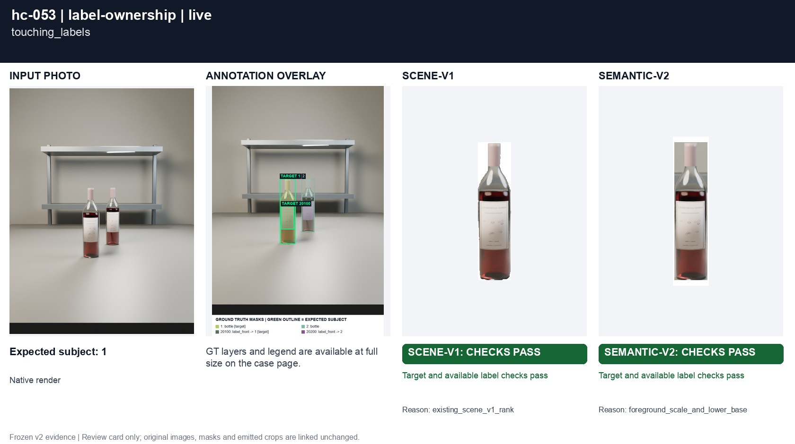
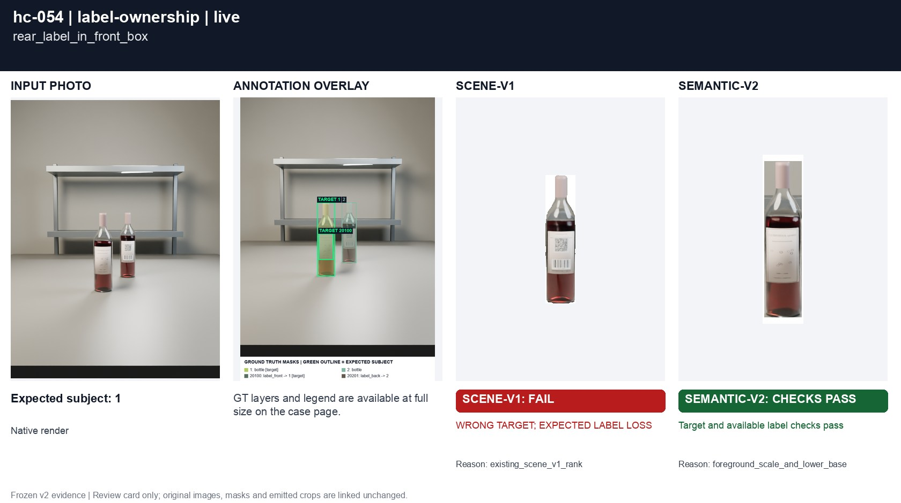
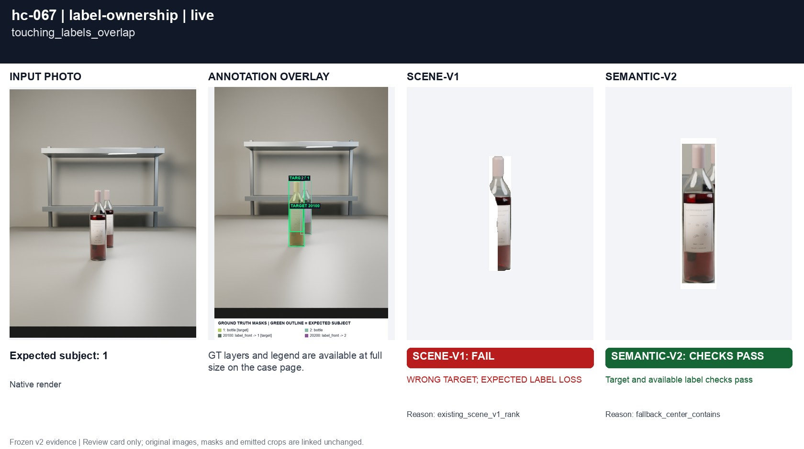
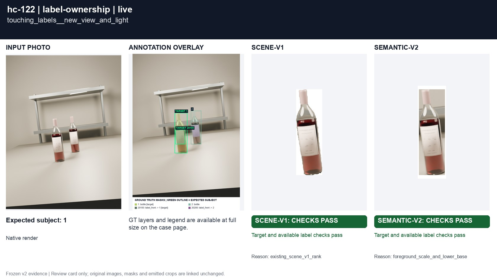
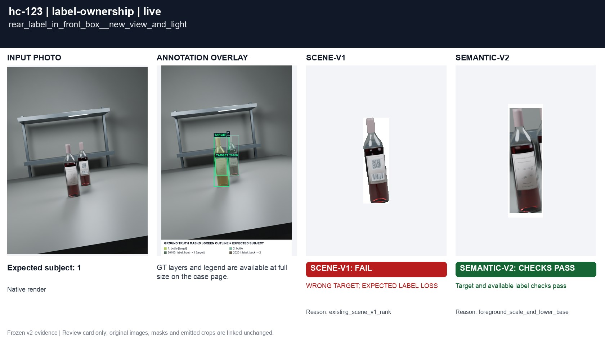
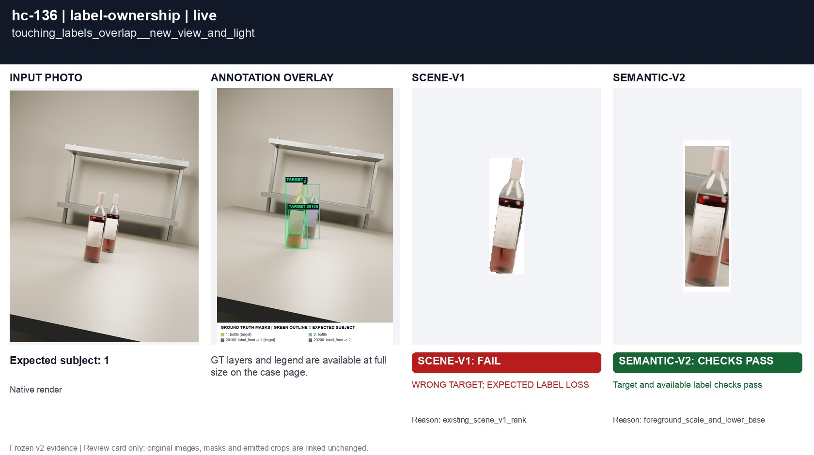
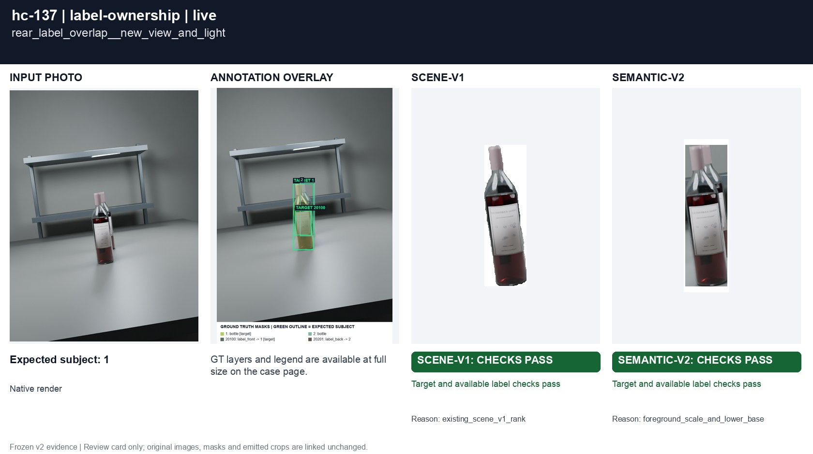

# Overlapping bottles and label owners

[All groups](../README.md)

Touching labels and a rear label inside the front bottle's bounding rectangle. Native owner IDs are used only for evaluation.

8 cases. Failures below use frozen result fields; photos and fixtures retain separate interpretation.

| Case | scene-v1 | semantic-v2 |
|---|---|---|
| [hc-053 touching_labels](../cases/hc-053.md) | Recorded checks pass | Recorded checks pass |
| [hc-054 rear_label_in_front_box](../cases/hc-054.md) | **FAIL** controlled: WRONG TARGET; EXPECTED LABEL LOSS, live: WRONG TARGET; EXPECTED LABEL LOSS | Recorded checks pass |
| [hc-067 touching_labels_overlap](../cases/hc-067.md) | **FAIL** controlled: WRONG TARGET; EXPECTED LABEL LOSS, live: WRONG TARGET; EXPECTED LABEL LOSS | Recorded checks pass |
| [hc-068 rear_label_overlap](../cases/hc-068.md) | **FAIL** controlled: WRONG TARGET; EXPECTED LABEL LOSS, live: WRONG TARGET; EXPECTED LABEL LOSS | Recorded checks pass |
| [hc-122 touching_labels__new_view_and_light](../cases/hc-122.md) | Recorded checks pass | Recorded checks pass |
| [hc-123 rear_label_in_front_box__new_view_and_light](../cases/hc-123.md) | **FAIL** controlled: WRONG TARGET; EXPECTED LABEL LOSS, live: WRONG TARGET; EXPECTED LABEL LOSS | Recorded checks pass |
| [hc-136 touching_labels_overlap__new_view_and_light](../cases/hc-136.md) | **FAIL** controlled: WRONG TARGET; EXPECTED LABEL LOSS, live: WRONG TARGET; EXPECTED LABEL LOSS | Recorded checks pass |
| [hc-137 rear_label_overlap__new_view_and_light](../cases/hc-137.md) | Recorded checks pass | Recorded checks pass |

## Visual examples

### hc-053 touching_labels

**scene-v1:** Recorded checks pass

[Open original photo, all masks and every selector crop](../cases/hc-053.md)

### hc-054 rear_label_in_front_box

**scene-v1:** **FAIL** controlled: WRONG TARGET; EXPECTED LABEL LOSS, live: WRONG TARGET; EXPECTED LABEL LOSS

[Open original photo, all masks and every selector crop](../cases/hc-054.md)

### hc-067 touching_labels_overlap

**scene-v1:** **FAIL** controlled: WRONG TARGET; EXPECTED LABEL LOSS, live: WRONG TARGET; EXPECTED LABEL LOSS

[Open original photo, all masks and every selector crop](../cases/hc-067.md)

### hc-068 rear_label_overlap

**scene-v1:** **FAIL** controlled: WRONG TARGET; EXPECTED LABEL LOSS, live: WRONG TARGET; EXPECTED LABEL LOSS

[Open original photo, all masks and every selector crop](../cases/hc-068.md)

### hc-122 touching_labels__new_view_and_light

**scene-v1:** Recorded checks pass

[Open original photo, all masks and every selector crop](../cases/hc-122.md)

### hc-123 rear_label_in_front_box__new_view_and_light

**scene-v1:** **FAIL** controlled: WRONG TARGET; EXPECTED LABEL LOSS, live: WRONG TARGET; EXPECTED LABEL LOSS

[Open original photo, all masks and every selector crop](../cases/hc-123.md)

### hc-136 touching_labels_overlap__new_view_and_light

**scene-v1:** **FAIL** controlled: WRONG TARGET; EXPECTED LABEL LOSS, live: WRONG TARGET; EXPECTED LABEL LOSS

[Open original photo, all masks and every selector crop](../cases/hc-136.md)

### hc-137 rear_label_overlap__new_view_and_light

**scene-v1:** Recorded checks pass

[Open original photo, all masks and every selector crop](../cases/hc-137.md)

