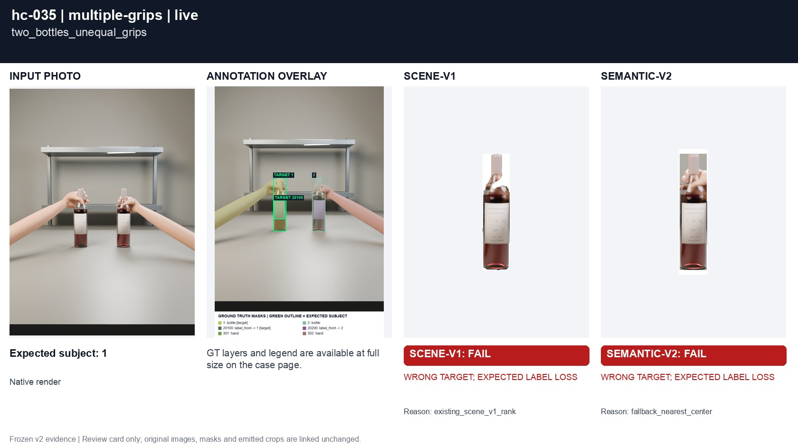
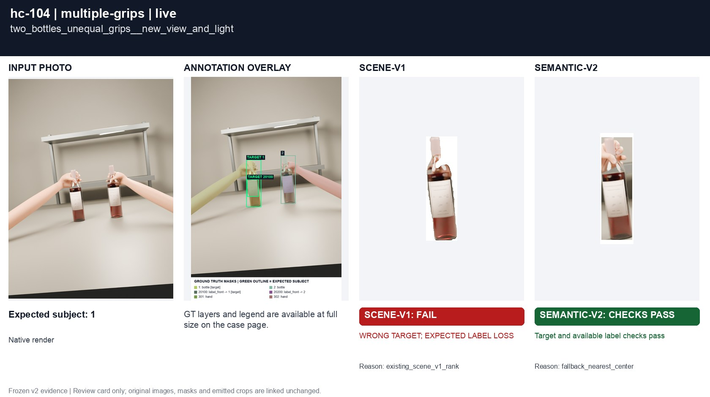
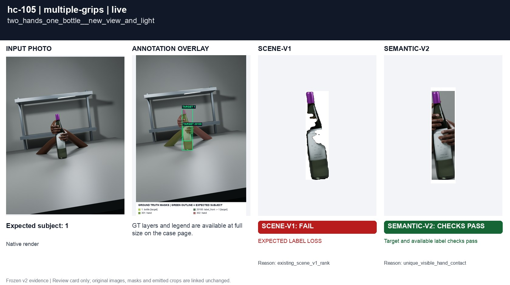

# Two hands: one or two subjects

[All groups](../README.md)

Unequal grips on different bottles remain ambiguous; two hands on one bottle support the same subject.

4 cases. Failures below use frozen result fields; photos and fixtures retain separate interpretation.

| Case | scene-v1 | semantic-v2 |
|---|---|---|
| [hc-035 two_bottles_unequal_grips](../cases/hc-035.md) | **FAIL** controlled: WRONG TARGET; EXPECTED LABEL LOSS, live: WRONG TARGET; EXPECTED LABEL LOSS | **FAIL** live: WRONG TARGET; EXPECTED LABEL LOSS |
| [hc-036 two_hands_one_bottle](../cases/hc-036.md) | **FAIL** live: EXPECTED LABEL LOSS | Recorded checks pass |
| [hc-104 two_bottles_unequal_grips__new_view_and_light](../cases/hc-104.md) | **FAIL** controlled: WRONG TARGET; EXPECTED LABEL LOSS, live: WRONG TARGET; EXPECTED LABEL LOSS | Recorded checks pass |
| [hc-105 two_hands_one_bottle__new_view_and_light](../cases/hc-105.md) | **FAIL** live: EXPECTED LABEL LOSS | Recorded checks pass |

## Visual examples

### hc-035 two_bottles_unequal_grips

**scene-v1:** **FAIL** controlled: WRONG TARGET; EXPECTED LABEL LOSS, live: WRONG TARGET; EXPECTED LABEL LOSS

[Open original photo, all masks and every selector crop](../cases/hc-035.md)

### hc-036 two_hands_one_bottle

**scene-v1:** **FAIL** live: EXPECTED LABEL LOSS

[Open original photo, all masks and every selector crop](../cases/hc-036.md)

### hc-104 two_bottles_unequal_grips__new_view_and_light

**scene-v1:** **FAIL** controlled: WRONG TARGET; EXPECTED LABEL LOSS, live: WRONG TARGET; EXPECTED LABEL LOSS

[Open original photo, all masks and every selector crop](../cases/hc-104.md)

### hc-105 two_hands_one_bottle__new_view_and_light

**scene-v1:** **FAIL** live: EXPECTED LABEL LOSS

[Open original photo, all masks and every selector crop](../cases/hc-105.md)

