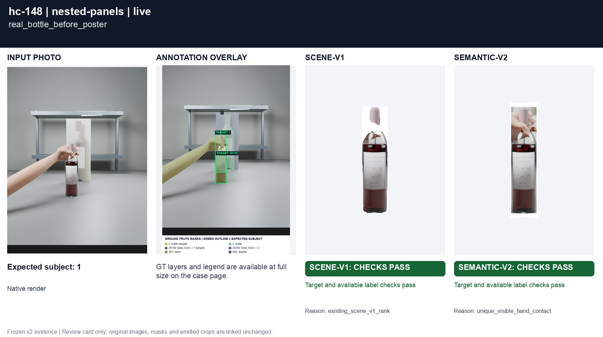
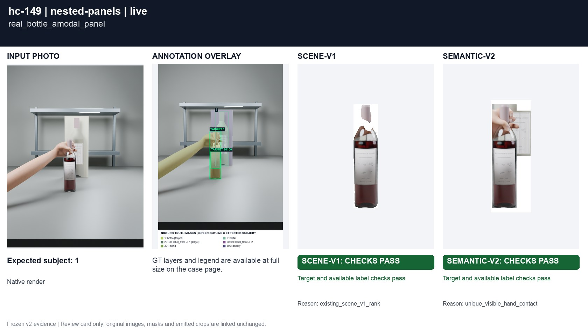
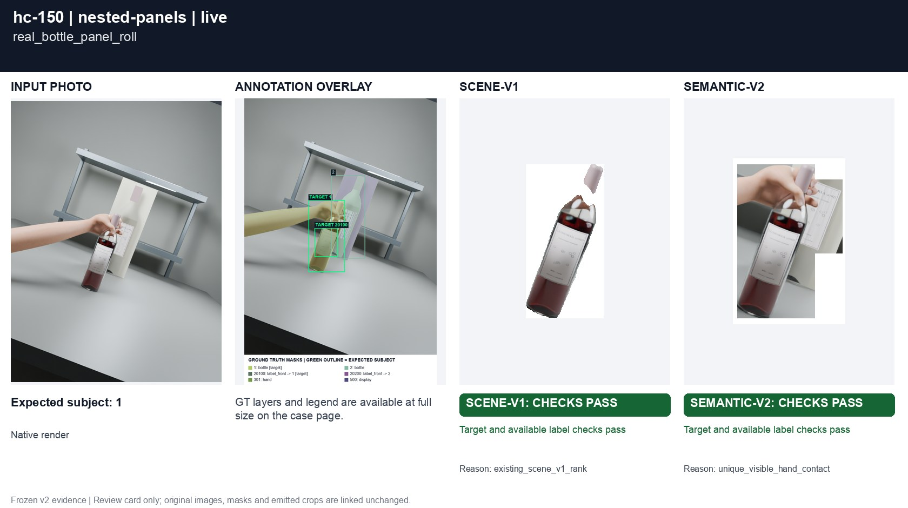

# Real bottles crossing printed panels

[All groups](../README.md)

Physical foreground bottles overlap a rear printed panel. A separate controlled fault fills a panel mask across the foreground silhouette; RGB and visible GT masks remain unchanged.

3 cases. Failures below use frozen result fields; photos and fixtures retain separate interpretation.

| Case | scene-v1 | semantic-v2 |
|---|---|---|
| [hc-148 real_bottle_before_poster](../cases/hc-148.md) | Recorded checks pass | Recorded checks pass |
| [hc-149 real_bottle_amodal_panel](../cases/hc-149.md) | Recorded checks pass | Recorded checks pass |
| [hc-150 real_bottle_panel_roll](../cases/hc-150.md) | Recorded checks pass | Recorded checks pass |

## Visual examples

### hc-148 real_bottle_before_poster

**scene-v1:** Recorded checks pass

[Open original photo, all masks and every selector crop](../cases/hc-148.md)

### hc-149 real_bottle_amodal_panel

**scene-v1:** Recorded checks pass

[Open original photo, all masks and every selector crop](../cases/hc-149.md)

### hc-150 real_bottle_panel_roll

**scene-v1:** Recorded checks pass

[Open original photo, all masks and every selector crop](../cases/hc-150.md)

