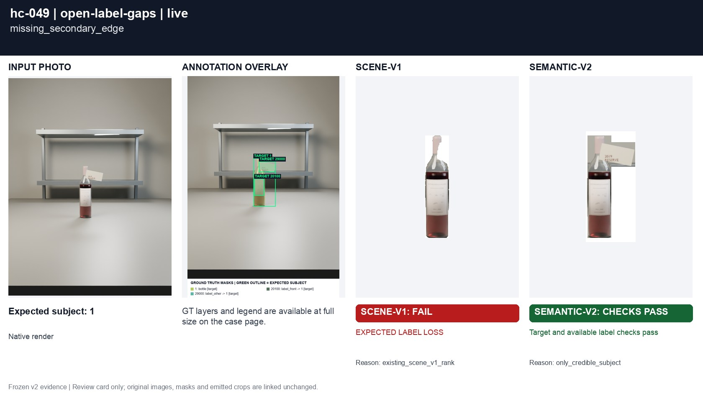
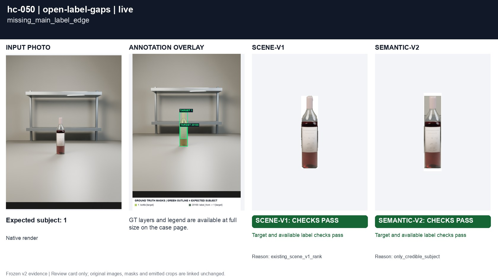
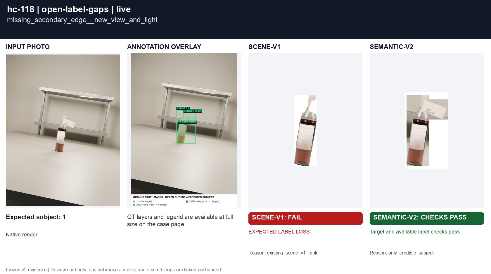
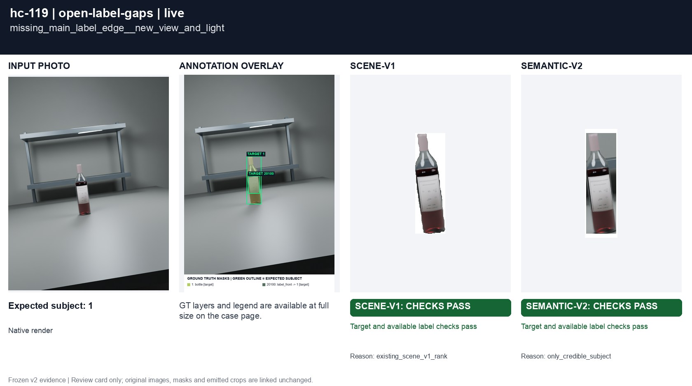

# Label omissions connected to the silhouette

[All groups](../README.md)

A missing secondary label and a missing main-label side, each connected to the exterior of the supplied detector mask. Source RGB must survive.

4 cases. Failures below use frozen result fields; photos and fixtures retain separate interpretation.

| Case | scene-v1 | semantic-v2 |
|---|---|---|
| [hc-049 missing_secondary_edge](../cases/hc-049.md) | **FAIL** controlled: EXPECTED LABEL LOSS, live: EXPECTED LABEL LOSS | Recorded checks pass |
| [hc-050 missing_main_label_edge](../cases/hc-050.md) | **FAIL** controlled: EXPECTED LABEL LOSS | Recorded checks pass |
| [hc-118 missing_secondary_edge__new_view_and_light](../cases/hc-118.md) | **FAIL** controlled: EXPECTED LABEL LOSS, live: EXPECTED LABEL LOSS | Recorded checks pass |
| [hc-119 missing_main_label_edge__new_view_and_light](../cases/hc-119.md) | **FAIL** controlled: EXPECTED LABEL LOSS | Recorded checks pass |

## Visual examples

### hc-049 missing_secondary_edge

**scene-v1:** **FAIL** controlled: EXPECTED LABEL LOSS, live: EXPECTED LABEL LOSS

[Open original photo, all masks and every selector crop](../cases/hc-049.md)

### hc-050 missing_main_label_edge

**scene-v1:** **FAIL** controlled: EXPECTED LABEL LOSS

[Open original photo, all masks and every selector crop](../cases/hc-050.md)

### hc-118 missing_secondary_edge__new_view_and_light

**scene-v1:** **FAIL** controlled: EXPECTED LABEL LOSS, live: EXPECTED LABEL LOSS

[Open original photo, all masks and every selector crop](../cases/hc-118.md)

### hc-119 missing_main_label_edge__new_view_and_light

**scene-v1:** **FAIL** controlled: EXPECTED LABEL LOSS

[Open original photo, all masks and every selector crop](../cases/hc-119.md)

