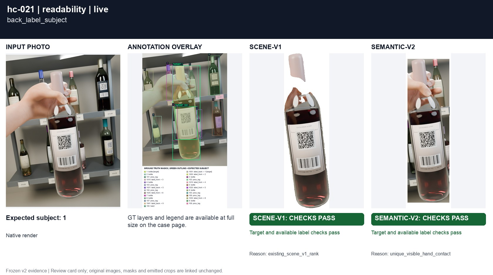
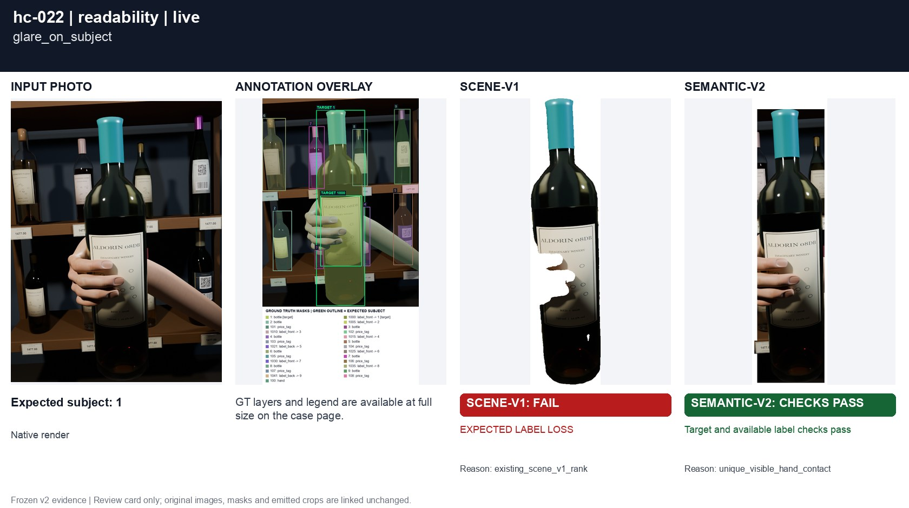
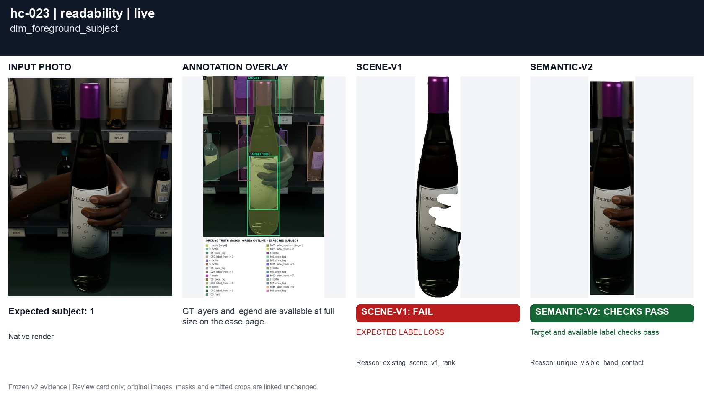
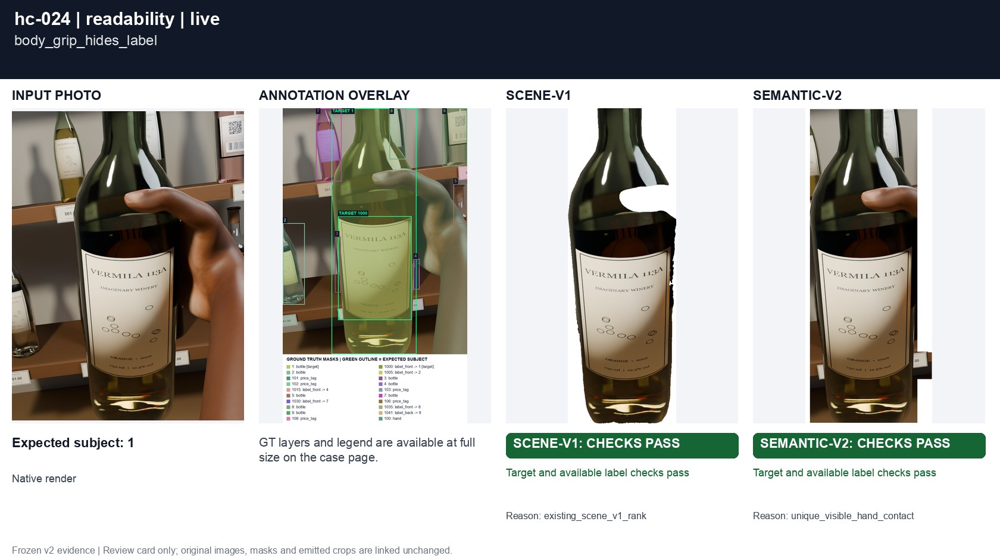
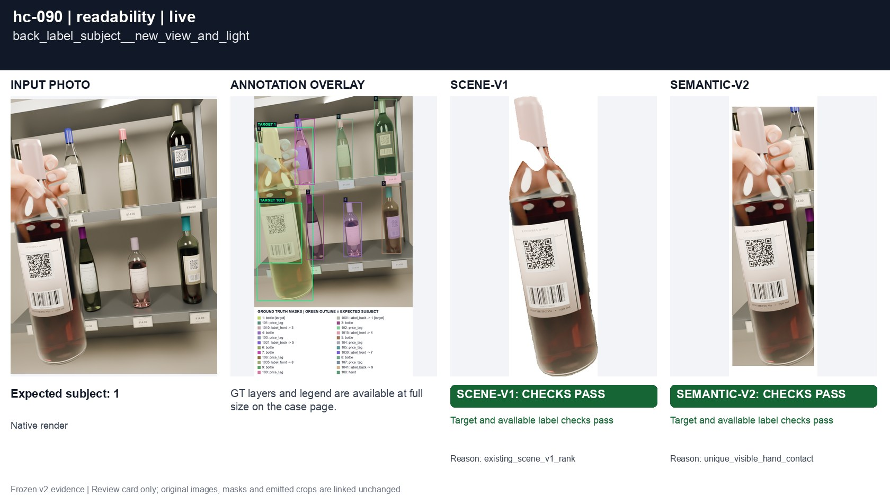
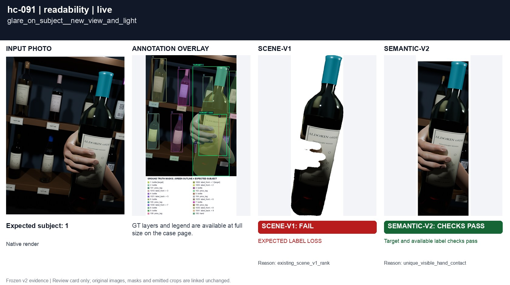
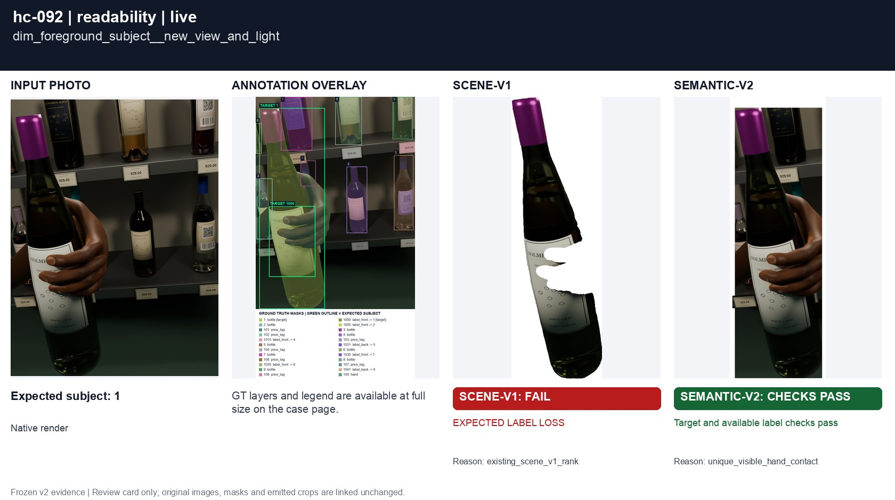
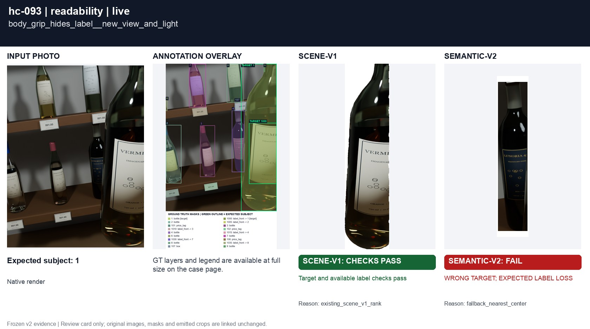
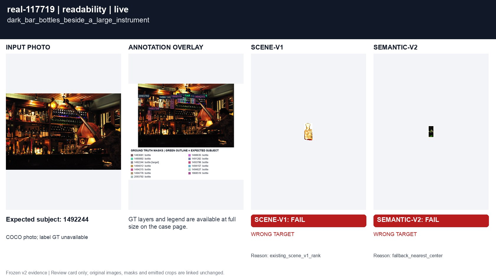

# Intent despite poor readability

[All groups](../README.md)

A rear label, glare, low light and a body grip. The intended bottle stays the subject even when another label is easier to read. Focus contributes only weakly.

9 cases. Failures below use frozen result fields; photos and fixtures retain separate interpretation.

| Case | scene-v1 | semantic-v2 |
|---|---|---|
| [hc-021 back_label_subject](../cases/hc-021.md) | Recorded checks pass | Recorded checks pass |
| [hc-022 glare_on_subject](../cases/hc-022.md) | **FAIL** live: EXPECTED LABEL LOSS | Recorded checks pass |
| [hc-023 dim_foreground_subject](../cases/hc-023.md) | **FAIL** live: EXPECTED LABEL LOSS | Recorded checks pass |
| [hc-024 body_grip_hides_label](../cases/hc-024.md) | Recorded checks pass | Recorded checks pass |
| [hc-090 back_label_subject__new_view_and_light](../cases/hc-090.md) | Recorded checks pass | Recorded checks pass |
| [hc-091 glare_on_subject__new_view_and_light](../cases/hc-091.md) | **FAIL** live: EXPECTED LABEL LOSS | Recorded checks pass |
| [hc-092 dim_foreground_subject__new_view_and_light](../cases/hc-092.md) | **FAIL** live: EXPECTED LABEL LOSS | Recorded checks pass |
| [hc-093 body_grip_hides_label__new_view_and_light](../cases/hc-093.md) | Recorded checks pass | **FAIL** controlled: WRONG TARGET; EXPECTED LABEL LOSS, live: WRONG TARGET; EXPECTED LABEL LOSS |
| [real-117719 dark_bar_bottles_beside_a_large_instrument](../cases/real-117719.md) | **FAIL** live: WRONG TARGET | **FAIL** live: WRONG TARGET |

## Visual examples

### hc-021 back_label_subject

**scene-v1:** Recorded checks pass

[Open original photo, all masks and every selector crop](../cases/hc-021.md)

### hc-022 glare_on_subject

**scene-v1:** **FAIL** live: EXPECTED LABEL LOSS

[Open original photo, all masks and every selector crop](../cases/hc-022.md)

### hc-023 dim_foreground_subject

**scene-v1:** **FAIL** live: EXPECTED LABEL LOSS

[Open original photo, all masks and every selector crop](../cases/hc-023.md)

### hc-024 body_grip_hides_label

**scene-v1:** Recorded checks pass

[Open original photo, all masks and every selector crop](../cases/hc-024.md)

### hc-090 back_label_subject__new_view_and_light

**scene-v1:** Recorded checks pass

[Open original photo, all masks and every selector crop](../cases/hc-090.md)

### hc-091 glare_on_subject__new_view_and_light

**scene-v1:** **FAIL** live: EXPECTED LABEL LOSS

[Open original photo, all masks and every selector crop](../cases/hc-091.md)

### hc-092 dim_foreground_subject__new_view_and_light

**scene-v1:** **FAIL** live: EXPECTED LABEL LOSS

[Open original photo, all masks and every selector crop](../cases/hc-092.md)

### hc-093 body_grip_hides_label__new_view_and_light

**scene-v1:** Recorded checks pass

[Open original photo, all masks and every selector crop](../cases/hc-093.md)

### real-117719 dark_bar_bottles_beside_a_large_instrument

**scene-v1:** **FAIL** live: WRONG TARGET

[Open original photo, all masks and every selector crop](../cases/real-117719.md)

