# Review regression fixtures

[All groups](../README.md)

Additional declared contract fixtures; legacy scene-v1 is not scored against the new contract.

39 cases. Failures below use frozen result fields; photos and fixtures retain separate interpretation.

| Case | scene-v1 | semantic-v2 |
|---|---|---|
| [fb-missed-tap-hand Missed tap continues to the unique hand rule](../cases/fb-missed-tap-hand.md) | Contract N/A; fallback: target match | Recorded checks pass |
| [fb-missed-tap-single Missed tap continues to the single candidate](../cases/fb-missed-tap-single.md) | Contract N/A; fallback: target match | Recorded checks pass |
| [fb-missed-tap-reticle Missed tap continues to the explicit reticle](../cases/fb-missed-tap-reticle.md) | Contract N/A; fallback: target differs | Recorded checks pass |
| [fb-mask-tap-over-label-box A real mask hit beats another label's rectangle](../cases/fb-mask-tap-over-label-box.md) | Contract N/A; fallback: target differs | Recorded checks pass |
| [fb-multi-hit-pool An ambiguous tap cannot select an untapped center candidate](../cases/fb-multi-hit-pool.md) | Contract N/A; fallback: target match | Recorded checks pass |
| [fb-tiny-hand-distractor A small contacted can cannot cancel a larger grip (contact alone is unconfirmed; use geometric fallback)](../cases/fb-tiny-hand-distractor.md) | Contract N/A; fallback: target differs | Recorded checks pass |
| [fb-secondary-label-hole An undetected secondary label survives a bottle-mask hole](../cases/fb-secondary-label-hole.md) | Contract N/A; fallback: target match | Recorded checks pass |
| [fb-label-context Label-only evidence keeps the full context despite a distractor](../cases/fb-label-context.md) | Contract N/A; fallback: target differs | Recorded checks pass |
| [fb-unequal-two-grips Small grip-support differences do not invent unique intent](../cases/fb-unequal-two-grips.md) | Contract N/A; fallback: target match | Recorded checks pass |
| [fb-box-around-hand A background carton surrounding a hand cannot steal the held bottle (contact alone is unconfirmed; use geometric fallback)](../cases/fb-box-around-hand.md) | Contract N/A; fallback: target differs | Recorded checks pass |
| [fb-body-grip-enclosure A real bottle body grip remains valid when its box encloses the hand](../cases/fb-body-grip-enclosure.md) | Contract N/A; fallback: target match | Recorded checks pass |
| [fb-different-hands-unequal Different hands holding two bottles cannot manufacture a unique grip](../cases/fb-different-hands-unequal.md) | Contract N/A; fallback: target match | Recorded checks pass |
| [fb-two-hands-one-subject Two hands may support the same physical bottle (contact alone is unconfirmed; use geometric fallback)](../cases/fb-two-hands-one-subject.md) | Contract N/A; fallback: target match | Recorded checks pass |
| [fb-unlabeled-strip-conflict An unlabeled held strip cannot confidently override a much larger centered labeled bottle](../cases/fb-unlabeled-strip-conflict.md) | Contract N/A; fallback: target match | Recorded checks pass |
| [fb-exterior-label-strip Secondary label pixels touching the silhouette edge survive](../cases/fb-exterior-label-strip.md) | Contract N/A; fallback: target match | Recorded checks pass |
| [fb-label-gap-tap A tap on white paper missing from the bottle mask resolves through unique label context](../cases/fb-label-gap-tap.md) | Contract N/A; fallback: target match | Recorded checks pass |
| [fb-three-foreground Three bottles: off-center foreground beats two near-center backgrounds](../cases/fb-three-foreground.md) | Contract N/A; fallback: target differs | Recorded checks pass |
| [fb-three-weak-depth Three similar bottles: uncertain depth uses center fallback](../cases/fb-three-weak-depth.md) | Contract N/A; fallback: target match | Recorded checks pass |
| [fb-background-magnum A larger background magnum is not proof of camera proximity](../cases/fb-background-magnum.md) | Contract N/A; fallback: target match | Recorded checks pass |
| [fb-three-tap-background An explicit background tap overrides foreground prominence](../cases/fb-three-tap-background.md) | Contract N/A; fallback: target match | Recorded checks pass |
| [fb-held-carton-only A held carton remains a valid package when there is no competing bottle](../cases/fb-held-carton-only.md) | Contract N/A; fallback: target match | Recorded checks pass |
| [fb-orphan-label-beside-bottle An off-center orphan cannot win passive dominance over a physical bottle](../cases/fb-orphan-label-beside-bottle.md) | Contract N/A; fallback: target match | Recorded checks pass |
| [fb-centered-label-closeup-with-bottle A centered label close-up survives a small background bottle](../cases/fb-centered-label-closeup-with-bottle.md) | Contract N/A; fallback: target differs | Recorded checks pass |
| [fb-tap-orphan-label An explicit tap can select an off-center unowned label](../cases/fb-tap-orphan-label.md) | Contract N/A; fallback: target differs | Recorded checks pass |
| [fb-dominant-label-price-conflict A dominant real label also classified as price tag keeps full context](../cases/fb-dominant-label-price-conflict.md) | Contract N/A; fallback: target differs | Recorded checks pass |
| [fb-separate-shelf-levels A larger bottle on a lower shelf is not proof of camera proximity](../cases/fb-separate-shelf-levels.md) | Contract N/A; fallback: target match | Recorded checks pass |
| [fb-truncated-background-peer A truncated background silhouette cannot establish a foreground size ratio](../cases/fb-truncated-background-peer.md) | Contract N/A; fallback: target match | Recorded checks pass |
| [fb-bystander-hand-three An ambiguous hand touching only background bottles cannot suppress a clear foreground](../cases/fb-bystander-hand-three.md) | Contract N/A; fallback: target differs | Recorded checks pass |
| [fb-held-unlabelled-carton Wine label presence cannot override stronger contact with an unlabelled held carton](../cases/fb-held-unlabelled-carton.md) | Contract N/A; fallback: target match | Recorded checks pass |
| [fb-lying-foreground-three A lying foreground bottle survives two upright bottles near center](../cases/fb-lying-foreground-three.md) | Contract N/A; fallback: target differs | Recorded checks pass |
| [fb-unowned-label-logo-mask A large unowned label extent is preserved when its mask collapses to a small logo](../cases/fb-unowned-label-logo-mask.md) | Contract N/A; fallback: target match | Recorded checks pass |
| [fb-weak-wrap-strong-grip Weak incidental front wrap cannot steal a stronger grip (contact alone is unconfirmed; use geometric fallback)](../cases/fb-weak-wrap-strong-grip.md) | Contract N/A; fallback: target differs | Recorded checks pass |
| [fb-multiple-grips-unheld-foreground Two confirmed grips block an unrelated unheld foreground bottle](../cases/fb-multiple-grips-unheld-foreground.md) | Contract N/A; fallback: target differs | Recorded checks pass |
| [fb-owner-and-uncertain-background A confirmed grip plus another uncertain hand cannot promote an unheld bottle](../cases/fb-owner-and-uncertain-background.md) | Contract N/A; fallback: target match | Recorded checks pass |
| [fb-held-neck-dominant-paper A held neck cannot discard an unowned complete label (contact alone is unconfirmed; use geometric fallback)](../cases/fb-held-neck-dominant-paper.md) | Contract N/A; fallback: target differs | Recorded checks pass |
| [fb-held-neck-pending-logo A held subject retains pending full paper even if its mask is only a logo (contact alone is unconfirmed; use geometric fallback)](../cases/fb-held-neck-pending-logo.md) | Contract N/A; fallback: target match | Recorded checks pass |
| [fb-point-contact-near-center-bottle Unverified side contact cannot outrank a central bottle](../cases/fb-point-contact-near-center-bottle.md) | Contract N/A; fallback: target match | Recorded checks pass |
| [fb-opposed-background-midbody Opposed background skin without front or terminal evidence is not a grip](../cases/fb-opposed-background-midbody.md) | Contract N/A; fallback: target match | Recorded checks pass |
| [fb-enclosing-label-panel A complete panel encloses bottle artwork; preserve the panel context](../cases/fb-enclosing-label-panel.md) | Contract N/A; fallback: target differs | Recorded checks pass |

## Visual examples

### fb-missed-tap-hand Missed tap continues to the unique hand rule

**scene-v1:** Contract N/A; fallback: target match

[Open original photo, all masks and every selector crop](../cases/fb-missed-tap-hand.md)

[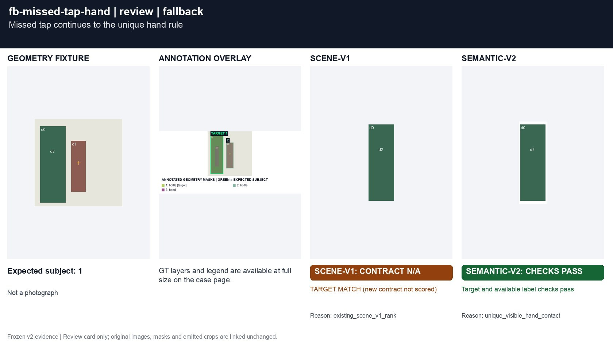](../cases/fb-missed-tap-hand.md)

### fb-missed-tap-single Missed tap continues to the single candidate

**scene-v1:** Contract N/A; fallback: target match

[Open original photo, all masks and every selector crop](../cases/fb-missed-tap-single.md)

[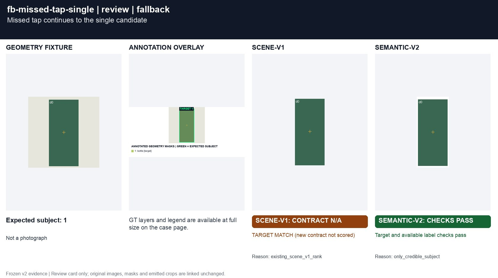](../cases/fb-missed-tap-single.md)

### fb-missed-tap-reticle Missed tap continues to the explicit reticle

**scene-v1:** Contract N/A; fallback: target differs

[Open original photo, all masks and every selector crop](../cases/fb-missed-tap-reticle.md)

[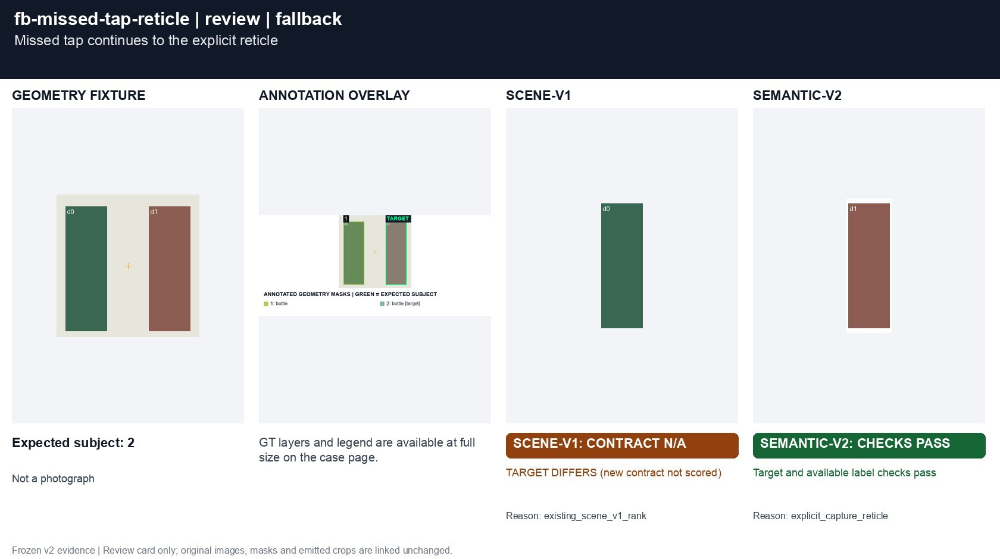](../cases/fb-missed-tap-reticle.md)

### fb-mask-tap-over-label-box A real mask hit beats another label's rectangle

**scene-v1:** Contract N/A; fallback: target differs

[Open original photo, all masks and every selector crop](../cases/fb-mask-tap-over-label-box.md)

[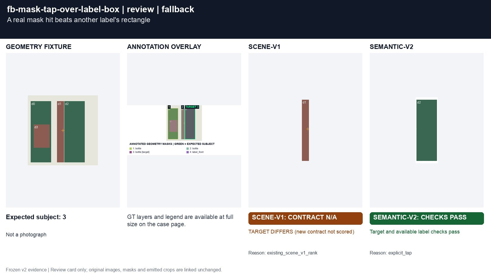](../cases/fb-mask-tap-over-label-box.md)

### fb-multi-hit-pool An ambiguous tap cannot select an untapped center candidate

**scene-v1:** Contract N/A; fallback: target match

[Open original photo, all masks and every selector crop](../cases/fb-multi-hit-pool.md)

[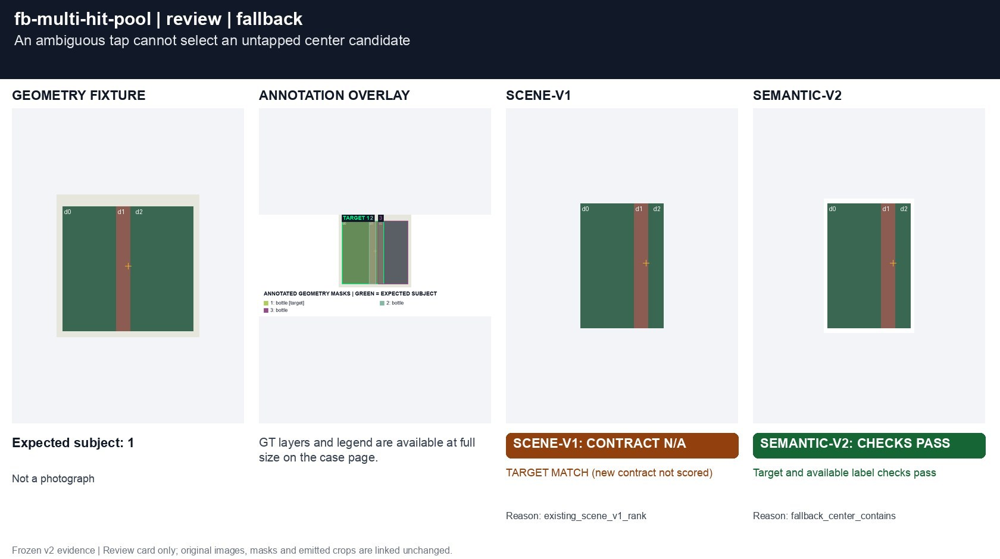](../cases/fb-multi-hit-pool.md)

### fb-tiny-hand-distractor A small contacted can cannot cancel a larger grip (contact alone is unconfirmed; use geometric fallback)

**scene-v1:** Contract N/A; fallback: target differs

[Open original photo, all masks and every selector crop](../cases/fb-tiny-hand-distractor.md)

[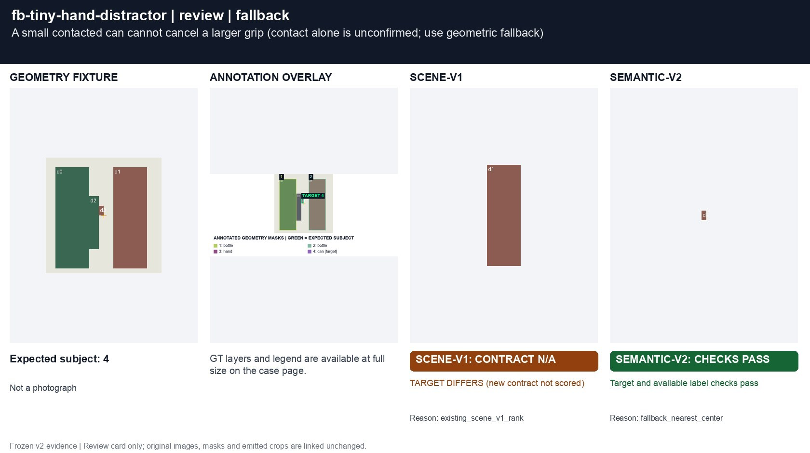](../cases/fb-tiny-hand-distractor.md)

### fb-secondary-label-hole An undetected secondary label survives a bottle-mask hole

**scene-v1:** Contract N/A; fallback: target match

[Open original photo, all masks and every selector crop](../cases/fb-secondary-label-hole.md)

[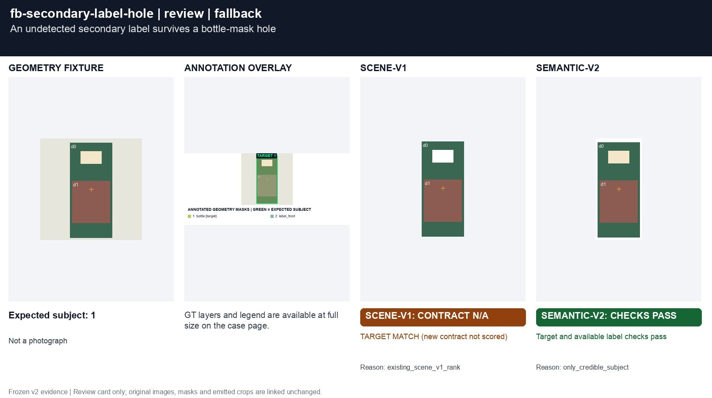](../cases/fb-secondary-label-hole.md)

### fb-label-context Label-only evidence keeps the full context despite a distractor

**scene-v1:** Contract N/A; fallback: target differs

[Open original photo, all masks and every selector crop](../cases/fb-label-context.md)

[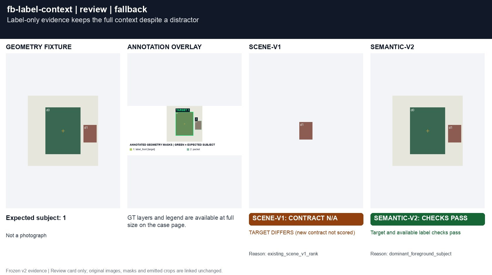](../cases/fb-label-context.md)

### fb-unequal-two-grips Small grip-support differences do not invent unique intent

**scene-v1:** Contract N/A; fallback: target match

[Open original photo, all masks and every selector crop](../cases/fb-unequal-two-grips.md)

[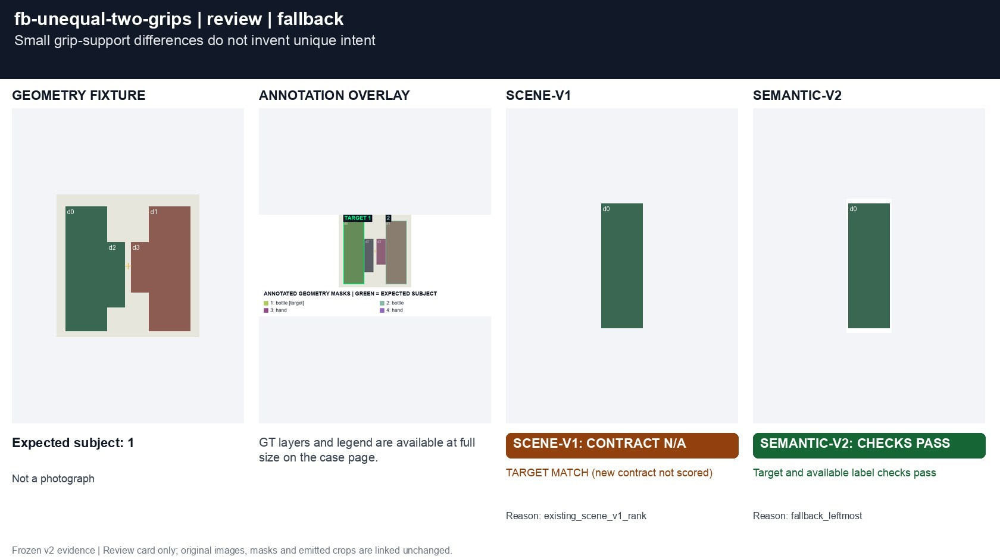](../cases/fb-unequal-two-grips.md)

### fb-box-around-hand A background carton surrounding a hand cannot steal the held bottle (contact alone is unconfirmed; use geometric fallback)

**scene-v1:** Contract N/A; fallback: target differs

[Open original photo, all masks and every selector crop](../cases/fb-box-around-hand.md)

[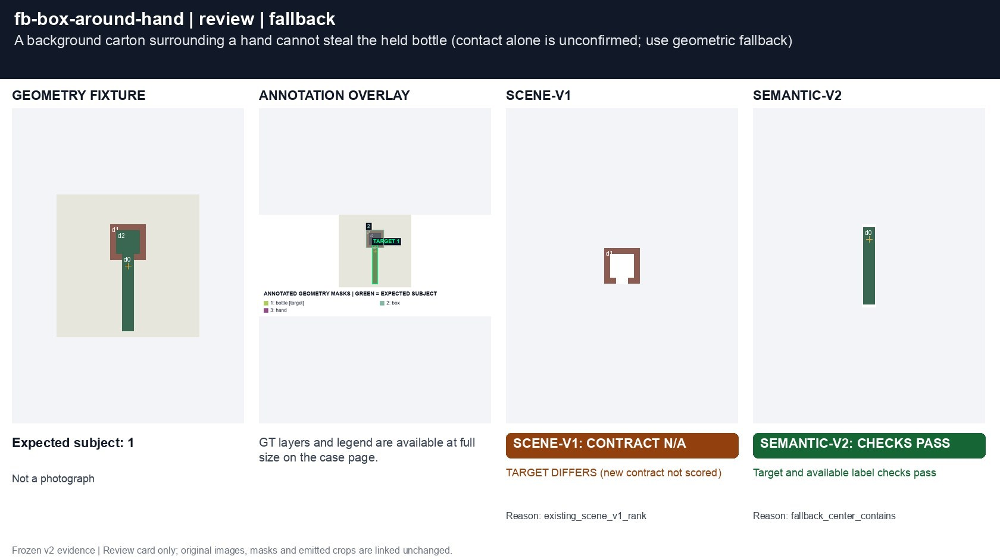](../cases/fb-box-around-hand.md)

### fb-body-grip-enclosure A real bottle body grip remains valid when its box encloses the hand

**scene-v1:** Contract N/A; fallback: target match

[Open original photo, all masks and every selector crop](../cases/fb-body-grip-enclosure.md)

### fb-different-hands-unequal Different hands holding two bottles cannot manufacture a unique grip

**scene-v1:** Contract N/A; fallback: target match

[Open original photo, all masks and every selector crop](../cases/fb-different-hands-unequal.md)

[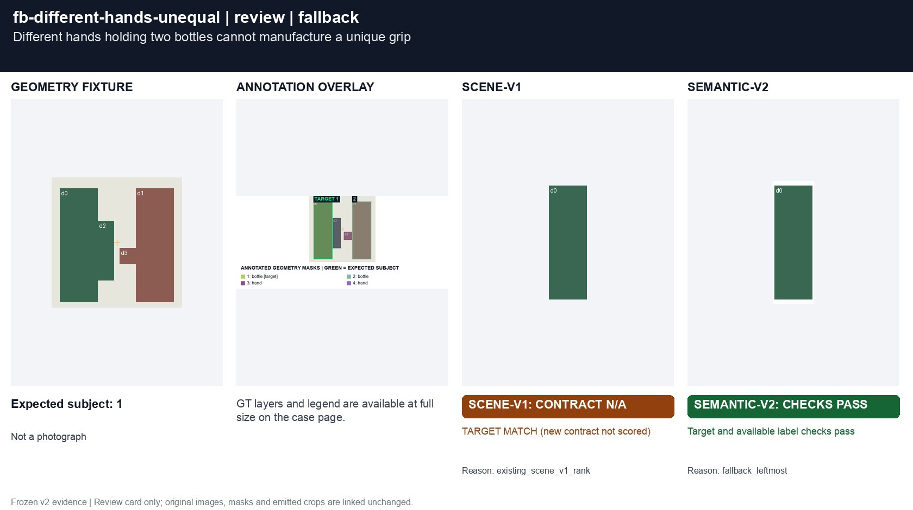](../cases/fb-different-hands-unequal.md)

### fb-two-hands-one-subject Two hands may support the same physical bottle (contact alone is unconfirmed; use geometric fallback)

**scene-v1:** Contract N/A; fallback: target match

[Open original photo, all masks and every selector crop](../cases/fb-two-hands-one-subject.md)

[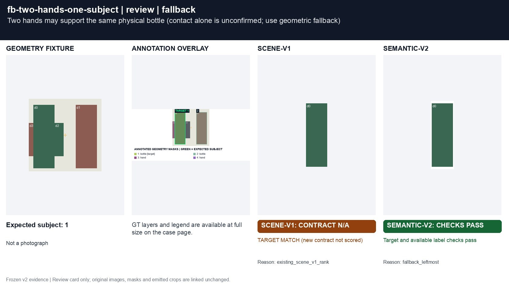](../cases/fb-two-hands-one-subject.md)

### fb-unlabeled-strip-conflict An unlabeled held strip cannot confidently override a much larger centered labeled bottle

**scene-v1:** Contract N/A; fallback: target match

[Open original photo, all masks and every selector crop](../cases/fb-unlabeled-strip-conflict.md)

[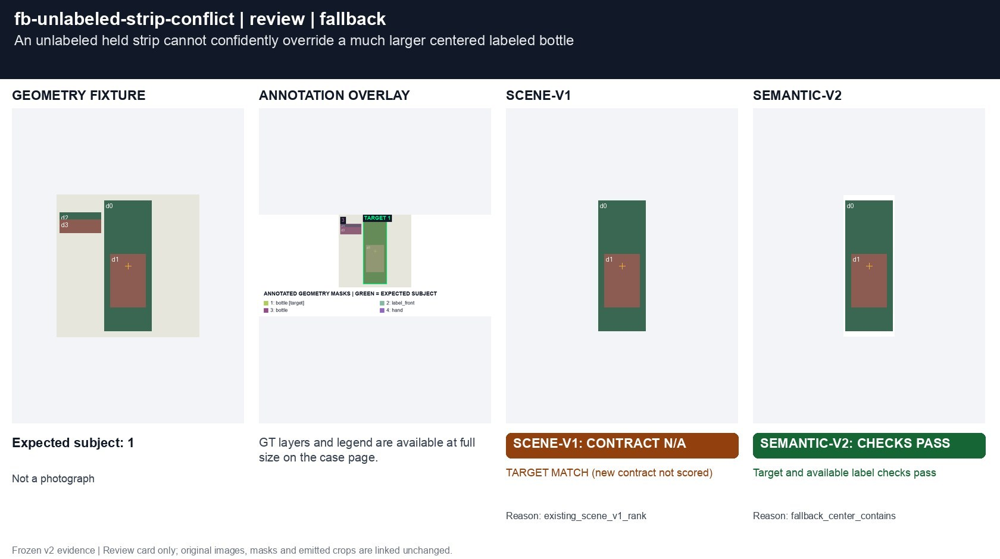](../cases/fb-unlabeled-strip-conflict.md)

### fb-exterior-label-strip Secondary label pixels touching the silhouette edge survive

**scene-v1:** Contract N/A; fallback: target match

[Open original photo, all masks and every selector crop](../cases/fb-exterior-label-strip.md)

[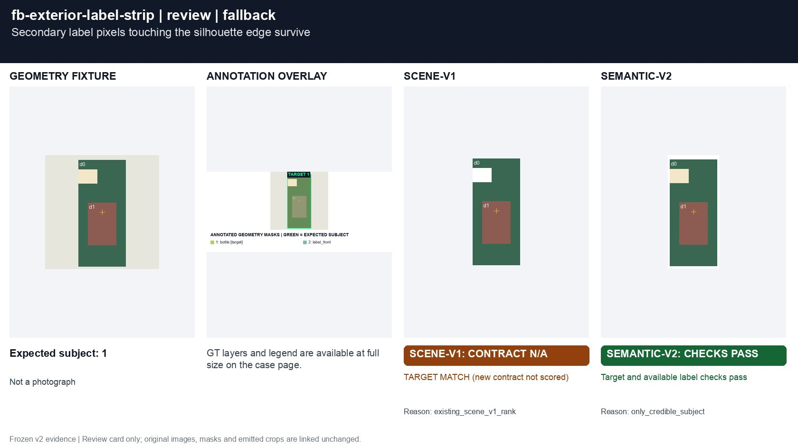](../cases/fb-exterior-label-strip.md)

### fb-label-gap-tap A tap on white paper missing from the bottle mask resolves through unique label context

**scene-v1:** Contract N/A; fallback: target match

[Open original photo, all masks and every selector crop](../cases/fb-label-gap-tap.md)

[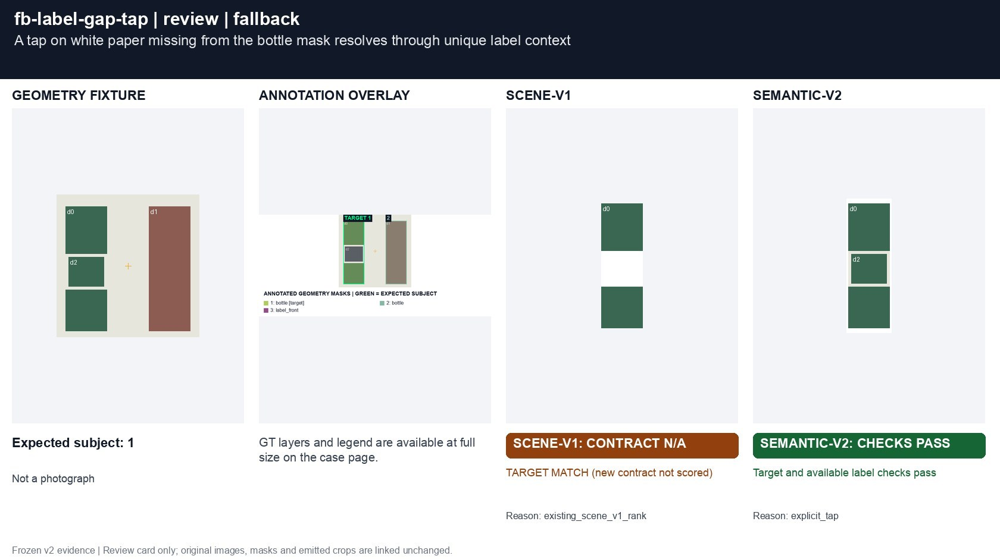](../cases/fb-label-gap-tap.md)

### fb-three-foreground Three bottles: off-center foreground beats two near-center backgrounds

**scene-v1:** Contract N/A; fallback: target differs

[Open original photo, all masks and every selector crop](../cases/fb-three-foreground.md)

[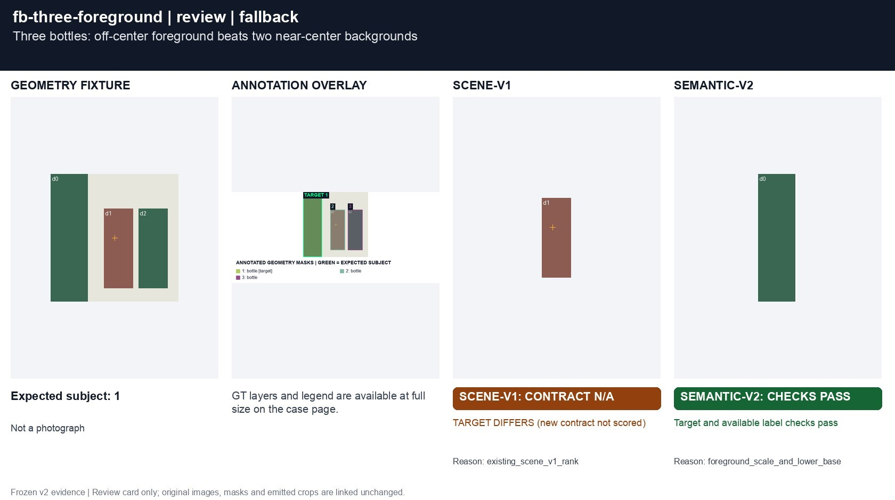](../cases/fb-three-foreground.md)

### fb-three-weak-depth Three similar bottles: uncertain depth uses center fallback

**scene-v1:** Contract N/A; fallback: target match

[Open original photo, all masks and every selector crop](../cases/fb-three-weak-depth.md)

[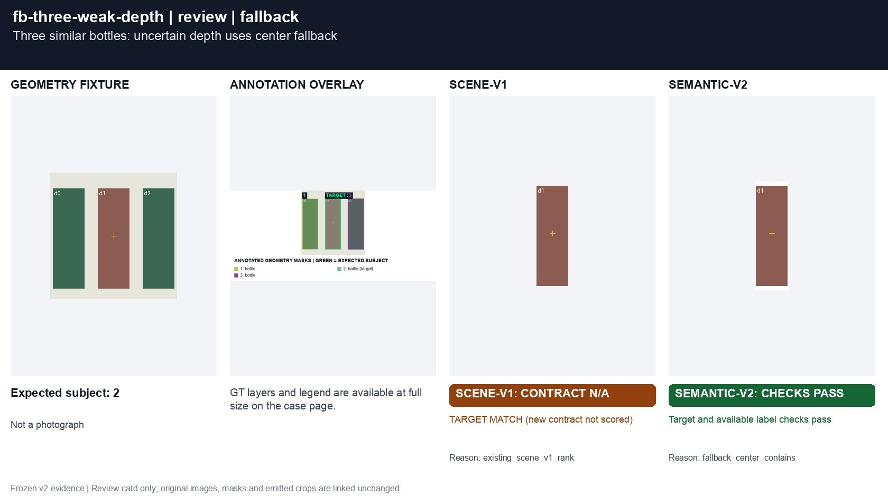](../cases/fb-three-weak-depth.md)

### fb-background-magnum A larger background magnum is not proof of camera proximity

**scene-v1:** Contract N/A; fallback: target match

[Open original photo, all masks and every selector crop](../cases/fb-background-magnum.md)

[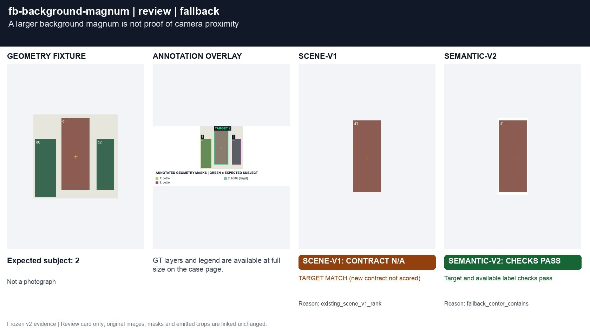](../cases/fb-background-magnum.md)

### fb-three-tap-background An explicit background tap overrides foreground prominence

**scene-v1:** Contract N/A; fallback: target match

[Open original photo, all masks and every selector crop](../cases/fb-three-tap-background.md)

[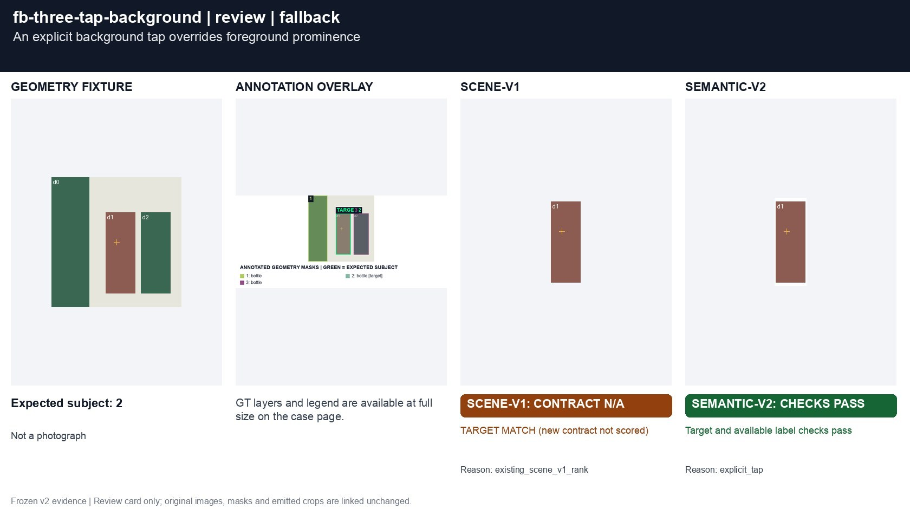](../cases/fb-three-tap-background.md)

### fb-held-carton-only A held carton remains a valid package when there is no competing bottle

**scene-v1:** Contract N/A; fallback: target match

[Open original photo, all masks and every selector crop](../cases/fb-held-carton-only.md)

[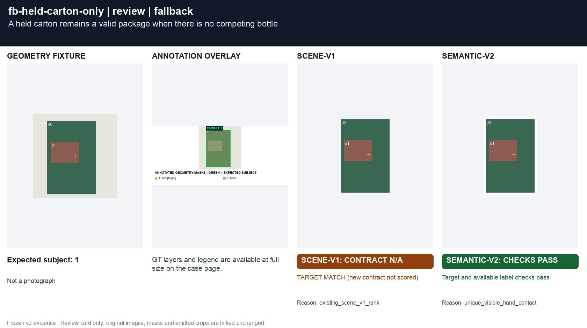](../cases/fb-held-carton-only.md)

### fb-orphan-label-beside-bottle An off-center orphan cannot win passive dominance over a physical bottle

**scene-v1:** Contract N/A; fallback: target match

[Open original photo, all masks and every selector crop](../cases/fb-orphan-label-beside-bottle.md)

[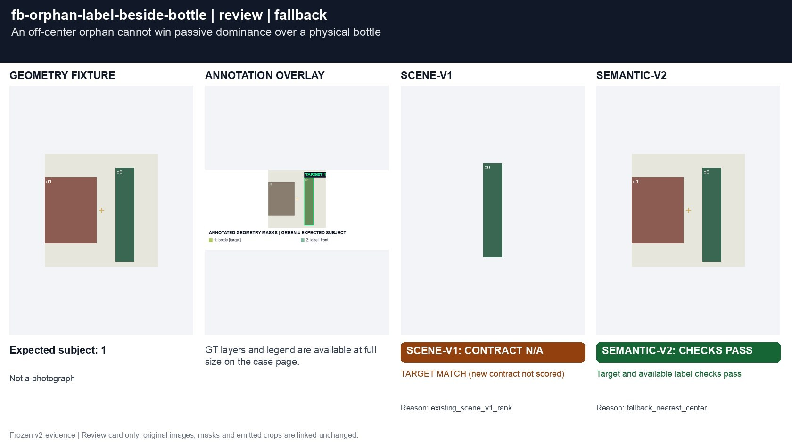](../cases/fb-orphan-label-beside-bottle.md)

### fb-centered-label-closeup-with-bottle A centered label close-up survives a small background bottle

**scene-v1:** Contract N/A; fallback: target differs

[Open original photo, all masks and every selector crop](../cases/fb-centered-label-closeup-with-bottle.md)

[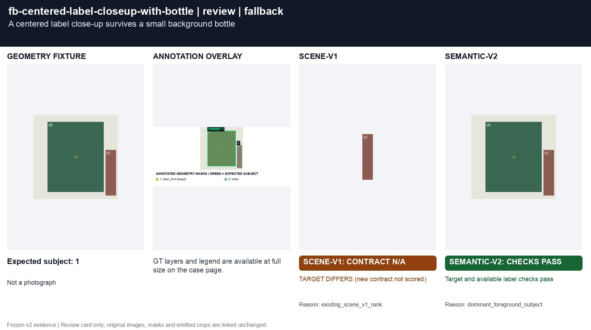](../cases/fb-centered-label-closeup-with-bottle.md)

### fb-tap-orphan-label An explicit tap can select an off-center unowned label

**scene-v1:** Contract N/A; fallback: target differs

[Open original photo, all masks and every selector crop](../cases/fb-tap-orphan-label.md)

[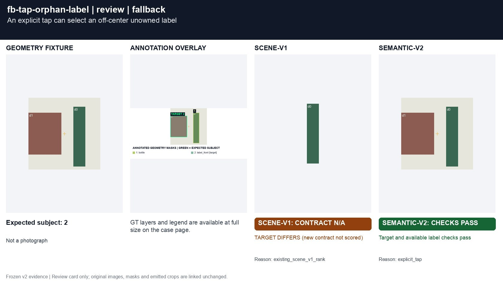](../cases/fb-tap-orphan-label.md)

### fb-dominant-label-price-conflict A dominant real label also classified as price tag keeps full context

**scene-v1:** Contract N/A; fallback: target differs

[Open original photo, all masks and every selector crop](../cases/fb-dominant-label-price-conflict.md)

[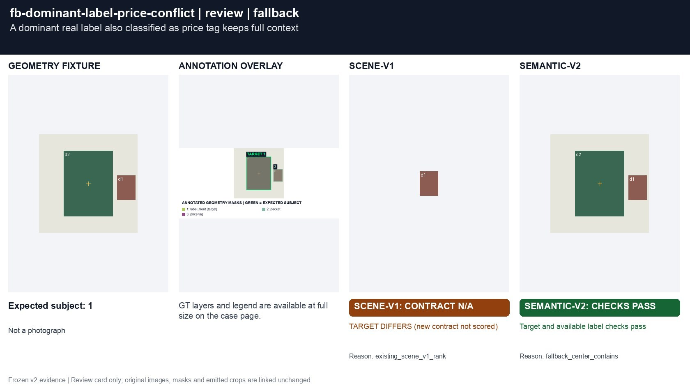](../cases/fb-dominant-label-price-conflict.md)

### fb-separate-shelf-levels A larger bottle on a lower shelf is not proof of camera proximity

**scene-v1:** Contract N/A; fallback: target match

[Open original photo, all masks and every selector crop](../cases/fb-separate-shelf-levels.md)

[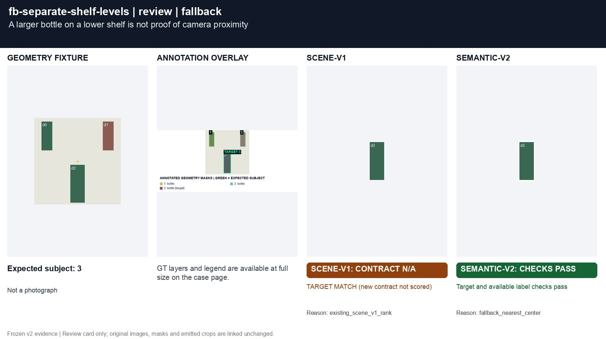](../cases/fb-separate-shelf-levels.md)

### fb-truncated-background-peer A truncated background silhouette cannot establish a foreground size ratio

**scene-v1:** Contract N/A; fallback: target match

[Open original photo, all masks and every selector crop](../cases/fb-truncated-background-peer.md)

[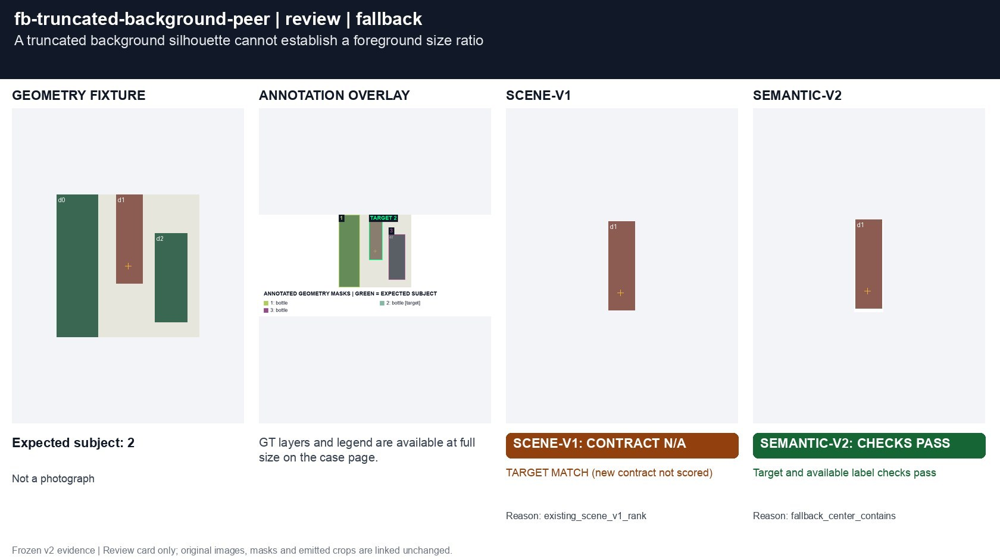](../cases/fb-truncated-background-peer.md)

### fb-bystander-hand-three An ambiguous hand touching only background bottles cannot suppress a clear foreground

**scene-v1:** Contract N/A; fallback: target differs

[Open original photo, all masks and every selector crop](../cases/fb-bystander-hand-three.md)

[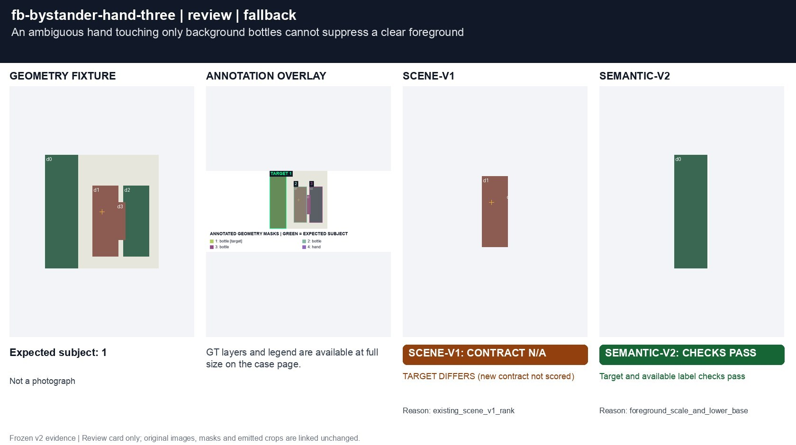](../cases/fb-bystander-hand-three.md)

### fb-held-unlabelled-carton Wine label presence cannot override stronger contact with an unlabelled held carton

**scene-v1:** Contract N/A; fallback: target match

[Open original photo, all masks and every selector crop](../cases/fb-held-unlabelled-carton.md)

[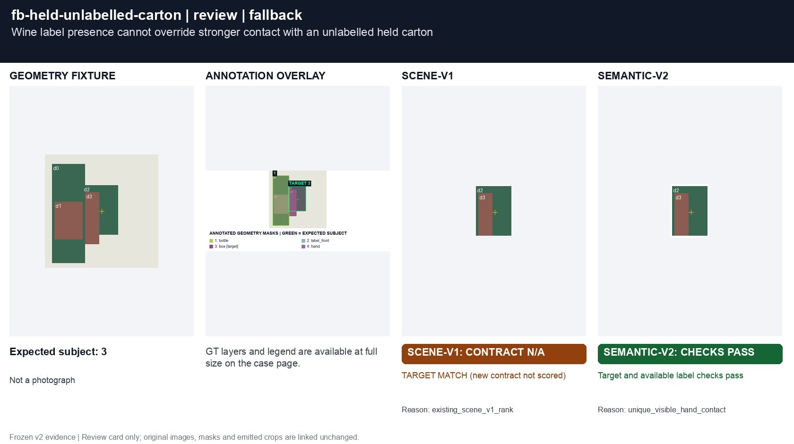](../cases/fb-held-unlabelled-carton.md)

### fb-lying-foreground-three A lying foreground bottle survives two upright bottles near center

**scene-v1:** Contract N/A; fallback: target differs

[Open original photo, all masks and every selector crop](../cases/fb-lying-foreground-three.md)

[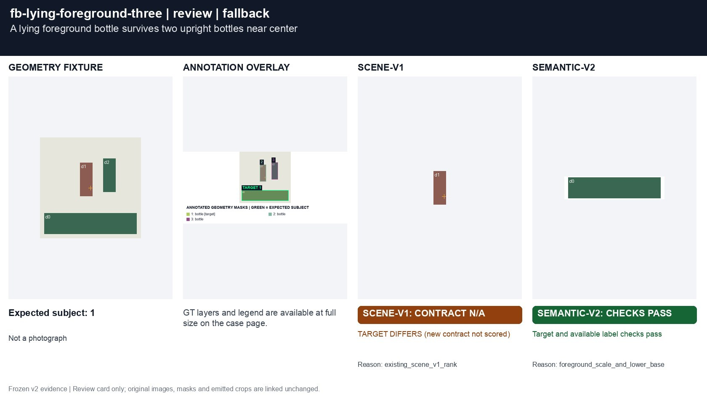](../cases/fb-lying-foreground-three.md)

### fb-unowned-label-logo-mask A large unowned label extent is preserved when its mask collapses to a small logo

**scene-v1:** Contract N/A; fallback: target match

[Open original photo, all masks and every selector crop](../cases/fb-unowned-label-logo-mask.md)

[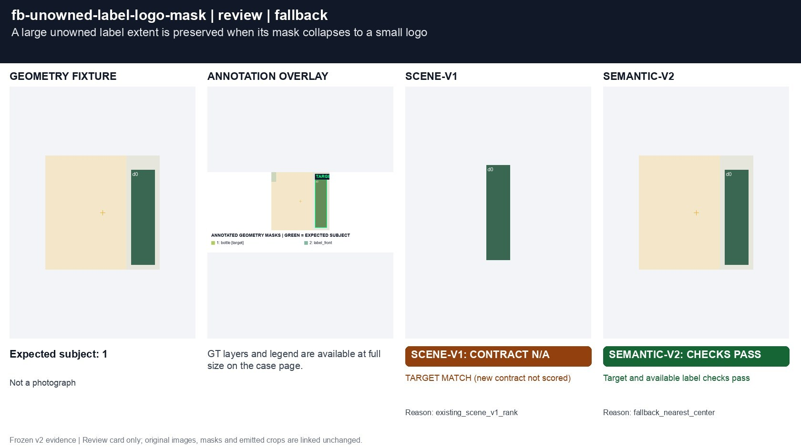](../cases/fb-unowned-label-logo-mask.md)

### fb-weak-wrap-strong-grip Weak incidental front wrap cannot steal a stronger grip (contact alone is unconfirmed; use geometric fallback)

**scene-v1:** Contract N/A; fallback: target differs

[Open original photo, all masks and every selector crop](../cases/fb-weak-wrap-strong-grip.md)

[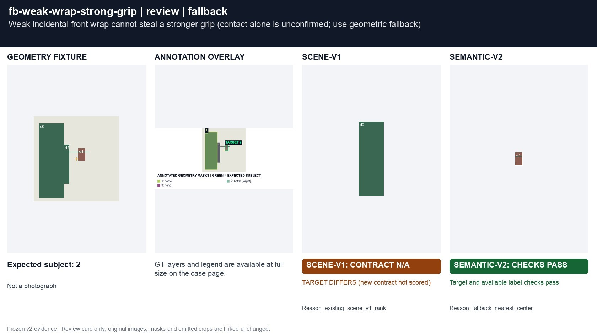](../cases/fb-weak-wrap-strong-grip.md)

### fb-multiple-grips-unheld-foreground Two confirmed grips block an unrelated unheld foreground bottle

**scene-v1:** Contract N/A; fallback: target differs

[Open original photo, all masks and every selector crop](../cases/fb-multiple-grips-unheld-foreground.md)

[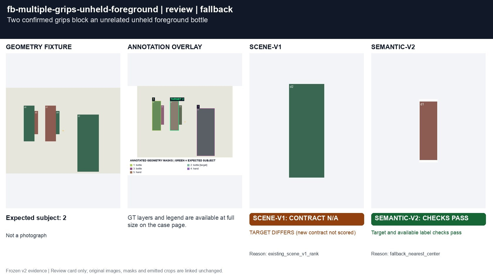](../cases/fb-multiple-grips-unheld-foreground.md)

### fb-owner-and-uncertain-background A confirmed grip plus another uncertain hand cannot promote an unheld bottle

**scene-v1:** Contract N/A; fallback: target match

[Open original photo, all masks and every selector crop](../cases/fb-owner-and-uncertain-background.md)

[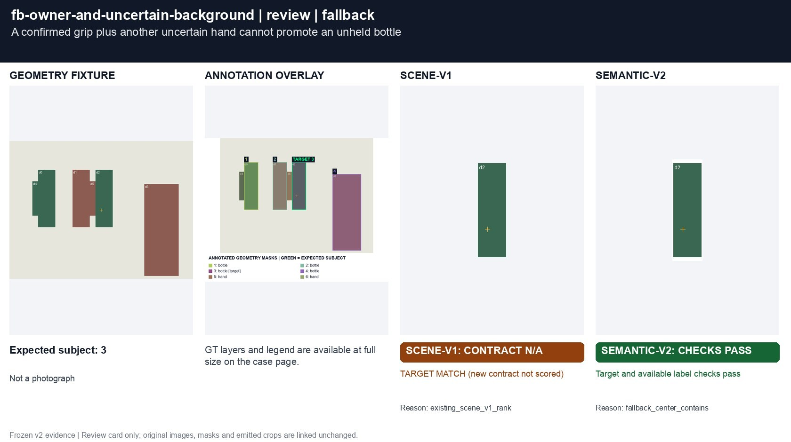](../cases/fb-owner-and-uncertain-background.md)

### fb-held-neck-dominant-paper A held neck cannot discard an unowned complete label (contact alone is unconfirmed; use geometric fallback)

**scene-v1:** Contract N/A; fallback: target differs

[Open original photo, all masks and every selector crop](../cases/fb-held-neck-dominant-paper.md)

[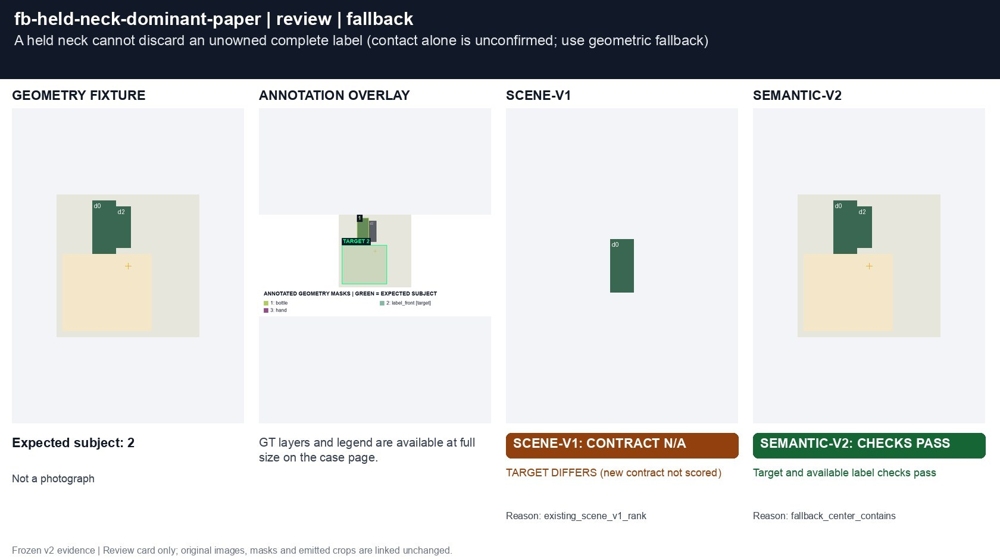](../cases/fb-held-neck-dominant-paper.md)

### fb-held-neck-pending-logo A held subject retains pending full paper even if its mask is only a logo (contact alone is unconfirmed; use geometric fallback)

**scene-v1:** Contract N/A; fallback: target match

[Open original photo, all masks and every selector crop](../cases/fb-held-neck-pending-logo.md)

[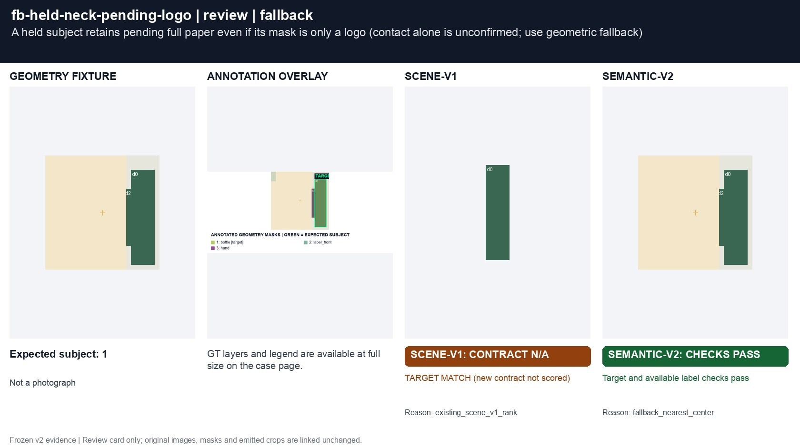](../cases/fb-held-neck-pending-logo.md)

### fb-point-contact-near-center-bottle Unverified side contact cannot outrank a central bottle

**scene-v1:** Contract N/A; fallback: target match

[Open original photo, all masks and every selector crop](../cases/fb-point-contact-near-center-bottle.md)

[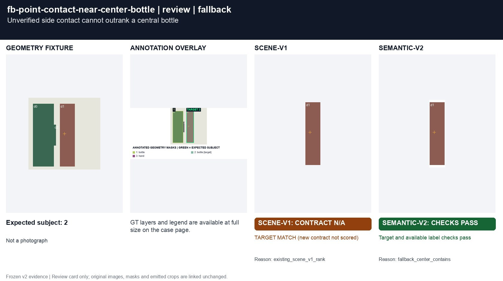](../cases/fb-point-contact-near-center-bottle.md)

### fb-opposed-background-midbody Opposed background skin without front or terminal evidence is not a grip

**scene-v1:** Contract N/A; fallback: target match

[Open original photo, all masks and every selector crop](../cases/fb-opposed-background-midbody.md)

### fb-enclosing-label-panel A complete panel encloses bottle artwork; preserve the panel context

**scene-v1:** Contract N/A; fallback: target differs

[Open original photo, all masks and every selector crop](../cases/fb-enclosing-label-panel.md)

[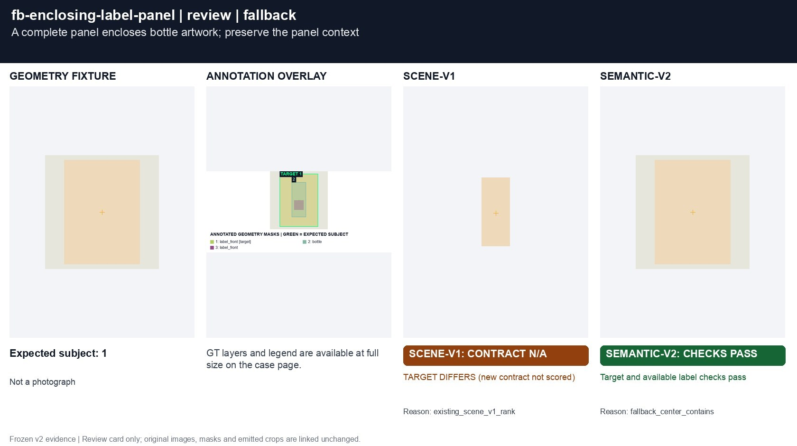](../cases/fb-enclosing-label-panel.md)

