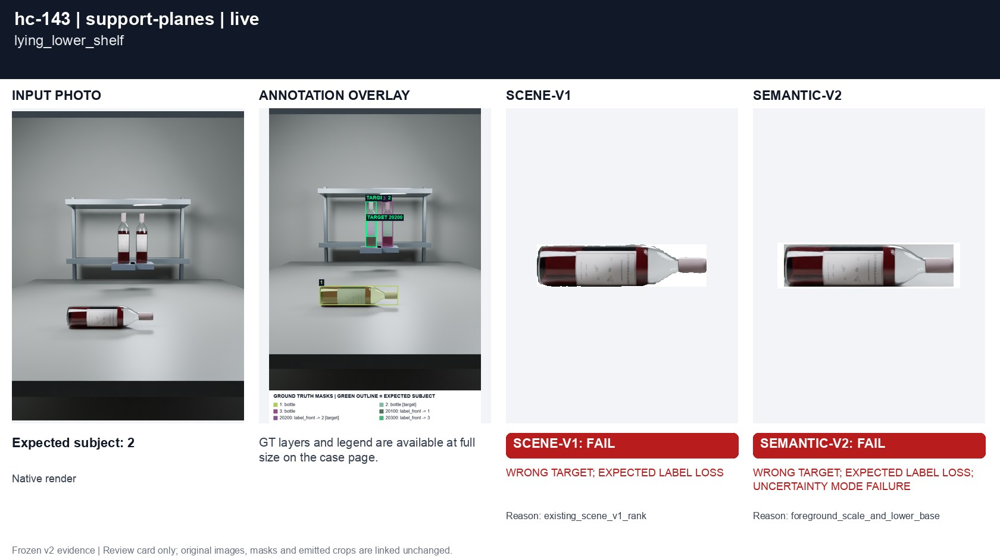
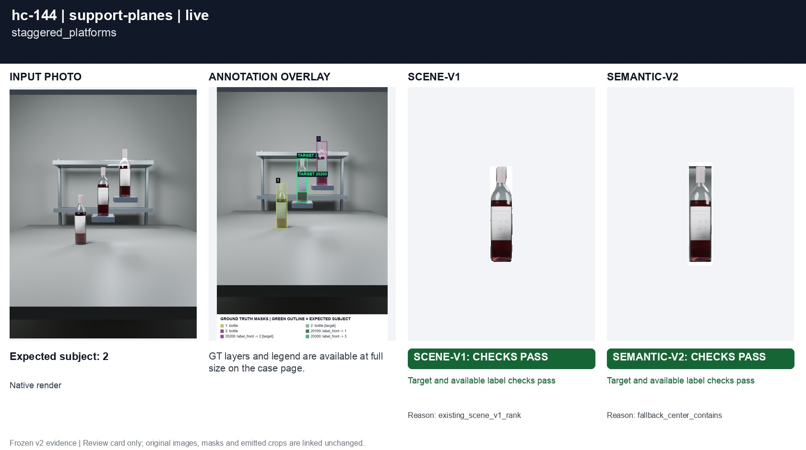

# Separate shelves and support planes

[All groups](../README.md)

Raised background shelves and a lying bottle on a lower level. A lower image base alone must not certify camera proximity; ambiguous scenes require the declared geometric fallback.

3 cases. Failures below use frozen result fields; photos and fixtures retain separate interpretation.

| Case | scene-v1 | semantic-v2 |
|---|---|---|
| [hc-142 raised_rear_shelf](../cases/hc-142.md) | Recorded checks pass | Recorded checks pass |
| [hc-143 lying_lower_shelf](../cases/hc-143.md) | **FAIL** controlled: WRONG TARGET; EXPECTED LABEL LOSS, live: WRONG TARGET; EXPECTED LABEL LOSS | **FAIL** controlled: WRONG TARGET; EXPECTED LABEL LOSS; UNCERTAINTY MODE FAILURE, live: WRONG TARGET; EXPECTED LABEL LOSS; UNCERTAINTY MODE FAILURE |
| [hc-144 staggered_platforms](../cases/hc-144.md) | Recorded checks pass | Recorded checks pass |

## Visual examples

### hc-142 raised_rear_shelf

**scene-v1:** Recorded checks pass

[Open original photo, all masks and every selector crop](../cases/hc-142.md)

### hc-143 lying_lower_shelf

**scene-v1:** **FAIL** controlled: WRONG TARGET; EXPECTED LABEL LOSS, live: WRONG TARGET; EXPECTED LABEL LOSS

[Open original photo, all masks and every selector crop](../cases/hc-143.md)

### hc-144 staggered_platforms

**scene-v1:** Recorded checks pass

[Open original photo, all masks and every selector crop](../cases/hc-144.md)

