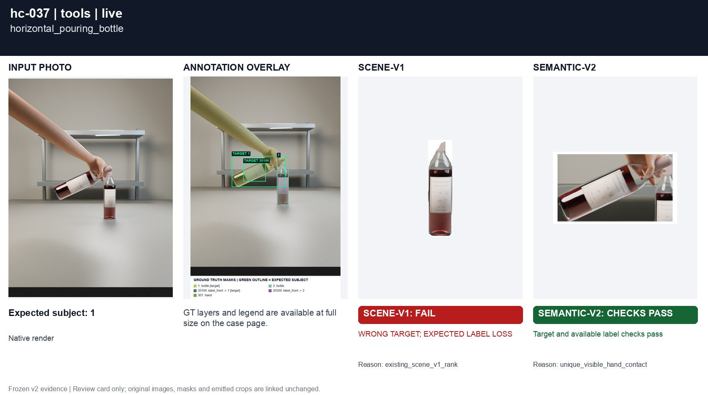
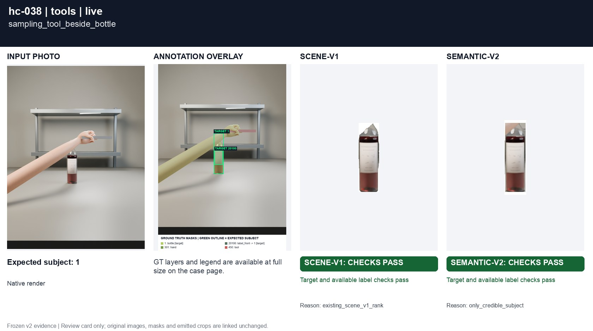
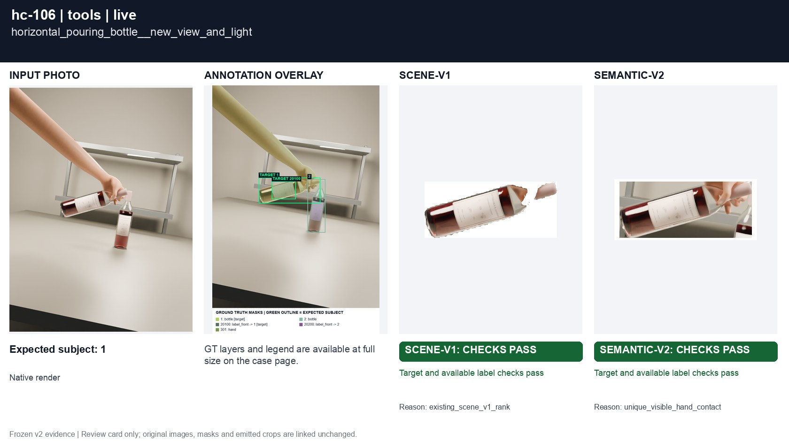
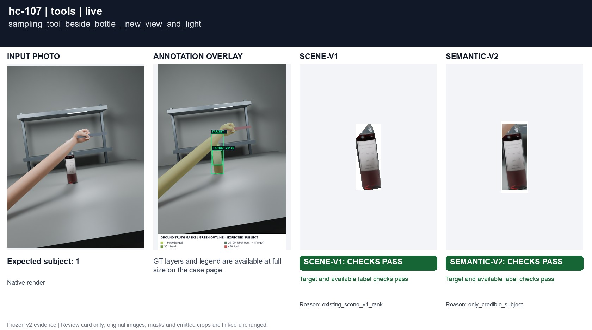

# Horizontal bottle versus a wine tool

[All groups](../README.md)

A real pouring bottle and a slender sampling tool. Tool masks are independently annotated, never renamed to fit the selector.

4 cases. Failures below use frozen result fields; photos and fixtures retain separate interpretation.

| Case | scene-v1 | semantic-v2 |
|---|---|---|
| [hc-037 horizontal_pouring_bottle](../cases/hc-037.md) | **FAIL** live: WRONG TARGET; EXPECTED LABEL LOSS | Recorded checks pass |
| [hc-038 sampling_tool_beside_bottle](../cases/hc-038.md) | Recorded checks pass | Recorded checks pass |
| [hc-106 horizontal_pouring_bottle__new_view_and_light](../cases/hc-106.md) | Recorded checks pass | Recorded checks pass |
| [hc-107 sampling_tool_beside_bottle__new_view_and_light](../cases/hc-107.md) | Recorded checks pass | **FAIL** controlled: WRONG TARGET; EXPECTED LABEL LOSS |

## Visual examples

### hc-037 horizontal_pouring_bottle

**scene-v1:** **FAIL** live: WRONG TARGET; EXPECTED LABEL LOSS

[Open original photo, all masks and every selector crop](../cases/hc-037.md)

### hc-038 sampling_tool_beside_bottle

**scene-v1:** Recorded checks pass

[Open original photo, all masks and every selector crop](../cases/hc-038.md)

### hc-106 horizontal_pouring_bottle__new_view_and_light

**scene-v1:** Recorded checks pass

[Open original photo, all masks and every selector crop](../cases/hc-106.md)

### hc-107 sampling_tool_beside_bottle__new_view_and_light

**scene-v1:** Recorded checks pass

[Open original photo, all masks and every selector crop](../cases/hc-107.md)

