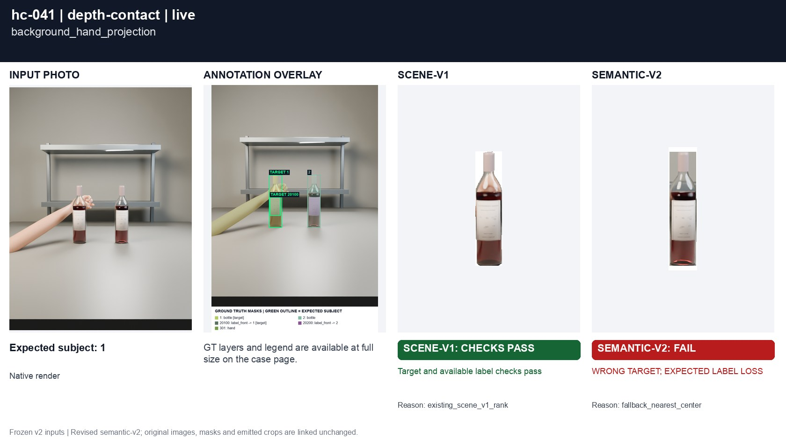
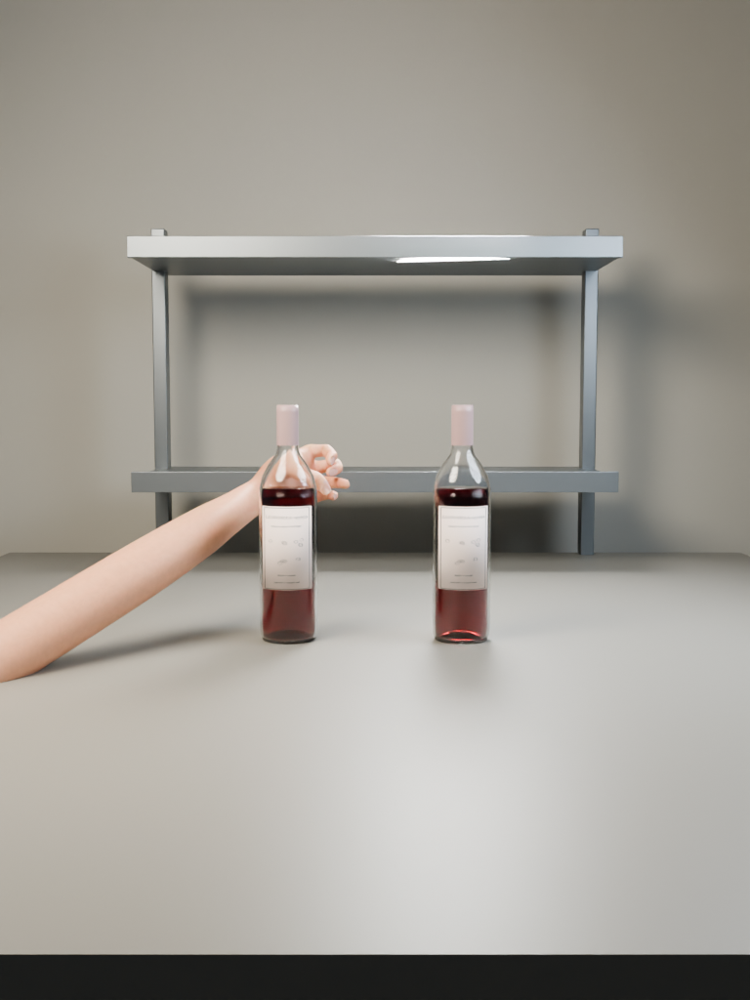
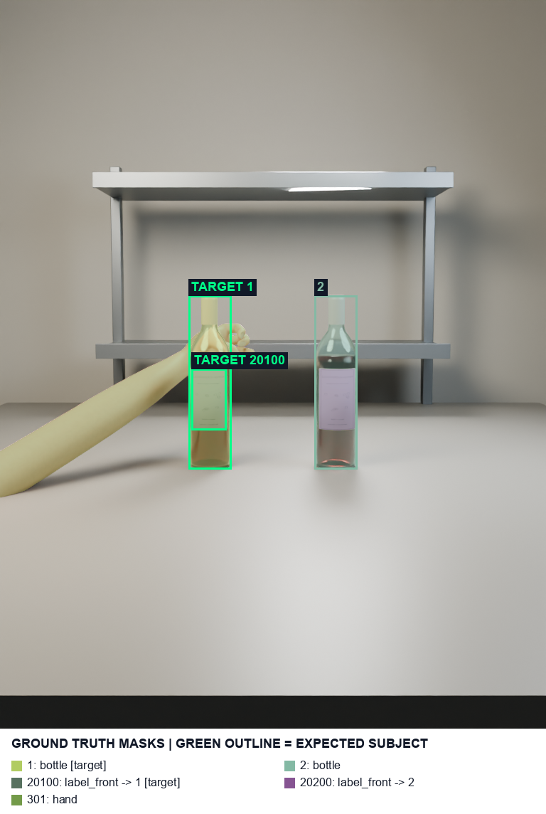
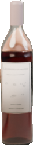
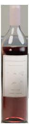
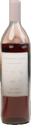
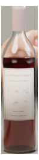

# hc-041 background_hand_projection

[All cases](../README.md) · [Group](../groups/depth-contact.md) · [Exact case metadata](../evidence/hc-041.json)

**scene-v1:** Recorded checks pass  
**semantic-v2:** **FAIL** live: WRONG TARGET; EXPECTED LABEL LOSS

## Expected result

- Group: `depth-contact`; provenance: `new_native_render`.
- Expected subject: `1`; acceptable IDs: `[1, 2]`.
- Expected status: `selected`; expected selection mode: `fallback`.
- Interaction: `{}`.
- Annotation source: native opaque visible geometry.
- Complete label GT: `True`.

No unique intended bottle. The annotated crop target follows the revised photo-center / pixel-distance / left / upper policy; this is a product fallback, not evidence of user intent.

## Original input and masks

| Mask ID | Category | Parent | Expected subject or label | Original binary PNG |
|---|---|---|---|---|
| `1` | bottle | `None` | yes | [view raw mask](../assets/masks/hc-041-i1.png) |
| `2` | bottle | `None` |  | [view raw mask](../assets/masks/hc-041-i2.png) |
| `20100` | label_front | `1` | yes | [view raw mask](../assets/masks/hc-041-i20100.png) |
| `20200` | label_front | `2` |  | [view raw mask](../assets/masks/hc-041-i20200.png) |
| `301` | hand | `None` |  | [view raw mask](../assets/masks/hc-041-i301.png) |

## Saved selector outputs

`live` replays saved detector responses; `controlled` uses declared GT-derived detections and faults. No new inference was run for this gallery. Expected-label retention below 98% is flagged separately from target matching. A full-frame crop can retain distractors.

### live

| Selector | Result | Assigned subject | Mode | Expected-label retention | Reason |
|---|---|---|---|---|---|
| `scene-v1` | Recorded checks pass | `1` | `legacy` | 100.00% | `existing_scene_v1_rank` |
| `semantic-v2` | **FAIL: WRONG TARGET, EXPECTED LABEL LOSS** | `2` | `fallback` | 0.00% | `fallback_nearest_center` |

#### scene-v1 live crop

[View original selector keep mask](../assets/crops/hc-041-live-scene-v1-keep.png)

#### semantic-v2 live crop

[View original selector keep mask](../assets/crops/hc-041-live-semantic-v2-keep.png)

Label crop views: [view 1](../assets/crops/hc-041-live-semantic-v2-label-0.png).
### controlled

| Selector | Result | Assigned subject | Mode | Expected-label retention | Reason |
|---|---|---|---|---|---|
| `scene-v1` | Recorded checks pass | `1` | `legacy` | 100.00% | `existing_scene_v1_rank` |
| `semantic-v2` | Recorded checks pass | `1` | `fallback` | 100.00% | `fallback_leftmost` |

#### scene-v1 controlled crop

[View original selector keep mask](../assets/crops/hc-041-controlled-scene-v1-keep.png)

#### semantic-v2 controlled crop

[View original selector keep mask](../assets/crops/hc-041-controlled-semantic-v2-keep.png)

Label crop views: [view 1](../assets/crops/hc-041-controlled-semantic-v2-label-0.png).

## Detector investigation · 20 October 2026

UNRESOLVED: independent detector localization error reverses the exact GT tie. Lossless and local-crop proposals do not consistently recover the frozen geometry. No near-tie epsilon was added.

[All eleven investigations](../INVESTIGATION.md) · [Raw model trials](../investigation/README.md) · [Exact remaining geometry](../evidence/residual-failures.json).

The masks below are the exact primary detector outputs; boxes are reported separately from the candidate geometry actually used. Primary cache bytes are unchanged.

| Index | Class | Reported box | Current candidate box | Geometry source | Exact detector mask |
|---|---|---|---|---|---|
| `d0` | wine bottle | `[444.0, 413.0, 501.0, 658.0]` | `[444, 414, 501, 658]` | `visible_mask` | [mask PNG](../detector-masks/hc-041-primary-d0.png) |
| `d1` | wine bottle | `[266.0, 413.0, 323.0, 658.0]` | `[266, 413, 323, 658]` | `detector_box` | [mask PNG](../detector-masks/hc-041-primary-d1.png) |
| `d2` | wine label | `[448.0, 517.0, 500.0, 604.0]` | `None` | `not an eligible semantic candidate` | [mask PNG](../detector-masks/hc-041-primary-d2.png) |
| `d3` | wine label | `[267.0, 517.0, 320.0, 604.0]` | `None` | `not an eligible semantic candidate` | [mask PNG](../detector-masks/hc-041-primary-d3.png) |
| `d4` | hand | `[307.0, 453.0, 358.0, 513.0]` | `None` | `not an eligible semantic candidate` | [mask PNG](../detector-masks/hc-041-primary-d4.png) |
| `d5` | hand | `[260.0, 454.0, 359.0, 514.0]` | `None` | `not an eligible semantic candidate` | [mask PNG](../detector-masks/hc-041-primary-d5.png) |

Independent detector fallback winner: `d0`; emitted winner: `d0`. It remains a scored target mismatch.

