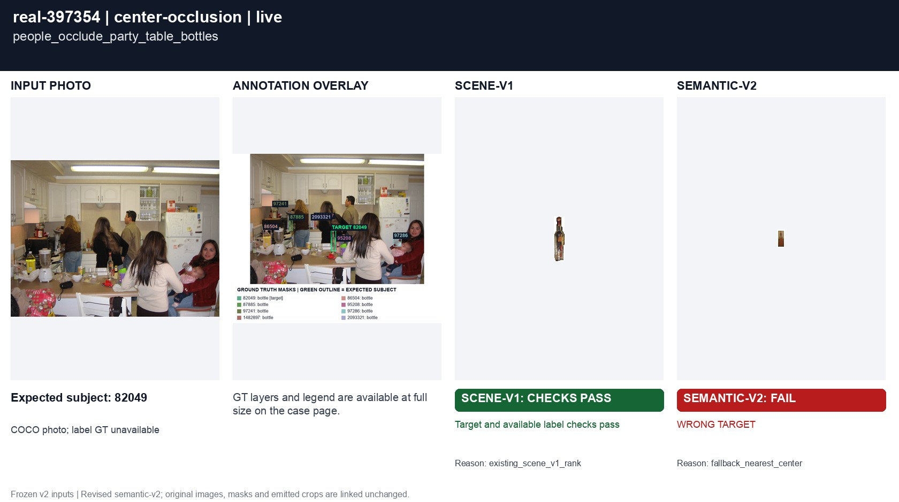
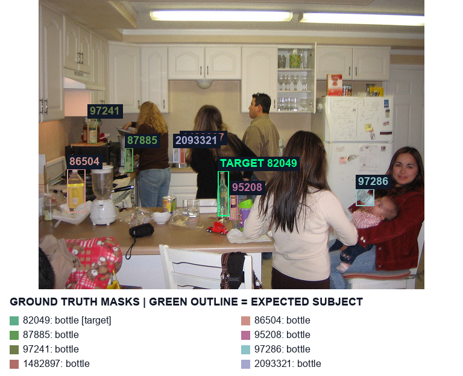
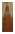

# real-397354 people_occlude_party_table_bottles

[All cases](../README.md) · [Group](../groups/center-occlusion.md) · [Exact case metadata](../evidence/real-397354.json)

**scene-v1:** Recorded checks pass  
**semantic-v2:** **FAIL** live: WRONG TARGET

## Expected result

- Group: `center-occlusion`; provenance: `coco_real_photo`.
- Expected subject: `82049`; acceptable IDs: `[82049, 86504, 87885, 95208, 97241, 97286, 1482897, 2093321]`.
- Expected status: `selected`; expected selection mode: `fallback`.
- Interaction: `{}`.
- Annotation source: COCO bottle polygons; Codex visual target review before evaluation, not independently adjudicated; background instance coverage can be incomplete.
- Complete label GT: `False`.

No unique intended bottle. The annotated crop target follows the revised photo-center / pixel-distance / left / upper policy; this is a product fallback, not evidence of user intent.

COCO image `397354` · [original source](http://images.cocodataset.org/val2017/000000397354.jpg) · [Flickr source](http://farm1.staticflickr.com/188/410311643_a3c829f3c7_z.jpg) · [license: Attribution-ShareAlike License](http://creativecommons.org/licenses/by-sa/2.0/).

Real targets are developer judgments, not independently adjudicated user intent. COCO competitor coverage may be incomplete; no hand or complete-label ground truth is invented.

## Original input and masks

| Mask ID | Category | Parent | Expected subject or label | Original binary PNG |
|---|---|---|---|---|
| `82049` | bottle | `None` | yes | [view raw mask](../assets/masks/real-397354-i82049.png) |
| `86504` | bottle | `None` |  | [view raw mask](../assets/masks/real-397354-i86504.png) |
| `87885` | bottle | `None` |  | [view raw mask](../assets/masks/real-397354-i87885.png) |
| `95208` | bottle | `None` |  | [view raw mask](../assets/masks/real-397354-i95208.png) |
| `97241` | bottle | `None` |  | [view raw mask](../assets/masks/real-397354-i97241.png) |
| `97286` | bottle | `None` |  | [view raw mask](../assets/masks/real-397354-i97286.png) |
| `1482897` | bottle | `None` |  | [view raw mask](../assets/masks/real-397354-i1482897.png) |
| `2093321` | bottle | `None` |  | [view raw mask](../assets/masks/real-397354-i2093321.png) |

## Saved selector outputs

`live` replays saved detector responses; `controlled` uses declared GT-derived detections and faults. No new inference was run for this gallery. Expected-label retention below 98% is flagged separately from target matching. A full-frame crop can retain distractors.

### live

| Selector | Result | Assigned subject | Mode | Expected-label retention | Reason |
|---|---|---|---|---|---|
| `scene-v1` | Recorded checks pass | `82049` | `legacy` | not scored | `existing_scene_v1_rank` |
| `semantic-v2` | **FAIL: WRONG TARGET** | `1482897` | `fallback` | not scored | `fallback_nearest_center` |

#### scene-v1 live crop

[View original selector keep mask](../assets/crops/real-397354-live-scene-v1-keep.png)

#### semantic-v2 live crop

[View original selector keep mask](../assets/crops/real-397354-live-semantic-v2-keep.png)

## Detector investigation · 20 October 2026

UNRESOLVED: small localization differences reverse two near-equal distances. The tested generic/lossless profiles do not safely repair the ordering.

[All eleven investigations](../INVESTIGATION.md) · [Raw model trials](../investigation/README.md) · [Exact remaining geometry](../evidence/residual-failures.json).

The masks below are the exact primary detector outputs; boxes are reported separately from the candidate geometry actually used. Primary cache bytes are unchanged.

| Index | Class | Reported box | Current candidate box | Geometry source | Exact detector mask |
|---|---|---|---|---|---|
| `d0` | wine bottle | `[52.0, 244.0, 63.0, 281.0]` | `[51, 245, 64, 282]` | `visible_mask` | [mask PNG](../detector-masks/real-397354-primary-d0.png) |
| `d1` | wine bottle | `[524.0, 312.0, 557.0, 341.0]` | `[525, 313, 557, 342]` | `visible_mask` | [mask PNG](../detector-masks/real-397354-primary-d1.png) |
| `d2` | wine bottle | `[317.0, 322.0, 329.0, 365.0]` | `[318, 322, 329, 365]` | `visible_mask` | [mask PNG](../detector-masks/real-397354-primary-d2.png) |
| `d3` | wine bottle | `[46.0, 279.0, 76.0, 348.0]` | `[47, 279, 78, 348]` | `visible_mask` | [mask PNG](../detector-masks/real-397354-primary-d3.png) |
| `d4` | wine bottle | `[222.0, 245.0, 233.0, 270.0]` | `[222, 245, 233, 270]` | `detector_box` | [mask PNG](../detector-masks/real-397354-primary-d4.png) |
| `d5` | wine bottle | `[142.0, 245.0, 155.0, 284.0]` | `[142, 245, 156, 285]` | `visible_mask` | [mask PNG](../detector-masks/real-397354-primary-d5.png) |
| `d6` | wine bottle | `[233.0, 240.0, 244.0, 270.0]` | `[233, 240, 244, 270]` | `detector_box` | [mask PNG](../detector-masks/real-397354-primary-d6.png) |
| `d7` | wine bottle | `[295.0, 280.0, 315.0, 364.0]` | `[296, 281, 316, 364]` | `visible_mask` | [mask PNG](../detector-masks/real-397354-primary-d7.png) |
| `d8` | hand | `[534.0, 336.0, 555.0, 353.0]` | `None` | `not an eligible semantic candidate` | [mask PNG](../detector-masks/real-397354-primary-d8.png) |
| `d9` | hand | `[152.0, 216.0, 162.0, 227.0]` | `None` | `not an eligible semantic candidate` | [mask PNG](../detector-masks/real-397354-primary-d9.png) |
| `d10` | hand | `[138.0, 202.0, 155.0, 215.0]` | `None` | `not an eligible semantic candidate` | [mask PNG](../detector-masks/real-397354-primary-d10.png) |
| `d11` | hand | `[339.0, 295.0, 349.0, 312.0]` | `None` | `not an eligible semantic candidate` | [mask PNG](../detector-masks/real-397354-primary-d11.png) |
| `d12` | can | `[205.0, 324.0, 228.0, 354.0]` | `[205, 324, 228, 354]` | `detector_box` | [mask PNG](../detector-masks/real-397354-primary-d12.png) |
| `d13` | can | `[73.0, 208.0, 101.0, 237.0]` | `[73, 208, 101, 237]` | `detector_box` | [mask PNG](../detector-masks/real-397354-primary-d13.png) |
| `d14` | can | `[504.0, 140.0, 520.0, 159.0]` | `[504, 140, 520, 159]` | `detector_box` | [mask PNG](../detector-masks/real-397354-primary-d14.png) |
| `d15` | box | `[0.0, 256.0, 12.0, 319.0]` | `[0, 256, 12, 319]` | `detector_box` | [mask PNG](../detector-masks/real-397354-primary-d15.png) |
| `d16` | box | `[477.0, 122.0, 505.0, 159.0]` | `[477, 122, 505, 159]` | `detector_box` | [mask PNG](../detector-masks/real-397354-primary-d16.png) |
| `d17` | box | `[548.0, 143.0, 573.0, 159.0]` | `[548, 143, 573, 159]` | `detector_box` | [mask PNG](../detector-masks/real-397354-primary-d17.png) |

Independent detector fallback winner: `d6`; emitted winner: `d6`. It remains a scored target mismatch.

