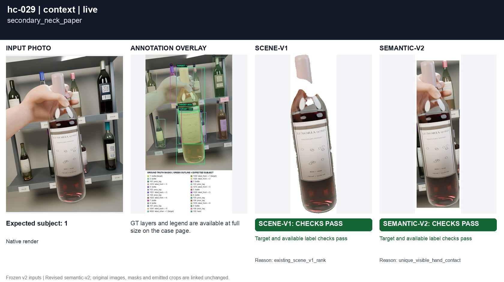
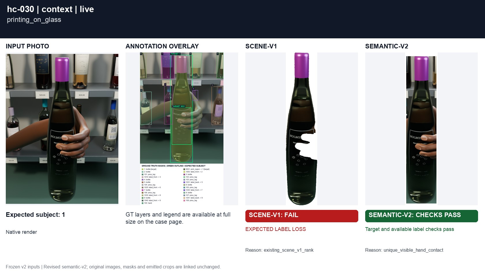
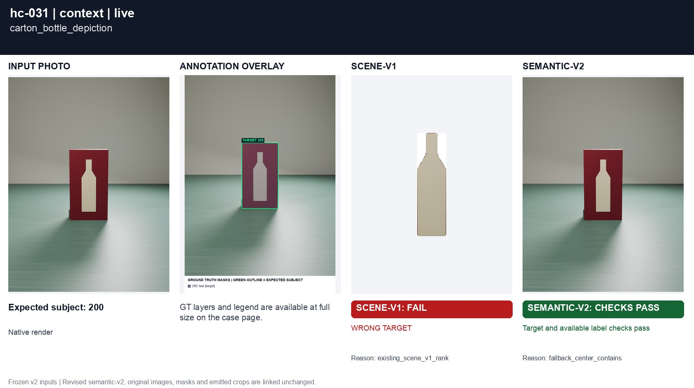
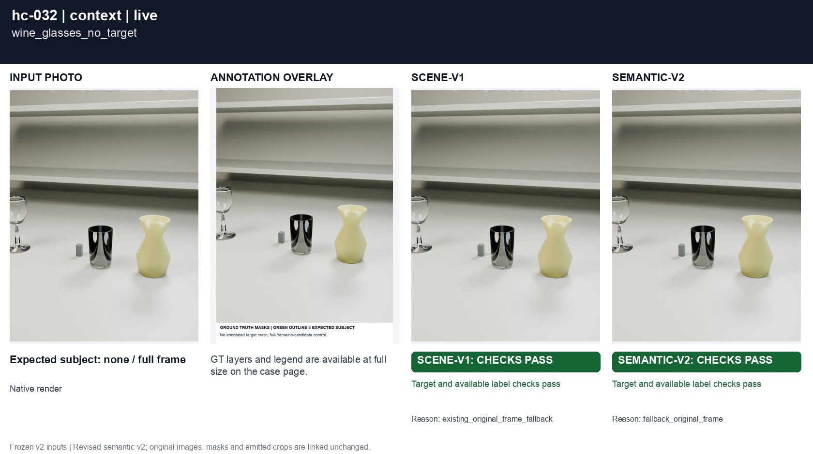
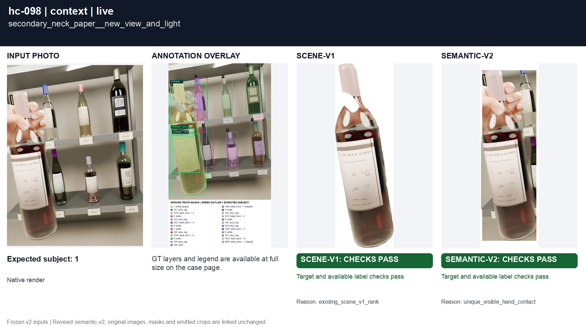
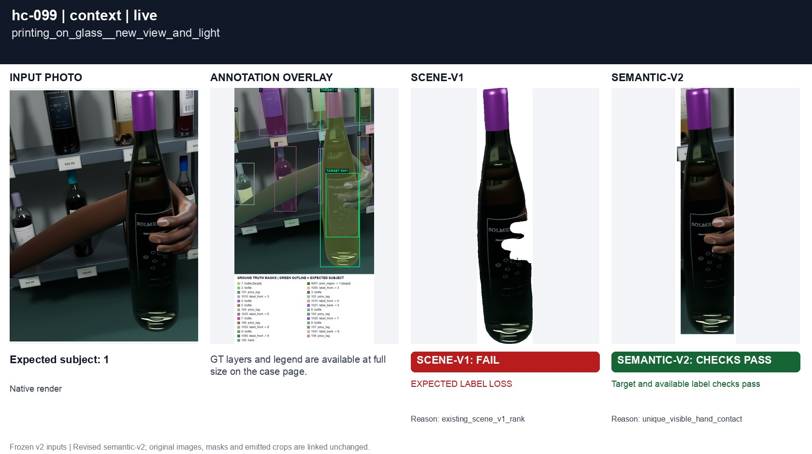
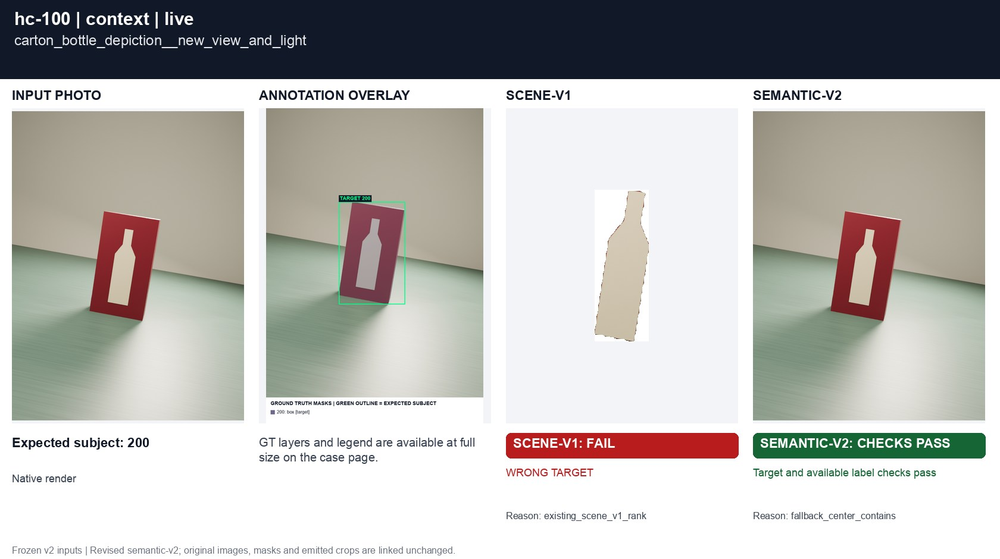
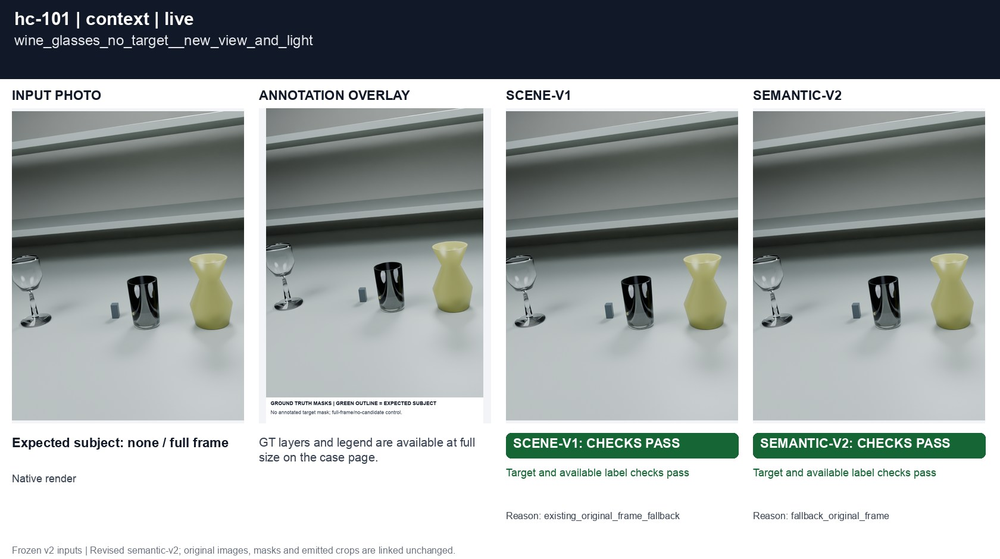
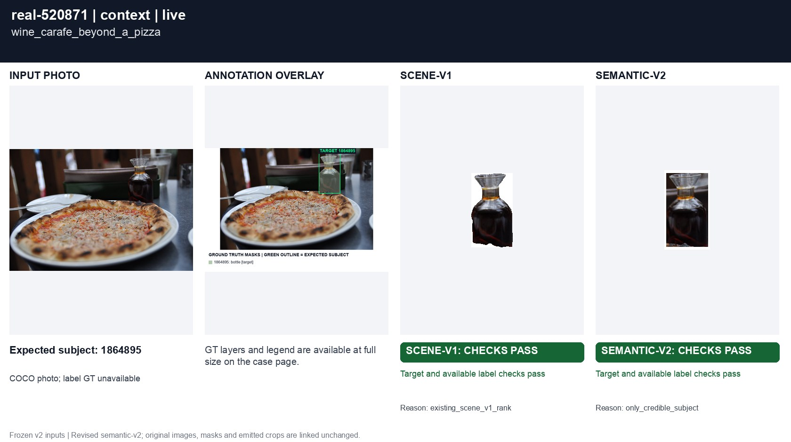

# Secondary labels and physical context

[All groups](../README.md)

Secondary paper, direct glass printing, a printed bottle depiction inside a carton, and a wine-glass-only negative. Nonexclusive masks preserve nested physical regions.

9 cases. Failures below use frozen result fields; photos and fixtures retain separate interpretation.

| Case | scene-v1 | semantic-v2 |
|---|---|---|
| [hc-029 secondary_neck_paper](../cases/hc-029.md) | Recorded checks pass | Recorded checks pass |
| [hc-030 printing_on_glass](../cases/hc-030.md) | **FAIL** live: EXPECTED LABEL LOSS | Recorded checks pass |
| [hc-031 carton_bottle_depiction](../cases/hc-031.md) | **FAIL** live: WRONG TARGET | Recorded checks pass |
| [hc-032 wine_glasses_no_target](../cases/hc-032.md) | Recorded checks pass | Recorded checks pass |
| [hc-098 secondary_neck_paper__new_view_and_light](../cases/hc-098.md) | Recorded checks pass | Recorded checks pass |
| [hc-099 printing_on_glass__new_view_and_light](../cases/hc-099.md) | **FAIL** live: EXPECTED LABEL LOSS | Recorded checks pass |
| [hc-100 carton_bottle_depiction__new_view_and_light](../cases/hc-100.md) | **FAIL** live: WRONG TARGET | Recorded checks pass |
| [hc-101 wine_glasses_no_target__new_view_and_light](../cases/hc-101.md) | Recorded checks pass | Recorded checks pass |
| [real-520871 wine_carafe_beyond_a_pizza](../cases/real-520871.md) | Recorded checks pass | Recorded checks pass |

## Visual examples

### hc-029 secondary_neck_paper

**scene-v1:** Recorded checks pass

[Open original photo, all masks and every selector crop](../cases/hc-029.md)

### hc-030 printing_on_glass

**scene-v1:** **FAIL** live: EXPECTED LABEL LOSS

[Open original photo, all masks and every selector crop](../cases/hc-030.md)

### hc-031 carton_bottle_depiction

**scene-v1:** **FAIL** live: WRONG TARGET

[Open original photo, all masks and every selector crop](../cases/hc-031.md)

### hc-032 wine_glasses_no_target

**scene-v1:** Recorded checks pass

[Open original photo, all masks and every selector crop](../cases/hc-032.md)

### hc-098 secondary_neck_paper__new_view_and_light

**scene-v1:** Recorded checks pass

[Open original photo, all masks and every selector crop](../cases/hc-098.md)

### hc-099 printing_on_glass__new_view_and_light

**scene-v1:** **FAIL** live: EXPECTED LABEL LOSS

[Open original photo, all masks and every selector crop](../cases/hc-099.md)

### hc-100 carton_bottle_depiction__new_view_and_light

**scene-v1:** **FAIL** live: WRONG TARGET

[Open original photo, all masks and every selector crop](../cases/hc-100.md)

### hc-101 wine_glasses_no_target__new_view_and_light

**scene-v1:** Recorded checks pass

[Open original photo, all masks and every selector crop](../cases/hc-101.md)

### real-520871 wine_carafe_beyond_a_pizza

**scene-v1:** Recorded checks pass

[Open original photo, all masks and every selector crop](../cases/real-520871.md)

