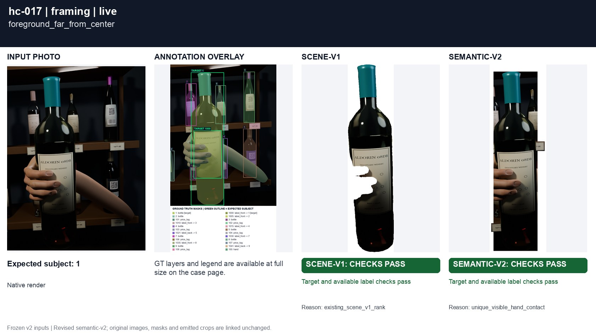
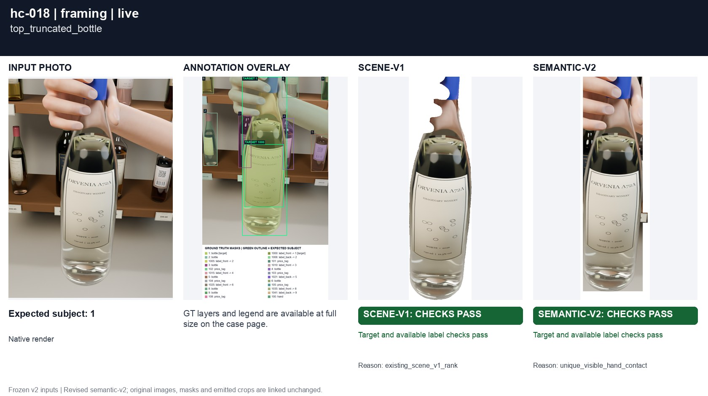
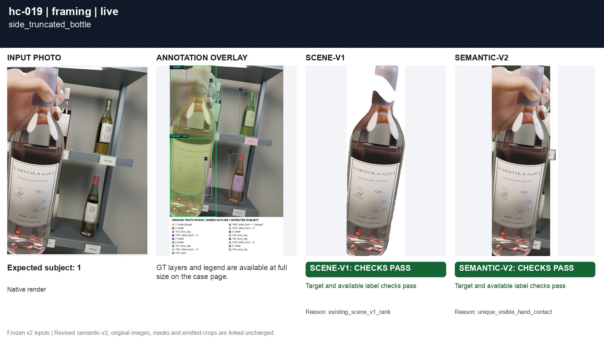
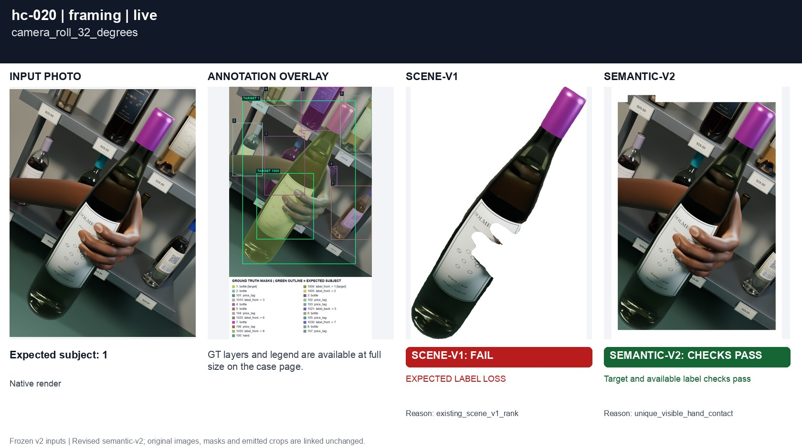
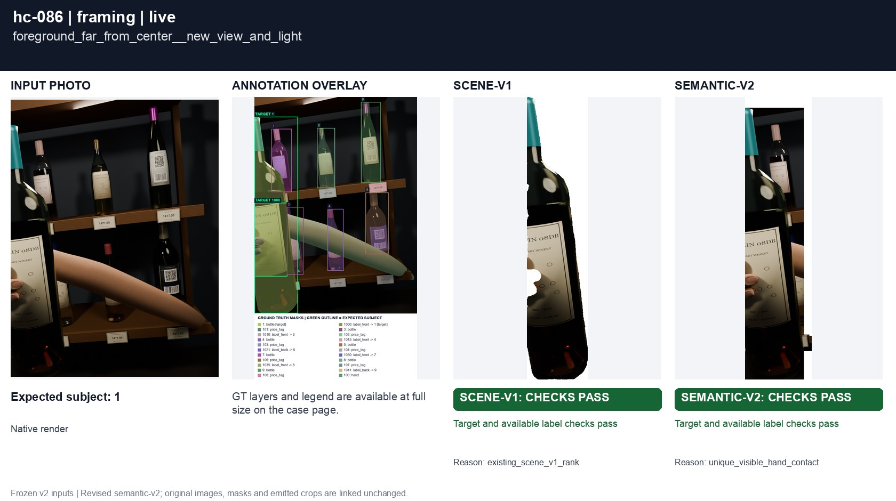
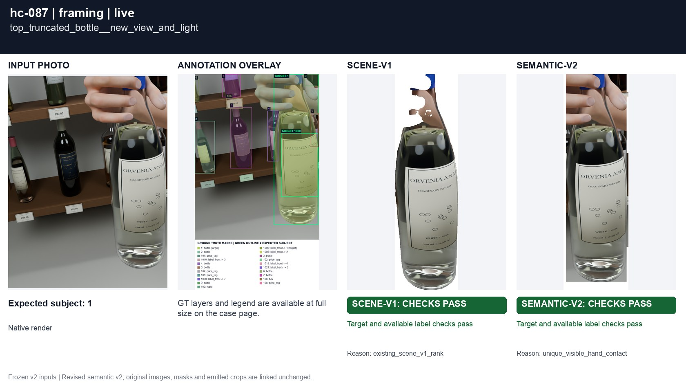
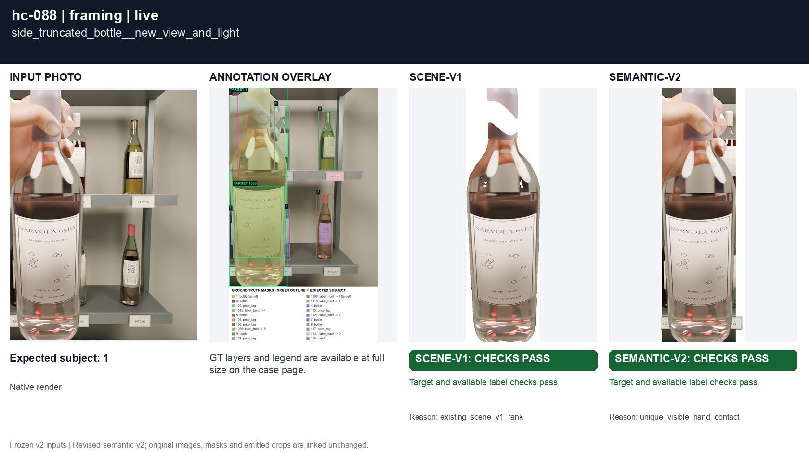
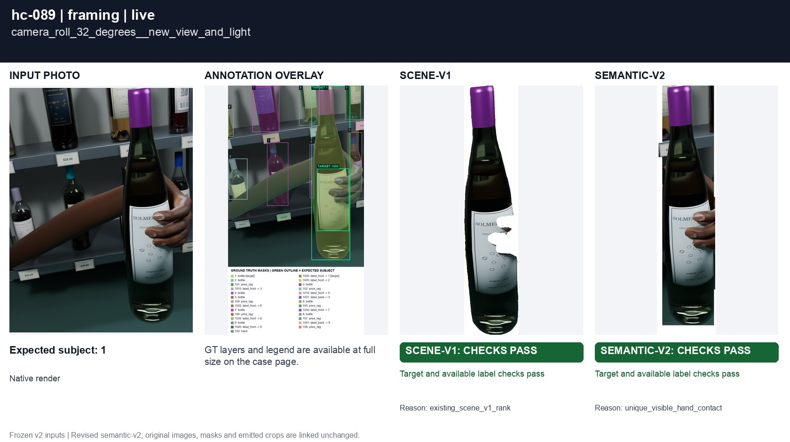
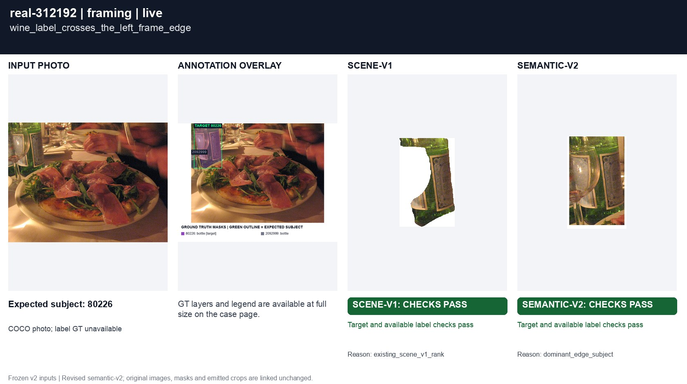
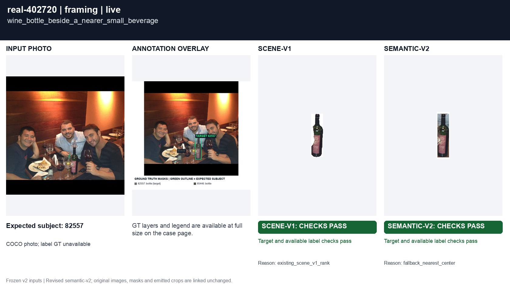

# Scale, edges and orientation

[All groups](../README.md)

An off-center foreground bottle, top truncation, a bottle crossing a side edge, and a rotated camera. Edge contact must not outweigh clear foreground intent.

10 cases. Failures below use frozen result fields; photos and fixtures retain separate interpretation.

| Case | scene-v1 | semantic-v2 |
|---|---|---|
| [hc-017 foreground_far_from_center](../cases/hc-017.md) | Recorded checks pass | Recorded checks pass |
| [hc-018 top_truncated_bottle](../cases/hc-018.md) | Recorded checks pass | Recorded checks pass |
| [hc-019 side_truncated_bottle](../cases/hc-019.md) | Recorded checks pass | Recorded checks pass |
| [hc-020 camera_roll_32_degrees](../cases/hc-020.md) | **FAIL** live: EXPECTED LABEL LOSS | Recorded checks pass |
| [hc-086 foreground_far_from_center__new_view_and_light](../cases/hc-086.md) | Recorded checks pass | Recorded checks pass |
| [hc-087 top_truncated_bottle__new_view_and_light](../cases/hc-087.md) | Recorded checks pass | Recorded checks pass |
| [hc-088 side_truncated_bottle__new_view_and_light](../cases/hc-088.md) | Recorded checks pass | Recorded checks pass |
| [hc-089 camera_roll_32_degrees__new_view_and_light](../cases/hc-089.md) | Recorded checks pass | Recorded checks pass |
| [real-312192 wine_label_crosses_the_left_frame_edge](../cases/real-312192.md) | Recorded checks pass | Recorded checks pass |
| [real-402720 wine_bottle_beside_a_nearer_small_beverage](../cases/real-402720.md) | Recorded checks pass | Recorded checks pass |

## Visual examples

### hc-017 foreground_far_from_center

**scene-v1:** Recorded checks pass

[Open original photo, all masks and every selector crop](../cases/hc-017.md)

### hc-018 top_truncated_bottle

**scene-v1:** Recorded checks pass

[Open original photo, all masks and every selector crop](../cases/hc-018.md)

### hc-019 side_truncated_bottle

**scene-v1:** Recorded checks pass

[Open original photo, all masks and every selector crop](../cases/hc-019.md)

### hc-020 camera_roll_32_degrees

**scene-v1:** **FAIL** live: EXPECTED LABEL LOSS

[Open original photo, all masks and every selector crop](../cases/hc-020.md)

### hc-086 foreground_far_from_center__new_view_and_light

**scene-v1:** Recorded checks pass

[Open original photo, all masks and every selector crop](../cases/hc-086.md)

### hc-087 top_truncated_bottle__new_view_and_light

**scene-v1:** Recorded checks pass

[Open original photo, all masks and every selector crop](../cases/hc-087.md)

### hc-088 side_truncated_bottle__new_view_and_light

**scene-v1:** Recorded checks pass

[Open original photo, all masks and every selector crop](../cases/hc-088.md)

### hc-089 camera_roll_32_degrees__new_view_and_light

**scene-v1:** Recorded checks pass

[Open original photo, all masks and every selector crop](../cases/hc-089.md)

### real-312192 wine_label_crosses_the_left_frame_edge

**scene-v1:** Recorded checks pass

[Open original photo, all masks and every selector crop](../cases/real-312192.md)

### real-402720 wine_bottle_beside_a_nearer_small_beverage

**scene-v1:** Recorded checks pass

[Open original photo, all masks and every selector crop](../cases/real-402720.md)

