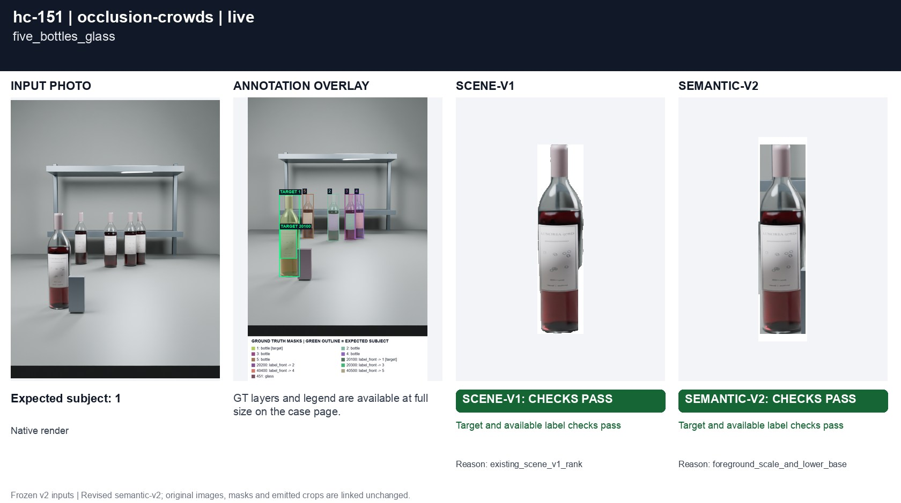
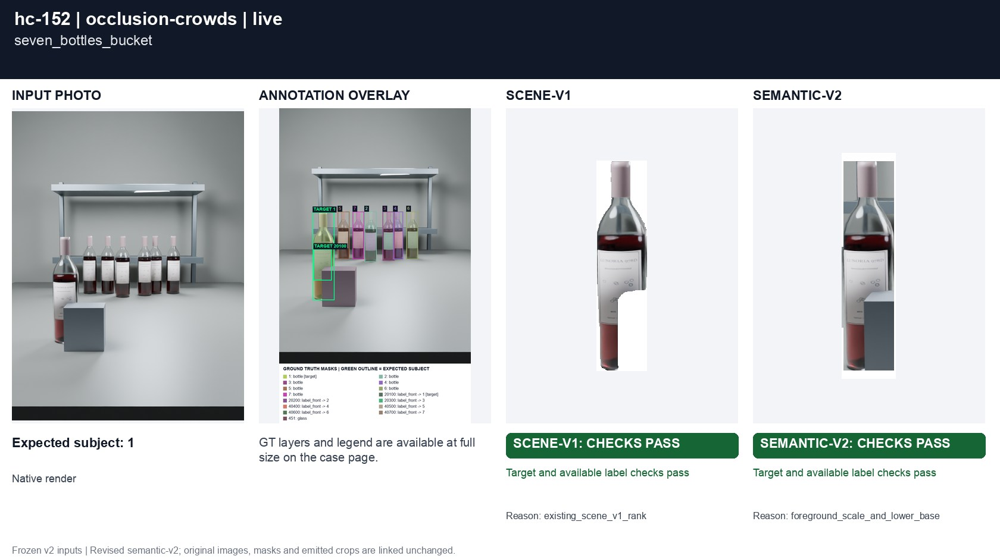
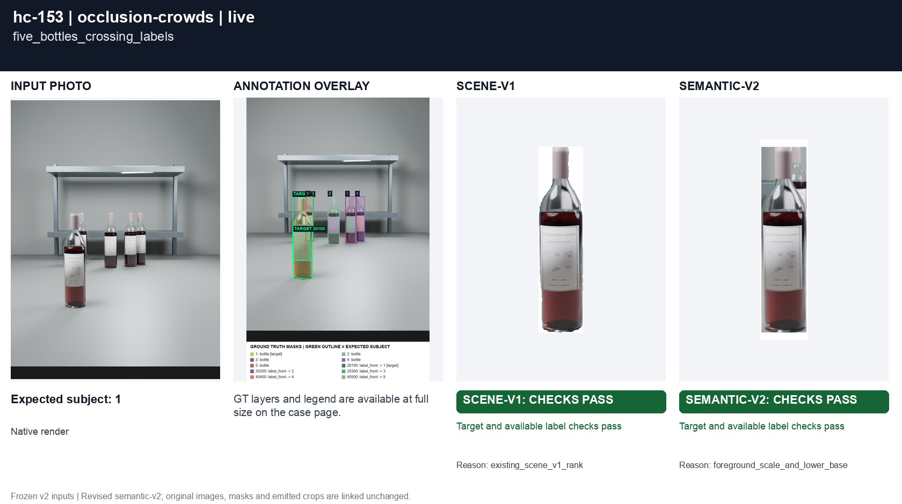

# Foreground intent among crowded and occluded bottles

[All groups](../README.md)

Five to seven bottles, a foreground glass or a bucket and competing labels. Only visible label pixels are annotated; no hidden label content is generated.

3 cases. Failures below use frozen result fields; photos and fixtures retain separate interpretation.

| Case | scene-v1 | semantic-v2 |
|---|---|---|
| [hc-151 five_bottles_glass](../cases/hc-151.md) | Recorded checks pass | Recorded checks pass |
| [hc-152 seven_bottles_bucket](../cases/hc-152.md) | Recorded checks pass | Recorded checks pass |
| [hc-153 five_bottles_crossing_labels](../cases/hc-153.md) | Recorded checks pass | Recorded checks pass |

## Visual examples

### hc-151 five_bottles_glass

**scene-v1:** Recorded checks pass

[Open original photo, all masks and every selector crop](../cases/hc-151.md)

### hc-152 seven_bottles_bucket

**scene-v1:** Recorded checks pass

[Open original photo, all masks and every selector crop](../cases/hc-152.md)

### hc-153 five_bottles_crossing_labels

**scene-v1:** Recorded checks pass

[Open original photo, all masks and every selector crop](../cases/hc-153.md)

