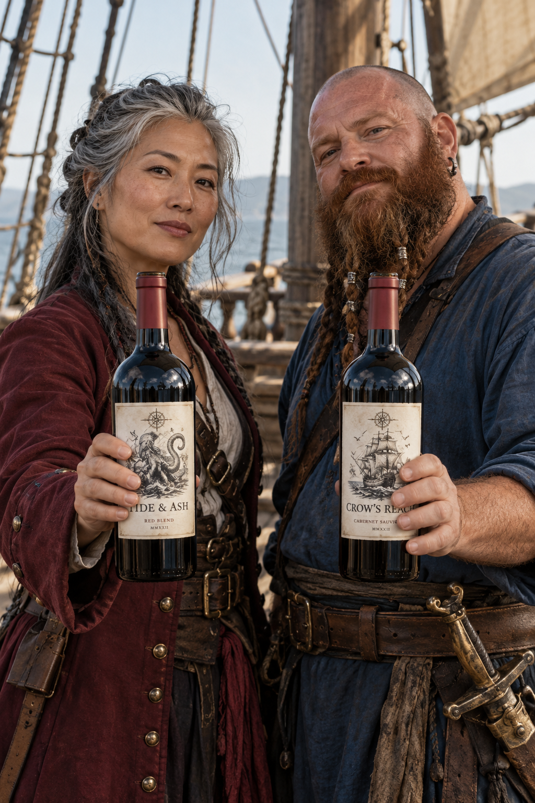
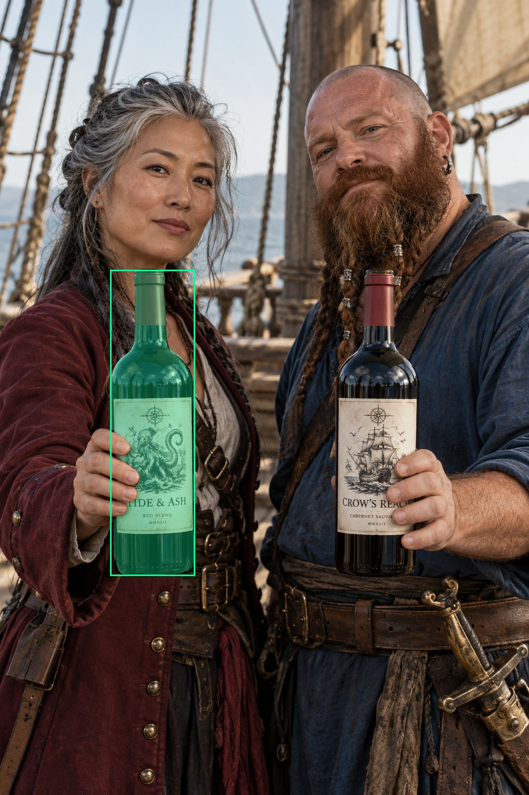
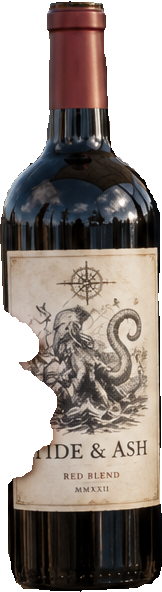
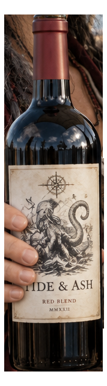
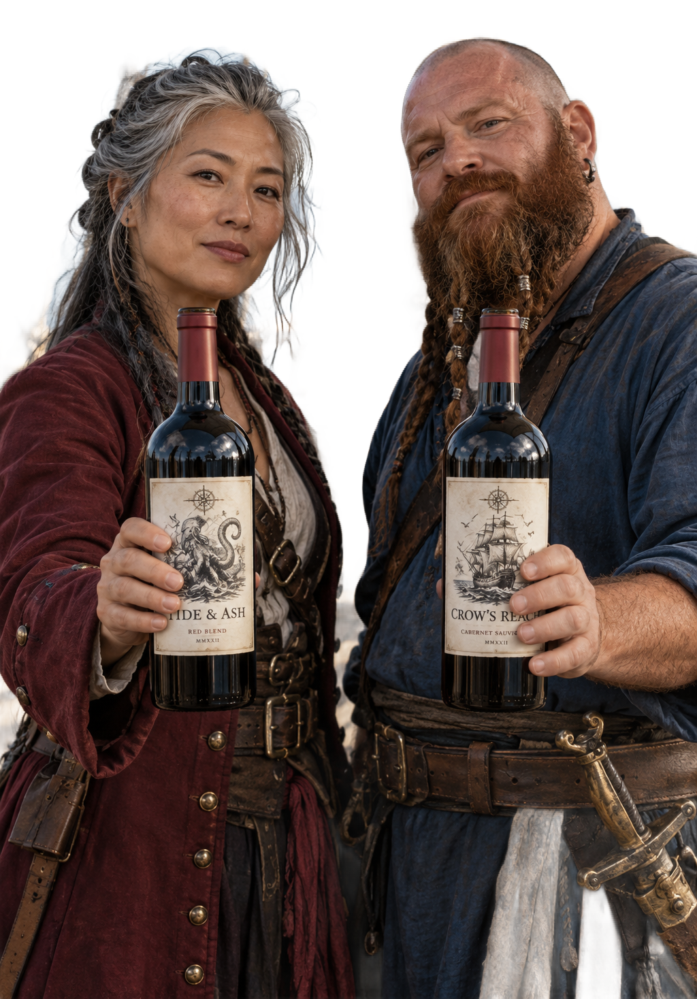

# main-selector-imagegen-diverse-v3-20261020:CT03

**Scene and masks pending — exploratory. All targets/masks are proposals; no approved segmentation ground truth.**

**scene-v1: No automatic failure flag; usability pending.**

Reference title (source): Два оригинальных пирата · две равноправные бутылки

Reference target description (source): Две удерживаемые бутылки — предварительный fallback

Expected intent: `ambiguous`. Accepted target proposals: `d1`.

Scene group: `main-selector-imagegen-diverse-v3-20261020:CT03`. Development only; no independent split claim.

## Original and proposed target





Green marks the unreviewed target proposal. Source image pixels are retained separately.

[Selected-label mask audit](../selected-label-mask-audit.json): incomplete proposal retention is flagged separately from target agreement.

[Full-resolution target proposal mask](../masks/diverse-v3--CT03-d1.png)

## Selector results

### scene-v1: No automatic failure flag; usability pending

Selected: d1; reason: existing_scene_v1_rank; mode: legacy; crop 162×592 px. Target agreement: True. Target retention proxy: 99.9%; maximum other-bottle retention: 0.0%; minimum associated label retention: 99.8%. Mask ownership, label completeness and legibility still require human review.



[Full-resolution keep mask](../keep-masks/diverse-v3--CT03-scene-v1.png) · [Exact decision JSON](../results/diverse-v3--CT03-scene-v1.json)

Associated label-mask retention proxies (unreviewed ownership): d3: 99.8%, 33782 source pixels

### semantic-v2: No automatic failure flag; usability pending

Selected: d1; reason: fallback_nearest_center; mode: fallback; crop 178×639 px. Target agreement: True. Target retention proxy: 100.0%; maximum other-bottle retention: 0.0%; minimum associated label retention: 100.0%. Mask ownership, label completeness and legibility still require human review. Selected-label mask audit: d3 100.0%.



[Full-resolution keep mask](../keep-masks/diverse-v3--CT03-semantic-v2.png) · [Exact decision JSON](../results/diverse-v3--CT03-semantic-v2.json)

Returned label views: [label 1](../label-crops/diverse-v3--CT03-semantic-v2-0.png)

Associated label-mask retention proxies (unreviewed ownership): d3: 100.0%, 33782 source pixels

### dis-v1: PROXY failure; no native target ID

Selected: dis-foreground; reason: dis_foreground_mask; mode: foreground; crop 1024×1468 px. Target agreement: n/a (no native target ID). Target retention proxy: 100.0%; maximum other-bottle retention: 100.0%; minimum associated label retention: 100.0%. Mask ownership, label completeness and legibility still require human review.



[Full-resolution keep mask](../keep-masks/diverse-v3--CT03-dis-v1.png) · [Exact decision JSON](../results/diverse-v3--CT03-dis-v1.json)

Associated label-mask retention proxies (unreviewed ownership): d3: 100.0%, 33782 source pixels

## All frozen mask proposals

These links expose every detector proposal, including labels and hands. Shapes and owners are unreviewed.

| ID | Detector class | Full-resolution mask |
|---|---|---|
| d0 | wine bottle | [PNG](../masks/diverse-v3--CT03-d0.png) |
| d1 | wine bottle | [PNG](../masks/diverse-v3--CT03-d1.png) |
| d2 | wine label | [PNG](../masks/diverse-v3--CT03-d2.png) |
| d3 | wine label | [PNG](../masks/diverse-v3--CT03-d3.png) |
| d4 | hand | [PNG](../masks/diverse-v3--CT03-d4.png) |
| d5 | hand | [PNG](../masks/diverse-v3--CT03-d5.png) |
| d6 | hand | [PNG](../masks/diverse-v3--CT03-d6.png) |

[Raw frozen detector response](../detections/diverse-v3--CT03.json)

<details><summary>Generation prompt (quoted source data)</summary>

```text
Generate ONE independent portrait 2:3 photograph, approximately 1024 by 1536 pixels. Two entirely original adult pirates on a wooden sailing ship deck: a gray-haired East Asian woman in a plain maroon coat at left and a stocky red-bearded man with a shaved head and blue shirt at right. Show both faces and upper bodies. Each person presents one physical wine bottle with a clear grasp around mid-body and visible opposing thumb and fingers. Exactly two equal-sized bottles, LEFT and RIGHT, at the same depth, labels equally readable and both inside the frame. Symmetric centered composition, no dominant owner or pointing gesture, no third bottle. Photorealistic candid cinematic photograph, fictional wine branding, anatomically plausible hands, visible physical contact where requested. No captions, arrows, bounding boxes, watermarks, collage or UI. Create entirely original pirate characters with no actor or existing film character likeness.
```

</details>

Source review notes (quoted reference data):

> Цель предварительно связана с маской SAM3 по заданию генерации; подтвердите по самому фото. Форма масок и их владельцы ещё не проверены.
> Окружение: Два пирата на палубе. Проверьте реалистичность рук, хват и присутствие требуемых деталей.
> Запрос с Джеком Воробьём заблокирован генератором; здесь два оригинальных пиратских персонажа.
