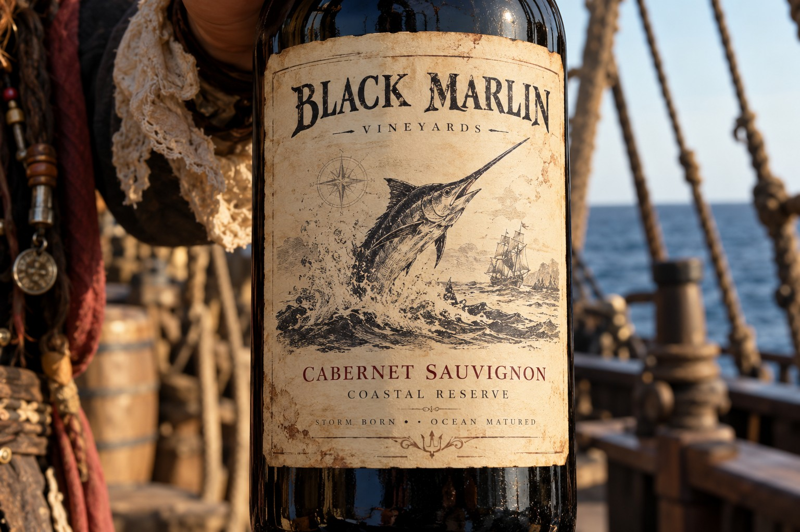
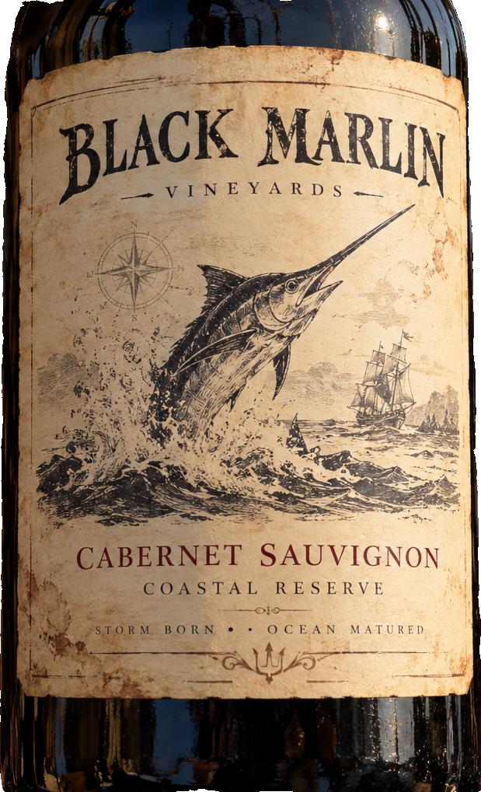
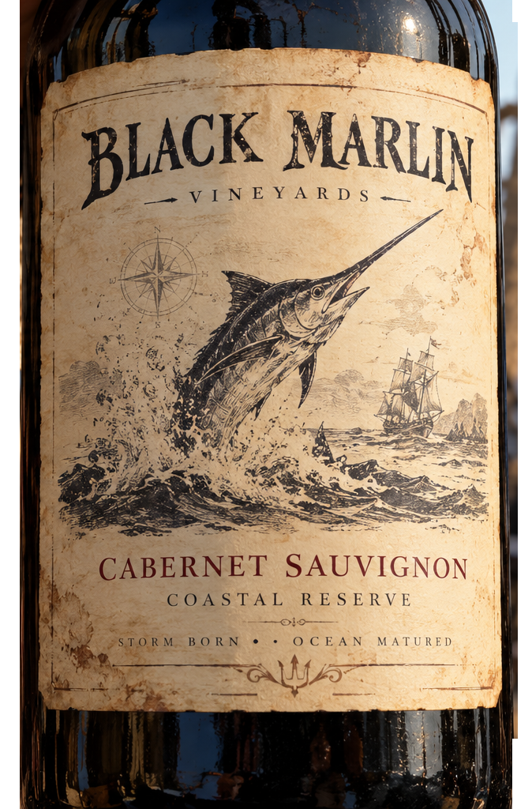
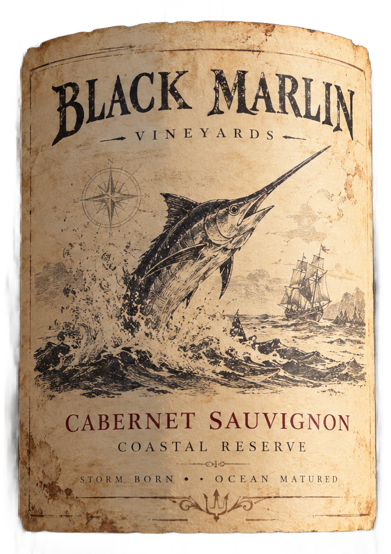

# main-selector-imagegen-diverse-v3-20261020:CT09

**Scene and masks pending — exploratory. All targets/masks are proposals; no approved segmentation ground truth.**

**scene-v1: FAIL — provisional target/proxy.**

Reference title (source): Пиратская бутылка · крупный план без горлышка

Reference target description (source): Полный контекст крупного плана этикетки

Expected intent: `label_context`. Accepted target proposals: `full_context`.

Scene group: `main-selector-imagegen-diverse-v3-20261020:CT09`. Development only; no independent split claim.

## Original and proposed target




Green marks the unreviewed target proposal. Source image pixels are retained separately.

[Selected-label mask audit](../selected-label-mask-audit.json): incomplete proposal retention is flagged separately from target agreement.

## Selector results

### scene-v1: FAIL — provisional target/proxy

Selected: d0; reason: existing_scene_v1_rank; mode: legacy; crop 619×1019 px. Target agreement: False. Target retention proxy: n/a; maximum other-bottle retention: n/a; minimum associated label retention: n/a. Mask ownership, label completeness and legibility still require human review.



[Full-resolution keep mask](../keep-masks/diverse-v3--CT09-scene-v1.png) · [Exact decision JSON](../results/diverse-v3--CT09-scene-v1.json)

### semantic-v2: FAIL — provisional target/proxy

Selected: d0; reason: only_credible_subject; mode: confident; crop 674×1024 px. Target agreement: False. Target retention proxy: n/a; maximum other-bottle retention: n/a; minimum associated label retention: n/a. Mask ownership, label completeness and legibility still require human review. Selected-label mask audit: d1 100.0%.



[Full-resolution keep mask](../keep-masks/diverse-v3--CT09-semantic-v2.png) · [Exact decision JSON](../results/diverse-v3--CT09-semantic-v2.json)

Returned label views: [label 1](../label-crops/diverse-v3--CT09-semantic-v2-0.png)

### dis-v1: PROXY failure; no native target ID

Selected: dis-foreground; reason: dis_foreground_mask; mode: foreground; crop 642×909 px. Target agreement: n/a (no native target ID). Target retention proxy: n/a; maximum other-bottle retention: n/a; minimum associated label retention: n/a. Mask ownership, label completeness and legibility still require human review.



[Full-resolution keep mask](../keep-masks/diverse-v3--CT09-dis-v1.png) · [Exact decision JSON](../results/diverse-v3--CT09-dis-v1.json)

## All frozen mask proposals

These links expose every detector proposal, including labels and hands. Shapes and owners are unreviewed.

| ID | Detector class | Full-resolution mask |
|---|---|---|
| d0 | wine bottle | [PNG](../masks/diverse-v3--CT09-d0.png) |
| d1 | wine label | [PNG](../masks/diverse-v3--CT09-d1.png) |
| d2 | hand | [PNG](../masks/diverse-v3--CT09-d2.png) |

[Raw frozen detector response](../detections/diverse-v3--CT09.json)

<details><summary>Generation prompt (quoted source data)</summary>

```text
Use case: photorealistic-natural. Generate ONE independent photograph, landscape 3:2, approximately 1536 by 1024 pixels. Extreme close-up of a wine bottle presented by Captain Jack Sparrow on a ship deck. Only a little pirate sleeve and rigging visible at frame edges. Label and surrounding glass fill the frame; neck and base stay outside. Preserve the full visible label context. Extreme close-up of one physical dark wine bottle front paper label. Its entire cream label, blank paper margins, curved glass on both sides and a little glass below are visible. Bottle neck and base extend beyond frame. No hands, other bottles or background distractions. Preserve full visible label context. Make the scene composition, person, clothing and location specific to this scenario, rather than repeating a generic bottle on a tasting counter. Show genuine physical contact when a grip is requested. Fictional wine branding; no arrows, bounding boxes, captions, collages, watermark or UI. Maintain anatomically plausible hands. Keep the target visible label inside the frame except the explicit close-up and occlusion cases.
```

</details>

Source review notes (quoted reference data):

> Цель предварительно связана с маской SAM3 по заданию генерации; подтвердите по самому фото. Форма масок и их владельцы ещё не проверены.
> Окружение: Крупный план пиратской бутылки. Проверьте реалистичность рук, хват и присутствие требуемых деталей.
> Лицо в кадре отсутствует: личность персонажа по этому изображению определить нельзя.
