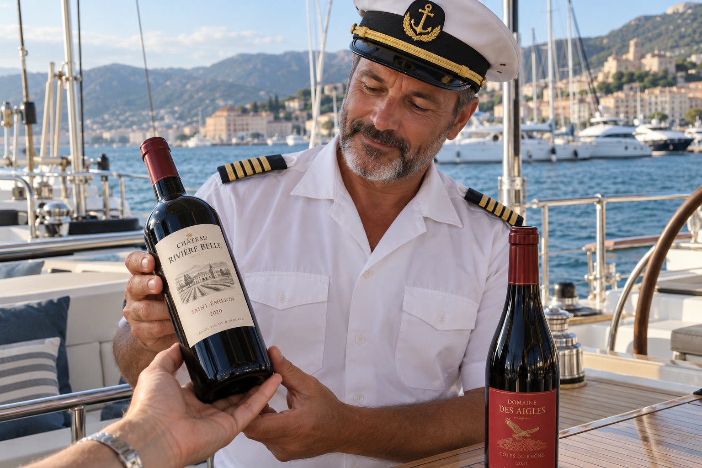
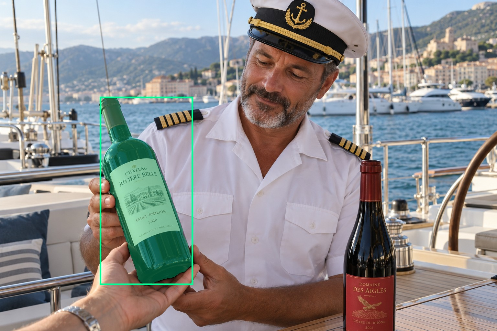
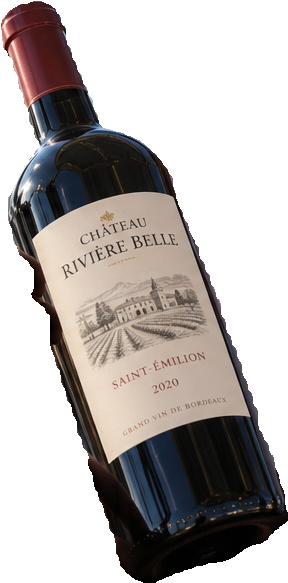
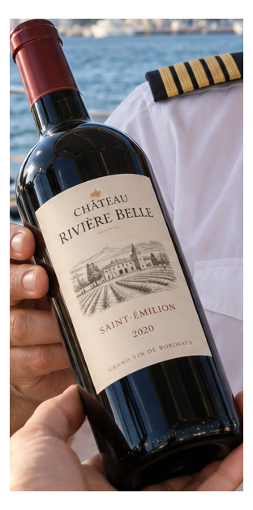
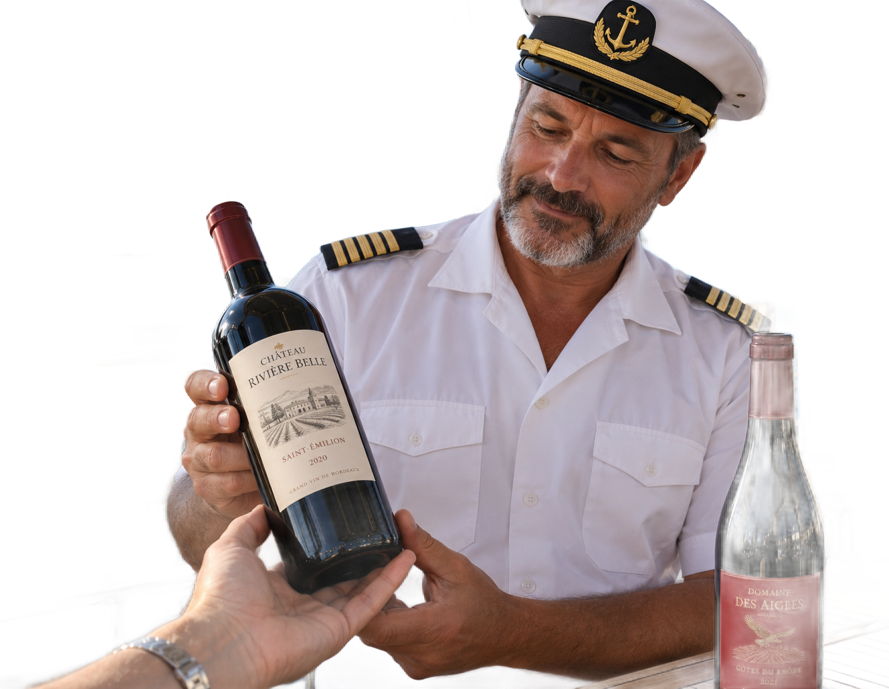

# main-selector-imagegen-diverse-v3-20261020:GP02

**Scene and masks pending — exploratory. All targets/masks are proposals; no approved segmentation ground truth.**

**scene-v1: No automatic failure flag; usability pending.**

Reference title (source): Капитан на яхте · поддержка основания слева

Reference target description (source): Левая бутылка, поддерживаемая снизу

Expected intent: `clear`. Accepted target proposals: `d1`.

Scene group: `main-selector-imagegen-diverse-v3-20261020:GP02-with-GP11`. Development only; no independent split claim.

## Original and proposed target





Green marks the unreviewed target proposal. Source image pixels are retained separately.

[Selected-label mask audit](../selected-label-mask-audit.json): incomplete proposal retention is flagged separately from target agreement.

[Full-resolution target proposal mask](../masks/diverse-v3--GP02-d1.png)

## Selector results

### scene-v1: No automatic failure flag; usability pending

Selected: d1; reason: existing_scene_v1_rank; mode: legacy; crop 288×583 px. Target agreement: True. Target retention proxy: 100.0%; maximum other-bottle retention: 0.0%; minimum associated label retention: 100.0%. Mask ownership, label completeness and legibility still require human review.



[Full-resolution keep mask](../keep-masks/diverse-v3--GP02-scene-v1.png) · [Exact decision JSON](../results/diverse-v3--GP02-scene-v1.json)

Associated label-mask retention proxies (unreviewed ownership): d3: 100.0%, 35817 source pixels

### semantic-v2: No automatic failure flag; usability pending

Selected: d1; reason: fallback_nearest_center; mode: fallback; crop 312×628 px. Target agreement: True. Target retention proxy: 100.0%; maximum other-bottle retention: 0.0%; minimum associated label retention: 100.0%. Mask ownership, label completeness and legibility still require human review. Selected-label mask audit: d3 100.0%.



[Full-resolution keep mask](../keep-masks/diverse-v3--GP02-semantic-v2.png) · [Exact decision JSON](../results/diverse-v3--GP02-semantic-v2.json)

Returned label views: [label 1](../label-crops/diverse-v3--GP02-semantic-v2-0.png)

Associated label-mask retention proxies (unreviewed ownership): d3: 100.0%, 35817 source pixels

### dis-v1: PROXY failure; no native target ID

Selected: dis-foreground; reason: dis_foreground_mask; mode: foreground; crop 1320×1024 px. Target agreement: n/a (no native target ID). Target retention proxy: 99.9%; maximum other-bottle retention: 29.4%; minimum associated label retention: 100.0%. Mask ownership, label completeness and legibility still require human review.



[Full-resolution keep mask](../keep-masks/diverse-v3--GP02-dis-v1.png) · [Exact decision JSON](../results/diverse-v3--GP02-dis-v1.json)

Associated label-mask retention proxies (unreviewed ownership): d3: 100.0%, 35817 source pixels

## All frozen mask proposals

These links expose every detector proposal, including labels and hands. Shapes and owners are unreviewed.

| ID | Detector class | Full-resolution mask |
|---|---|---|
| d0 | wine bottle | [PNG](../masks/diverse-v3--GP02-d0.png) |
| d1 | wine bottle | [PNG](../masks/diverse-v3--GP02-d1.png) |
| d2 | wine label | [PNG](../masks/diverse-v3--GP02-d2.png) |
| d3 | wine label | [PNG](../masks/diverse-v3--GP02-d3.png) |
| d4 | hand | [PNG](../masks/diverse-v3--GP02-d4.png) |
| d5 | hand | [PNG](../masks/diverse-v3--GP02-d5.png) |
| d6 | hand | [PNG](../masks/diverse-v3--GP02-d6.png) |

[Raw frozen detector response](../detections/diverse-v3--GP02.json)

<details><summary>Generation prompt (quoted source data)</summary>

```text
Use case: photorealistic-natural. Generate ONE independent photograph, landscape 3:2, approximately 1536 by 1024 pixels. An adult yacht captain in white uniform and navy captain cap examines a wine bottle while standing on a modern sailing yacht in a marina. Show the captain face and torso, hand physically holding the bottle, teak deck, stainless railings and blue sea. Candid vacation photograph, label turned toward camera. Two bottles in the described setting. A hand from lower left visibly cups and supports the BASE of the LEFT dark bottle with ivory label, fingers curved upward around its bottom and base lifted from table. The right unheld bottle has a brighter red label. Make the scene composition, person, clothing and location specific to this scenario, rather than repeating a generic bottle on a tasting counter. Show genuine physical contact when a grip is requested. Fictional wine branding; no arrows, bounding boxes, captions, collages, watermark or UI. Maintain anatomically plausible hands. Keep the target visible label inside the frame except the explicit close-up and occlusion cases.
```

</details>

Source review notes (quoted reference data):

> Цель предварительно связана с маской SAM3 по заданию генерации; подтвердите по самому фото. Форма масок и их владельцы ещё не проверены.
> Окружение: Капитан на яхте. Проверьте реалистичность рук, хват и присутствие требуемых деталей.
> Помимо хвата капитана видна поддерживающая рука другого человека снизу. Проверьте естественность анатомии и соответствие задуманному хвату.
