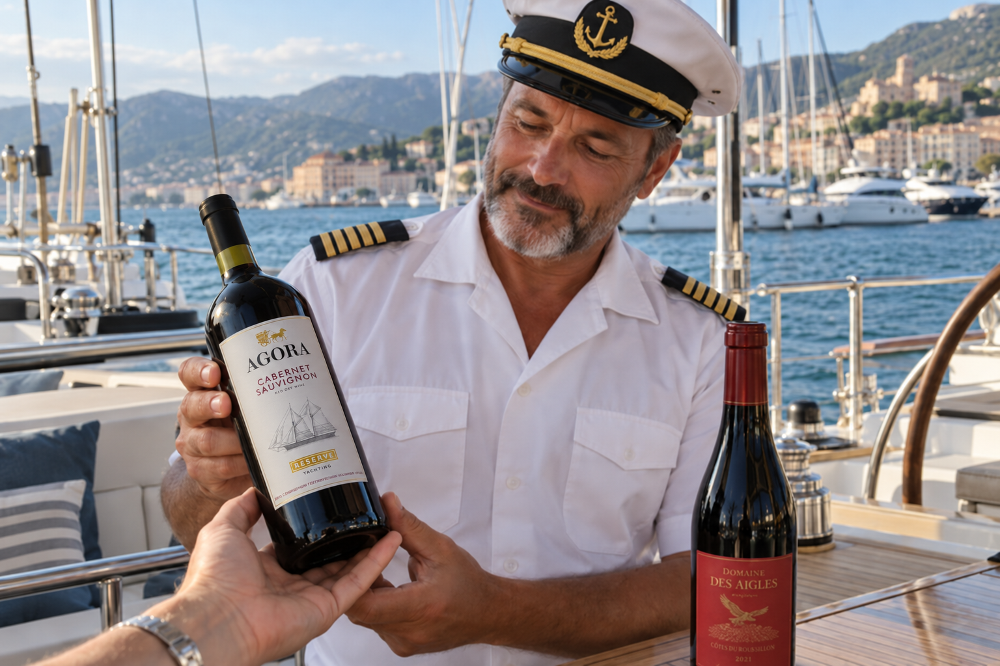
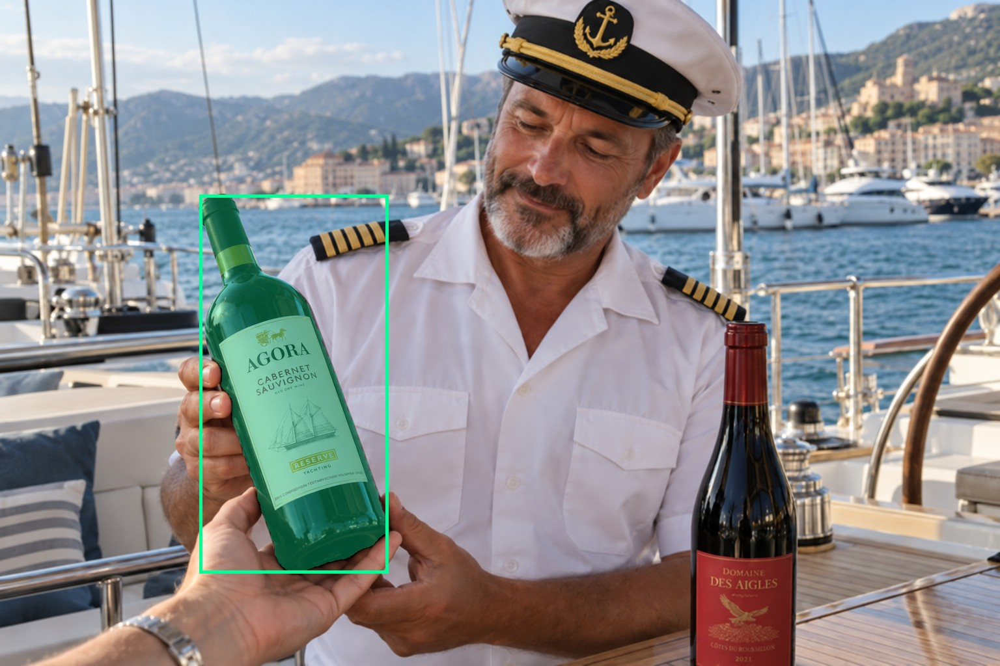
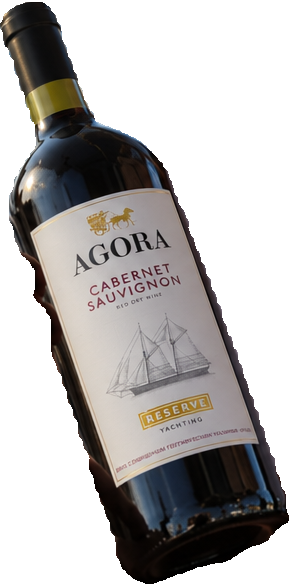
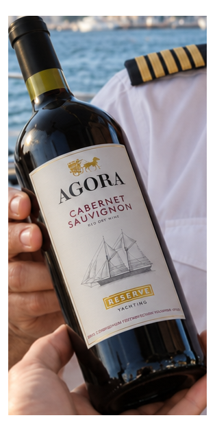
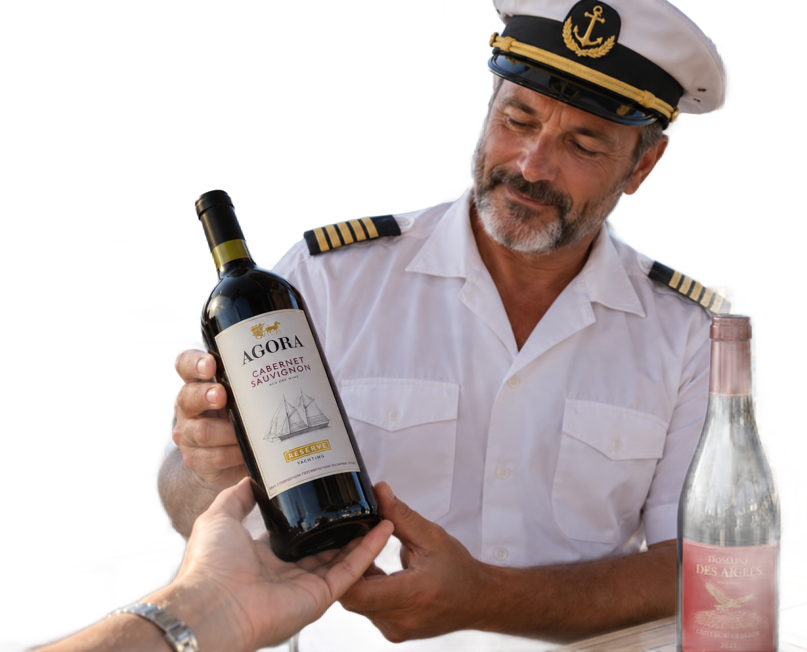

# main-selector-imagegen-diverse-v3-20261020:GP11

**Scene and masks pending — exploratory. All targets/masks are proposals; no approved segmentation ground truth.**

**scene-v1: No automatic failure flag; usability pending.**

Reference title (source): Капитан на яхте · AGORA Cabernet Sauvignon

Reference target description (source): Левая удерживаемая бутылка AGORA

Expected intent: `clear`. Accepted target proposals: `d1`.

Scene group: `main-selector-imagegen-diverse-v3-20261020:GP02-with-GP11`. Development only; no independent split claim.

## Original and proposed target





Green marks the unreviewed target proposal. Source image pixels are retained separately.

[Selected-label mask audit](../selected-label-mask-audit.json): incomplete proposal retention is flagged separately from target agreement.

[Full-resolution target proposal mask](../masks/diverse-v3--GP11-d1.png)

## Selector results

### scene-v1: No automatic failure flag; usability pending

Selected: d1; reason: existing_scene_v1_rank; mode: legacy; crop 289×584 px. Target agreement: True. Target retention proxy: 100.0%; maximum other-bottle retention: 0.0%; minimum associated label retention: 100.0%. Mask ownership, label completeness and legibility still require human review.



[Full-resolution keep mask](../keep-masks/diverse-v3--GP11-scene-v1.png) · [Exact decision JSON](../results/diverse-v3--GP11-scene-v1.json)

Associated label-mask retention proxies (unreviewed ownership): d3: 100.0%, 40359 source pixels

### semantic-v2: No automatic failure flag; usability pending

Selected: d1; reason: fallback_nearest_center; mode: fallback; crop 314×628 px. Target agreement: True. Target retention proxy: 100.0%; maximum other-bottle retention: 0.0%; minimum associated label retention: 100.0%. Mask ownership, label completeness and legibility still require human review. Selected-label mask audit: d3 100.0%.



[Full-resolution keep mask](../keep-masks/diverse-v3--GP11-semantic-v2.png) · [Exact decision JSON](../results/diverse-v3--GP11-semantic-v2.json)

Returned label views: [label 1](../label-crops/diverse-v3--GP11-semantic-v2-0.png)

Associated label-mask retention proxies (unreviewed ownership): d3: 100.0%, 40359 source pixels

### dis-v1: PROXY failure; no native target ID

Selected: dis-foreground; reason: dis_foreground_mask; mode: foreground; crop 1265×1024 px. Target agreement: n/a (no native target ID). Target retention proxy: 99.9%; maximum other-bottle retention: 36.5%; minimum associated label retention: 100.0%. Mask ownership, label completeness and legibility still require human review.



[Full-resolution keep mask](../keep-masks/diverse-v3--GP11-dis-v1.png) · [Exact decision JSON](../results/diverse-v3--GP11-dis-v1.json)

Associated label-mask retention proxies (unreviewed ownership): d3: 100.0%, 40359 source pixels

## All frozen mask proposals

These links expose every detector proposal, including labels and hands. Shapes and owners are unreviewed.

| ID | Detector class | Full-resolution mask |
|---|---|---|
| d0 | wine bottle | [PNG](../masks/diverse-v3--GP11-d0.png) |
| d1 | wine bottle | [PNG](../masks/diverse-v3--GP11-d1.png) |
| d2 | wine label | [PNG](../masks/diverse-v3--GP11-d2.png) |
| d3 | wine label | [PNG](../masks/diverse-v3--GP11-d3.png) |
| d4 | hand | [PNG](../masks/diverse-v3--GP11-d4.png) |
| d5 | hand | [PNG](../masks/diverse-v3--GP11-d5.png) |
| d6 | hand | [PNG](../masks/diverse-v3--GP11-d6.png) |

[Raw frozen detector response](../detections/diverse-v3--GP11.json)

<details><summary>Generation prompt (quoted source data)</summary>

```text
Use case: precise-object-edit.
Input images: Image 1 is the edit target, a landscape photograph of a yacht captain examining a wine bottle. Image 2 is the product reference and insertion source, an AGORA Cabernet Sauvignon Reserve Yachting wine bottle.
Primary request: Replace ONLY the foreground wine bottle being held and supported by the captain and the other person's hand in Image 1 with the exact wine product from Image 2. Keep the held bottle in its current position and tilt, with the same natural grasp and support. The AGORA bottle must be a believable physical three-dimensional bottle inside this photograph, with matching scale, perspective, sunlight, glass reflections, contact shadows and partial occlusion by the existing fingers.
Product fidelity: Preserve the distinctive AGORA bottle silhouette, black capsule, neck details, silver-gray label, gold crest and horse, black AGORA wordmark, burgundy CABERNET SAUVIGNON text, sailing ship drawing and gold RESERVE badge with YACHTING below it. Reproduce the product branding from the reference image accurately; the main visible label text is "AGORA", "CABERNET SAUVIGNON", "RED DRY WINE", "RESERVE", "YACHTING". Fit the entire label naturally to the tilted bottle surface.
Invariants: Preserve the captain's face, identity, facial expression, gaze, uniform, hat, body pose and all existing hands and fingers. Preserve the second upright red-label bottle on the table exactly as in Image 1. Preserve the yacht, marina, sea, distant mountains, railings, lighting, background and landscape 3:2 composition. Change only the held wine bottle. Keep a complete photorealistic opaque photograph, without the product reference's cutout border or background. No arrows, captions, boxes, watermarks or extra objects.
```

</details>

Source review notes (quoted reference data):

> Цель предварительно связана с маской SAM3 по заданию генерации; подтвердите по самому фото. Форма масок и их владельцы ещё не проверены.
> Окружение: Капитан на яхте с AGORA. Проверьте реалистичность рук, хват и присутствие требуемых деталей.
> Вариант GP02: удерживаемая бутылка заменена на AGORA по изображению товара. Для оценки независимости это одна группа с GP02; обе сцены требуют отдельного решения review.
> Сохранён исходный сюжет передачи бутылки: капитан держит её, другая рука поддерживает снизу.
