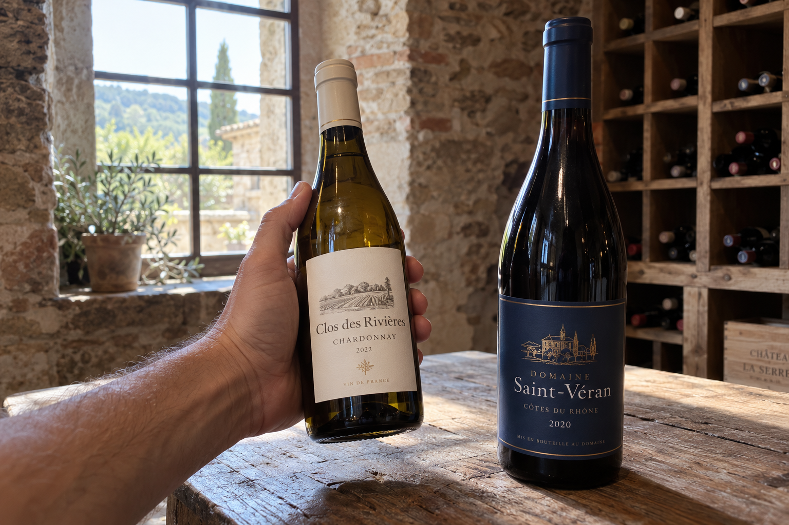
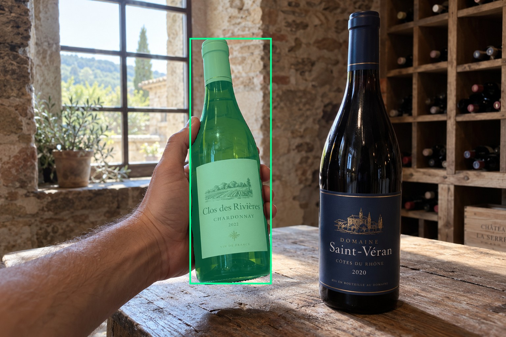
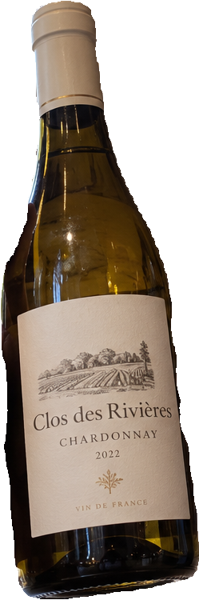
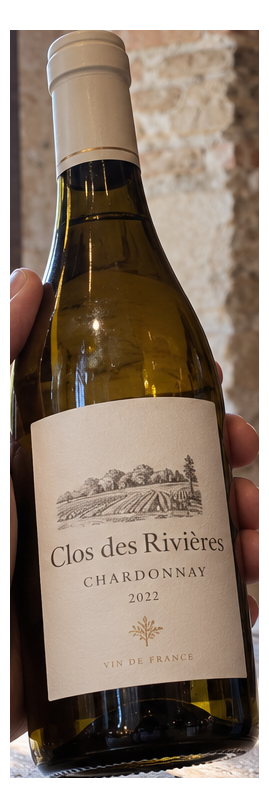
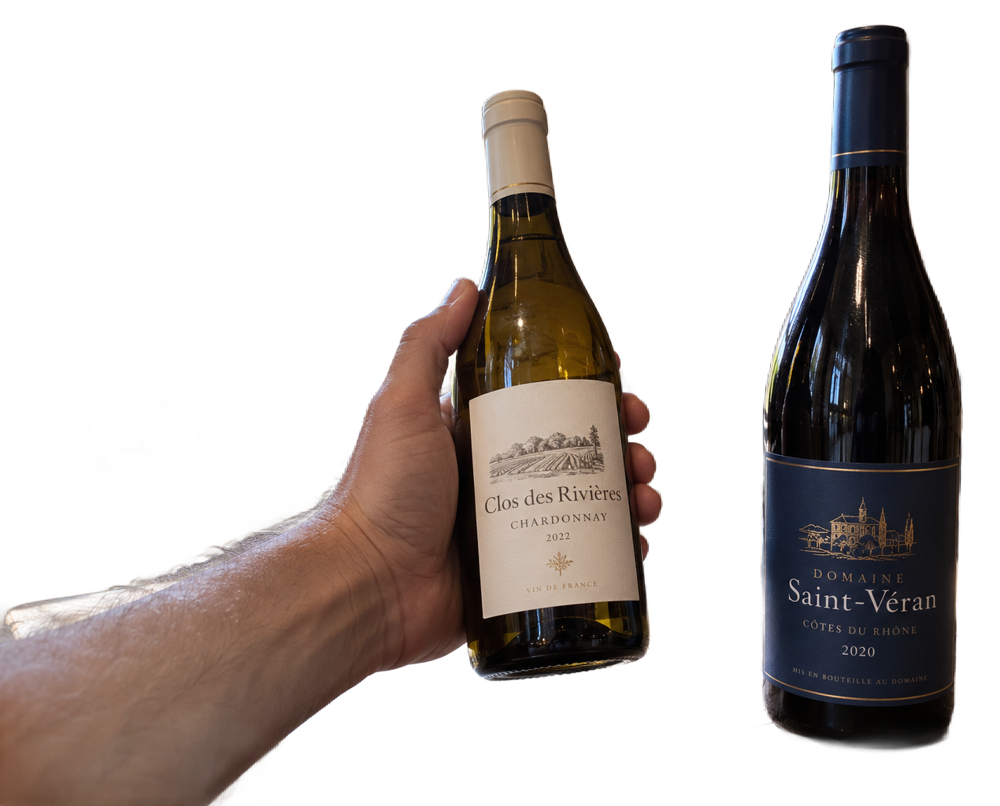

# main-selector-imagegen-diverse-v3-20261020:HP04

**Scene and masks pending — exploratory. All targets/masks are proposals; no approved segmentation ground truth.**

**scene-v1: No automatic failure flag; usability pending.**

Reference title (source): Предплечье перед соседней бутылкой

Reference target description (source): Маленькая удерживаемая бутылка слева

Expected intent: `clear`. Accepted target proposals: `d13`.

Scene group: `main-selector-imagegen-diverse-v3-20261020:HP04`. Development only; no independent split claim.

## Original and proposed target





Green marks the unreviewed target proposal. Source image pixels are retained separately.

[Selected-label mask audit](../selected-label-mask-audit.json): incomplete proposal retention is flagged separately from target agreement.

[Full-resolution target proposal mask](../masks/diverse-v3--HP04-d13.png)

## Selector results

### scene-v1: No automatic failure flag; usability pending

Selected: d13; reason: existing_scene_v1_rank; mode: legacy; crop 249×750 px. Target agreement: True. Target retention proxy: 100.0%; maximum other-bottle retention: 0.0%; minimum associated label retention: 100.0%. Mask ownership, label completeness and legibility still require human review.



[Full-resolution keep mask](../keep-masks/diverse-v3--HP04-scene-v1.png) · [Exact decision JSON](../results/diverse-v3--HP04-scene-v1.json)

Associated label-mask retention proxies (unreviewed ownership): d30: 100.0%, 54600 source pixels

### semantic-v2: No automatic failure flag; usability pending

Selected: d13; reason: unique_visible_hand_contact; mode: confident; crop 269×808 px. Target agreement: True. Target retention proxy: 100.0%; maximum other-bottle retention: 0.0%; minimum associated label retention: 100.0%. Mask ownership, label completeness and legibility still require human review. Selected-label mask audit: d30 100.0%.



[Full-resolution keep mask](../keep-masks/diverse-v3--HP04-semantic-v2.png) · [Exact decision JSON](../results/diverse-v3--HP04-semantic-v2.json)

Returned label views: [label 1](../label-crops/diverse-v3--HP04-semantic-v2-0.png)

Associated label-mask retention proxies (unreviewed ownership): d30: 100.0%, 54600 source pixels

### dis-v1: PROXY failure; no native target ID

Selected: dis-foreground; reason: dis_foreground_mask; mode: foreground; crop 1270×1024 px. Target agreement: n/a (no native target ID). Target retention proxy: 100.0%; maximum other-bottle retention: 99.8%; minimum associated label retention: 100.0%. Mask ownership, label completeness and legibility still require human review.



[Full-resolution keep mask](../keep-masks/diverse-v3--HP04-dis-v1.png) · [Exact decision JSON](../results/diverse-v3--HP04-dis-v1.json)

Associated label-mask retention proxies (unreviewed ownership): d30: 100.0%, 54600 source pixels

## All frozen mask proposals

These links expose every detector proposal, including labels and hands. Shapes and owners are unreviewed.

| ID | Detector class | Full-resolution mask |
|---|---|---|
| d0 | wine bottle | [PNG](../masks/diverse-v3--HP04-d0.png) |
| d1 | wine bottle | [PNG](../masks/diverse-v3--HP04-d1.png) |
| d2 | wine bottle | [PNG](../masks/diverse-v3--HP04-d2.png) |
| d3 | wine bottle | [PNG](../masks/diverse-v3--HP04-d3.png) |
| d4 | wine bottle | [PNG](../masks/diverse-v3--HP04-d4.png) |
| d5 | wine bottle | [PNG](../masks/diverse-v3--HP04-d5.png) |
| d6 | wine bottle | [PNG](../masks/diverse-v3--HP04-d6.png) |
| d7 | wine bottle | [PNG](../masks/diverse-v3--HP04-d7.png) |
| d8 | wine bottle | [PNG](../masks/diverse-v3--HP04-d8.png) |
| d9 | wine bottle | [PNG](../masks/diverse-v3--HP04-d9.png) |
| d10 | wine bottle | [PNG](../masks/diverse-v3--HP04-d10.png) |
| d11 | wine bottle | [PNG](../masks/diverse-v3--HP04-d11.png) |
| d12 | wine bottle | [PNG](../masks/diverse-v3--HP04-d12.png) |
| d13 | wine bottle | [PNG](../masks/diverse-v3--HP04-d13.png) |
| d14 | wine bottle | [PNG](../masks/diverse-v3--HP04-d14.png) |
| d15 | wine bottle | [PNG](../masks/diverse-v3--HP04-d15.png) |
| d16 | wine bottle | [PNG](../masks/diverse-v3--HP04-d16.png) |
| d17 | wine bottle | [PNG](../masks/diverse-v3--HP04-d17.png) |
| d18 | wine bottle | [PNG](../masks/diverse-v3--HP04-d18.png) |
| d19 | wine bottle | [PNG](../masks/diverse-v3--HP04-d19.png) |
| d20 | wine bottle | [PNG](../masks/diverse-v3--HP04-d20.png) |
| d21 | wine bottle | [PNG](../masks/diverse-v3--HP04-d21.png) |
| d22 | wine bottle | [PNG](../masks/diverse-v3--HP04-d22.png) |
| d23 | wine bottle | [PNG](../masks/diverse-v3--HP04-d23.png) |
| d24 | wine bottle | [PNG](../masks/diverse-v3--HP04-d24.png) |
| d25 | wine bottle | [PNG](../masks/diverse-v3--HP04-d25.png) |
| d26 | wine bottle | [PNG](../masks/diverse-v3--HP04-d26.png) |
| d27 | wine bottle | [PNG](../masks/diverse-v3--HP04-d27.png) |
| d28 | wine bottle | [PNG](../masks/diverse-v3--HP04-d28.png) |
| d29 | wine label | [PNG](../masks/diverse-v3--HP04-d29.png) |
| d30 | wine label | [PNG](../masks/diverse-v3--HP04-d30.png) |
| d31 | hand | [PNG](../masks/diverse-v3--HP04-d31.png) |
| d32 | box | [PNG](../masks/diverse-v3--HP04-d32.png) |

[Raw frozen detector response](../detections/diverse-v3--HP04.json)

<details><summary>Generation prompt (quoted source data)</summary>

```text
Use case: photorealistic-natural. Generate exactly ONE independent candid smartphone photograph. Show believable glass, paper, natural material imperfections, fictional wine branding, and anatomically plausible hands. No collage, grid, arrows, annotations, bounding boxes, highlights, watermark, UI overlay, or explanatory caption. Text is allowed on physical objects within the scene. Keep the target visible front label entirely inside the frame unless partial occlusion or close-up is explicitly requested. Image format: landscape 3:2, approximately 1536 by 1024 pixels. Setting: inside a real wine cellar. Use stone or brick walls, wooden wine racks, storage cubbies, a cellar tasting table and practical dim lights. Background wine bottles may be present on shelves but should remain clearly in the background. Viewpoint: the customer is examining a wine bottle in their own hand while shopping or browsing the cellar, with the bottle front label turned toward the phone camera. Show the bottle, the holding hand and enough surrounding shelves or cellar details to establish the location. Scene details: A hand from left holds a small LEFT white-label bottle at mid-body, fingers wrapping glass. Its forearm extends across the scene in front of a larger RIGHT blue-label bottle without touching that right bottle. Two bottles only. Bright natural window light.
```

</details>

Source review notes (quoted reference data):

> Цель предварительно связана с маской SAM3 по заданию генерации; подтвердите по самому фото. Форма масок и их владельцы ещё не проверены.
> Окружение: Винный погреб. Проверьте реалистичность рук, хват и присутствие требуемых деталей.
