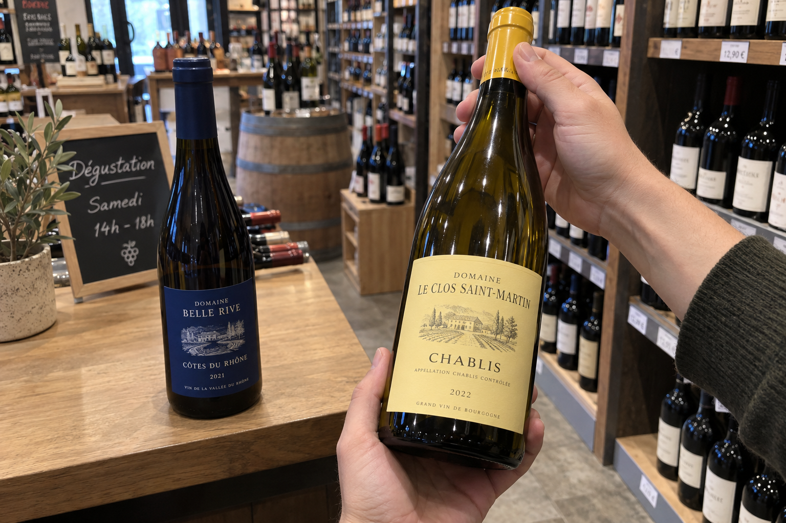
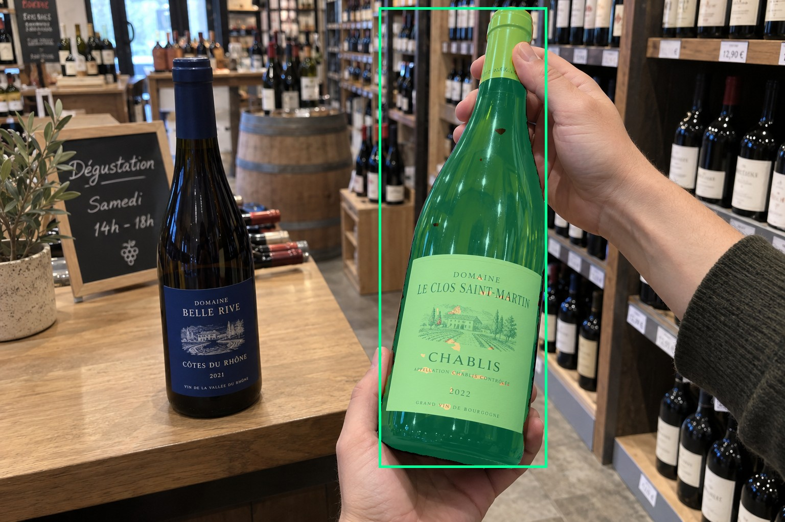
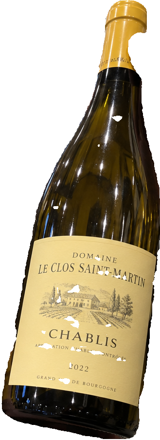
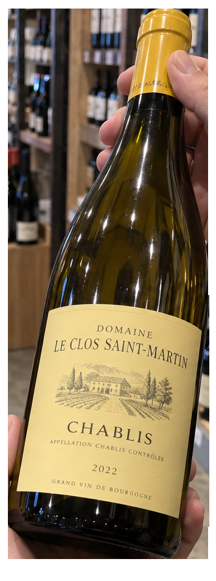
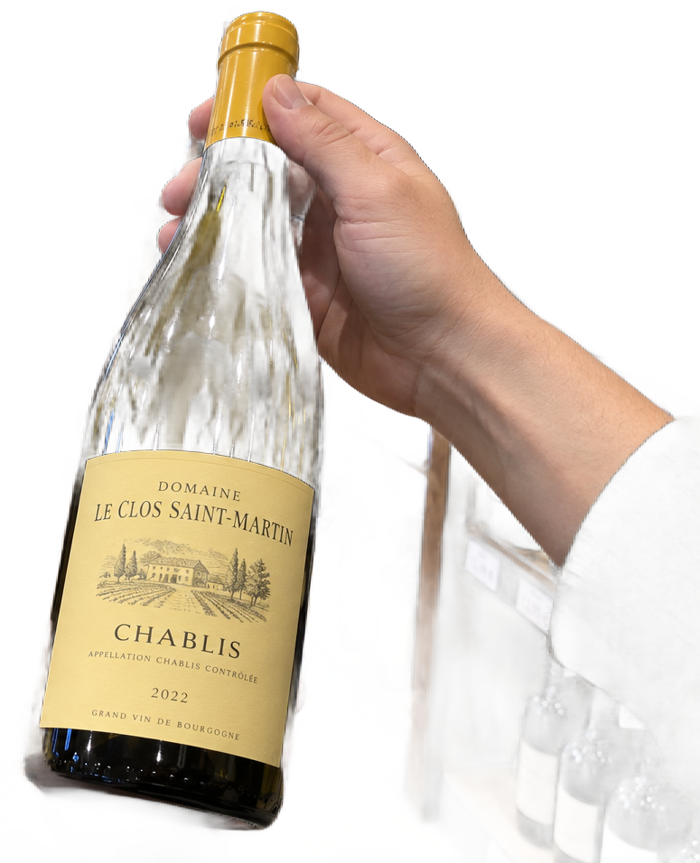

# main-selector-imagegen-diverse-v3-20261020:HP07

**Scene and masks pending — exploratory. All targets/masks are proposals; no approved segmentation ground truth.**

**scene-v1: FAIL — provisional target/proxy.**

Reference title (source): Одна бутылка двумя руками

Reference target description (source): Правая бутылка, удерживаемая двумя руками

Expected intent: `clear`. Accepted target proposals: `d54`.

Scene group: `main-selector-imagegen-diverse-v3-20261020:HP07`. Development only; no independent split claim.

## Original and proposed target





Green marks the unreviewed target proposal. Source image pixels are retained separately.

[Selected-label mask audit](../selected-label-mask-audit.json): incomplete proposal retention is flagged separately from target agreement.

[Full-resolution target proposal mask](../masks/diverse-v3--HP07-d54.png)

## Selector results

### scene-v1: FAIL — provisional target/proxy

Selected: d54; reason: existing_scene_v1_rank; mode: legacy; crop 329×905 px. Target agreement: True. Target retention proxy: 99.9%; maximum other-bottle retention: 0.4%; minimum associated label retention: 97.8%. Mask ownership, label completeness and legibility still require human review.



[Full-resolution keep mask](../keep-masks/diverse-v3--HP07-scene-v1.png) · [Exact decision JSON](../results/diverse-v3--HP07-scene-v1.json)

Associated label-mask retention proxies (unreviewed ownership): d115: 97.8%, 83646 source pixels

### semantic-v2: FAIL — provisional target/proxy

Selected: d54; reason: unique_visible_hand_contact; mode: confident; crop 355×953 px. Target agreement: True. Target retention proxy: 100.0%; maximum other-bottle retention: 100.0%; minimum associated label retention: 100.0%. Mask ownership, label completeness and legibility still require human review. Selected-label mask audit: d115 100.0%; d101 100.0%; d94 100.0%; d96 100.0%; d85 100.0%; d128 100.0%; d135 100.0%; d84 100.0%; d139 100.0%; d129 100.0%; d131 100.0%.



[Full-resolution keep mask](../keep-masks/diverse-v3--HP07-semantic-v2.png) · [Exact decision JSON](../results/diverse-v3--HP07-semantic-v2.json)

Returned label views: [label 1](../label-crops/diverse-v3--HP07-semantic-v2-0.png) · [label 2](../label-crops/diverse-v3--HP07-semantic-v2-1.png) · [label 3](../label-crops/diverse-v3--HP07-semantic-v2-2.png) · [label 4](../label-crops/diverse-v3--HP07-semantic-v2-3.png) · [label 5](../label-crops/diverse-v3--HP07-semantic-v2-4.png) · [label 6](../label-crops/diverse-v3--HP07-semantic-v2-5.png) · [label 7](../label-crops/diverse-v3--HP07-semantic-v2-6.png) · [label 8](../label-crops/diverse-v3--HP07-semantic-v2-7.png)

Associated label-mask retention proxies (unreviewed ownership): d115: 100.0%, 83646 source pixels

### dis-v1: PROXY failure; no native target ID

Selected: dis-foreground; reason: dis_foreground_mask; mode: foreground; crop 775×956 px. Target agreement: n/a (no native target ID). Target retention proxy: 66.8%; maximum other-bottle retention: 12.5%; minimum associated label retention: 99.8%. Mask ownership, label completeness and legibility still require human review.



[Full-resolution keep mask](../keep-masks/diverse-v3--HP07-dis-v1.png) · [Exact decision JSON](../results/diverse-v3--HP07-dis-v1.json)

Associated label-mask retention proxies (unreviewed ownership): d115: 99.8%, 83646 source pixels

## All frozen mask proposals

These links expose every detector proposal, including labels and hands. Shapes and owners are unreviewed.

| ID | Detector class | Full-resolution mask |
|---|---|---|
| d0 | wine bottle | [PNG](../masks/diverse-v3--HP07-d0.png) |
| d1 | wine bottle | [PNG](../masks/diverse-v3--HP07-d1.png) |
| d2 | wine bottle | [PNG](../masks/diverse-v3--HP07-d2.png) |
| d3 | wine bottle | [PNG](../masks/diverse-v3--HP07-d3.png) |
| d4 | wine bottle | [PNG](../masks/diverse-v3--HP07-d4.png) |
| d5 | wine bottle | [PNG](../masks/diverse-v3--HP07-d5.png) |
| d6 | wine bottle | [PNG](../masks/diverse-v3--HP07-d6.png) |
| d7 | wine bottle | [PNG](../masks/diverse-v3--HP07-d7.png) |
| d8 | wine bottle | [PNG](../masks/diverse-v3--HP07-d8.png) |
| d9 | wine bottle | [PNG](../masks/diverse-v3--HP07-d9.png) |
| d10 | wine bottle | [PNG](../masks/diverse-v3--HP07-d10.png) |
| d11 | wine bottle | [PNG](../masks/diverse-v3--HP07-d11.png) |
| d12 | wine bottle | [PNG](../masks/diverse-v3--HP07-d12.png) |
| d13 | wine bottle | [PNG](../masks/diverse-v3--HP07-d13.png) |
| d14 | wine bottle | [PNG](../masks/diverse-v3--HP07-d14.png) |
| d15 | wine bottle | [PNG](../masks/diverse-v3--HP07-d15.png) |
| d16 | wine bottle | [PNG](../masks/diverse-v3--HP07-d16.png) |
| d17 | wine bottle | [PNG](../masks/diverse-v3--HP07-d17.png) |
| d18 | wine bottle | [PNG](../masks/diverse-v3--HP07-d18.png) |
| d19 | wine bottle | [PNG](../masks/diverse-v3--HP07-d19.png) |
| d20 | wine bottle | [PNG](../masks/diverse-v3--HP07-d20.png) |
| d21 | wine bottle | [PNG](../masks/diverse-v3--HP07-d21.png) |
| d22 | wine bottle | [PNG](../masks/diverse-v3--HP07-d22.png) |
| d23 | wine bottle | [PNG](../masks/diverse-v3--HP07-d23.png) |
| d24 | wine bottle | [PNG](../masks/diverse-v3--HP07-d24.png) |
| d25 | wine bottle | [PNG](../masks/diverse-v3--HP07-d25.png) |
| d26 | wine bottle | [PNG](../masks/diverse-v3--HP07-d26.png) |
| d27 | wine bottle | [PNG](../masks/diverse-v3--HP07-d27.png) |
| d28 | wine bottle | [PNG](../masks/diverse-v3--HP07-d28.png) |
| d29 | wine bottle | [PNG](../masks/diverse-v3--HP07-d29.png) |
| d30 | wine bottle | [PNG](../masks/diverse-v3--HP07-d30.png) |
| d31 | wine bottle | [PNG](../masks/diverse-v3--HP07-d31.png) |
| d32 | wine bottle | [PNG](../masks/diverse-v3--HP07-d32.png) |
| d33 | wine bottle | [PNG](../masks/diverse-v3--HP07-d33.png) |
| d34 | wine bottle | [PNG](../masks/diverse-v3--HP07-d34.png) |
| d35 | wine bottle | [PNG](../masks/diverse-v3--HP07-d35.png) |
| d36 | wine bottle | [PNG](../masks/diverse-v3--HP07-d36.png) |
| d37 | wine bottle | [PNG](../masks/diverse-v3--HP07-d37.png) |
| d38 | wine bottle | [PNG](../masks/diverse-v3--HP07-d38.png) |
| d39 | wine bottle | [PNG](../masks/diverse-v3--HP07-d39.png) |
| d40 | wine bottle | [PNG](../masks/diverse-v3--HP07-d40.png) |
| d41 | wine bottle | [PNG](../masks/diverse-v3--HP07-d41.png) |
| d42 | wine bottle | [PNG](../masks/diverse-v3--HP07-d42.png) |
| d43 | wine bottle | [PNG](../masks/diverse-v3--HP07-d43.png) |
| d44 | wine bottle | [PNG](../masks/diverse-v3--HP07-d44.png) |
| d45 | wine bottle | [PNG](../masks/diverse-v3--HP07-d45.png) |
| d46 | wine bottle | [PNG](../masks/diverse-v3--HP07-d46.png) |
| d47 | wine bottle | [PNG](../masks/diverse-v3--HP07-d47.png) |
| d48 | wine bottle | [PNG](../masks/diverse-v3--HP07-d48.png) |
| d49 | wine bottle | [PNG](../masks/diverse-v3--HP07-d49.png) |
| d50 | wine bottle | [PNG](../masks/diverse-v3--HP07-d50.png) |
| d51 | wine bottle | [PNG](../masks/diverse-v3--HP07-d51.png) |
| d52 | wine bottle | [PNG](../masks/diverse-v3--HP07-d52.png) |
| d53 | wine bottle | [PNG](../masks/diverse-v3--HP07-d53.png) |
| d54 | wine bottle | [PNG](../masks/diverse-v3--HP07-d54.png) |
| d55 | wine bottle | [PNG](../masks/diverse-v3--HP07-d55.png) |
| d56 | wine bottle | [PNG](../masks/diverse-v3--HP07-d56.png) |
| d57 | wine bottle | [PNG](../masks/diverse-v3--HP07-d57.png) |
| d58 | wine bottle | [PNG](../masks/diverse-v3--HP07-d58.png) |
| d59 | wine bottle | [PNG](../masks/diverse-v3--HP07-d59.png) |
| d60 | wine bottle | [PNG](../masks/diverse-v3--HP07-d60.png) |
| d61 | wine bottle | [PNG](../masks/diverse-v3--HP07-d61.png) |
| d62 | wine bottle | [PNG](../masks/diverse-v3--HP07-d62.png) |
| d63 | wine bottle | [PNG](../masks/diverse-v3--HP07-d63.png) |
| d64 | wine bottle | [PNG](../masks/diverse-v3--HP07-d64.png) |
| d65 | wine label | [PNG](../masks/diverse-v3--HP07-d65.png) |
| d66 | wine label | [PNG](../masks/diverse-v3--HP07-d66.png) |
| d67 | wine label | [PNG](../masks/diverse-v3--HP07-d67.png) |
| d68 | wine label | [PNG](../masks/diverse-v3--HP07-d68.png) |
| d69 | wine label | [PNG](../masks/diverse-v3--HP07-d69.png) |
| d70 | wine label | [PNG](../masks/diverse-v3--HP07-d70.png) |
| d71 | wine label | [PNG](../masks/diverse-v3--HP07-d71.png) |
| d72 | wine label | [PNG](../masks/diverse-v3--HP07-d72.png) |
| d73 | wine label | [PNG](../masks/diverse-v3--HP07-d73.png) |
| d74 | wine label | [PNG](../masks/diverse-v3--HP07-d74.png) |
| d75 | wine label | [PNG](../masks/diverse-v3--HP07-d75.png) |
| d76 | wine label | [PNG](../masks/diverse-v3--HP07-d76.png) |
| d77 | wine label | [PNG](../masks/diverse-v3--HP07-d77.png) |
| d78 | wine label | [PNG](../masks/diverse-v3--HP07-d78.png) |
| d79 | wine label | [PNG](../masks/diverse-v3--HP07-d79.png) |
| d80 | wine label | [PNG](../masks/diverse-v3--HP07-d80.png) |
| d81 | wine label | [PNG](../masks/diverse-v3--HP07-d81.png) |
| d82 | wine label | [PNG](../masks/diverse-v3--HP07-d82.png) |
| d83 | wine label | [PNG](../masks/diverse-v3--HP07-d83.png) |
| d84 | wine label | [PNG](../masks/diverse-v3--HP07-d84.png) |
| d85 | wine label | [PNG](../masks/diverse-v3--HP07-d85.png) |
| d86 | wine label | [PNG](../masks/diverse-v3--HP07-d86.png) |
| d87 | wine label | [PNG](../masks/diverse-v3--HP07-d87.png) |
| d88 | wine label | [PNG](../masks/diverse-v3--HP07-d88.png) |
| d89 | wine label | [PNG](../masks/diverse-v3--HP07-d89.png) |
| d90 | wine label | [PNG](../masks/diverse-v3--HP07-d90.png) |
| d91 | wine label | [PNG](../masks/diverse-v3--HP07-d91.png) |
| d92 | wine label | [PNG](../masks/diverse-v3--HP07-d92.png) |
| d93 | wine label | [PNG](../masks/diverse-v3--HP07-d93.png) |
| d94 | wine label | [PNG](../masks/diverse-v3--HP07-d94.png) |
| d95 | wine label | [PNG](../masks/diverse-v3--HP07-d95.png) |
| d96 | wine label | [PNG](../masks/diverse-v3--HP07-d96.png) |
| d97 | wine label | [PNG](../masks/diverse-v3--HP07-d97.png) |
| d98 | wine label | [PNG](../masks/diverse-v3--HP07-d98.png) |
| d99 | wine label | [PNG](../masks/diverse-v3--HP07-d99.png) |
| d100 | wine label | [PNG](../masks/diverse-v3--HP07-d100.png) |
| d101 | wine label | [PNG](../masks/diverse-v3--HP07-d101.png) |
| d102 | wine label | [PNG](../masks/diverse-v3--HP07-d102.png) |
| d103 | wine label | [PNG](../masks/diverse-v3--HP07-d103.png) |
| d104 | wine label | [PNG](../masks/diverse-v3--HP07-d104.png) |
| d105 | wine label | [PNG](../masks/diverse-v3--HP07-d105.png) |
| d106 | wine label | [PNG](../masks/diverse-v3--HP07-d106.png) |
| d107 | wine label | [PNG](../masks/diverse-v3--HP07-d107.png) |
| d108 | wine label | [PNG](../masks/diverse-v3--HP07-d108.png) |
| d109 | wine label | [PNG](../masks/diverse-v3--HP07-d109.png) |
| d110 | wine label | [PNG](../masks/diverse-v3--HP07-d110.png) |
| d111 | wine label | [PNG](../masks/diverse-v3--HP07-d111.png) |
| d112 | wine label | [PNG](../masks/diverse-v3--HP07-d112.png) |
| d113 | wine label | [PNG](../masks/diverse-v3--HP07-d113.png) |
| d114 | wine label | [PNG](../masks/diverse-v3--HP07-d114.png) |
| d115 | wine label | [PNG](../masks/diverse-v3--HP07-d115.png) |
| d116 | wine label | [PNG](../masks/diverse-v3--HP07-d116.png) |
| d117 | wine label | [PNG](../masks/diverse-v3--HP07-d117.png) |
| d118 | wine label | [PNG](../masks/diverse-v3--HP07-d118.png) |
| d119 | wine label | [PNG](../masks/diverse-v3--HP07-d119.png) |
| d120 | wine label | [PNG](../masks/diverse-v3--HP07-d120.png) |
| d121 | wine label | [PNG](../masks/diverse-v3--HP07-d121.png) |
| d122 | wine label | [PNG](../masks/diverse-v3--HP07-d122.png) |
| d123 | wine label | [PNG](../masks/diverse-v3--HP07-d123.png) |
| d124 | hand | [PNG](../masks/diverse-v3--HP07-d124.png) |
| d125 | hand | [PNG](../masks/diverse-v3--HP07-d125.png) |
| d126 | hand | [PNG](../masks/diverse-v3--HP07-d126.png) |
| d127 | price tag | [PNG](../masks/diverse-v3--HP07-d127.png) |
| d128 | price tag | [PNG](../masks/diverse-v3--HP07-d128.png) |
| d129 | price tag | [PNG](../masks/diverse-v3--HP07-d129.png) |
| d130 | price tag | [PNG](../masks/diverse-v3--HP07-d130.png) |
| d131 | price tag | [PNG](../masks/diverse-v3--HP07-d131.png) |
| d132 | price tag | [PNG](../masks/diverse-v3--HP07-d132.png) |
| d133 | price tag | [PNG](../masks/diverse-v3--HP07-d133.png) |
| d134 | price tag | [PNG](../masks/diverse-v3--HP07-d134.png) |
| d135 | price tag | [PNG](../masks/diverse-v3--HP07-d135.png) |
| d136 | price tag | [PNG](../masks/diverse-v3--HP07-d136.png) |
| d137 | price tag | [PNG](../masks/diverse-v3--HP07-d137.png) |
| d138 | price tag | [PNG](../masks/diverse-v3--HP07-d138.png) |
| d139 | price tag | [PNG](../masks/diverse-v3--HP07-d139.png) |
| d140 | price tag | [PNG](../masks/diverse-v3--HP07-d140.png) |
| d141 | price tag | [PNG](../masks/diverse-v3--HP07-d141.png) |
| d142 | price tag | [PNG](../masks/diverse-v3--HP07-d142.png) |
| d143 | price tag | [PNG](../masks/diverse-v3--HP07-d143.png) |
| d144 | price tag | [PNG](../masks/diverse-v3--HP07-d144.png) |
| d145 | price tag | [PNG](../masks/diverse-v3--HP07-d145.png) |
| d146 | price tag | [PNG](../masks/diverse-v3--HP07-d146.png) |
| d147 | price tag | [PNG](../masks/diverse-v3--HP07-d147.png) |
| d148 | price tag | [PNG](../masks/diverse-v3--HP07-d148.png) |

[Raw frozen detector response](../detections/diverse-v3--HP07.json)

<details><summary>Generation prompt (quoted source data)</summary>

```text
Use case: photorealistic-natural. Generate exactly ONE independent candid smartphone photograph. Show believable glass, paper, natural material imperfections, fictional wine branding, and anatomically plausible hands. No collage, grid, arrows, annotations, bounding boxes, highlights, watermark, UI overlay, or explanatory caption. Text is allowed on physical objects within the scene. Keep the target visible front label entirely inside the frame unless partial occlusion or close-up is explicitly requested. Image format: landscape 3:2, approximately 1536 by 1024 pixels. Setting: inside a real wine store. Use a shop tasting counter, bottle shelves with small price strips, retail aisle details and natural store lighting. Background wine bottles may be present on shelves but should remain clearly in the background. Viewpoint: the customer is examining a wine bottle in their own hand while shopping or browsing the cellar, with the bottle front label turned toward the phone camera. Show the bottle, the holding hand and enough surrounding shelves or cellar details to establish the location. Scene details: Two physical wine bottles. Two hands belonging to one person visibly hold the RIGHT yellow-label bottle, one around body and one around neck, presenting it toward camera. The LEFT blue-label bottle is completely unattended and farther back. No other hands.
```

</details>

Source review notes (quoted reference data):

> Цель предварительно связана с маской SAM3 по заданию генерации; подтвердите по самому фото. Форма масок и их владельцы ещё не проверены.
> Окружение: Винный магазин. Проверьте реалистичность рук, хват и присутствие требуемых деталей.
