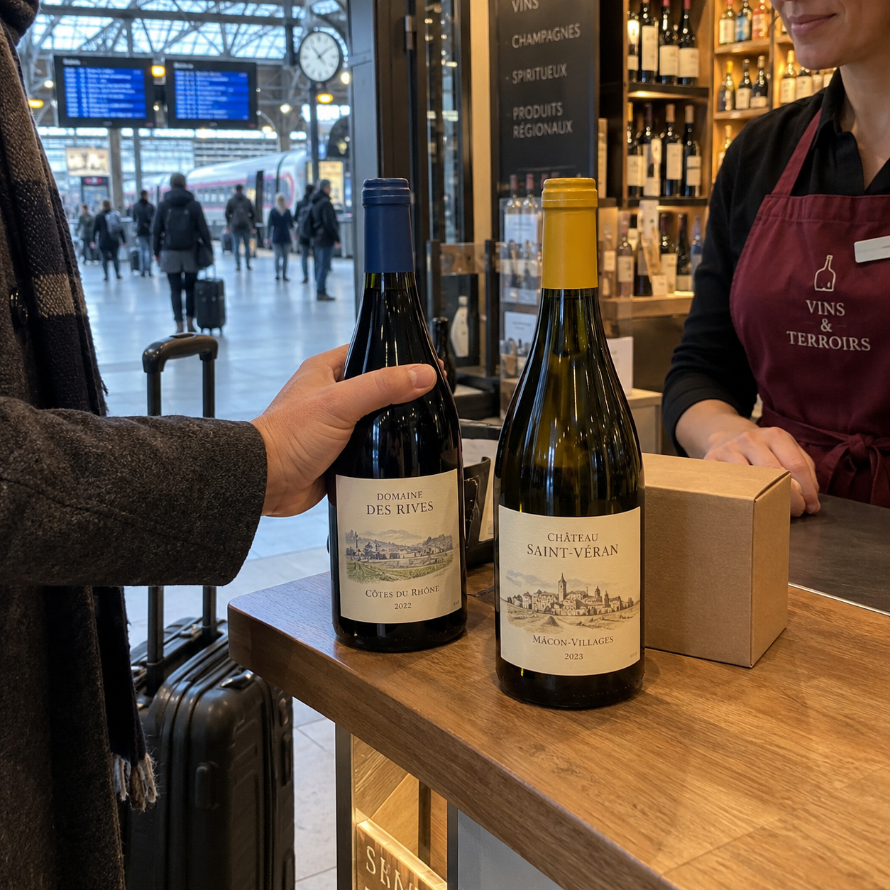
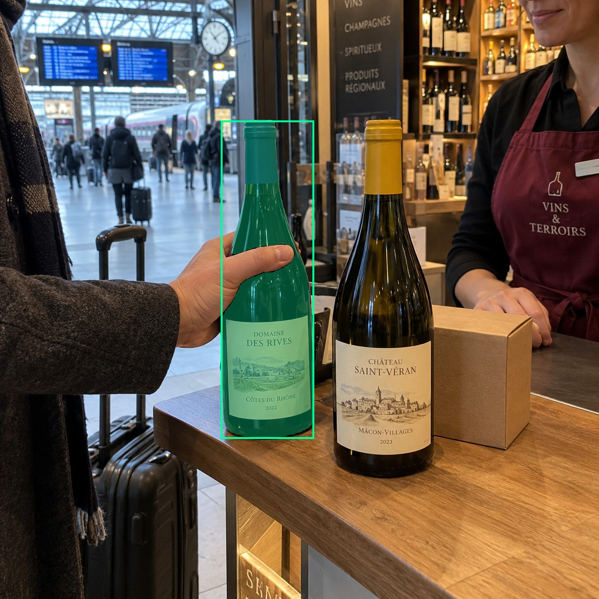
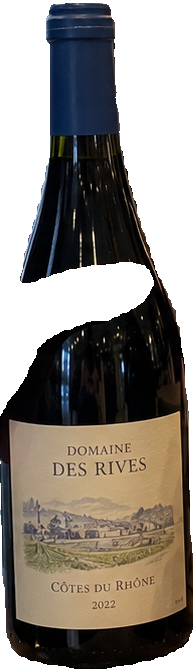
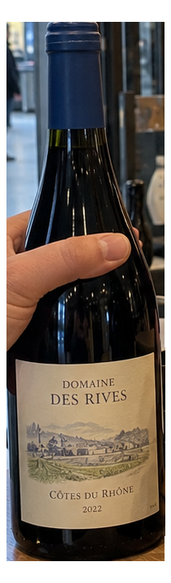
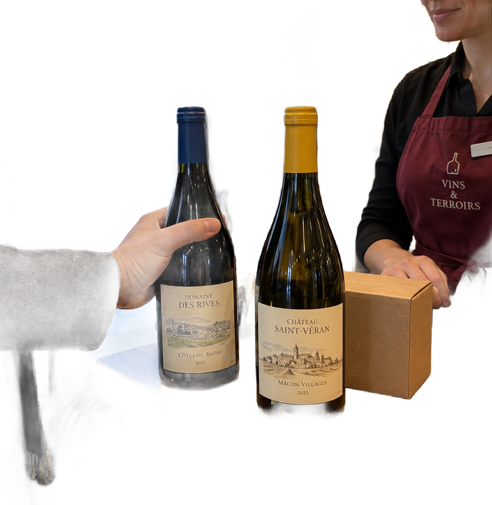

# main-selector-imagegen-diverse-v3-20261020:HP10

**Scene and masks pending — exploratory. All targets/masks are proposals; no approved segmentation ground truth.**

**scene-v1: No automatic failure flag; usability pending.**

Reference title (source): Вокзальный винный магазин · хват слева и рука на коробке

Reference target description (source): Удерживаемая левая бутылка

Expected intent: `clear`. Accepted target proposals: `d14`.

Scene group: `main-selector-imagegen-diverse-v3-20261020:HP10`. Development only; no independent split claim.

## Original and proposed target





Green marks the unreviewed target proposal. Source image pixels are retained separately.

[Selected-label mask audit](../selected-label-mask-audit.json): incomplete proposal retention is flagged separately from target agreement.

[Full-resolution target proposal mask](../masks/diverse-v3--HP10-d14.png)

## Selector results

### scene-v1: No automatic failure flag; usability pending

Selected: d14; reason: existing_scene_v1_rank; mode: legacy; crop 193×669 px. Target agreement: True. Target retention proxy: 99.9%; maximum other-bottle retention: 0.1%; minimum associated label retention: 100.0%. Mask ownership, label completeness and legibility still require human review.



[Full-resolution keep mask](../keep-masks/diverse-v3--HP10-scene-v1.png) · [Exact decision JSON](../results/diverse-v3--HP10-scene-v1.json)

Associated label-mask retention proxies (unreviewed ownership): d48: 100.0%, 34448 source pixels

### semantic-v2: FAIL — provisional target/proxy

Selected: d14; reason: fallback_center_contains; mode: fallback; crop 211×720 px. Target agreement: True. Target retention proxy: 100.0%; maximum other-bottle retention: 100.0%; minimum associated label retention: 100.0%. Mask ownership, label completeness and legibility still require human review. Selected-label mask audit: d48 100.0%.



[Full-resolution keep mask](../keep-masks/diverse-v3--HP10-semantic-v2.png) · [Exact decision JSON](../results/diverse-v3--HP10-semantic-v2.json)

Returned label views: [label 1](../label-crops/diverse-v3--HP10-semantic-v2-0.png)

Associated label-mask retention proxies (unreviewed ownership): d48: 100.0%, 34448 source pixels

### dis-v1: PROXY failure; no native target ID

Selected: dis-foreground; reason: dis_foreground_mask; mode: foreground; crop 1159×1189 px. Target agreement: n/a (no native target ID). Target retention proxy: 97.7%; maximum other-bottle retention: 100.0%; minimum associated label retention: 100.0%. Mask ownership, label completeness and legibility still require human review.



[Full-resolution keep mask](../keep-masks/diverse-v3--HP10-dis-v1.png) · [Exact decision JSON](../results/diverse-v3--HP10-dis-v1.json)

Associated label-mask retention proxies (unreviewed ownership): d48: 100.0%, 34448 source pixels

## All frozen mask proposals

These links expose every detector proposal, including labels and hands. Shapes and owners are unreviewed.

| ID | Detector class | Full-resolution mask |
|---|---|---|
| d0 | wine bottle | [PNG](../masks/diverse-v3--HP10-d0.png) |
| d1 | wine bottle | [PNG](../masks/diverse-v3--HP10-d1.png) |
| d2 | wine bottle | [PNG](../masks/diverse-v3--HP10-d2.png) |
| d3 | wine bottle | [PNG](../masks/diverse-v3--HP10-d3.png) |
| d4 | wine bottle | [PNG](../masks/diverse-v3--HP10-d4.png) |
| d5 | wine bottle | [PNG](../masks/diverse-v3--HP10-d5.png) |
| d6 | wine bottle | [PNG](../masks/diverse-v3--HP10-d6.png) |
| d7 | wine bottle | [PNG](../masks/diverse-v3--HP10-d7.png) |
| d8 | wine bottle | [PNG](../masks/diverse-v3--HP10-d8.png) |
| d9 | wine bottle | [PNG](../masks/diverse-v3--HP10-d9.png) |
| d10 | wine bottle | [PNG](../masks/diverse-v3--HP10-d10.png) |
| d11 | wine bottle | [PNG](../masks/diverse-v3--HP10-d11.png) |
| d12 | wine bottle | [PNG](../masks/diverse-v3--HP10-d12.png) |
| d13 | wine bottle | [PNG](../masks/diverse-v3--HP10-d13.png) |
| d14 | wine bottle | [PNG](../masks/diverse-v3--HP10-d14.png) |
| d15 | wine bottle | [PNG](../masks/diverse-v3--HP10-d15.png) |
| d16 | wine bottle | [PNG](../masks/diverse-v3--HP10-d16.png) |
| d17 | wine bottle | [PNG](../masks/diverse-v3--HP10-d17.png) |
| d18 | wine bottle | [PNG](../masks/diverse-v3--HP10-d18.png) |
| d19 | wine bottle | [PNG](../masks/diverse-v3--HP10-d19.png) |
| d20 | wine bottle | [PNG](../masks/diverse-v3--HP10-d20.png) |
| d21 | wine bottle | [PNG](../masks/diverse-v3--HP10-d21.png) |
| d22 | wine bottle | [PNG](../masks/diverse-v3--HP10-d22.png) |
| d23 | wine bottle | [PNG](../masks/diverse-v3--HP10-d23.png) |
| d24 | wine bottle | [PNG](../masks/diverse-v3--HP10-d24.png) |
| d25 | wine bottle | [PNG](../masks/diverse-v3--HP10-d25.png) |
| d26 | wine bottle | [PNG](../masks/diverse-v3--HP10-d26.png) |
| d27 | wine bottle | [PNG](../masks/diverse-v3--HP10-d27.png) |
| d28 | wine bottle | [PNG](../masks/diverse-v3--HP10-d28.png) |
| d29 | wine bottle | [PNG](../masks/diverse-v3--HP10-d29.png) |
| d30 | wine bottle | [PNG](../masks/diverse-v3--HP10-d30.png) |
| d31 | wine bottle | [PNG](../masks/diverse-v3--HP10-d31.png) |
| d32 | wine bottle | [PNG](../masks/diverse-v3--HP10-d32.png) |
| d33 | wine label | [PNG](../masks/diverse-v3--HP10-d33.png) |
| d34 | wine label | [PNG](../masks/diverse-v3--HP10-d34.png) |
| d35 | wine label | [PNG](../masks/diverse-v3--HP10-d35.png) |
| d36 | wine label | [PNG](../masks/diverse-v3--HP10-d36.png) |
| d37 | wine label | [PNG](../masks/diverse-v3--HP10-d37.png) |
| d38 | wine label | [PNG](../masks/diverse-v3--HP10-d38.png) |
| d39 | wine label | [PNG](../masks/diverse-v3--HP10-d39.png) |
| d40 | wine label | [PNG](../masks/diverse-v3--HP10-d40.png) |
| d41 | wine label | [PNG](../masks/diverse-v3--HP10-d41.png) |
| d42 | wine label | [PNG](../masks/diverse-v3--HP10-d42.png) |
| d43 | wine label | [PNG](../masks/diverse-v3--HP10-d43.png) |
| d44 | wine label | [PNG](../masks/diverse-v3--HP10-d44.png) |
| d45 | wine label | [PNG](../masks/diverse-v3--HP10-d45.png) |
| d46 | wine label | [PNG](../masks/diverse-v3--HP10-d46.png) |
| d47 | wine label | [PNG](../masks/diverse-v3--HP10-d47.png) |
| d48 | wine label | [PNG](../masks/diverse-v3--HP10-d48.png) |
| d49 | wine label | [PNG](../masks/diverse-v3--HP10-d49.png) |
| d50 | wine label | [PNG](../masks/diverse-v3--HP10-d50.png) |
| d51 | wine label | [PNG](../masks/diverse-v3--HP10-d51.png) |
| d52 | wine label | [PNG](../masks/diverse-v3--HP10-d52.png) |
| d53 | wine label | [PNG](../masks/diverse-v3--HP10-d53.png) |
| d54 | wine label | [PNG](../masks/diverse-v3--HP10-d54.png) |
| d55 | wine label | [PNG](../masks/diverse-v3--HP10-d55.png) |
| d56 | wine label | [PNG](../masks/diverse-v3--HP10-d56.png) |
| d57 | wine label | [PNG](../masks/diverse-v3--HP10-d57.png) |
| d58 | wine label | [PNG](../masks/diverse-v3--HP10-d58.png) |
| d59 | wine label | [PNG](../masks/diverse-v3--HP10-d59.png) |
| d60 | wine label | [PNG](../masks/diverse-v3--HP10-d60.png) |
| d61 | wine label | [PNG](../masks/diverse-v3--HP10-d61.png) |
| d62 | hand | [PNG](../masks/diverse-v3--HP10-d62.png) |
| d63 | hand | [PNG](../masks/diverse-v3--HP10-d63.png) |
| d64 | hand | [PNG](../masks/diverse-v3--HP10-d64.png) |
| d65 | hand | [PNG](../masks/diverse-v3--HP10-d65.png) |
| d66 | hand | [PNG](../masks/diverse-v3--HP10-d66.png) |
| d67 | hand | [PNG](../masks/diverse-v3--HP10-d67.png) |
| d68 | hand | [PNG](../masks/diverse-v3--HP10-d68.png) |
| d69 | hand | [PNG](../masks/diverse-v3--HP10-d69.png) |
| d70 | box | [PNG](../masks/diverse-v3--HP10-d70.png) |
| d71 | box | [PNG](../masks/diverse-v3--HP10-d71.png) |
| d72 | price tag | [PNG](../masks/diverse-v3--HP10-d72.png) |
| d73 | price tag | [PNG](../masks/diverse-v3--HP10-d73.png) |
| d74 | price tag | [PNG](../masks/diverse-v3--HP10-d74.png) |
| d75 | price tag | [PNG](../masks/diverse-v3--HP10-d75.png) |

[Raw frozen detector response](../detections/diverse-v3--HP10.json)

<details><summary>Generation prompt (quoted source data)</summary>

```text
Use case: photorealistic-natural. Generate ONE independent photograph, square, approximately 1024 by 1024 pixels. A traveler in a station wine shop examines a bottle at a luggage-height counter. Show coat sleeve, suitcase and railway concourse through the entrance, with a shop assistant nearby. Two bottles and a plain small carton in the described setting. A hand from left grips the LEFT blue-label bottle body. Another hand rests on the carton behind the RIGHT yellow-label bottle, clearly not touching that bottle. Natural shop phone photograph. Make the scene composition, person, clothing and location specific to this scenario, rather than repeating a generic bottle on a tasting counter. Show genuine physical contact when a grip is requested. Fictional wine branding; no arrows, bounding boxes, captions, collages, watermark or UI. Maintain anatomically plausible hands. Keep the target visible label inside the frame except the explicit close-up and occlusion cases.
```

</details>

Source review notes (quoted reference data):

> Цель предварительно связана с маской SAM3 по заданию генерации; подтвердите по самому фото. Форма масок и их владельцы ещё не проверены.
> Окружение: Вокзальный винный магазин. Проверьте реалистичность рук, хват и присутствие требуемых деталей.
