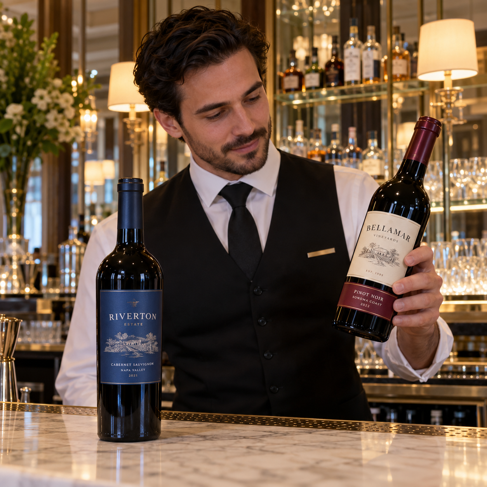
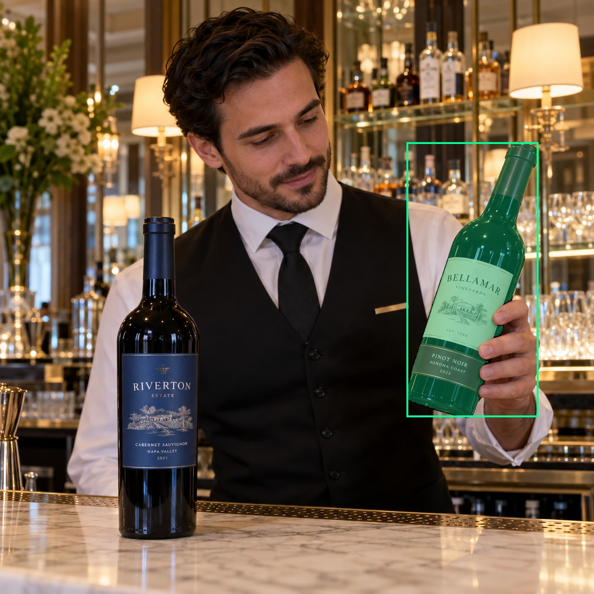
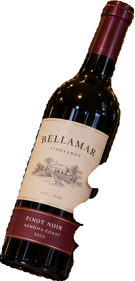
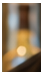
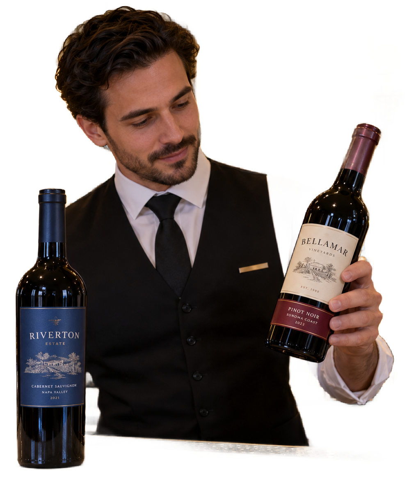

# main-selector-imagegen-diverse-v3-20261020:LB05

**Scene and masks pending — exploratory. All targets/masks are proposals; no approved segmentation ground truth.**

**scene-v1: No automatic failure flag; usability pending.**

Reference title (source): У мраморной стойки · две бумажные этикетки

Reference target description (source): Правая удерживаемая бутылка с двумя этикетками

Expected intent: `clear`. Accepted target proposals: `d2`.

Scene group: `main-selector-imagegen-diverse-v3-20261020:LB05`. Development only; no independent split claim.

## Original and proposed target





Green marks the unreviewed target proposal. Source image pixels are retained separately.

[Selected-label mask audit](../selected-label-mask-audit.json): incomplete proposal retention is flagged separately from target agreement.

[Full-resolution target proposal mask](../masks/diverse-v3--LB05-d2.png)

## Selector results

### scene-v1: No automatic failure flag; usability pending

Selected: d2; reason: existing_scene_v1_rank; mode: legacy; crop 280×581 px. Target agreement: True. Target retention proxy: 100.0%; maximum other-bottle retention: 0.0%; minimum associated label retention: 99.7%. Mask ownership, label completeness and legibility still require human review.



[Full-resolution keep mask](../keep-masks/diverse-v3--LB05-scene-v1.png) · [Exact decision JSON](../results/diverse-v3--LB05-scene-v1.json)

Associated label-mask retention proxies (unreviewed ownership): d17: 99.9%, 24501 source pixels; d24: 99.7%, 9376 source pixels

### semantic-v2: FAIL — provisional target/proxy

Selected: d3; reason: fallback_nearest_center; mode: fallback; crop 43×75 px. Target agreement: False. Target retention proxy: 0.0%; maximum other-bottle retention: 100.0%; minimum associated label retention: 0.0%. Mask ownership, label completeness and legibility still require human review.



[Full-resolution keep mask](../keep-masks/diverse-v3--LB05-semantic-v2.png) · [Exact decision JSON](../results/diverse-v3--LB05-semantic-v2.json)

Associated label-mask retention proxies (unreviewed ownership): d17: 0.0%, 24501 source pixels; d24: 0.0%, 9376 source pixels

### dis-v1: PROXY failure; no native target ID

Selected: dis-foreground; reason: dis_foreground_mask; mode: foreground; crop 997×1186 px. Target agreement: n/a (no native target ID). Target retention proxy: 99.8%; maximum other-bottle retention: 99.9%; minimum associated label retention: 100.0%. Mask ownership, label completeness and legibility still require human review.



[Full-resolution keep mask](../keep-masks/diverse-v3--LB05-dis-v1.png) · [Exact decision JSON](../results/diverse-v3--LB05-dis-v1.json)

Associated label-mask retention proxies (unreviewed ownership): d17: 100.0%, 24501 source pixels; d24: 100.0%, 9376 source pixels

## All frozen mask proposals

These links expose every detector proposal, including labels and hands. Shapes and owners are unreviewed.

| ID | Detector class | Full-resolution mask |
|---|---|---|
| d0 | wine bottle | [PNG](../masks/diverse-v3--LB05-d0.png) |
| d1 | wine bottle | [PNG](../masks/diverse-v3--LB05-d1.png) |
| d2 | wine bottle | [PNG](../masks/diverse-v3--LB05-d2.png) |
| d3 | wine bottle | [PNG](../masks/diverse-v3--LB05-d3.png) |
| d4 | wine bottle | [PNG](../masks/diverse-v3--LB05-d4.png) |
| d5 | wine bottle | [PNG](../masks/diverse-v3--LB05-d5.png) |
| d6 | wine bottle | [PNG](../masks/diverse-v3--LB05-d6.png) |
| d7 | wine bottle | [PNG](../masks/diverse-v3--LB05-d7.png) |
| d8 | wine bottle | [PNG](../masks/diverse-v3--LB05-d8.png) |
| d9 | wine bottle | [PNG](../masks/diverse-v3--LB05-d9.png) |
| d10 | wine bottle | [PNG](../masks/diverse-v3--LB05-d10.png) |
| d11 | wine bottle | [PNG](../masks/diverse-v3--LB05-d11.png) |
| d12 | wine bottle | [PNG](../masks/diverse-v3--LB05-d12.png) |
| d13 | wine bottle | [PNG](../masks/diverse-v3--LB05-d13.png) |
| d14 | wine bottle | [PNG](../masks/diverse-v3--LB05-d14.png) |
| d15 | wine bottle | [PNG](../masks/diverse-v3--LB05-d15.png) |
| d16 | wine label | [PNG](../masks/diverse-v3--LB05-d16.png) |
| d17 | wine label | [PNG](../masks/diverse-v3--LB05-d17.png) |
| d18 | wine label | [PNG](../masks/diverse-v3--LB05-d18.png) |
| d19 | wine label | [PNG](../masks/diverse-v3--LB05-d19.png) |
| d20 | wine label | [PNG](../masks/diverse-v3--LB05-d20.png) |
| d21 | wine label | [PNG](../masks/diverse-v3--LB05-d21.png) |
| d22 | wine label | [PNG](../masks/diverse-v3--LB05-d22.png) |
| d23 | wine label | [PNG](../masks/diverse-v3--LB05-d23.png) |
| d24 | wine label | [PNG](../masks/diverse-v3--LB05-d24.png) |
| d25 | wine label | [PNG](../masks/diverse-v3--LB05-d25.png) |
| d26 | wine label | [PNG](../masks/diverse-v3--LB05-d26.png) |
| d27 | wine label | [PNG](../masks/diverse-v3--LB05-d27.png) |
| d28 | wine label | [PNG](../masks/diverse-v3--LB05-d28.png) |
| d29 | wine label | [PNG](../masks/diverse-v3--LB05-d29.png) |
| d30 | hand | [PNG](../masks/diverse-v3--LB05-d30.png) |
| d31 | wine glass | [PNG](../masks/diverse-v3--LB05-d31.png) |
| d32 | wine glass | [PNG](../masks/diverse-v3--LB05-d32.png) |
| d33 | wine glass | [PNG](../masks/diverse-v3--LB05-d33.png) |
| d34 | wine glass | [PNG](../masks/diverse-v3--LB05-d34.png) |
| d35 | wine glass | [PNG](../masks/diverse-v3--LB05-d35.png) |
| d36 | wine glass | [PNG](../masks/diverse-v3--LB05-d36.png) |

[Raw frozen detector response](../detections/diverse-v3--LB05.json)

<details><summary>Generation prompt (quoted source data)</summary>

```text
Use case: photorealistic-natural. Generate ONE independent photograph, square, approximately 1024 by 1024 pixels. An adult hotel bartender examines a bottle with two separate paper labels at a marble bar. Show face, uniform, mirrored backbar and soft lamps; no extra gripping hands. Two bottles. A hand from right grips the RIGHT bottle between a large upper ivory label and a separate smaller lower red label; both labels face camera and remain fully in frame. LEFT unheld bottle has one clean blue label. Thumb and fingers visibly wrap glass. Make the scene composition, person, clothing and location specific to this scenario, rather than repeating a generic bottle on a tasting counter. Show genuine physical contact when a grip is requested. Fictional wine branding; no arrows, bounding boxes, captions, collages, watermark or UI. Maintain anatomically plausible hands. Keep the target visible label inside the frame except the explicit close-up and occlusion cases.
```

</details>

Source review notes (quoted reference data):

> Цель предварительно связана с маской SAM3 по заданию генерации; подтвердите по самому фото. Форма масок и их владельцы ещё не проверены.
> Окружение: У мраморной стойки. Проверьте реалистичность рук, хват и присутствие требуемых деталей.
