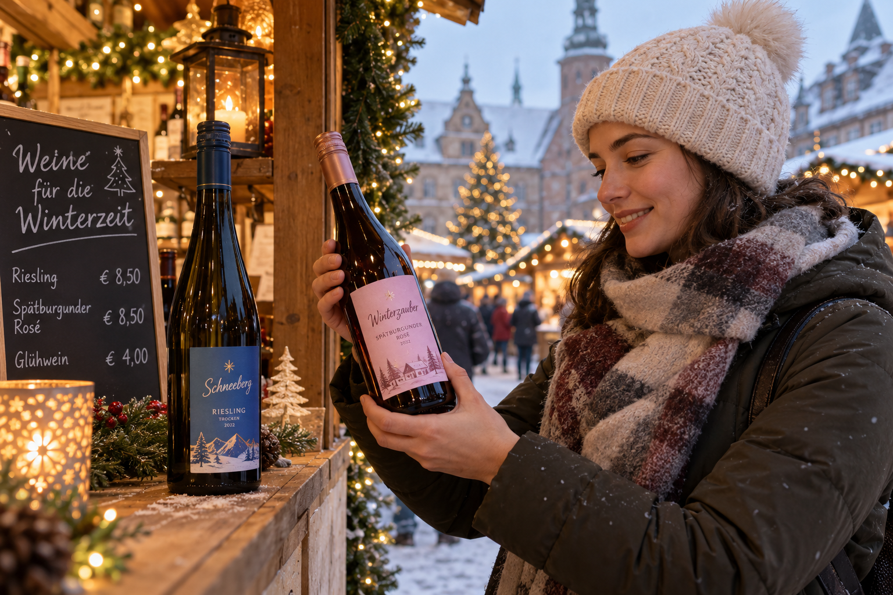
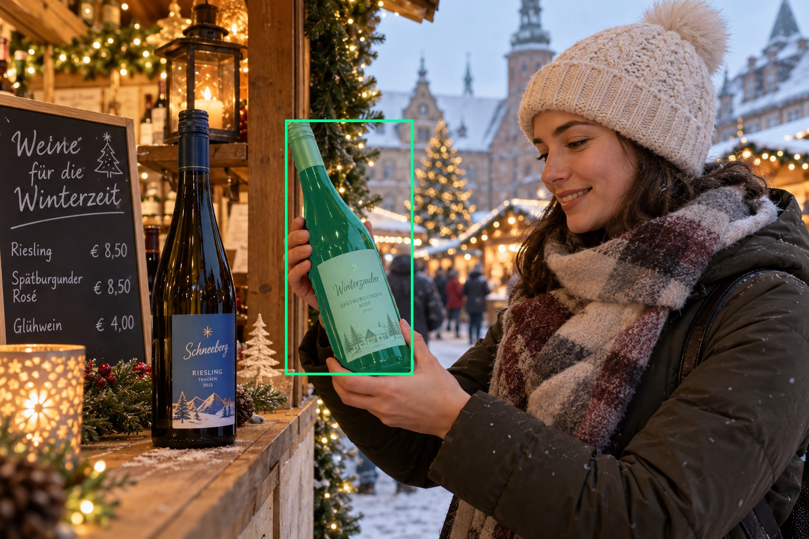
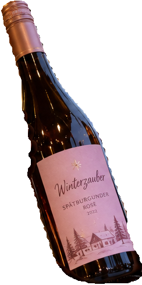
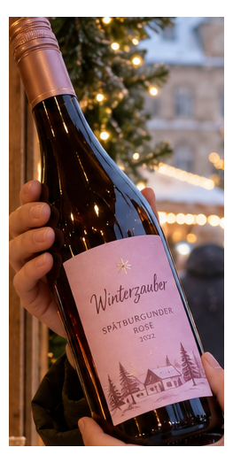
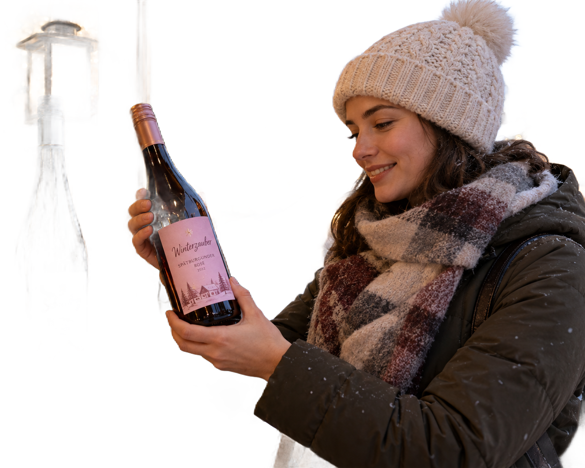

# main-selector-imagegen-diverse-v3-20261020:LB07

**Scene and masks pending — exploratory. All targets/masks are proposals; no approved segmentation ground truth.**

**scene-v1: No automatic failure flag; usability pending.**

Reference title (source): На рождественском рынке · соседний ценник не принадлежит цели

Reference target description (source): Правая удерживаемая бутылка с розовой этикеткой

Expected intent: `clear`. Accepted target proposals: `d10`.

Scene group: `main-selector-imagegen-diverse-v3-20261020:LB07`. Development only; no independent split claim.

## Original and proposed target





Green marks the unreviewed target proposal. Source image pixels are retained separately.

[Selected-label mask audit](../selected-label-mask-audit.json): incomplete proposal retention is flagged separately from target agreement.

[Full-resolution target proposal mask](../masks/diverse-v3--LB07-d10.png)

## Selector results

### scene-v1: No automatic failure flag; usability pending

Selected: d10; reason: existing_scene_v1_rank; mode: legacy; crop 244×488 px. Target agreement: True. Target retention proxy: 100.0%; maximum other-bottle retention: 0.0%; minimum associated label retention: 100.0%. Mask ownership, label completeness and legibility still require human review.



[Full-resolution keep mask](../keep-masks/diverse-v3--LB07-scene-v1.png) · [Exact decision JSON](../results/diverse-v3--LB07-scene-v1.json)

Associated label-mask retention proxies (unreviewed ownership): d16: 100.0%, 22605 source pixels

### semantic-v2: No automatic failure flag; usability pending

Selected: d10; reason: unique_visible_hand_contact; mode: confident; crop 263×523 px. Target agreement: True. Target retention proxy: 100.0%; maximum other-bottle retention: 0.0%; minimum associated label retention: 100.0%. Mask ownership, label completeness and legibility still require human review. Selected-label mask audit: d16 100.0%.



[Full-resolution keep mask](../keep-masks/diverse-v3--LB07-semantic-v2.png) · [Exact decision JSON](../results/diverse-v3--LB07-semantic-v2.json)

Returned label views: [label 1](../label-crops/diverse-v3--LB07-semantic-v2-0.png)

Associated label-mask retention proxies (unreviewed ownership): d16: 100.0%, 22605 source pixels

### dis-v1: Proxy satisfied; usability pending

Selected: dis-foreground; reason: dis_foreground_mask; mode: foreground; crop 1279×1024 px. Target agreement: n/a (no native target ID). Target retention proxy: 97.4%; maximum other-bottle retention: 0.0%; minimum associated label retention: 100.0%. Mask ownership, label completeness and legibility still require human review.



[Full-resolution keep mask](../keep-masks/diverse-v3--LB07-dis-v1.png) · [Exact decision JSON](../results/diverse-v3--LB07-dis-v1.json)

Associated label-mask retention proxies (unreviewed ownership): d16: 100.0%, 22605 source pixels

## All frozen mask proposals

These links expose every detector proposal, including labels and hands. Shapes and owners are unreviewed.

| ID | Detector class | Full-resolution mask |
|---|---|---|
| d0 | wine bottle | [PNG](../masks/diverse-v3--LB07-d0.png) |
| d1 | wine bottle | [PNG](../masks/diverse-v3--LB07-d1.png) |
| d2 | wine bottle | [PNG](../masks/diverse-v3--LB07-d2.png) |
| d3 | wine bottle | [PNG](../masks/diverse-v3--LB07-d3.png) |
| d4 | wine bottle | [PNG](../masks/diverse-v3--LB07-d4.png) |
| d5 | wine bottle | [PNG](../masks/diverse-v3--LB07-d5.png) |
| d6 | wine bottle | [PNG](../masks/diverse-v3--LB07-d6.png) |
| d7 | wine bottle | [PNG](../masks/diverse-v3--LB07-d7.png) |
| d8 | wine bottle | [PNG](../masks/diverse-v3--LB07-d8.png) |
| d9 | wine bottle | [PNG](../masks/diverse-v3--LB07-d9.png) |
| d10 | wine bottle | [PNG](../masks/diverse-v3--LB07-d10.png) |
| d11 | wine label | [PNG](../masks/diverse-v3--LB07-d11.png) |
| d12 | wine label | [PNG](../masks/diverse-v3--LB07-d12.png) |
| d13 | wine label | [PNG](../masks/diverse-v3--LB07-d13.png) |
| d14 | wine label | [PNG](../masks/diverse-v3--LB07-d14.png) |
| d15 | wine label | [PNG](../masks/diverse-v3--LB07-d15.png) |
| d16 | wine label | [PNG](../masks/diverse-v3--LB07-d16.png) |
| d17 | hand | [PNG](../masks/diverse-v3--LB07-d17.png) |
| d18 | hand | [PNG](../masks/diverse-v3--LB07-d18.png) |
| d19 | hand | [PNG](../masks/diverse-v3--LB07-d19.png) |
| d20 | price tag | [PNG](../masks/diverse-v3--LB07-d20.png) |

[Raw frozen detector response](../detections/diverse-v3--LB07.json)

<details><summary>Generation prompt (quoted source data)</summary>

```text
Use case: photorealistic-natural. Generate ONE independent photograph, landscape 3:2, approximately 1536 by 1024 pixels. An adult shopper in a winter coat examines a pink-label wine bottle at a Christmas market stall. Gift lights, wooden huts, nearby price cards and light snow. Show face and hands. Two bottles in the described setting. A hand from right holds the RIGHT pink-label bottle body. A large bright price card sits beside the LEFT unheld blue-label bottle, clearly on its own stand and not attached to the target. Full target label paper visible. Make the scene composition, person, clothing and location specific to this scenario, rather than repeating a generic bottle on a tasting counter. Show genuine physical contact when a grip is requested. Fictional wine branding; no arrows, bounding boxes, captions, collages, watermark or UI. Maintain anatomically plausible hands. Keep the target visible label inside the frame except the explicit close-up and occlusion cases.
```

</details>

Source review notes (quoted reference data):

> Цель предварительно связана с маской SAM3 по заданию генерации; подтвердите по самому фото. Форма масок и их владельцы ещё не проверены.
> Окружение: На рождественском рынке. Проверьте реалистичность рук, хват и присутствие требуемых деталей.
