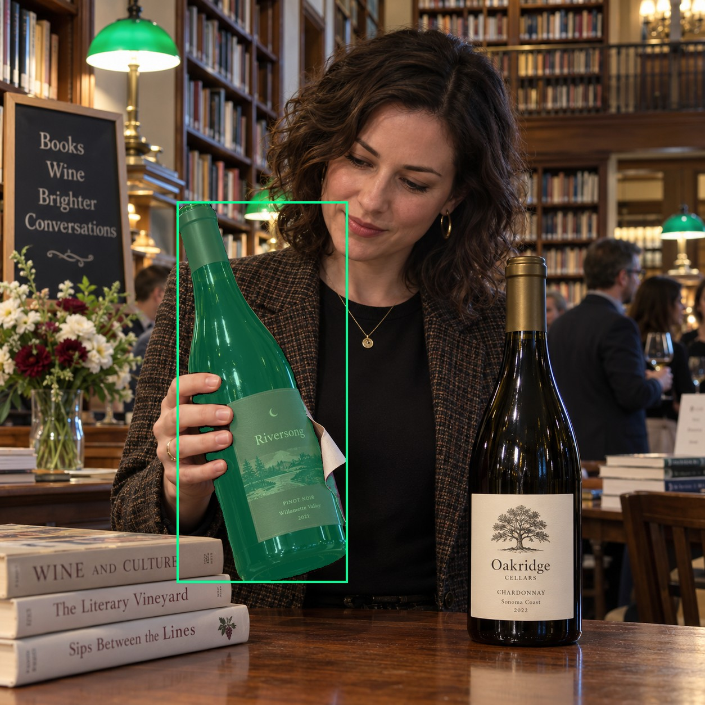
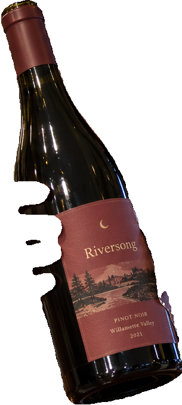
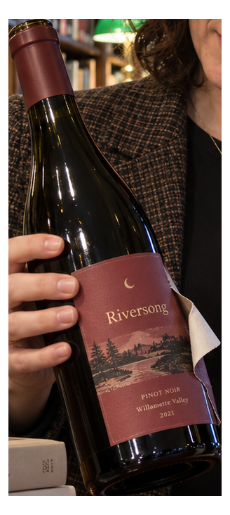
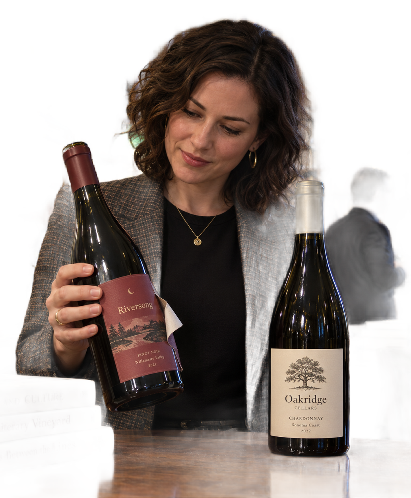

# main-selector-imagegen-diverse-v3-20261020:LB10

**Scene and masks pending — exploratory. All targets/masks are proposals; no approved segmentation ground truth.**

**scene-v1: No automatic failure flag; usability pending.**

Reference title (source): На вечере в библиотеке · частично снятая бумага

Reference target description (source): Левая удерживаемая бутылка с отслоившейся этикеткой

Expected intent: `clear`. Accepted target proposals: `d1`.

Scene group: `main-selector-imagegen-diverse-v3-20261020:LB10`. Development only; no independent split claim.

## Original and proposed target




Green marks the unreviewed target proposal. Source image pixels are retained separately.

[Selected-label mask audit](../selected-label-mask-audit.json): incomplete proposal retention is flagged separately from target agreement.

[Full-resolution target proposal mask](../masks/diverse-v3--LB10-d1.png)

## Selector results

### scene-v1: No automatic failure flag; usability pending

Selected: d1; reason: existing_scene_v1_rank; mode: legacy; crop 305×679 px. Target agreement: True. Target retention proxy: 100.0%; maximum other-bottle retention: 0.0%; minimum associated label retention: 99.8%. Mask ownership, label completeness and legibility still require human review.



[Full-resolution keep mask](../keep-masks/diverse-v3--LB10-scene-v1.png) · [Exact decision JSON](../results/diverse-v3--LB10-scene-v1.json)

Associated label-mask retention proxies (unreviewed ownership): d3: 99.8%, 36196 source pixels

### semantic-v2: No automatic failure flag; usability pending

Selected: d1; reason: unique_visible_hand_contact; mode: confident; crop 328×732 px. Target agreement: True. Target retention proxy: 100.0%; maximum other-bottle retention: 0.0%; minimum associated label retention: 100.0%. Mask ownership, label completeness and legibility still require human review. Selected-label mask audit: d3 100.0%.



[Full-resolution keep mask](../keep-masks/diverse-v3--LB10-semantic-v2.png) · [Exact decision JSON](../results/diverse-v3--LB10-semantic-v2.json)

Returned label views: [label 1](../label-crops/diverse-v3--LB10-semantic-v2-0.png)

Associated label-mask retention proxies (unreviewed ownership): d3: 100.0%, 36196 source pixels

### dis-v1: PROXY failure; no native target ID

Selected: dis-foreground; reason: dis_foreground_mask; mode: foreground; crop 1034×1252 px. Target agreement: n/a (no native target ID). Target retention proxy: 99.9%; maximum other-bottle retention: 91.9%; minimum associated label retention: 100.0%. Mask ownership, label completeness and legibility still require human review.



[Full-resolution keep mask](../keep-masks/diverse-v3--LB10-dis-v1.png) · [Exact decision JSON](../results/diverse-v3--LB10-dis-v1.json)

Associated label-mask retention proxies (unreviewed ownership): d3: 100.0%, 36196 source pixels

## All frozen mask proposals

These links expose every detector proposal, including labels and hands. Shapes and owners are unreviewed.

| ID | Detector class | Full-resolution mask |
|---|---|---|
| d0 | wine bottle | [PNG](../masks/diverse-v3--LB10-d0.png) |
| d1 | wine bottle | [PNG](../masks/diverse-v3--LB10-d1.png) |
| d2 | wine label | [PNG](../masks/diverse-v3--LB10-d2.png) |
| d3 | wine label | [PNG](../masks/diverse-v3--LB10-d3.png) |
| d4 | hand | [PNG](../masks/diverse-v3--LB10-d4.png) |
| d5 | hand | [PNG](../masks/diverse-v3--LB10-d5.png) |
| d6 | wine glass | [PNG](../masks/diverse-v3--LB10-d6.png) |
| d7 | wine glass | [PNG](../masks/diverse-v3--LB10-d7.png) |
| d8 | wine glass | [PNG](../masks/diverse-v3--LB10-d8.png) |

[Raw frozen detector response](../detections/diverse-v3--LB10.json)

<details><summary>Generation prompt (quoted source data)</summary>

```text
Use case: photorealistic-natural. Generate ONE independent photograph, square, approximately 1024 by 1024 pixels. An adult librarian examines a bottle with partly peeling label at a library wine-and-books event. Tall shelves, green reading lamps and a wooden table. Include face and holding hand. Two bottles. A hand from left firmly grips the LEFT bottle body while a corner of its red paper label is peeled outward and hangs visibly. The remaining front paper and detached flap belong to the same bottle. RIGHT unheld bottle has a complete ivory label. No extra hands. Make the scene composition, person, clothing and location specific to this scenario, rather than repeating a generic bottle on a tasting counter. Show genuine physical contact when a grip is requested. Fictional wine branding; no arrows, bounding boxes, captions, collages, watermark or UI. Maintain anatomically plausible hands. Keep the target visible label inside the frame except the explicit close-up and occlusion cases.
```

</details>

Source review notes (quoted reference data):

> Цель предварительно связана с маской SAM3 по заданию генерации; подтвердите по самому фото. Форма масок и их владельцы ещё не проверены.
> Окружение: На вечере в библиотеке. Проверьте реалистичность рук, хват и присутствие требуемых деталей.
