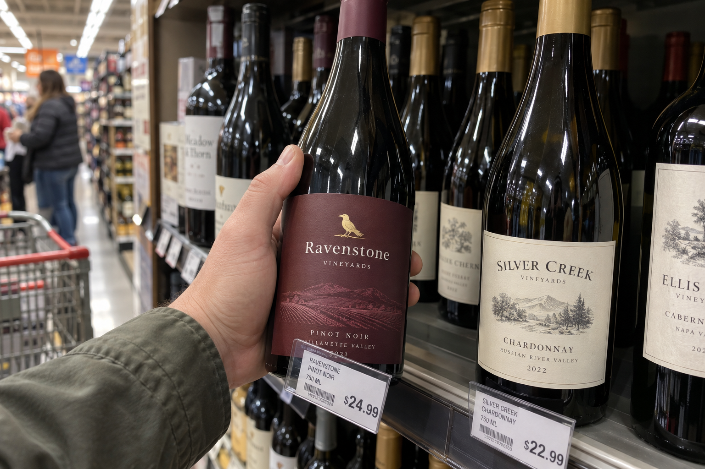
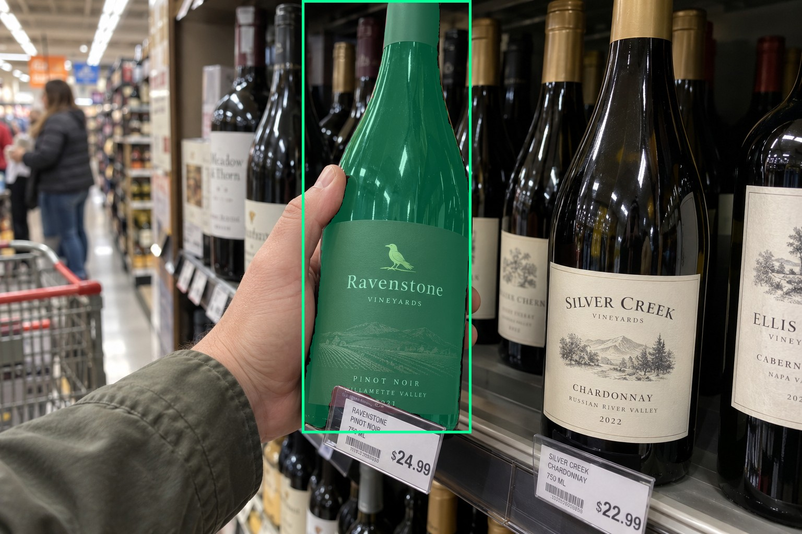
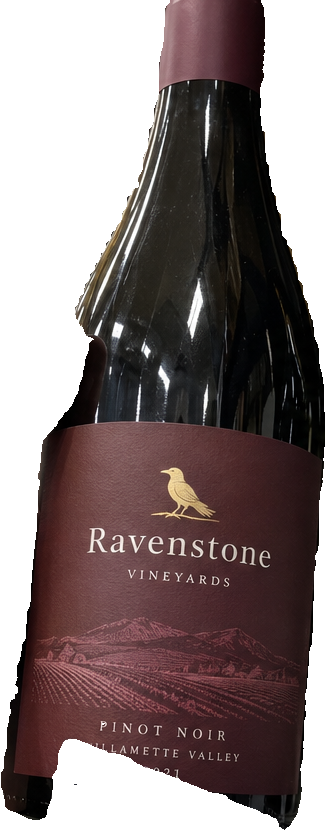
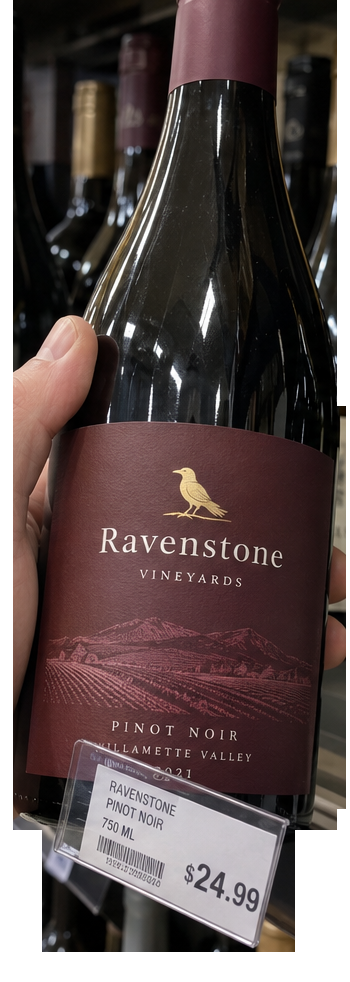
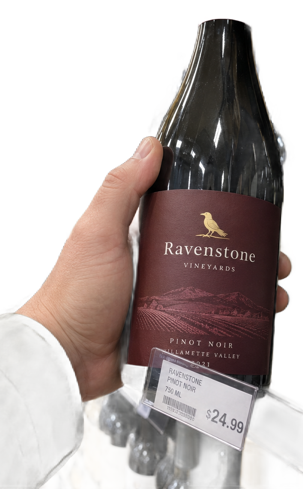

# main-selector-imagegen-diverse-v3-20261020:OC04

**Scene and masks pending — exploratory. All targets/masks are proposals; no approved segmentation ground truth.**

**scene-v1: No automatic failure flag; usability pending.**

Reference title (source): В супермаркете · ценник перед частью этикетки

Reference target description (source): Удерживаемая бутылка с бордовой этикеткой на переднем плане

Expected intent: `clear`. Accepted target proposals: `d25`.

Scene group: `main-selector-imagegen-diverse-v3-20261020:OC04`. Development only; no independent split claim.

## Original and proposed target





Green marks the unreviewed target proposal. Source image pixels are retained separately.

[Selected-label mask audit](../selected-label-mask-audit.json): incomplete proposal retention is flagged separately from target agreement.

[Full-resolution target proposal mask](../masks/diverse-v3--OC04-d25.png)

## Selector results

### scene-v1: No automatic failure flag; usability pending

Selected: d25; reason: existing_scene_v1_rank; mode: legacy; crop 325×831 px. Target agreement: True. Target retention proxy: 100.0%; maximum other-bottle retention: 0.2%; minimum associated label retention: 99.7%. Mask ownership, label completeness and legibility still require human review.



[Full-resolution keep mask](../keep-masks/diverse-v3--OC04-scene-v1.png) · [Exact decision JSON](../results/diverse-v3--OC04-scene-v1.json)

Associated label-mask retention proxies (unreviewed ownership): d45: 99.7%, 97322 source pixels

### semantic-v2: FAIL — provisional target/proxy

Selected: d25; reason: unique_visible_hand_contact; mode: confident; crop 350×982 px. Target agreement: True. Target retention proxy: 100.0%; maximum other-bottle retention: 100.0%; minimum associated label retention: 100.0%. Mask ownership, label completeness and legibility still require human review. Selected-label mask audit: d45 100.0%; d57 100.0%.



[Full-resolution keep mask](../keep-masks/diverse-v3--OC04-semantic-v2.png) · [Exact decision JSON](../results/diverse-v3--OC04-semantic-v2.json)

Returned label views: [label 1](../label-crops/diverse-v3--OC04-semantic-v2-0.png) · [label 2](../label-crops/diverse-v3--OC04-semantic-v2-1.png)

Associated label-mask retention proxies (unreviewed ownership): d45: 100.0%, 97322 source pixels

### dis-v1: PROXY failure; no native target ID

Selected: dis-foreground; reason: dis_foreground_mask; mode: foreground; crop 609×983 px. Target agreement: n/a (no native target ID). Target retention proxy: 94.0%; maximum other-bottle retention: 65.8%; minimum associated label retention: 100.0%. Mask ownership, label completeness and legibility still require human review.



[Full-resolution keep mask](../keep-masks/diverse-v3--OC04-dis-v1.png) · [Exact decision JSON](../results/diverse-v3--OC04-dis-v1.json)

Associated label-mask retention proxies (unreviewed ownership): d45: 100.0%, 97322 source pixels

## All frozen mask proposals

These links expose every detector proposal, including labels and hands. Shapes and owners are unreviewed.

| ID | Detector class | Full-resolution mask |
|---|---|---|
| d0 | wine bottle | [PNG](../masks/diverse-v3--OC04-d0.png) |
| d1 | wine bottle | [PNG](../masks/diverse-v3--OC04-d1.png) |
| d2 | wine bottle | [PNG](../masks/diverse-v3--OC04-d2.png) |
| d3 | wine bottle | [PNG](../masks/diverse-v3--OC04-d3.png) |
| d4 | wine bottle | [PNG](../masks/diverse-v3--OC04-d4.png) |
| d5 | wine bottle | [PNG](../masks/diverse-v3--OC04-d5.png) |
| d6 | wine bottle | [PNG](../masks/diverse-v3--OC04-d6.png) |
| d7 | wine bottle | [PNG](../masks/diverse-v3--OC04-d7.png) |
| d8 | wine bottle | [PNG](../masks/diverse-v3--OC04-d8.png) |
| d9 | wine bottle | [PNG](../masks/diverse-v3--OC04-d9.png) |
| d10 | wine bottle | [PNG](../masks/diverse-v3--OC04-d10.png) |
| d11 | wine bottle | [PNG](../masks/diverse-v3--OC04-d11.png) |
| d12 | wine bottle | [PNG](../masks/diverse-v3--OC04-d12.png) |
| d13 | wine bottle | [PNG](../masks/diverse-v3--OC04-d13.png) |
| d14 | wine bottle | [PNG](../masks/diverse-v3--OC04-d14.png) |
| d15 | wine bottle | [PNG](../masks/diverse-v3--OC04-d15.png) |
| d16 | wine bottle | [PNG](../masks/diverse-v3--OC04-d16.png) |
| d17 | wine bottle | [PNG](../masks/diverse-v3--OC04-d17.png) |
| d18 | wine bottle | [PNG](../masks/diverse-v3--OC04-d18.png) |
| d19 | wine bottle | [PNG](../masks/diverse-v3--OC04-d19.png) |
| d20 | wine bottle | [PNG](../masks/diverse-v3--OC04-d20.png) |
| d21 | wine bottle | [PNG](../masks/diverse-v3--OC04-d21.png) |
| d22 | wine bottle | [PNG](../masks/diverse-v3--OC04-d22.png) |
| d23 | wine bottle | [PNG](../masks/diverse-v3--OC04-d23.png) |
| d24 | wine bottle | [PNG](../masks/diverse-v3--OC04-d24.png) |
| d25 | wine bottle | [PNG](../masks/diverse-v3--OC04-d25.png) |
| d26 | wine bottle | [PNG](../masks/diverse-v3--OC04-d26.png) |
| d27 | wine bottle | [PNG](../masks/diverse-v3--OC04-d27.png) |
| d28 | wine bottle | [PNG](../masks/diverse-v3--OC04-d28.png) |
| d29 | wine bottle | [PNG](../masks/diverse-v3--OC04-d29.png) |
| d30 | wine bottle | [PNG](../masks/diverse-v3--OC04-d30.png) |
| d31 | wine label | [PNG](../masks/diverse-v3--OC04-d31.png) |
| d32 | wine label | [PNG](../masks/diverse-v3--OC04-d32.png) |
| d33 | wine label | [PNG](../masks/diverse-v3--OC04-d33.png) |
| d34 | wine label | [PNG](../masks/diverse-v3--OC04-d34.png) |
| d35 | wine label | [PNG](../masks/diverse-v3--OC04-d35.png) |
| d36 | wine label | [PNG](../masks/diverse-v3--OC04-d36.png) |
| d37 | wine label | [PNG](../masks/diverse-v3--OC04-d37.png) |
| d38 | wine label | [PNG](../masks/diverse-v3--OC04-d38.png) |
| d39 | wine label | [PNG](../masks/diverse-v3--OC04-d39.png) |
| d40 | wine label | [PNG](../masks/diverse-v3--OC04-d40.png) |
| d41 | wine label | [PNG](../masks/diverse-v3--OC04-d41.png) |
| d42 | wine label | [PNG](../masks/diverse-v3--OC04-d42.png) |
| d43 | wine label | [PNG](../masks/diverse-v3--OC04-d43.png) |
| d44 | wine label | [PNG](../masks/diverse-v3--OC04-d44.png) |
| d45 | wine label | [PNG](../masks/diverse-v3--OC04-d45.png) |
| d46 | wine label | [PNG](../masks/diverse-v3--OC04-d46.png) |
| d47 | hand | [PNG](../masks/diverse-v3--OC04-d47.png) |
| d48 | hand | [PNG](../masks/diverse-v3--OC04-d48.png) |
| d49 | box | [PNG](../masks/diverse-v3--OC04-d49.png) |
| d50 | box | [PNG](../masks/diverse-v3--OC04-d50.png) |
| d51 | price tag | [PNG](../masks/diverse-v3--OC04-d51.png) |
| d52 | price tag | [PNG](../masks/diverse-v3--OC04-d52.png) |
| d53 | price tag | [PNG](../masks/diverse-v3--OC04-d53.png) |
| d54 | price tag | [PNG](../masks/diverse-v3--OC04-d54.png) |
| d55 | price tag | [PNG](../masks/diverse-v3--OC04-d55.png) |
| d56 | price tag | [PNG](../masks/diverse-v3--OC04-d56.png) |
| d57 | price tag | [PNG](../masks/diverse-v3--OC04-d57.png) |

[Raw frozen detector response](../detections/diverse-v3--OC04.json)

<details><summary>Generation prompt (quoted source data)</summary>

```text
Use case: photorealistic-natural. Generate ONE independent photograph, landscape 3:2, approximately 1536 by 1024 pixels. A casually dressed adult shopper examines wine in a supermarket aisle, bright fluorescent lights, shopping cart and many shelf price cards. First-person handheld photo with an ordinary untidy composition. Two bottles in the described setting. A hand from left grips the LEFT burgundy-label bottle mid-body. A small shelf price-card holder crosses only the bottom corner of its label. The RIGHT unheld bottle has a fully readable cream label.  real grip and occlusion physically plausible. Make the scene composition, person, clothing and location specific to this scenario, rather than repeating a generic bottle on a tasting counter. Show genuine physical contact when a grip is requested. Fictional wine branding; no arrows, bounding boxes, captions, collages, watermark or UI. Maintain anatomically plausible hands. Keep the target visible label inside the frame except the explicit close-up and occlusion cases.
```

</details>

Source review notes (quoted reference data):

> Цель предварительно связана с маской SAM3 по заданию генерации; подтвердите по самому фото. Форма масок и их владельцы ещё не проверены.
> Окружение: В супермаркете. Проверьте реалистичность рук, хват и присутствие требуемых деталей.
> Предварительная точка задания попадала на бутылку в глубине слева. По фактическому фото цель исправлена на бутылку, которую держит рука на переднем плане.
