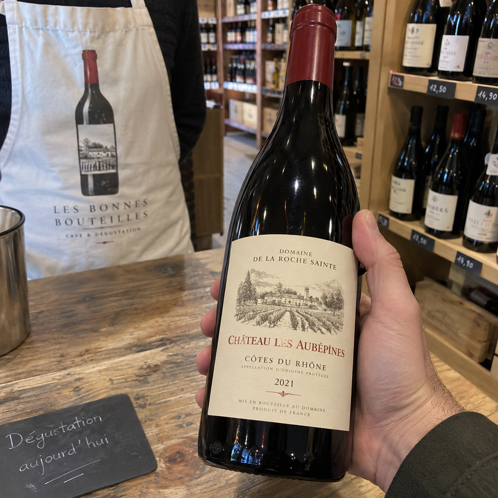
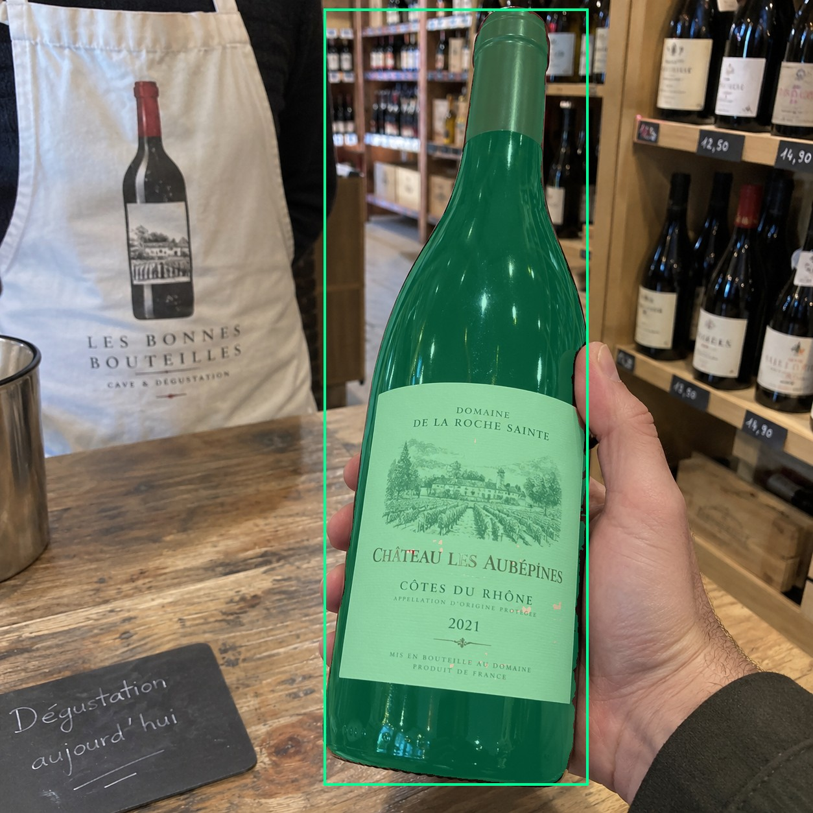
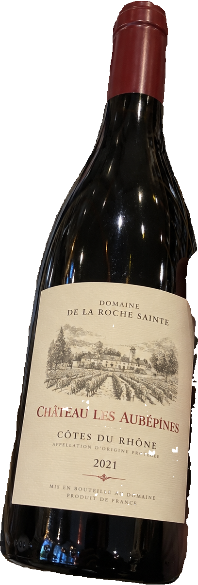
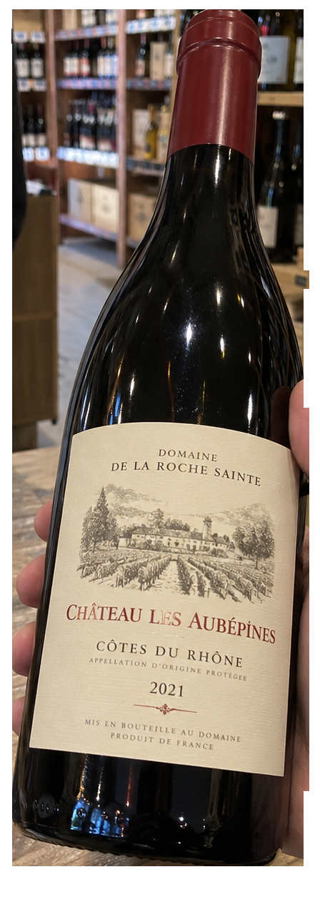
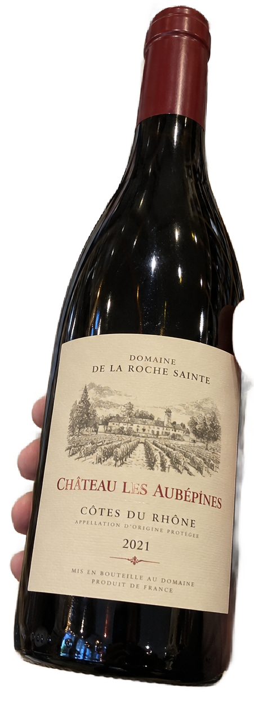

# main-selector-imagegen-diverse-v3-20261020:PD05

**Scene and masks pending — exploratory. All targets/masks are proposals; no approved segmentation ground truth.**

**scene-v1: No automatic failure flag; usability pending.**

Reference title (source): В руке: бутылка и рисунок на фартуке

Reference target description (source): Удерживаемая настоящая бутылка справа на столе

Expected intent: `clear`. Accepted target proposals: `d27`.

Scene group: `main-selector-imagegen-diverse-v3-20261020:PD05`. Development only; no independent split claim.

## Original and proposed target





Green marks the unreviewed target proposal. Source image pixels are retained separately.

[Selected-label mask audit](../selected-label-mask-audit.json): incomplete proposal retention is flagged separately from target agreement.

[Full-resolution target proposal mask](../masks/diverse-v3--PD05-d27.png)

## Selector results

### scene-v1: No automatic failure flag; usability pending

Selected: d27; reason: existing_scene_v1_rank; mode: legacy; crop 408×1201 px. Target agreement: True. Target retention proxy: 100.0%; maximum other-bottle retention: 0.0%; minimum associated label retention: 99.6%. Mask ownership, label completeness and legibility still require human review.



[Full-resolution keep mask](../keep-masks/diverse-v3--PD05-scene-v1.png) · [Exact decision JSON](../results/diverse-v3--PD05-scene-v1.json)

Associated label-mask retention proxies (unreviewed ownership): d38: 99.6%, 156944 source pixels

### semantic-v2: FAIL — provisional target/proxy

Selected: d27; reason: unique_visible_hand_contact; mode: confident; crop 448×1254 px. Target agreement: True. Target retention proxy: 100.0%; maximum other-bottle retention: 100.0%; minimum associated label retention: 100.0%. Mask ownership, label completeness and legibility still require human review. Selected-label mask audit: d38 100.0%; d69 100.0%; d79 99.5%; d75 100.0%; d70 100.0%; d71 100.0%; d65 100.0%; d76 100.0%.



[Full-resolution keep mask](../keep-masks/diverse-v3--PD05-semantic-v2.png) · [Exact decision JSON](../results/diverse-v3--PD05-semantic-v2.json)

Returned label views: [label 1](../label-crops/diverse-v3--PD05-semantic-v2-0.png) · [label 2](../label-crops/diverse-v3--PD05-semantic-v2-1.png) · [label 3](../label-crops/diverse-v3--PD05-semantic-v2-2.png) · [label 4](../label-crops/diverse-v3--PD05-semantic-v2-3.png) · [label 5](../label-crops/diverse-v3--PD05-semantic-v2-4.png) · [label 6](../label-crops/diverse-v3--PD05-semantic-v2-5.png) · [label 7](../label-crops/diverse-v3--PD05-semantic-v2-6.png) · [label 8](../label-crops/diverse-v3--PD05-semantic-v2-7.png)

Associated label-mask retention proxies (unreviewed ownership): d38: 100.0%, 156944 source pixels

### dis-v1: Proxy satisfied; usability pending

Selected: dis-foreground; reason: dis_foreground_mask; mode: foreground; crop 451×1254 px. Target agreement: n/a (no native target ID). Target retention proxy: 99.8%; maximum other-bottle retention: 5.2%; minimum associated label retention: 100.0%. Mask ownership, label completeness and legibility still require human review.



[Full-resolution keep mask](../keep-masks/diverse-v3--PD05-dis-v1.png) · [Exact decision JSON](../results/diverse-v3--PD05-dis-v1.json)

Associated label-mask retention proxies (unreviewed ownership): d38: 100.0%, 156944 source pixels

## All frozen mask proposals

These links expose every detector proposal, including labels and hands. Shapes and owners are unreviewed.

| ID | Detector class | Full-resolution mask |
|---|---|---|
| d0 | wine bottle | [PNG](../masks/diverse-v3--PD05-d0.png) |
| d1 | wine bottle | [PNG](../masks/diverse-v3--PD05-d1.png) |
| d2 | wine bottle | [PNG](../masks/diverse-v3--PD05-d2.png) |
| d3 | wine bottle | [PNG](../masks/diverse-v3--PD05-d3.png) |
| d4 | wine bottle | [PNG](../masks/diverse-v3--PD05-d4.png) |
| d5 | wine bottle | [PNG](../masks/diverse-v3--PD05-d5.png) |
| d6 | wine bottle | [PNG](../masks/diverse-v3--PD05-d6.png) |
| d7 | wine bottle | [PNG](../masks/diverse-v3--PD05-d7.png) |
| d8 | wine bottle | [PNG](../masks/diverse-v3--PD05-d8.png) |
| d9 | wine bottle | [PNG](../masks/diverse-v3--PD05-d9.png) |
| d10 | wine bottle | [PNG](../masks/diverse-v3--PD05-d10.png) |
| d11 | wine bottle | [PNG](../masks/diverse-v3--PD05-d11.png) |
| d12 | wine bottle | [PNG](../masks/diverse-v3--PD05-d12.png) |
| d13 | wine bottle | [PNG](../masks/diverse-v3--PD05-d13.png) |
| d14 | wine bottle | [PNG](../masks/diverse-v3--PD05-d14.png) |
| d15 | wine bottle | [PNG](../masks/diverse-v3--PD05-d15.png) |
| d16 | wine bottle | [PNG](../masks/diverse-v3--PD05-d16.png) |
| d17 | wine bottle | [PNG](../masks/diverse-v3--PD05-d17.png) |
| d18 | wine bottle | [PNG](../masks/diverse-v3--PD05-d18.png) |
| d19 | wine bottle | [PNG](../masks/diverse-v3--PD05-d19.png) |
| d20 | wine bottle | [PNG](../masks/diverse-v3--PD05-d20.png) |
| d21 | wine bottle | [PNG](../masks/diverse-v3--PD05-d21.png) |
| d22 | wine bottle | [PNG](../masks/diverse-v3--PD05-d22.png) |
| d23 | wine bottle | [PNG](../masks/diverse-v3--PD05-d23.png) |
| d24 | wine bottle | [PNG](../masks/diverse-v3--PD05-d24.png) |
| d25 | wine bottle | [PNG](../masks/diverse-v3--PD05-d25.png) |
| d26 | wine bottle | [PNG](../masks/diverse-v3--PD05-d26.png) |
| d27 | wine bottle | [PNG](../masks/diverse-v3--PD05-d27.png) |
| d28 | wine bottle | [PNG](../masks/diverse-v3--PD05-d28.png) |
| d29 | wine bottle | [PNG](../masks/diverse-v3--PD05-d29.png) |
| d30 | wine bottle | [PNG](../masks/diverse-v3--PD05-d30.png) |
| d31 | wine bottle | [PNG](../masks/diverse-v3--PD05-d31.png) |
| d32 | wine bottle | [PNG](../masks/diverse-v3--PD05-d32.png) |
| d33 | wine label | [PNG](../masks/diverse-v3--PD05-d33.png) |
| d34 | wine label | [PNG](../masks/diverse-v3--PD05-d34.png) |
| d35 | wine label | [PNG](../masks/diverse-v3--PD05-d35.png) |
| d36 | wine label | [PNG](../masks/diverse-v3--PD05-d36.png) |
| d37 | wine label | [PNG](../masks/diverse-v3--PD05-d37.png) |
| d38 | wine label | [PNG](../masks/diverse-v3--PD05-d38.png) |
| d39 | wine label | [PNG](../masks/diverse-v3--PD05-d39.png) |
| d40 | wine label | [PNG](../masks/diverse-v3--PD05-d40.png) |
| d41 | wine label | [PNG](../masks/diverse-v3--PD05-d41.png) |
| d42 | wine label | [PNG](../masks/diverse-v3--PD05-d42.png) |
| d43 | wine label | [PNG](../masks/diverse-v3--PD05-d43.png) |
| d44 | wine label | [PNG](../masks/diverse-v3--PD05-d44.png) |
| d45 | wine label | [PNG](../masks/diverse-v3--PD05-d45.png) |
| d46 | wine label | [PNG](../masks/diverse-v3--PD05-d46.png) |
| d47 | wine label | [PNG](../masks/diverse-v3--PD05-d47.png) |
| d48 | wine label | [PNG](../masks/diverse-v3--PD05-d48.png) |
| d49 | wine label | [PNG](../masks/diverse-v3--PD05-d49.png) |
| d50 | wine label | [PNG](../masks/diverse-v3--PD05-d50.png) |
| d51 | wine label | [PNG](../masks/diverse-v3--PD05-d51.png) |
| d52 | wine label | [PNG](../masks/diverse-v3--PD05-d52.png) |
| d53 | hand | [PNG](../masks/diverse-v3--PD05-d53.png) |
| d54 | box | [PNG](../masks/diverse-v3--PD05-d54.png) |
| d55 | box | [PNG](../masks/diverse-v3--PD05-d55.png) |
| d56 | box | [PNG](../masks/diverse-v3--PD05-d56.png) |
| d57 | box | [PNG](../masks/diverse-v3--PD05-d57.png) |
| d58 | box | [PNG](../masks/diverse-v3--PD05-d58.png) |
| d59 | box | [PNG](../masks/diverse-v3--PD05-d59.png) |
| d60 | box | [PNG](../masks/diverse-v3--PD05-d60.png) |
| d61 | box | [PNG](../masks/diverse-v3--PD05-d61.png) |
| d62 | box | [PNG](../masks/diverse-v3--PD05-d62.png) |
| d63 | box | [PNG](../masks/diverse-v3--PD05-d63.png) |
| d64 | price tag | [PNG](../masks/diverse-v3--PD05-d64.png) |
| d65 | price tag | [PNG](../masks/diverse-v3--PD05-d65.png) |
| d66 | price tag | [PNG](../masks/diverse-v3--PD05-d66.png) |
| d67 | price tag | [PNG](../masks/diverse-v3--PD05-d67.png) |
| d68 | price tag | [PNG](../masks/diverse-v3--PD05-d68.png) |
| d69 | price tag | [PNG](../masks/diverse-v3--PD05-d69.png) |
| d70 | price tag | [PNG](../masks/diverse-v3--PD05-d70.png) |
| d71 | price tag | [PNG](../masks/diverse-v3--PD05-d71.png) |
| d72 | price tag | [PNG](../masks/diverse-v3--PD05-d72.png) |
| d73 | price tag | [PNG](../masks/diverse-v3--PD05-d73.png) |
| d74 | price tag | [PNG](../masks/diverse-v3--PD05-d74.png) |
| d75 | price tag | [PNG](../masks/diverse-v3--PD05-d75.png) |
| d76 | price tag | [PNG](../masks/diverse-v3--PD05-d76.png) |
| d77 | price tag | [PNG](../masks/diverse-v3--PD05-d77.png) |
| d78 | price tag | [PNG](../masks/diverse-v3--PD05-d78.png) |
| d79 | price tag | [PNG](../masks/diverse-v3--PD05-d79.png) |

[Raw frozen detector response](../detections/diverse-v3--PD05.json)

<details><summary>Generation prompt (quoted source data)</summary>

```text
Use case: photorealistic-natural. Generate exactly ONE independent candid smartphone photograph. Show believable glass, paper, natural material imperfections, fictional wine branding, and anatomically plausible hands. No collage, grid, arrows, annotations, bounding boxes, highlights, watermark, UI overlay, or explanatory caption. Text is allowed on physical objects within the scene. Keep the target visible front label entirely inside the frame unless partial occlusion or close-up is explicitly requested. Image format: square, approximately 1024 by 1024 pixels. Setting: inside a real wine store. Use a shop tasting counter, bottle shelves with small price strips, retail aisle details and natural store lighting. Keep the described foreground inventory; background racks may be empty or softly blurred. Viewpoint: the customer is examining a wine bottle in their own hand while shopping or browsing the cellar, with the bottle front label turned toward the phone camera. Show the bottle, the holding hand and enough surrounding shelves or cellar details to establish the location. Scene details: One real red-label bottle stands RIGHT on a tasting counter. A person behind LEFT wears a white apron with a large clearly flat printed bottle graphic. Both of their hands remain outside frame. Show fabric folds deforming the graphic. No other foreground physical bottles. A visible hand from right firmly grips the REAL bottle around its mid-body, with thumb opposing curled fingers, presenting its visible label toward the phone. The graphic bottle remains on its flat medium.
```

</details>

Source review notes (quoted reference data):

> Цель предварительно связана с маской SAM3 по заданию генерации; подтвердите по самому фото. Форма масок и их владельцы ещё не проверены.
> Окружение: Винный магазин. Проверьте реалистичность рук, хват и присутствие требуемых деталей.
