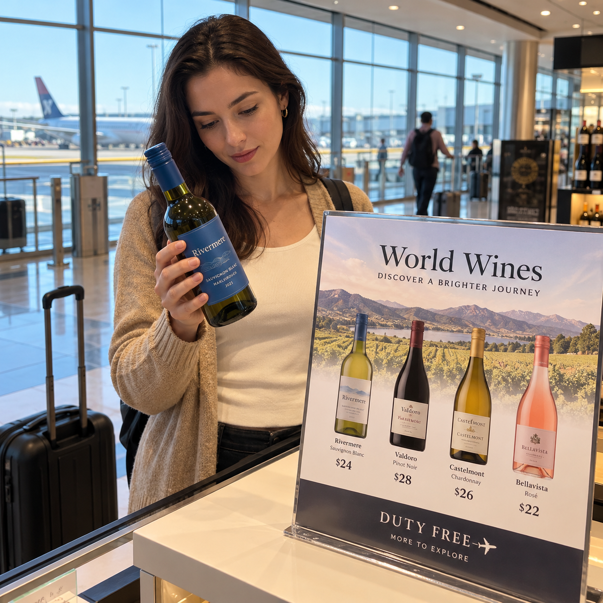
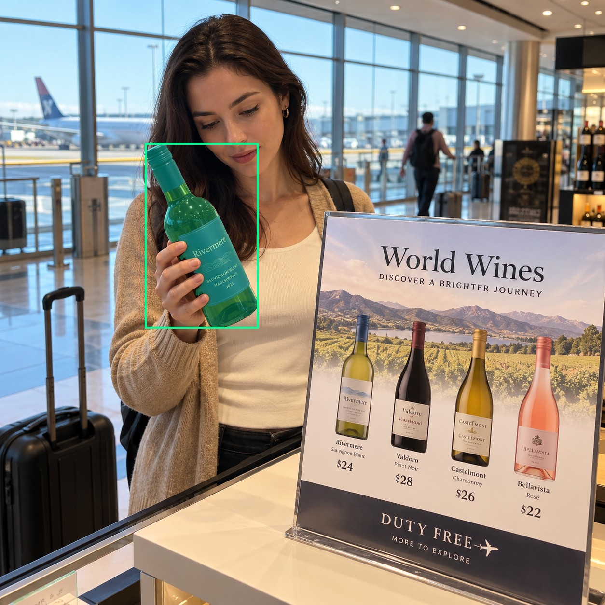
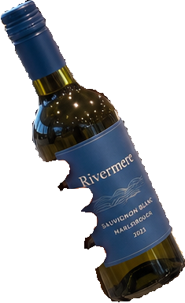
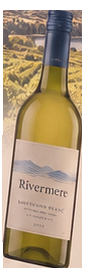
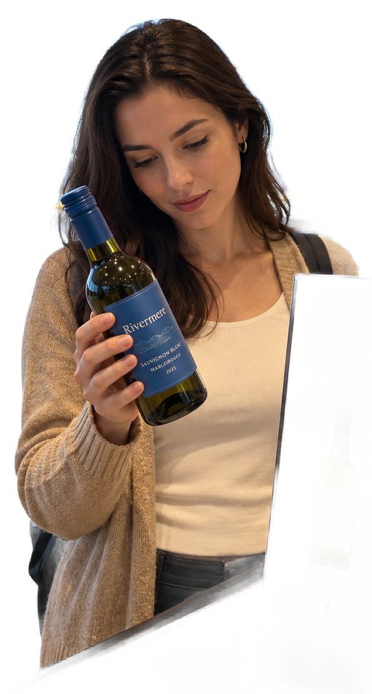

# main-selector-imagegen-diverse-v3-20261020:PD10

**Scene and masks pending — exploratory. All targets/masks are proposals; no approved segmentation ground truth.**

**scene-v1: No automatic failure flag; usability pending.**

Reference title (source): В аэропорту duty-free · бутылка и этикетка с рисунком бутылки

Reference target description (source): Настоящая бутылка слева от ценового плаката

Expected intent: `clear`. Accepted target proposals: `d7`.

Scene group: `main-selector-imagegen-diverse-v3-20261020:PD10`. Development only; no independent split claim.

## Original and proposed target





Green marks the unreviewed target proposal. Source image pixels are retained separately.

[Selected-label mask audit](../selected-label-mask-audit.json): incomplete proposal retention is flagged separately from target agreement.

[Full-resolution target proposal mask](../masks/diverse-v3--PD10-d7.png)

## Selector results

### scene-v1: No automatic failure flag; usability pending

Selected: d7; reason: existing_scene_v1_rank; mode: legacy; crop 235×385 px. Target agreement: True. Target retention proxy: 100.0%; maximum other-bottle retention: 0.0%; minimum associated label retention: 99.7%. Mask ownership, label completeness and legibility still require human review.



[Full-resolution keep mask](../keep-masks/diverse-v3--PD10-scene-v1.png) · [Exact decision JSON](../results/diverse-v3--PD10-scene-v1.json)

Associated label-mask retention proxies (unreviewed ownership): d22: 99.7%, 14346 source pixels

### semantic-v2: FAIL — provisional target/proxy

Selected: d11; reason: fallback_nearest_center; mode: fallback; crop 85×278 px. Target agreement: False. Target retention proxy: 0.0%; maximum other-bottle retention: 100.0%; minimum associated label retention: 0.0%. Mask ownership, label completeness and legibility still require human review. Selected-label mask audit: d21 100.0%.



[Full-resolution keep mask](../keep-masks/diverse-v3--PD10-semantic-v2.png) · [Exact decision JSON](../results/diverse-v3--PD10-semantic-v2.json)

Returned label views: [label 1](../label-crops/diverse-v3--PD10-semantic-v2-0.png)

Associated label-mask retention proxies (unreviewed ownership): d22: 0.0%, 14346 source pixels

### dis-v1: Proxy satisfied; usability pending

Selected: dis-foreground; reason: dis_foreground_mask; mode: foreground; crop 595×1109 px. Target agreement: n/a (no native target ID). Target retention proxy: 100.0%; maximum other-bottle retention: 0.0%; minimum associated label retention: 100.0%. Mask ownership, label completeness and legibility still require human review.



[Full-resolution keep mask](../keep-masks/diverse-v3--PD10-dis-v1.png) · [Exact decision JSON](../results/diverse-v3--PD10-dis-v1.json)

Associated label-mask retention proxies (unreviewed ownership): d22: 100.0%, 14346 source pixels

## All frozen mask proposals

These links expose every detector proposal, including labels and hands. Shapes and owners are unreviewed.

| ID | Detector class | Full-resolution mask |
|---|---|---|
| d0 | wine bottle | [PNG](../masks/diverse-v3--PD10-d0.png) |
| d1 | wine bottle | [PNG](../masks/diverse-v3--PD10-d1.png) |
| d2 | wine bottle | [PNG](../masks/diverse-v3--PD10-d2.png) |
| d3 | wine bottle | [PNG](../masks/diverse-v3--PD10-d3.png) |
| d4 | wine bottle | [PNG](../masks/diverse-v3--PD10-d4.png) |
| d5 | wine bottle | [PNG](../masks/diverse-v3--PD10-d5.png) |
| d6 | wine bottle | [PNG](../masks/diverse-v3--PD10-d6.png) |
| d7 | wine bottle | [PNG](../masks/diverse-v3--PD10-d7.png) |
| d8 | wine bottle | [PNG](../masks/diverse-v3--PD10-d8.png) |
| d9 | wine bottle | [PNG](../masks/diverse-v3--PD10-d9.png) |
| d10 | wine bottle | [PNG](../masks/diverse-v3--PD10-d10.png) |
| d11 | wine bottle | [PNG](../masks/diverse-v3--PD10-d11.png) |
| d12 | wine label | [PNG](../masks/diverse-v3--PD10-d12.png) |
| d13 | wine label | [PNG](../masks/diverse-v3--PD10-d13.png) |
| d14 | wine label | [PNG](../masks/diverse-v3--PD10-d14.png) |
| d15 | wine label | [PNG](../masks/diverse-v3--PD10-d15.png) |
| d16 | wine label | [PNG](../masks/diverse-v3--PD10-d16.png) |
| d17 | wine label | [PNG](../masks/diverse-v3--PD10-d17.png) |
| d18 | wine label | [PNG](../masks/diverse-v3--PD10-d18.png) |
| d19 | wine label | [PNG](../masks/diverse-v3--PD10-d19.png) |
| d20 | wine label | [PNG](../masks/diverse-v3--PD10-d20.png) |
| d21 | wine label | [PNG](../masks/diverse-v3--PD10-d21.png) |
| d22 | wine label | [PNG](../masks/diverse-v3--PD10-d22.png) |
| d23 | hand | [PNG](../masks/diverse-v3--PD10-d23.png) |
| d24 | hand | [PNG](../masks/diverse-v3--PD10-d24.png) |
| d25 | hand | [PNG](../masks/diverse-v3--PD10-d25.png) |
| d26 | price tag | [PNG](../masks/diverse-v3--PD10-d26.png) |
| d27 | price tag | [PNG](../masks/diverse-v3--PD10-d27.png) |
| d28 | price tag | [PNG](../masks/diverse-v3--PD10-d28.png) |
| d29 | price tag | [PNG](../masks/diverse-v3--PD10-d29.png) |
| d30 | price tag | [PNG](../masks/diverse-v3--PD10-d30.png) |
| d31 | price tag | [PNG](../masks/diverse-v3--PD10-d31.png) |
| d32 | price tag | [PNG](../masks/diverse-v3--PD10-d32.png) |

[Raw frozen detector response](../detections/diverse-v3--PD10.json)

<details><summary>Generation prompt (quoted source data)</summary>

```text
Use case: photorealistic-natural. Generate ONE independent photograph, square, approximately 1024 by 1024 pixels. A traveler examining a bottle display in airport duty-free. Show airport windows, luggage and retail promotional placards. Keep the physical bottle distinct from every printed image. Two objects in the described setting: a real small blue-label bottle LEFT, and a large rectangular flat promotional placard RIGHT showing several wine bottle pictures and prices. Show all placard edges and stand. The real bottle is closer with visible rounded glass base; no hands or other physical bottles. Make the scene composition, person, clothing and location specific to this scenario, rather than repeating a generic bottle on a tasting counter. Show genuine physical contact when a grip is requested. Fictional wine branding; no arrows, bounding boxes, captions, collages, watermark or UI. Maintain anatomically plausible hands. Keep the target visible label inside the frame except the explicit close-up and occlusion cases.
```

</details>

Source review notes (quoted reference data):

> Цель предварительно связана с маской SAM3 по заданию генерации; подтвердите по самому фото. Форма масок и их владельцы ещё не проверены.
> Окружение: В аэропорту duty-free. Проверьте реалистичность рук, хват и присутствие требуемых деталей.
