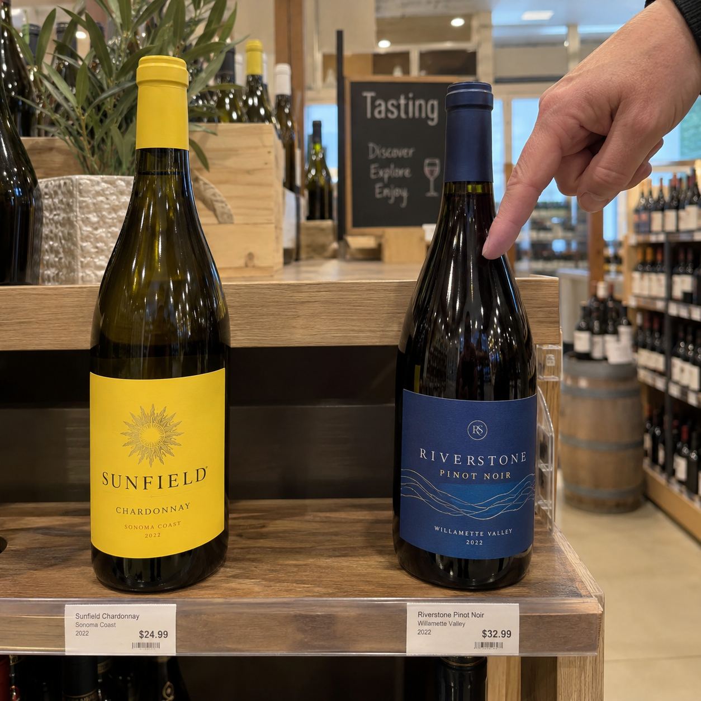
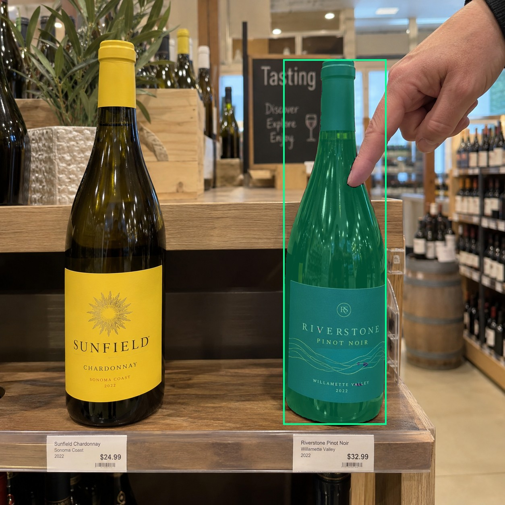
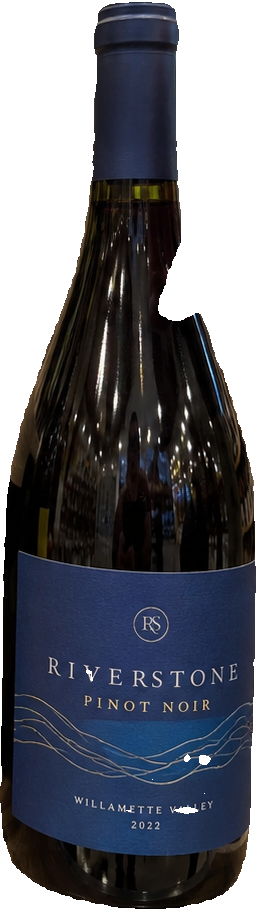
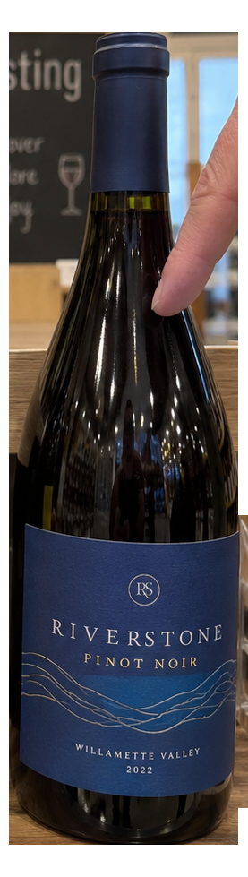
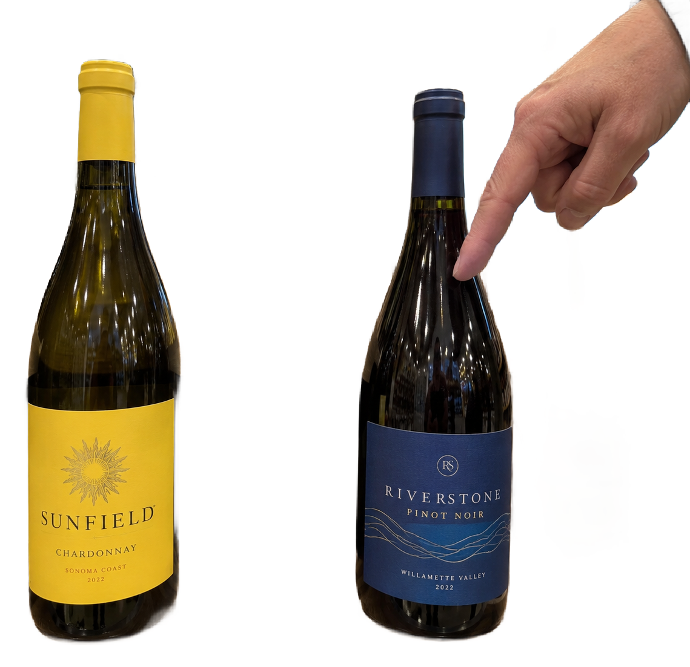

# main-selector-imagegen-diverse-v3-20261020:PN05

**Scene and masks pending — exploratory. All targets/masks are proposals; no approved segmentation ground truth.**

**scene-v1: FAIL — provisional target/proxy.**

Reference title (source): Указание на бутылку на полке

Reference target description (source): Правая бутылка с синей этикеткой

Expected intent: `clear`. Accepted target proposals: `d44`.

Scene group: `main-selector-imagegen-diverse-v3-20261020:PN05`. Development only; no independent split claim.

## Original and proposed target





Green marks the unreviewed target proposal. Source image pixels are retained separately.

[Selected-label mask audit](../selected-label-mask-audit.json): incomplete proposal retention is flagged separately from target agreement.

[Full-resolution target proposal mask](../masks/diverse-v3--PN05-d44.png)

## Selector results

### scene-v1: FAIL — provisional target/proxy

Selected: d44; reason: existing_scene_v1_rank; mode: legacy; crop 256×910 px. Target agreement: True. Target retention proxy: 100.0%; maximum other-bottle retention: 0.0%; minimum associated label retention: 99.2%. Mask ownership, label completeness and legibility still require human review.



[Full-resolution keep mask](../keep-masks/diverse-v3--PN05-scene-v1.png) · [Exact decision JSON](../results/diverse-v3--PN05-scene-v1.json)

Associated label-mask retention proxies (unreviewed ownership): d73: 99.2%, 66383 source pixels

### semantic-v2: No automatic failure flag; usability pending

Selected: d44; reason: explicit_pointing_gesture; mode: confident; crop 277×979 px. Target agreement: True. Target retention proxy: 100.0%; maximum other-bottle retention: 0.0%; minimum associated label retention: 100.0%. Mask ownership, label completeness and legibility still require human review. Selected-label mask audit: d73 100.0%.



[Full-resolution keep mask](../keep-masks/diverse-v3--PN05-semantic-v2.png) · [Exact decision JSON](../results/diverse-v3--PN05-semantic-v2.json)

Returned label views: [label 1](../label-crops/diverse-v3--PN05-semantic-v2-0.png)

Associated label-mask retention proxies (unreviewed ownership): d73: 100.0%, 66383 source pixels

### dis-v1: PROXY failure; no native target ID

Selected: dis-foreground; reason: dis_foreground_mask; mode: foreground; crop 1139×1102 px. Target agreement: n/a (no native target ID). Target retention proxy: 100.0%; maximum other-bottle retention: 99.4%; minimum associated label retention: 100.0%. Mask ownership, label completeness and legibility still require human review.



[Full-resolution keep mask](../keep-masks/diverse-v3--PN05-dis-v1.png) · [Exact decision JSON](../results/diverse-v3--PN05-dis-v1.json)

Associated label-mask retention proxies (unreviewed ownership): d73: 100.0%, 66383 source pixels

## All frozen mask proposals

These links expose every detector proposal, including labels and hands. Shapes and owners are unreviewed.

| ID | Detector class | Full-resolution mask |
|---|---|---|
| d0 | wine bottle | [PNG](../masks/diverse-v3--PN05-d0.png) |
| d1 | wine bottle | [PNG](../masks/diverse-v3--PN05-d1.png) |
| d2 | wine bottle | [PNG](../masks/diverse-v3--PN05-d2.png) |
| d3 | wine bottle | [PNG](../masks/diverse-v3--PN05-d3.png) |
| d4 | wine bottle | [PNG](../masks/diverse-v3--PN05-d4.png) |
| d5 | wine bottle | [PNG](../masks/diverse-v3--PN05-d5.png) |
| d6 | wine bottle | [PNG](../masks/diverse-v3--PN05-d6.png) |
| d7 | wine bottle | [PNG](../masks/diverse-v3--PN05-d7.png) |
| d8 | wine bottle | [PNG](../masks/diverse-v3--PN05-d8.png) |
| d9 | wine bottle | [PNG](../masks/diverse-v3--PN05-d9.png) |
| d10 | wine bottle | [PNG](../masks/diverse-v3--PN05-d10.png) |
| d11 | wine bottle | [PNG](../masks/diverse-v3--PN05-d11.png) |
| d12 | wine bottle | [PNG](../masks/diverse-v3--PN05-d12.png) |
| d13 | wine bottle | [PNG](../masks/diverse-v3--PN05-d13.png) |
| d14 | wine bottle | [PNG](../masks/diverse-v3--PN05-d14.png) |
| d15 | wine bottle | [PNG](../masks/diverse-v3--PN05-d15.png) |
| d16 | wine bottle | [PNG](../masks/diverse-v3--PN05-d16.png) |
| d17 | wine bottle | [PNG](../masks/diverse-v3--PN05-d17.png) |
| d18 | wine bottle | [PNG](../masks/diverse-v3--PN05-d18.png) |
| d19 | wine bottle | [PNG](../masks/diverse-v3--PN05-d19.png) |
| d20 | wine bottle | [PNG](../masks/diverse-v3--PN05-d20.png) |
| d21 | wine bottle | [PNG](../masks/diverse-v3--PN05-d21.png) |
| d22 | wine bottle | [PNG](../masks/diverse-v3--PN05-d22.png) |
| d23 | wine bottle | [PNG](../masks/diverse-v3--PN05-d23.png) |
| d24 | wine bottle | [PNG](../masks/diverse-v3--PN05-d24.png) |
| d25 | wine bottle | [PNG](../masks/diverse-v3--PN05-d25.png) |
| d26 | wine bottle | [PNG](../masks/diverse-v3--PN05-d26.png) |
| d27 | wine bottle | [PNG](../masks/diverse-v3--PN05-d27.png) |
| d28 | wine bottle | [PNG](../masks/diverse-v3--PN05-d28.png) |
| d29 | wine bottle | [PNG](../masks/diverse-v3--PN05-d29.png) |
| d30 | wine bottle | [PNG](../masks/diverse-v3--PN05-d30.png) |
| d31 | wine bottle | [PNG](../masks/diverse-v3--PN05-d31.png) |
| d32 | wine bottle | [PNG](../masks/diverse-v3--PN05-d32.png) |
| d33 | wine bottle | [PNG](../masks/diverse-v3--PN05-d33.png) |
| d34 | wine bottle | [PNG](../masks/diverse-v3--PN05-d34.png) |
| d35 | wine bottle | [PNG](../masks/diverse-v3--PN05-d35.png) |
| d36 | wine bottle | [PNG](../masks/diverse-v3--PN05-d36.png) |
| d37 | wine bottle | [PNG](../masks/diverse-v3--PN05-d37.png) |
| d38 | wine bottle | [PNG](../masks/diverse-v3--PN05-d38.png) |
| d39 | wine bottle | [PNG](../masks/diverse-v3--PN05-d39.png) |
| d40 | wine bottle | [PNG](../masks/diverse-v3--PN05-d40.png) |
| d41 | wine bottle | [PNG](../masks/diverse-v3--PN05-d41.png) |
| d42 | wine bottle | [PNG](../masks/diverse-v3--PN05-d42.png) |
| d43 | wine bottle | [PNG](../masks/diverse-v3--PN05-d43.png) |
| d44 | wine bottle | [PNG](../masks/diverse-v3--PN05-d44.png) |
| d45 | wine bottle | [PNG](../masks/diverse-v3--PN05-d45.png) |
| d46 | wine bottle | [PNG](../masks/diverse-v3--PN05-d46.png) |
| d47 | wine bottle | [PNG](../masks/diverse-v3--PN05-d47.png) |
| d48 | wine bottle | [PNG](../masks/diverse-v3--PN05-d48.png) |
| d49 | wine bottle | [PNG](../masks/diverse-v3--PN05-d49.png) |
| d50 | wine bottle | [PNG](../masks/diverse-v3--PN05-d50.png) |
| d51 | wine bottle | [PNG](../masks/diverse-v3--PN05-d51.png) |
| d52 | wine bottle | [PNG](../masks/diverse-v3--PN05-d52.png) |
| d53 | wine bottle | [PNG](../masks/diverse-v3--PN05-d53.png) |
| d54 | wine label | [PNG](../masks/diverse-v3--PN05-d54.png) |
| d55 | wine label | [PNG](../masks/diverse-v3--PN05-d55.png) |
| d56 | wine label | [PNG](../masks/diverse-v3--PN05-d56.png) |
| d57 | wine label | [PNG](../masks/diverse-v3--PN05-d57.png) |
| d58 | wine label | [PNG](../masks/diverse-v3--PN05-d58.png) |
| d59 | wine label | [PNG](../masks/diverse-v3--PN05-d59.png) |
| d60 | wine label | [PNG](../masks/diverse-v3--PN05-d60.png) |
| d61 | wine label | [PNG](../masks/diverse-v3--PN05-d61.png) |
| d62 | wine label | [PNG](../masks/diverse-v3--PN05-d62.png) |
| d63 | wine label | [PNG](../masks/diverse-v3--PN05-d63.png) |
| d64 | wine label | [PNG](../masks/diverse-v3--PN05-d64.png) |
| d65 | wine label | [PNG](../masks/diverse-v3--PN05-d65.png) |
| d66 | wine label | [PNG](../masks/diverse-v3--PN05-d66.png) |
| d67 | wine label | [PNG](../masks/diverse-v3--PN05-d67.png) |
| d68 | wine label | [PNG](../masks/diverse-v3--PN05-d68.png) |
| d69 | wine label | [PNG](../masks/diverse-v3--PN05-d69.png) |
| d70 | wine label | [PNG](../masks/diverse-v3--PN05-d70.png) |
| d71 | wine label | [PNG](../masks/diverse-v3--PN05-d71.png) |
| d72 | wine label | [PNG](../masks/diverse-v3--PN05-d72.png) |
| d73 | wine label | [PNG](../masks/diverse-v3--PN05-d73.png) |
| d74 | wine label | [PNG](../masks/diverse-v3--PN05-d74.png) |
| d75 | wine label | [PNG](../masks/diverse-v3--PN05-d75.png) |
| d76 | wine label | [PNG](../masks/diverse-v3--PN05-d76.png) |
| d77 | wine label | [PNG](../masks/diverse-v3--PN05-d77.png) |
| d78 | wine label | [PNG](../masks/diverse-v3--PN05-d78.png) |
| d79 | wine label | [PNG](../masks/diverse-v3--PN05-d79.png) |
| d80 | wine label | [PNG](../masks/diverse-v3--PN05-d80.png) |
| d81 | hand | [PNG](../masks/diverse-v3--PN05-d81.png) |
| d82 | box | [PNG](../masks/diverse-v3--PN05-d82.png) |
| d83 | box | [PNG](../masks/diverse-v3--PN05-d83.png) |
| d84 | box | [PNG](../masks/diverse-v3--PN05-d84.png) |
| d85 | price tag | [PNG](../masks/diverse-v3--PN05-d85.png) |
| d86 | price tag | [PNG](../masks/diverse-v3--PN05-d86.png) |
| d87 | price tag | [PNG](../masks/diverse-v3--PN05-d87.png) |
| d88 | price tag | [PNG](../masks/diverse-v3--PN05-d88.png) |
| d89 | price tag | [PNG](../masks/diverse-v3--PN05-d89.png) |
| d90 | price tag | [PNG](../masks/diverse-v3--PN05-d90.png) |
| d91 | price tag | [PNG](../masks/diverse-v3--PN05-d91.png) |
| d92 | price tag | [PNG](../masks/diverse-v3--PN05-d92.png) |
| d93 | price tag | [PNG](../masks/diverse-v3--PN05-d93.png) |
| d94 | price tag | [PNG](../masks/diverse-v3--PN05-d94.png) |
| d95 | price tag | [PNG](../masks/diverse-v3--PN05-d95.png) |
| d96 | price tag | [PNG](../masks/diverse-v3--PN05-d96.png) |
| d97 | price tag | [PNG](../masks/diverse-v3--PN05-d97.png) |
| d98 | wine glass | [PNG](../masks/diverse-v3--PN05-d98.png) |

[Raw frozen detector response](../detections/diverse-v3--PN05.json)

<details><summary>Generation prompt (quoted source data)</summary>

```text
Use case: photorealistic-natural. Generate exactly ONE independent candid smartphone photograph. Show believable glass, paper, natural material imperfections, fictional wine branding, and anatomically plausible hands. No collage, grid, arrows, annotations, bounding boxes, highlights, watermark, UI overlay, or explanatory caption. Text is allowed on physical objects within the scene. Keep the target visible front label entirely inside the frame unless partial occlusion or close-up is explicitly requested. Image format: square, approximately 1024 by 1024 pixels. Setting: inside a real wine store. Use a shop tasting counter, bottle shelves with small price strips, retail aisle details and natural store lighting. Keep the described foreground inventory; background racks may be empty or softly blurred. Scene details: Two widely separated bottles sit on the same low shelf. A hand enters from upper right, palm above the RIGHT blue-label bottle, index pointing almost vertically downward at that bottle shoulder. The left bottle has a bright yellow label. No grasp or contact.
```

</details>

Source review notes (quoted reference data):

> Цель предварительно связана с маской SAM3 по заданию генерации; подтвердите по самому фото. Форма масок и их владельцы ещё не проверены.
> Окружение: Винный магазин. Проверьте реалистичность рук, хват и присутствие требуемых деталей.
