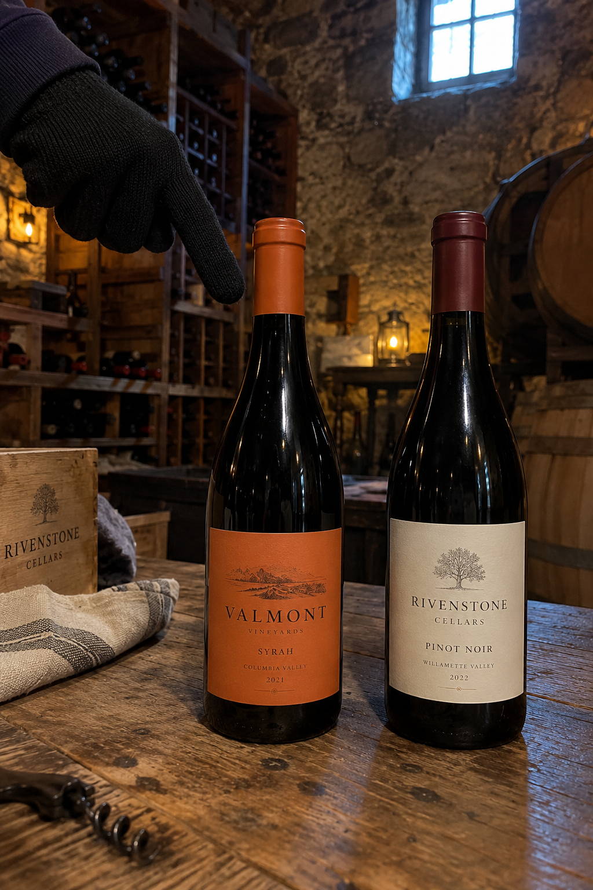
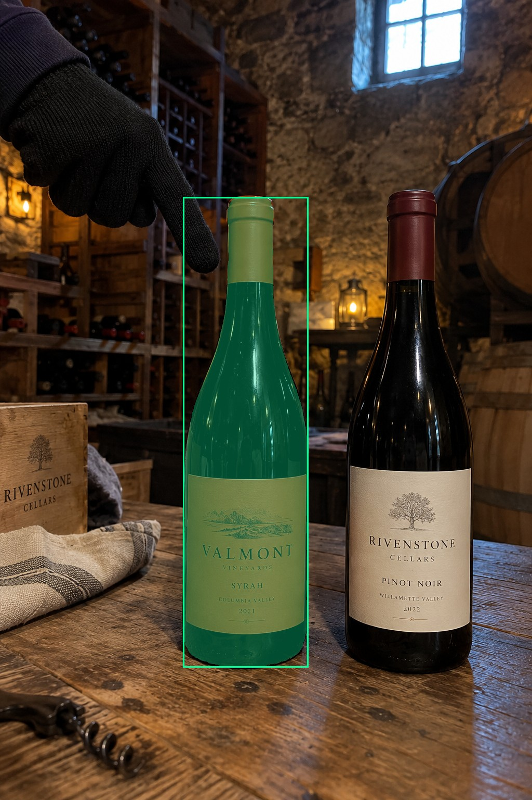
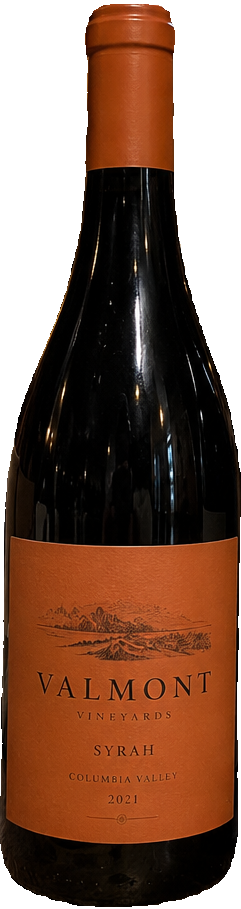
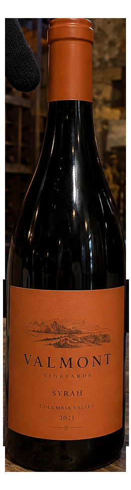
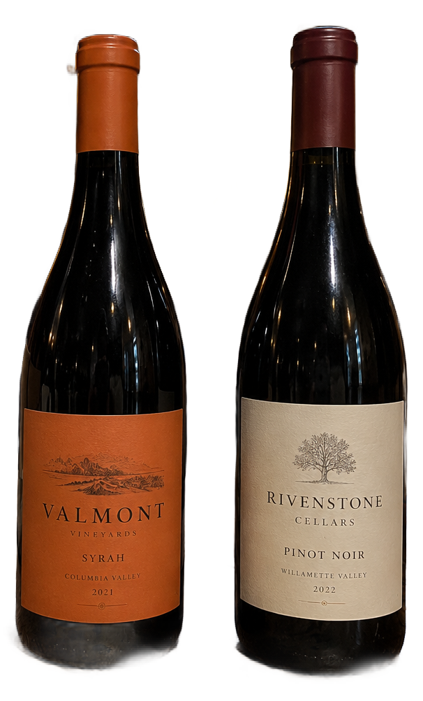

# main-selector-imagegen-diverse-v3-20261020:PN08

**Scene and masks pending — exploratory. All targets/masks are proposals; no approved segmentation ground truth.**

**scene-v1: No automatic failure flag; usability pending.**

Reference title (source): Палец в перчатке

Reference target description (source): Левая бутылка с оранжевой этикеткой

Expected intent: `clear`. Accepted target proposals: `d10`.

Scene group: `main-selector-imagegen-diverse-v3-20261020:PN08`. Development only; no independent split claim.

## Original and proposed target





Green marks the unreviewed target proposal. Source image pixels are retained separately.

[Selected-label mask audit](../selected-label-mask-audit.json): incomplete proposal retention is flagged separately from target agreement.

[Full-resolution target proposal mask](../masks/diverse-v3--PN08-d10.png)

## Selector results

### scene-v1: No automatic failure flag; usability pending

Selected: d10; reason: existing_scene_v1_rank; mode: legacy; crop 241×909 px. Target agreement: True. Target retention proxy: 100.0%; maximum other-bottle retention: 0.0%; minimum associated label retention: 100.0%. Mask ownership, label completeness and legibility still require human review.



[Full-resolution keep mask](../keep-masks/diverse-v3--PN08-scene-v1.png) · [Exact decision JSON](../results/diverse-v3--PN08-scene-v1.json)

Associated label-mask retention proxies (unreviewed ownership): d15: 100.0%, 66920 source pixels

### semantic-v2: No automatic failure flag; usability pending

Selected: d10; reason: explicit_pointing_gesture; mode: confident; crop 261×975 px. Target agreement: True. Target retention proxy: 100.0%; maximum other-bottle retention: 0.0%; minimum associated label retention: 100.0%. Mask ownership, label completeness and legibility still require human review. Selected-label mask audit: d15 100.0%.



[Full-resolution keep mask](../keep-masks/diverse-v3--PN08-semantic-v2.png) · [Exact decision JSON](../results/diverse-v3--PN08-semantic-v2.json)

Returned label views: [label 1](../label-crops/diverse-v3--PN08-semantic-v2-0.png)

Associated label-mask retention proxies (unreviewed ownership): d15: 100.0%, 66920 source pixels

### dis-v1: PROXY failure; no native target ID

Selected: dis-foreground; reason: dis_foreground_mask; mode: foreground; crop 606×1003 px. Target agreement: n/a (no native target ID). Target retention proxy: 99.5%; maximum other-bottle retention: 99.7%; minimum associated label retention: 100.0%. Mask ownership, label completeness and legibility still require human review.



[Full-resolution keep mask](../keep-masks/diverse-v3--PN08-dis-v1.png) · [Exact decision JSON](../results/diverse-v3--PN08-dis-v1.json)

Associated label-mask retention proxies (unreviewed ownership): d15: 100.0%, 66920 source pixels

## All frozen mask proposals

These links expose every detector proposal, including labels and hands. Shapes and owners are unreviewed.

| ID | Detector class | Full-resolution mask |
|---|---|---|
| d0 | wine bottle | [PNG](../masks/diverse-v3--PN08-d0.png) |
| d1 | wine bottle | [PNG](../masks/diverse-v3--PN08-d1.png) |
| d2 | wine bottle | [PNG](../masks/diverse-v3--PN08-d2.png) |
| d3 | wine bottle | [PNG](../masks/diverse-v3--PN08-d3.png) |
| d4 | wine bottle | [PNG](../masks/diverse-v3--PN08-d4.png) |
| d5 | wine bottle | [PNG](../masks/diverse-v3--PN08-d5.png) |
| d6 | wine bottle | [PNG](../masks/diverse-v3--PN08-d6.png) |
| d7 | wine bottle | [PNG](../masks/diverse-v3--PN08-d7.png) |
| d8 | wine bottle | [PNG](../masks/diverse-v3--PN08-d8.png) |
| d9 | wine bottle | [PNG](../masks/diverse-v3--PN08-d9.png) |
| d10 | wine bottle | [PNG](../masks/diverse-v3--PN08-d10.png) |
| d11 | wine bottle | [PNG](../masks/diverse-v3--PN08-d11.png) |
| d12 | wine bottle | [PNG](../masks/diverse-v3--PN08-d12.png) |
| d13 | wine bottle | [PNG](../masks/diverse-v3--PN08-d13.png) |
| d14 | wine label | [PNG](../masks/diverse-v3--PN08-d14.png) |
| d15 | wine label | [PNG](../masks/diverse-v3--PN08-d15.png) |
| d16 | hand | [PNG](../masks/diverse-v3--PN08-d16.png) |
| d17 | box | [PNG](../masks/diverse-v3--PN08-d17.png) |
| d18 | box | [PNG](../masks/diverse-v3--PN08-d18.png) |
| d19 | box | [PNG](../masks/diverse-v3--PN08-d19.png) |
| d20 | box | [PNG](../masks/diverse-v3--PN08-d20.png) |
| d21 | box | [PNG](../masks/diverse-v3--PN08-d21.png) |

[Raw frozen detector response](../detections/diverse-v3--PN08.json)

<details><summary>Generation prompt (quoted source data)</summary>

```text
Use case: photorealistic-natural. Generate exactly ONE independent candid smartphone photograph. Show believable glass, paper, natural material imperfections, fictional wine branding, and anatomically plausible hands. No collage, grid, arrows, annotations, bounding boxes, highlights, watermark, UI overlay, or explanatory caption. Text is allowed on physical objects within the scene. Keep the target visible front label entirely inside the frame unless partial occlusion or close-up is explicitly requested. Image format: portrait 2:3, approximately 1024 by 1536 pixels. Setting: inside a real wine cellar. Use stone or brick walls, wooden wine racks, storage cubbies, a cellar tasting table and practical dim lights. Keep the described foreground inventory; background racks may be empty or softly blurred. Scene details: Two wine bottles on a wooden tasting bench. A black knitted-glove hand enters from upper left with index extended down toward the LEFT orange-label bottle; other fingers curl visibly. Fingertip stops before the shoulder. The right cream-label bottle is unheld. Cool light from a high window.
```

</details>

Source review notes (quoted reference data):

> Цель предварительно связана с маской SAM3 по заданию генерации; подтвердите по самому фото. Форма масок и их владельцы ещё не проверены.
> Окружение: Винный погреб. Проверьте реалистичность рук, хват и присутствие требуемых деталей.
