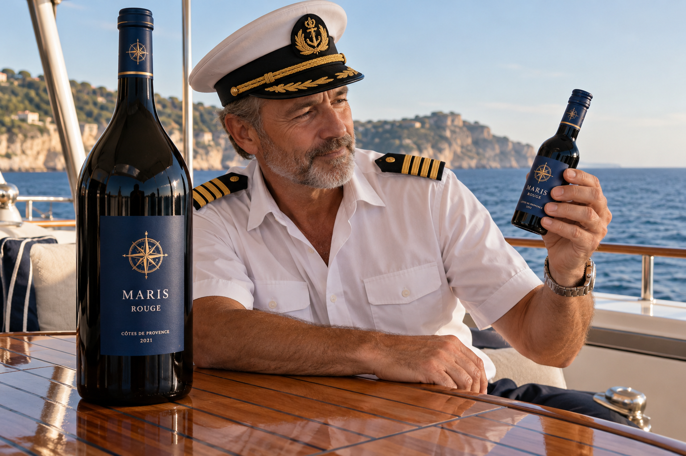
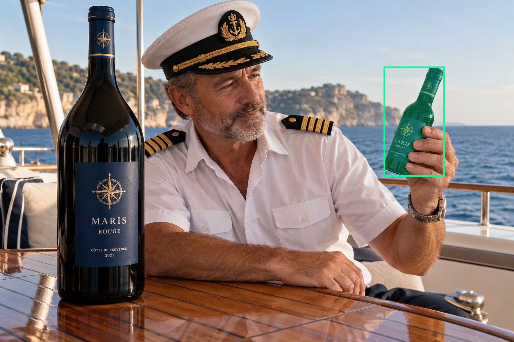
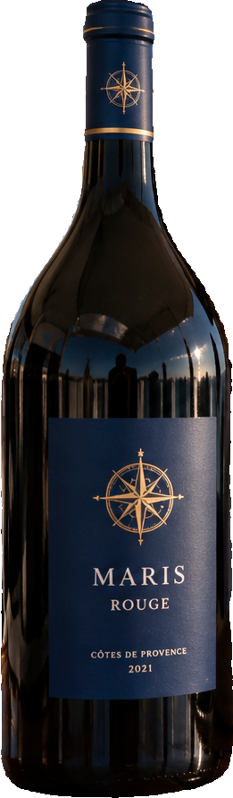
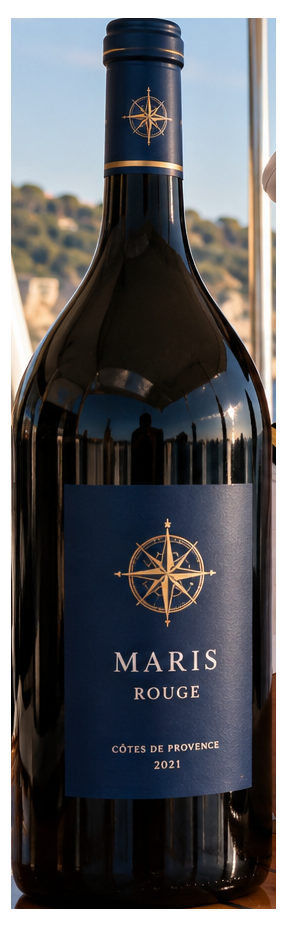
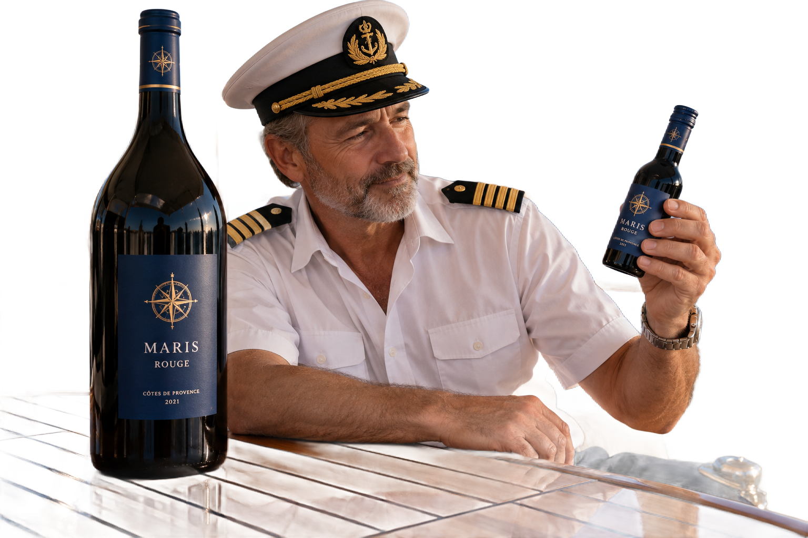

# main-selector-imagegen-diverse-v3-20261020:SZ01

**Scene and masks pending — exploratory. All targets/masks are proposals; no approved segmentation ground truth.**

**scene-v1: FAIL — provisional target/proxy.**

Reference title (source): Мини-бутылка у капитана · мини-бутылка справа и магнум слева

Reference target description (source): Маленькая удерживаемая бутылка справа

Expected intent: `clear`. Accepted target proposals: `d1`.

Scene group: `main-selector-imagegen-diverse-v3-20261020:SZ01`. Development only; no independent split claim.

## Original and proposed target





Green marks the unreviewed target proposal. Source image pixels are retained separately.

[Selected-label mask audit](../selected-label-mask-audit.json): incomplete proposal retention is flagged separately from target agreement.

[Full-resolution target proposal mask](../masks/diverse-v3--SZ01-d1.png)

## Selector results

### scene-v1: FAIL — provisional target/proxy

Selected: d0; reason: existing_scene_v1_rank; mode: legacy; crop 261×891 px. Target agreement: False. Target retention proxy: 0.0%; maximum other-bottle retention: 100.0%; minimum associated label retention: 0.0%. Mask ownership, label completeness and legibility still require human review.



[Full-resolution keep mask](../keep-masks/diverse-v3--SZ01-scene-v1.png) · [Exact decision JSON](../results/diverse-v3--SZ01-scene-v1.json)

Associated label-mask retention proxies (unreviewed ownership): d2: 0.0%, 2384 source pixels; d3: 0.0%, 8966 source pixels

### semantic-v2: FAIL — provisional target/proxy

Selected: d0; reason: fallback_nearest_center; mode: fallback; crop 287×945 px. Target agreement: False. Target retention proxy: 0.0%; maximum other-bottle retention: 100.0%; minimum associated label retention: 0.0%. Mask ownership, label completeness and legibility still require human review. Selected-label mask audit: d4 100.0%; d5 100.0%.



[Full-resolution keep mask](../keep-masks/diverse-v3--SZ01-semantic-v2.png) · [Exact decision JSON](../results/diverse-v3--SZ01-semantic-v2.json)

Returned label views: [label 1](../label-crops/diverse-v3--SZ01-semantic-v2-0.png) · [label 2](../label-crops/diverse-v3--SZ01-semantic-v2-1.png)

Associated label-mask retention proxies (unreviewed ownership): d2: 0.0%, 2384 source pixels; d3: 0.0%, 8966 source pixels

### dis-v1: PROXY failure; no native target ID

Selected: dis-foreground; reason: dis_foreground_mask; mode: foreground; crop 1536×1024 px. Target agreement: n/a (no native target ID). Target retention proxy: 99.2%; maximum other-bottle retention: 100.0%; minimum associated label retention: 97.8%. Mask ownership, label completeness and legibility still require human review.



[Full-resolution keep mask](../keep-masks/diverse-v3--SZ01-dis-v1.png) · [Exact decision JSON](../results/diverse-v3--SZ01-dis-v1.json)

Associated label-mask retention proxies (unreviewed ownership): d2: 97.8%, 2384 source pixels; d3: 99.5%, 8966 source pixels

## All frozen mask proposals

These links expose every detector proposal, including labels and hands. Shapes and owners are unreviewed.

| ID | Detector class | Full-resolution mask |
|---|---|---|
| d0 | wine bottle | [PNG](../masks/diverse-v3--SZ01-d0.png) |
| d1 | wine bottle | [PNG](../masks/diverse-v3--SZ01-d1.png) |
| d2 | wine label | [PNG](../masks/diverse-v3--SZ01-d2.png) |
| d3 | wine label | [PNG](../masks/diverse-v3--SZ01-d3.png) |
| d4 | wine label | [PNG](../masks/diverse-v3--SZ01-d4.png) |
| d5 | wine label | [PNG](../masks/diverse-v3--SZ01-d5.png) |
| d6 | hand | [PNG](../masks/diverse-v3--SZ01-d6.png) |
| d7 | hand | [PNG](../masks/diverse-v3--SZ01-d7.png) |

[Raw frozen detector response](../detections/diverse-v3--SZ01.json)

<details><summary>Generation prompt (quoted source data)</summary>

```text
Use case: photorealistic-natural. Generate ONE independent photograph, landscape 3:2, approximately 1536 by 1024 pixels. An adult yacht captain examines a tiny wine bottle near a large unattended bottle on a deck table. Show face, uniform, hands, teak and sea; the small held bottle is the target. Two bottles in the described setting. A hand from right visibly grips a tiny 187 ml blue-label bottle at RIGHT, holding it slightly up. A large unheld magnum stands LEFT and dominates the frame. Clear opposed fingers and thumb around the small bottle, label visible. Make the scene composition, person, clothing and location specific to this scenario, rather than repeating a generic bottle on a tasting counter. Show genuine physical contact when a grip is requested. Fictional wine branding; no arrows, bounding boxes, captions, collages, watermark or UI. Maintain anatomically plausible hands. Keep the target visible label inside the frame except the explicit close-up and occlusion cases.
```

</details>

Source review notes (quoted reference data):

> Цель предварительно связана с маской SAM3 по заданию генерации; подтвердите по самому фото. Форма масок и их владельцы ещё не проверены.
> Окружение: Мини-бутылка у капитана. Проверьте реалистичность рук, хват и присутствие требуемых деталей.
> Мини-бутылка поднята в верхнюю правую часть кадра; проверьте её маску отдельно от крупной бутылки.
